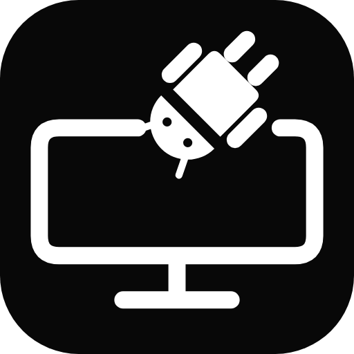

# DexDroid



A non-root Android external desktop with independent monitor rotation, phone
touchpad, touchscreen navigation and remembered app settings.

## Requirements

- Android 11+, a working external-video connection and a monitor.
- Running [Shizuku](https://shizuku.rikka.app/) with DexDroid authorized.
- Initially tested on Black Shark 4 / JoyUI with a 1920x1200 touchscreen monitor.

## Build and install

Download the APK from [GitHub Releases](https://github.com/PhiLong-Ho/DexDroid/releases),
or build it locally:

Open this folder in Android Studio, configure Android SDK 35, and use JDK 17+.
Connect an ADB-authorized phone, then run:

```sh
./gradlew :app:assembleDebug
adb install -r app/build/outputs/apk/debug/app-debug.apk
```

On Windows use `.\gradlew.bat` instead of `./gradlew`. This installs a debug build.
See [CONTRIBUTING.md](CONTRIBUTING.md) for development setup and quality checks.

## Quick guide

1. Connect the monitor, start Shizuku, then open DexDroid. Authorize it on first use;
   the desktop starts automatically when the monitor and Shizuku are ready.
2. Choose **Rotate** for landscape, portrait or either flipped orientation.
   **Apps** launches an app; hold an app for a one-time orientation.
3. Use the phone pad: move/tap to point/click, two fingers to scroll or pinch,
   three fingers right for Back. **Scroll** selects mode/speed; **Save app** remembers settings.
4. On the monitor, swipe inward from either side for Back, up from the bottom for
   Apps, or down from the top for Controls. Tap search to use its local keyboard.
5. **Settings** offers resolution/UI DPI, input options, profiles and diagnostics.
   **Stop** ends the desktop; normal phone backgrounding keeps it running.
6. **Settings > Monitor profiles** saves the current resolution/DPI/orientation.
   Apply a profile and **Keep** to remember it for that monitor; use **Update from
   current** to change a saved snapshot. Recognized monitors restore it on startup.

Monitor touch depends on Android's display association. App resizing/DRM support
varies. General Android keyboard mirroring is not included. Shizuku needs restarting
after a phone reboot.

[Specification](SPEC.md) · [Changelog](CHANGELOG.md) ·
[Test results](testresults/README.md) · [Design](docs/DESIGN.md) ·
[Releasing](docs/RELEASING.md) · [Codex workflow](docs/CODEX.md)
