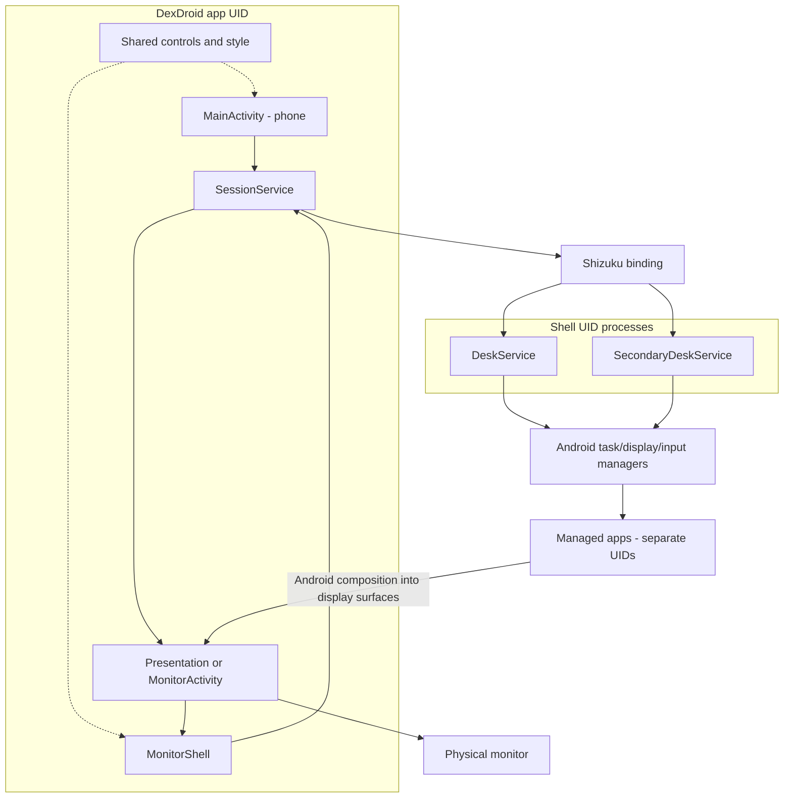
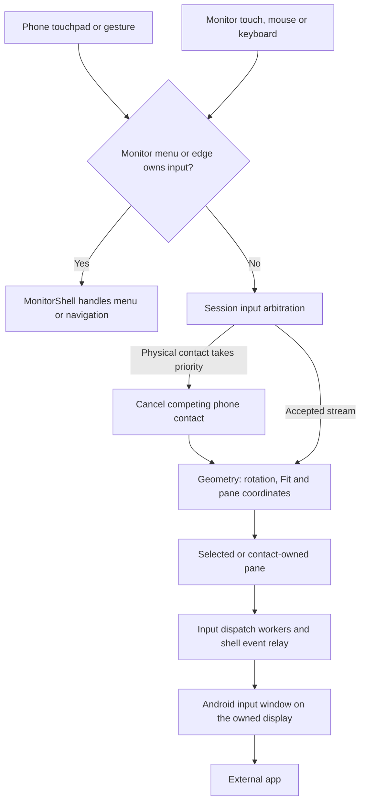
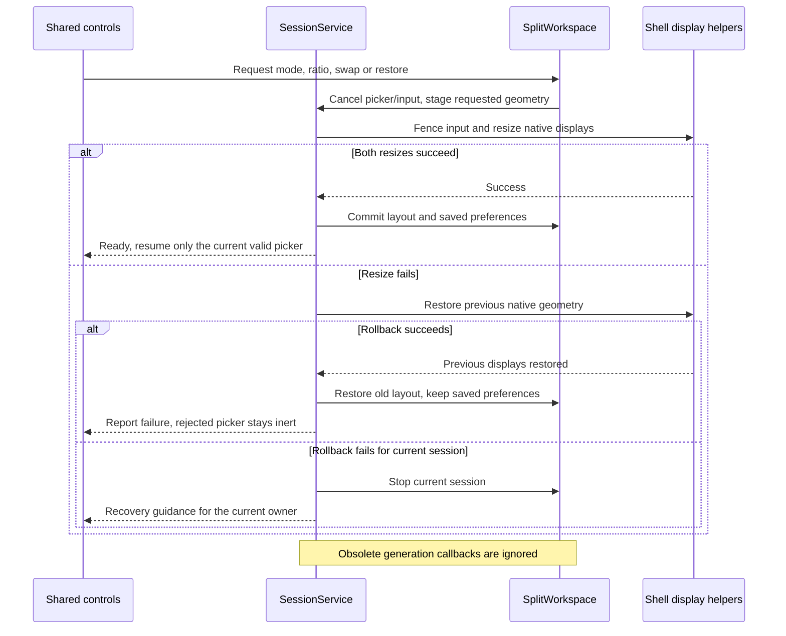
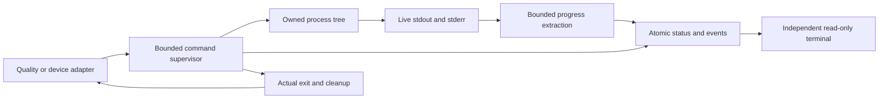

# Architecture and maintenance map

Start with the [source-linked code/component map and feature diagram atlas](architecture/README.md).
Each feature owner has an overview and representative sequence with failure/lifecycle
boundaries. Read it before implementation and record architectural impact using
[the expert preflight](WORKFLOW.md#architecture-before-implementation).

The app has a controller process, one shell process per managed app display, and two UI surfaces. Do not put shell privileges in
the phone Activity or duplicate authoritative desktop state in monitor widgets.

## System overview

The host owns the physical output window; shell helpers own managed app displays.
The host may use a Presentation on OEM monitors or an independent Activity on
eligible API 36+ displays. This diagram abstracts Android's compositor rather
than introducing a new graphics process. Shizuku access is not root access. The
phone and monitor render shared actions backed by one session state.

## Input path

The split input queue is bounded to 64 events. The generic session worker uses an
unbounded LinkedBlockingQueue with selective move/scroll shedding; this map does
not imply a global input-queue bound or introduce a runtime fix.

A stream retains its contact/key ownership. A geometry change or navigation
handoff cancels input before resize/teardown. Fit bars reject contacts. Monitor
search's local keyboard edits its own field; it does not mirror the phone IME
into arbitrary apps. See the detailed input and compatibility sections below.

| Owner | Responsibility |
| --- | --- |
| `MonitorActivity` | Independent physical-monitor host on eligible API 36+ displays; generation/display checked attachment to service-owned content |
| `MainActivity` | Phone controller, dialogs, touchpad recognizers; binds to service |
| `SessionService` | Foreground session, display discovery, Shizuku connection, preferences, input arbitration, presentation and cursor |
| `DeskService` / `IDeskService.aidl` | Shizuku shell user service (`:desktop`); virtual display, targeted launch and input injection |
| `SplitWorkspace` / `SplitLayout` | Service-owned two-pane displays, layout/rollback and bounded pane input; pure logical geometry |
| `LayoutPanel` | Shared current-state layout controls on phone and monitor |
| `LauncherControls` | Shared mode selector, spatial app actions, pressed feedback and picker token ownership |
| `SplitLayoutPreferences` | Durable split enabled/direction/ratio/order, excluding runtime identities and transient selection |
| `DestinationHighlight` | Non-interactive temporary launch target below monitor menus; service-owned picker lifetime |
| `SecondaryDeskService` / `InputEvents` | Separate shell display owner; complete pointer/key event relay with native coordinate rebasing |
| `MonitorShell` | Native monitor menu tree, edge navigation, modal input and transitions |
| `MenuNavigation` | Shared visited-menu stack, valid-parent filtering and root/close semantics |
| `ControllerStyle` | Shared phone/monitor widget surfaces, typography and collapsible status card |
| `ShizukuSetup` | Setup-state classification, shared native guidance/actions and explicit display-0 external navigation |
| `UserGuide` | Shared concise offline guide sections for both Settings menus |
| `MonitorSearchKeyboard` | Local low-latency keyboard for monitor launcher search |
| `IdleDesktop` / `EdgeFeedback` | Idle launch surface and transient navigation feedback |
| `DisplayTasks` | Pure legacy Stack / modern RootTask placement and fullscreen evidence |
| `ScreenInsets` | Phone system-bar, cutout and IME-safe padding shared by native dialogs/controller |
| `Geometry` | Pure rotation/Fit/input mapping and DPI recommendation |
| `MonitorProfiles` / `MonitorProfilePreferences` | Pure named snapshots/bindings/working settings and isolated atomic preference persistence |
| `MonitorProfilesPanel` | Shared phone/monitor management view and monitor-local name keyboard |
| `AppCatalog` | Service-owned asynchronous discovery, shared cache and package invalidation |
| `DiagnosticLog` | Bounded session event log; no typed/screen content |
| `InputTestActivity` (`src/debug` only) | Development target for native tap/scroll/pinch/Back checks; absent from release |

These classes live under `app/src/main/java/dev/dexdroid`. The architecture is
small but `SessionService`, `MainActivity` and `MonitorShell` have accumulated
multiple responsibilities. Formatting makes them readable; it does not finish
their decomposition. Extract one tested responsibility at a time when changing
it (candidate boundaries: preference profiles, display session, menu construction,
gesture recognition). A wholesale rewrite alongside UI changes is hard to audit.

## Invariants

Debug-only experiments are separate from this product architecture. The explicit
[two-pane prototype](changes/two-pane-prototype.md) reuses two shell bridges and
has its own bounded Activity lifetime; it is absent from release source sets.
Its synthetic keyboard gate remains failed and retained separately from the user's
Epomaker Split 65 Bluetooth report. Product split view is defined by
[its own contract](specs/split-view.md) and acceptance evidence, not by a prototype pass.

- Android display IDs are session-scoped. Rediscover after disconnect/recreation;
  do not persist a display ID as a monitor identity.
- Phone orientation is portrait. External rotation is 0/90/180/270 independently
  of phone rotation and the monitor's fixed physical landscape signal.
- Geometry maps pixels both ways through Fit and rotation. Bars reject contacts.
  Widgets/hit regions and the desktop must use the same mapping.
- Physical monitor touch wins over phone input until release/cancel. Preserve
  pointer IDs/down times and cancel before navigation takes ownership.
- Monitor touch hides the cursor; touchpad input restores it. Modal menus consume
  contacts and outside dismissal never clicks through to the external app.
- Activity teardown is not session Stop. Explicit Stop, disconnect, Shizuku loss
  and process death need lifecycle cleanup, contact cancellation and recovery.
- Resolution preview is reversible and rolls back after 15 seconds unless kept.
- Service/preferences are the source of truth for both menus, including per-app
  rotation/scroll mode/speed and live setting values.

## Test ownership

`app/src/test` runs pure JVM tests without device privileges. `app/src/androidTest`
uses the custom `DeviceChecks` instrumentation entry point. `UiAcceptance` calls
`PhoneMenuAcceptance`; monitor, search, idle and icon suites have their own
entry classes. Read `docs/requirements.json` for mappings and unclosed gaps.

The desktop uses Android hidden APIs under shell privileges. Reflection and
Android 11/JoyUI behavior are compatibility risks. The shell bridge selects
`InputManagerGlobal` when available and the Android 11 singleton otherwise;
verified fullscreen roots avoid the removed legacy task-mode API. The app targets
API 36 with a declared special-use foreground session. Notification permission
denial must not stop desktop input. Phone recovery explicitly targets display 0. A general emulator does not
prove physical HDMI touch, Shizuku or multi-display behavior. On modern Android, monitors eligible for Activity tasks use their own Activity
to avoid Presentation host-task removal; presentation-only OEM monitors use the
existing Presentation window with an explicit diagnostic limitation. Android 11 retains Presentation. Both build the
same service-owned monitor content and route identical input; the modern host
closes on Stop/disconnect and cannot attach to an obsolete session. With an independent Activity host, the phone task can be destroyed independently. A five-second host-attachment deadline reports recovery if
Android blocks opening the monitor host from background. The deadline captures
monitor identity and generation, tears down failed startup/wake lock, and tells
the user to reopen on the phone. Attachment/Stop removes it; obsolete callbacks
and late hosts cannot adopt or stop the next session. Background reconnect
on modern OEM builds remains a verification gap. Native Android IME
on the desktop display is not enabled by DexDroid; the high-latency mirrored
IME experiment was removed. Keep launcher search local.

Display API references: [Display.Mode](https://developer.android.com/reference/android/view/Display.Mode),
[DisplayMetrics](https://developer.android.com/reference/android/util/DisplayMetrics),
and [VirtualDisplay](https://developer.android.com/reference/android/hardware/display/VirtualDisplay).

### Presentation-only OEM monitors

Before choosing the modern Activity host, SessionService asks the public
ActivityManager launch-eligibility API about the actual monitor and host Intent.
Some Samsung Android 16 HDMI displays allow Presentation windows but cannot host
Activity tasks. These retain the same service-owned content through Presentation;
no display policy or root exemption is enabled. Diagnostics identify the fallback.
Ordinary background use and phone-task destruction are separate lifecycle checks.
If the OEM keeps the window, fresh external input must still work; if Android
removes it, resources must stop cleanly and reopening the controller must recover.

### Private Activity navigation

On Android 12+, DeskService requests the framework TRUSTED virtual-display flag
(1 << 10) using the authorized shell's existing ADD_TRUSTED_DISPLAY permission.
Normal third-party applications can then launch their own non-exported child
Activities on that desktop instead of Android resolving them onto display 0.
Android 14+ also requests OWN_FOCUS so the virtual desktop and phone can retain
independent input focus. Android 11 retains its legacy display flags. No periodic task reparenting or phone-task stealing is used. Rejected creation is reported by the existing failure path. The app and
third-party apps are not granted privileged display permissions.

The child device suite runs ordinary Activities from the test APK under its own
application UID. Its exported parent opens a private singleTask reader through
normal startActivity, then the test verifies actual display/task identity,
intent and parent state, PixelCopy pixels, real input and Back in four rotations.
These fixtures do not ship in production APK/AAB artifacts.

TestInputDriver lives in src/debug, not main or release. A separate authorized
shell process validates external presentation targets and injects Motion/Key
parcels through InputDispatcher without UiAutomation's animation flush. Native
phone-display tests keep the public default-display UiAutomation path. Binding
is established before event timestamps are generated, and the reserved Shizuku
destroy transaction exits the test process after unbinding. Continuous event
streams still traverse the actual monitor window, widgets and product relay.

### Task handoff and controller resume

The phone controller is a singleTask Activity. Each instance owns its service UI
listener; a destroyed older instance cannot clear a newer listener, and resume
reattaches it. Launcher/notification recovery targets display 0. Acceptance waits
for the background transition to finish before reopening, then requires actual
phone Settings/Close input and fresh external touch, not visibility alone.

`DesktopTasks` lives in the shell helper and registers the platform task listener
through reflection, resolving notification transaction codes on the running OS.
It queries current RootTaskInfo (API 31+) or StackInfo (API 30) on a dedicated
HandlerThread, coalescing events at 150ms and retaining at most one pending query.
There is no timer polling or task movement. Only the owned virtual display's
occupancy is returned; unrelated app names/snapshots are not sent to the UI.
Duplicate occupancy is suppressed. Query errors are reported without treating
unknown state as empty. The observer unregisters and stops on teardown.

`IDesktopListener` returns occupancy to SessionService. Main-thread application
checks the captured session generation and current display ID before changing
state. When the last task departs, the service cancels held contacts, hides the
pointer, clears the absent selected app and exposes the existing IdleDesktop
over retained TextureView pixels. A remaining task keeps idle hidden. Reopening
through DexDroid still uses explicit verified placement; phone launches are never
forced back to the desktop. Build 22 refreshes the changed helper/AIDL contract.

Platform references: [task notifications](https://android.googlesource.com/platform/frameworks/base/+/refs/heads/android16-release/core/java/android/app/ITaskStackListener.aidl),
[root task metadata](https://android.googlesource.com/platform/frameworks/base/+/refs/heads/android16-release/core/java/android/app/ActivityTaskManager.java),
[legacy stack metadata](https://android.googlesource.com/platform/frameworks/base/+/android-11.0.0_r1/core/java/android/app/ActivityManager.java).

### Apps discovery and menu acknowledgment

SessionService owns AppCatalog for its lifetime and prewarms it at service start.
One worker scans launcher packages, labels and icons; no package discovery runs
on the UI thread. Package broadcasts invalidate a revision. At most one scan runs,
and stale completions coalesce into one current scan. Errors keep the previous
list and expose an explicit retry. Service teardown unregisters the receiver and
ignores late results.

Phone and monitor open their shared-style menu shell before observing the cache.
Cold discovery shows a monochrome progress row; refresh retains searchable rows.
Completion filters using the current editor text without replacing the editor or
keyboard. Dismissal, replacement and monitor destruction remove subscriptions;
callbacks also check their owning dialog/editor. App rows clone cached drawables
per surface so different display densities never share mutable icon bounds.
Non-cloneable icons are rasterized on the worker before publication.

CatalogAcceptance gates a real worker scan to test pending, refresh, error/retry,
search retention, coalescing and dismissal. Timings measure the accepted native
Apps action to first OnDraw, with separate cold acknowledgment and warm samples
in four monitor rotations. They exclude physical input delay, animation completion
and frame pacing. Screenshots wait separately for presentation to settle.

### Protected-window guidance

DeskService owns ProtectedWindowObserver alongside the task observer. While a
current desktop task exists, a separate single worker checks visible-app window
metadata using shell dumpsys with a two-second service timeout and two-second
fixed delay. It never runs on input/task/UI workers, queues no overlapping scans,
and skips idle desktops. ProtectedWindows parses surfaced, on-screen FLAG_SECURE
windows for the owned virtual display only. The complete window-list header may
follow a JoyUI display diagnostic without a newline; incomplete headers/fields
remain unknown. Phone/other-display and hidden windows
are excluded; unsupported output is unknown. Metadata is streamed and discarded;
no window titles, URLs, page contents or screenshots are retained or sent over IPC.

The one-way listener carries only display ID and a three-state result. Main-thread
application checks session generation and display ID, retains the last confirmed
state on unknown, and clears state on empty desktop/Stop/disconnect. Teardown
terminates in-flight inspection and its executor. The monitor notice occupies only
its own hit area, so other app touches and edge navigation remain available.
Help/outside dismissal own their full contact stream and never click through.
Notice acknowledgment is local to that protected episode and survives menu/rotation
rebuilds. A subsequent clear state re-arms it.

ControllerStyle shares notice styling and ProtectedScreenGuide supplies identical
offline text to both menus. Settings always exposes Help, independently of metadata
availability. This detects protection, not Chrome incognito; no browser flags or
privileged capture policy are changed. Build 24 refreshes the shell/AIDL contract.

### Android 11 touch and global focus

A physical DOWN can move legacy global focus away from the virtual app after its
relayed DOWN has already pressed a View. The resulting focus-loss notification
clears that pressed state before UP, losing the semantic click even though both
events reach the right coordinates. The different-UID reader fixture records that
sequence; it is distinct from missing input injection or a protected window.

On API 30, Monitor holds an initial app contact until its Window focus callback.
OEM Presentation hosts that do not gain focus use a 100 ms main-handler settling
fallback. This is asynchronous; there is no sleep, global animation flush or
synthetic retry. At most 16 MotionEvents are held, adjacent moves coalesce, and
original ordering/timestamps survive. Busy/stale/removed hosts, edge takeover and
overflow discard pending input. Teardown recycles events/removes the timeout.
Other Android versions retain their existing relay. The diagnostic records actual
relay delay and which path released it. Reader acceptance retains semantic clicks
and separately asserts no focus loss during contact, with native event-to-dispatch
samples distinguished from physical-touch-to-photon measurements.

Buffered focus-wait contacts participate in the same physical-input ownership
predicate as relayed contacts and shell gestures, so phone touch/pointer/wheel
cannot interleave. Shared monitor cancellation clears queued events and removes
the timer as well as canceling relayed contacts. Release detaches its bounded
batch before feeding DOWN through normal initialization, so that initialization's
cancellation cannot recycle a still-valid buffered UP. Dispatch is one main-thread
turn; newer contacts cannot interleave with the detached batch.

Notification creation, platform service start/foreground promotion, wake-lock
acquisition and monitor launch share one recovery boundary. ForegroundPromotion
is the narrow platform adapter; controlled instrumentation rejects that adapter
on the real bound service and checks cleared state, guidance and a normal retry.
This fault injection does not claim an actual vendor background-policy denial.

Phone controller launcher intents explicitly request startup on the existing
singleTask Activity. Resume retries an existing pending request; explicit Stop
clears that request, so controller focus restoration does not restart a session.

## Split workspace

### Layout transaction

The sequence abbreviates the surface-layout waits and generation/serial checks
explained below. Fullscreen restoration succeeds only when both panes are visible;
matching a direction alone is insufficient after rollback.

`SessionService` owns `SplitWorkspace` on the same monitor host. Each pane has
a separate Shizuku `DeskService` instance and session-scoped virtual display.
The existing primary helper is retained; `SecondaryDeskService` runs in
`:desktop-secondary`. There is no additional controller Activity or background
TextureView owner. One rotated/scaled logical workspace contains both textures,
empty-pane Apps icons and the divider; selection is shown in status/menu values. `MonitorShell` remains
the sole modal/edge UI owner; Layout uses the same `LayoutPanel` on both screens.
Each workspace supplies a unique Shizuku user-service tag. Shizuku removes a
service by its args identity even when the caller supplies an old connection;
late cleanup of a retired workspace must not destroy a newly bound secondary.
The tag is session-local and does not affect persistent monitor profile identity.

Layout changes fence the bounded 64-event pane input queue, resize actual native
displays, then commit geometry on main. Failure restores both displays and the
prior layout; failed rollback stops the session. Divider drag previews locally
and commits one resize on release. Fullscreen retains the hidden pane's surface
and task; End explicitly retains pane 1 and closes pane 2. Runtime displays are
session-local; selected layout settings persist through SplitLayoutPreferences.
A ten-second secondary startup deadline restores single view on missing binding.

Physical contacts and held hardware keys retain their initial pane. Physical
touch cancels phone input; changing geometry cancels contacts/keys before resize.
Accepted cancellation events drain before teardown, even after the UI detaches.
Source, button/axis state, modifiers, repeats and native pointer IDs survive IPC;
child-local coordinates are rebased into a fresh MotionEvent so Android raw/mouse
cursor coordinates also belong to that pane. Coalesced motion history is not relayed.
Reserved system keys and general IME placement remain Android-controlled.
Surface parcel references are retained/released explicitly during resize/Stop.
Task/protection observers update only their own pane; a departing task clears its
texture without obscuring the other app. Secondary loss stops both.

On Android 11, `LegacyInputWindow` focuses the current task already on its owned
display after task/component/UID changes or resize. Explicit launch paths own
activation; readiness never calls Recents, which can bring phone Home forward on
legacy ROMs. After focus and each InputDispatcher evidence query, it rechecks the
exact display, top task, component and UID before caching readiness. A changed
target invalidates readiness and drops that contact. This runs on the shell input
worker. The 600 ms polling budget uses individually one-second-bounded dumpsys
calls; it is not on the UI thread or on the steady-state pointer path. A missing
window reports a pending status and discards the complete contact/key sequence;
it never redirects input to a phone task. Subsequent successful input clears it.
Motion routing uses a fresh virtual device event, clearing source-window/vendor
routing marks while preserving public Android security/gesture flags. Source,
button/axis state and pointer IDs remain intact; original hardware device IDs and
coalesced history are not forwarded across virtual displays.

Task observation follows the actual top component, including a previously covered
app revealed by handoff. Same-package child changes do not cancel its current
contact. Every helper implements Shizuku's destroy transaction by stopping its
resources and terminating; unbinding must not accumulate orphan shell processes.

Legacy split host contacts allow one asynchronous frame (16 ms) after focus
settling before forwarding DOWN; the existing 100 ms fallback remains bounded.
The same 16-event buffer coalesces MOVE and participates in physical-input
arbitration, and callbacks/events are removed on cancellation or teardown.
A cancelled keyboard UP is omitted on Android 11 if its display no longer has
native focus: Android already cancelled that native stream on focus departure.

Both single and split textures have the actual native app buffer dimensions.
Their containing workspace supplies rotation and Fit scaling. Resizing stages
measured bounds before creating a fresh Surface wrapper; the remote helper retains
its parcelled reference and callers release temporary wrappers in finally.
Native rendered-circle and child-screen acceptance guard actual pixels separately
from app/task dimensions and input coordinates. Replacing the SurfaceTexture
programmatically did not work on the tested JoyUI renderer and was removed.

Split resizing first stages both TextureView bounds on main and waits for their
actual pre-draw layout (two-second timeout, removed on teardown). Only then are
buffer sizes set and fresh Surface wrappers attached on the desktop worker.
Single-view resizing uses the same measured-native-size ordering; its workspace
uses the same parent rotation/scaling as split view rather than a differently
sized texture with a content matrix.
TextureView can otherwise reset the producer size during layout after the virtual
display attaches it, leaving a stretched/cropped frame with correct native input.
Rollback uses the same old-geometry preparation; only the worker waits for its
bounded three-second completion, and unavailable rollback stops the session.
The UI thread never waits for remote resizing or an input-window dump.
Staged texture bounds remain authoritative through the remote operation and are
cleared only at commit/rollback. Task and selection callbacks may refresh state
during that interval but cannot restore the previous producer dimensions.

Android 11 additionally fences output detachment before resizing/reattaching.
Each helper names its display with its PID, and the shell worker waits for that
exact output to disappear from SurfaceFlinger's compositor state. The loop has a
1.5-second budget with individually one-second-bounded dumpsys calls; it rejects
unknown/timeout output and fails into rollback/Stop. It is absent from steady input
and modern Android paths. Immediate detach/attach could coalesce into one traversal
and retain the compositor's old destination clip. First-pane fixture edge/content
pixels and second-pane circles now guard both app surfaces, not only native sizes.

Both controllers share one Apps/Rotate/Layout row. Status owns Start/Stop;
Settings owns App settings, containing Scroll, Save and Reset. Phone Scroll sits at
the left of the pad header, the Touchpad/Info group is centered, and remote Back is
an independent target at the right. Remote Back cancels pad state before sending
the selected app its key. The monitor has no pad; Scroll lives in App settings.

`MenuNavigation` stores visited destinations on both surfaces. Up returns to a
valid parent; system/edge Back first hides a visible local keyboard. Close, outside
and Fit dismiss the whole flow. Main shortcuts and monitor Apps/Controls edge
gestures establish fresh roots. Phone routes retain exact render callbacks and
validate picker tokens; monitor routes filter invalid launcher parents. Settings
scroll and Apps queries survive child navigation. Scroll restoration uses a
view-local one-shot layout listener, so abandoned menu views do not retain root
observer callbacks. Fixed Keep/Revert controls stay below the header during a
display preview, including after returning to Settings. Profiles and Controls
use their existing confirmation panel rather than duplicating it.
Pane decorations no longer draw a selection outline over app content.

Layout's spatial app targets resolve position through swap order before opening
a picker. `SessionService.AppSelection` binds the picker to its workspace,
generation, primary display and pane; replacement invalidates older tokens.
Picker launches use that captured target rather than mutable current selection.
Phone dialog cleanup and monitor close/Back/destroy end only their own token.
Configuration and teardown invalidate all choices. A non-interactive highlight
in the shared monitor shell draws the captured rectangle below menu scrims/panels
only while a native destination button is pressed. In-place mode completion may
resume only the original generation/display and latest picker serial, in its expected
workspace/mode. Launcher destination capture does not select or resize a pane.
A launch into a hidden fullscreen pane uses the configuration success callback to
launch once after resize; generation/workspace guards discard it after Stop or
failure, without a polling loop or additional queue. A newer picker invalidates the
pending mode continuation even after it closes; Stop/disconnect and failed mode
setup leave the old launcher inert. `LauncherControls` owns each
menu's token and uses Android's native button pressed/click lifecycle, including
drag cancellation and accessibility clicks. Its mode selector fences the old
choice, applies the shared service configuration and obtains a fresh choice after
completion; search and the phone dialog remain in place. Selecting a split
direction applies it and clears fullscreen even when that direction is already
selected. Completion only resumes ownership if split is visibly restored; a failed
resize that rolls back to fullscreen leaves the old picker inert. Repeating an
already-visible mode is a no-op; Single uses the existing
End lifecycle. App rows resolve spatial
positions through Swap. Main Apps opens the launcher directly; advanced settings
stay in Layout. Picker Up/system Back return to Layout when opened there (Back
hides a visible keyboard first); Close/outside dismiss the whole flow;
successful launch dismisses the menu. Both empty pane decorations reuse
`IdleDesktop`, including its canvas and centered Apps target.

Pane decorations and visible idle canvases join the native texture pre-draw fence
using staged width/height/DPI and the pending or rollback layout. Setting their
sizes only after resize completion can leave old measured frames until another
traversal. GONE canvases/hidden panes are not awaited. Idle captions yield to the
centered Apps target in short panes. Launcher mode completion also refreshes its
adapter and requests parent layout; acceptance verifies contrasting rendered text.

The visible split gap is 2 logical dp; pure geometry computes a centered, clipped
12 dp minimum grab band without enlarging native app buffers or queueing per-pixel
resizes. Input origin and cancellation rules still own the entire divider stream.
Only successful configuration commits write `split.enabled/vertical/ratio/swapped`.
Fresh desktop creation restores enabled split before draining pending app launch;
the normal asynchronous configuration completion drains that request. Stop releases
resources while retaining saved choices; End persists single view with split geometry
retained. No task, display ID, maximized/selected pane or pending picker is persisted.

### Explicit Stop and phone return

`SessionService.pauseDesktop` captures only the existing MainActivity app task.
Shell cleanup confirms that retired displays have disappeared from Android task
metadata with a bounded two-second retry loop, then waits for WindowManager to
finish container animations and commit input windows using its native
`syncInputTransactions` barrier (Android 11 no-argument / newer boolean variant).
This shell-side barrier is outside the metadata retry deadline; framework/Binder
stalls remain an explicit compatibility limit. Task metadata alone can precede
the actual phone window handoff and strand JoyUI with a blank, unfocused window. After single/split cleanup on the
shared serial desktop worker, the same worker asks the primary shell helper to
focus the captured existing phone task. A normal `AppTask.moveToFront()` can be
silently rejected by background-start policy once display removal foregrounds
the migrated app. Instrumentation can mask that restriction, so native ADB/UI
Chrome Stop checks run separately without app instrumentation. Chrome can also
recreate itself when its display configuration changes; display removal alone
does not demonstrate a usable phone return.

The return checks volatile generation/request/live-owner state immediately before
its IPC. A newer session, released/replaced owner or failed cleanup cancels it.
The helper refuses a return while its desktop exists and validates an exact,
sole MainActivity task on display 0 using Android 11 StackInfo taskNames/taskIds
or modern RootTaskInfo childTaskNames/childTaskIds. It calls the shell `moveTaskToFront` with display-0 options;
it synchronizes the return window/input transition before reporting completion.
It never sends a startup Intent, creates a controller, closes/reparents another
phone task or runs a repeated foreground watcher. The shell operation stays off
the UI thread. Failure exposes phone-reopen guidance; a missing controller is
skipped. This replaces the old fixed 250 ms timer and normal AppTask return.

A per-Stop result aggregates primary Stop and secondary input/display cleanup on
that same serial worker. Failed input quiescence or a final Stop/handoff fault
prevents restoration. An optional app-close warning may fall back to Stop that
confirms display/task removal. Current stopped sessions expose uncertainty/reopen
guidance; generation/request guards suppress obsolete error status when a new
session is starting. Generic Stop for disconnect/dependency loss does not schedule
restoration. Task IDs remain runtime-only and the shell validates them afresh.

### Compact status and setup help

`ControllerStyle.StatusCard` hides only the operation/configuration details; its
header keeps monitor state and Start/Stop. A clickable vertical body owns disclosure;
its child buttons retain independent contacts. The header places a secondary-text
Show details / Hide details cue directly
beneath the monitor summary, alongside the independent Start/Stop column. It adds
no separate disclosure row or target.
The body exposes keyboard/accessibility action, expansion state and current text;
the cue is excluded as a duplicate accessibility node. `statusExpanded` is a
shared durable preference, read again when either surface rebuilds. Confirmation,
protected-content notice and recovery actions are outside the collapsible region.
`SessionService` caches Shizuku setup state on connection/authorization/binder
transitions and foreground checks. Status rendering does not query package
installation repeatedly. `ShizukuSetup.Panel` builds native views without a
custom View subclass and handles user-requested manager/download launch errors
in place. External destinations use display 0. It contains no ADB/pairing client,
root startup or installer. `UserGuide` owns one offline body; menu owners supply
related routes through `MenuNavigation` so parent position and Close semantics
remain shared.

## Evidence privacy boundary

[Privacy policy and flow](PRIVACY.md) separates private device capture from public
host evidence. `check_privacy.py` guards indexed raw paths and actual host inputs
before upload; failure withholds the artifact. Integrity packaging remains separate.

## Keeping diagrams useful

Update these high-level views when process boundaries, ownership, input routing or
transactions change. Keep feature-level user/state flows in the owning
[feature contracts](specs/README.md); link back here for implementation decisions.
Render changed Mermaid blocks, inspect labels/arrows and compare them with code.
A successful renderer checks syntax, not architecture correctness. Start new
maintainers at [ONBOARDING](ONBOARDING.md), and follow [WORKFLOW](WORKFLOW.md).

## Local command observation

The supervisor owns child lifetime and byte-preserving raw capture. The independent
viewer only reads atomic status snapshots. Owning runners decide test acceptance
and cleanup outcomes; heartbeat or completed command status is not full acceptance.

See [monitoring](LOCAL_MONITORING.md) for deadlines, limits and verified scope.
