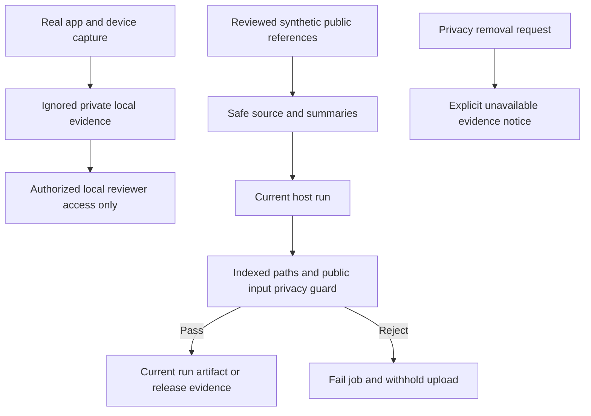
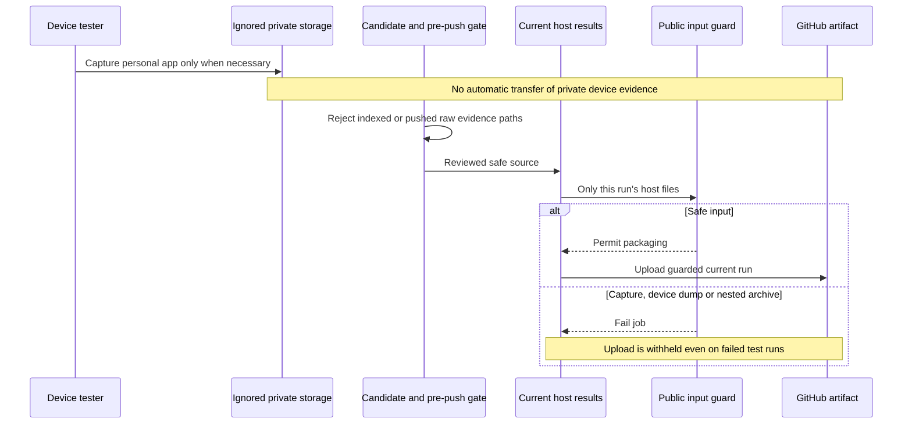

# Private test evidence and public delivery

Real browser sessions, messages, account content, app screens, device dumps and
logs are private by default. Keep them in ignored local runs/private archives;
permission to test an app is not permission to publish its data. Do not open or
capture personal apps for routine acceptance: use synthetic fixture apps/data.
If a real-app check is necessary, explain its scope and keep captures private.
Public UI references require inspected synthetic content and explicit review.
Never move private screenshots into GitHub issues, PRs, releases or CI artifacts.

Public automation uploads only its current host run after both repository-path
and actual-input privacy checks. Rejection fails packaging/upload; it does not
redact bytes silently or count the run as verified. The guard rejects raw tracked
testresults, capture/device paths and common media/archive signatures. This is a
bounded backstop, not semantic detection of all private text or encoded content.
Safe-looking filenames and hashes do not establish permission to publish.

Privacy removal overrides historical-evidence retention. Record withdrawal and
availability honestly; retained bytes still require their original hashes.
Do not copy removed captures into public backups or manufacture replacement
passing evidence. Local private copies remain until separately deleted by owner.

For exposure: remove public artifacts/assets, prepare a fresh filtered clone,
verify every exposed branch/tag, obtain two fresh approvals and request the
specific history/protection exception. Rewriting hashes invalidates old reviews
and source/report bindings: disclose that, never invent retroactive approvals.
Pause tag-triggered releases during approved replacement, restore protections,
then verify remote refs and public artifacts. GitHub Support must handle cached
commit/PR references; other clones must be cleaned or replaced. Never merge old
history back into the sanitized repository.

## Publication boundary

No new cloud service or paid monitoring is introduced.

