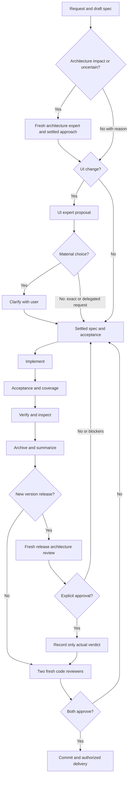

# Development workflow

Start with [onboarding](ONBOARDING.md), then the owning [feature contract](specs/README.md).
[AGENTS.md](../AGENTS.md) is the agent policy; this page explains the working flow.
There is no app behavior change in this workflow update.

Use [coding practice](CODING_PRACTICE.md) for the focused daily loop: targeted
iteration, complete candidate checks, evidence reuse, safe parallel work and one
final candidate freeze. This page continues to own UI decisions and delivery.

## Architecture before implementation

Every task reads the [code/component map and feature atlas](architecture/README.md)
and records architectural impact in its change record before implementation.
For a clearly local change, record N/A and a short source-based reason. Possible
changes to ownership, process/thread boundaries, IPC/API contracts, lifecycle,
queues, persistence/migration, shared input/geometry, security/privacy, dependencies,
build topology or release/evidence bindings require the
[architecture-review skill](../.agents/skills/architecture-review/SKILL.md) and a
fresh read-only architecture expert first. Uncertain impact triggers review.

The expert inspects current source/tests/diagrams and returns affected owners and
invariants, current/proposed overview and sequence, alternatives/tradeoffs,
failure/cancel/stale/rollback/teardown paths, compatibility and verification scope,
and an explicit approve-approach, changes-needed or unresolved-questions conclusion.
Record identity/scope/findings/decision in the existing change record. Resolve
blockers and consequential unclear requirements before dependent work; use the
existing user-clarification policy. Ordinary authorized technical choices need no
additional permission. Re-review material implementation departures.

Maintain a source-linked system/component map and overview plus sequence for each
feature owner. Use [the architecture page template](templates/feature-architecture.md).
Label diagrams as current implementation, intended contract, debug-only or planned;
keep failures and verification limits visible. Render/inspect changed diagrams for
readability and source agreement. Record material lasting decisions as small ADRs
with alternatives/consequences; avoid an ADR for routine edits. The expert preflight
is separate from UI review, rendered acceptance and both fresh final reviewers.
It is an agent-session policy, not a new CI service that authenticates judgment.

## Before implementation

Write the requested outcome and observable acceptance in `SPEC.md`, its owning
feature spec and `requirements.json`. Keep unknowns explicit. For UI work, invoke
the [UI review skill](../.agents/skills/dexdroid-ui-review/SKILL.md) and create a
focused UI expert agent before choosing the dependent design or implementing it.
Give it the current task, relevant design/spec sections, constraints and current
captures when available. Identify missing or historical captures honestly.

The expert considers the whole user task: discoverability, actions to completion,
current-state feedback, navigation/recovery, keyboard/accessibility, constrained
bounds and consistency across phone/monitor. Fewer taps alone do not prove a better
experience. Do not trade away touchpad space, useful actions or readable feedback
just to reduce a control count.

Present a concrete recommendation to the user: before/after task steps, a small
annotated wireframe when placement/navigation changes, important states and
tradeoffs, and the decisions that remain. One recommendation and only meaningful
alternatives are sufficient. A precisely requested typo/icon correction can use
a few sentences; a new flow needs representative screen/state sketches.

The user chose **wait for material UI decisions**. An exact correction or an
already selected/delegated design may proceed after the brief expert proposal;
do not ask for the same approval again. When placement, grouping, action
availability, navigation, persistence, failure behavior or another consequential
requirement remains unclear, ask the user and wait before dependent implementation.
An expert recommendation or silence is not the user's decision. Continue
independent investigation, documentation or host work while waiting. This rule also
applies to unresolved non-UI requirements discovered during review.

Record the expert's identity, proposal, settled user decision/existing instruction,
remaining questions and acceptance consequences in the existing change record.
Update spec/design before code. A material implementation departure needs another
expert/user review; formatting and routine implementation details do not.

## Build and verify

Implement using shared state, style and geometry. Update behavior-focused tests
after implementation. Reconcile concrete requirement checks and run
`python tools/coverage.py update` for every test-source change; inspect and commit
both generated coverage files. Use [CONTRIBUTING](../CONTRIBUTING.md) for commands
and [QUALITY](QUALITY.md) for risk-based scenario selection, visual acceptance
and performance measurement. Fix causes rather than relaxing checks to pass.

Review actual rendered states after implementation. The UI proposal evaluates
the intended experience; it cannot approve actual screenshots, establish a golden
baseline or prove latency. Record those outcomes and gaps separately.

Maintain the diagrams next to changed ownership/flow in
[architecture](ARCHITECTURE.md) and the owning feature spec. Architecture diagrams
explain process boundaries, ownership and data/control flow. Feature diagrams
explain user-visible states and transitions; technical plans stay in architecture
or change records. Use a small Mermaid diagram and adjacent prose, not a generated
class dump. Render changed diagrams and inspect label/arrow readability. Syntax
rendering does not prove semantic correctness; reviewers check against source.

## Retain and review

Follow [the evidence policy](EVIDENCE.md): routine CI artifacts contain only their
own run; approved release publication attaches a verified current-run host ZIP.
Local runs remain ignored until bundled. Git keeps concise scope/results/gaps,
checksummed archive descriptors and available locations. Existing history stays
intact; do not copy entire raw attempts into tracked change folders again.

Follow [REVIEWS](REVIEWS.md) for exactly two fresh independent final code reviewers,
both approving the final staged digest. The upstream UI expert is a separate role
and does not count as either final approval. Changes after review require a new
pair. Record approvals, validate the gate, then commit. Push/PR/release only within
the user's authorized scope; protected `main` and release gates remain in force.

This change does not migrate historical evidence, rewrite Git history, upload
local device bundles, dispatch CI or publish a release. Future archive locations
must disclose local-only/pending/expired states rather than imply availability.

## Every release candidate

After completed checks/evidence, every new version needs fresh architecture
approval before the two final reviewers, even for task N/A, patches, prereleases
and docs-only. Inspect cumulative release changes and current architecture;
record actual verdict/findings/gaps against the exact pre-attestation snapshot.
Only faithful attestation may be added before final reviewers approve the full
canonical candidate. Missing approval/blockers stop tag/push/dispatch/sign/publish.
See [release architecture review](RELEASING.md#release-architecture-review) for
binding, freshness/retry rules and the distinction from existing automated CI.
