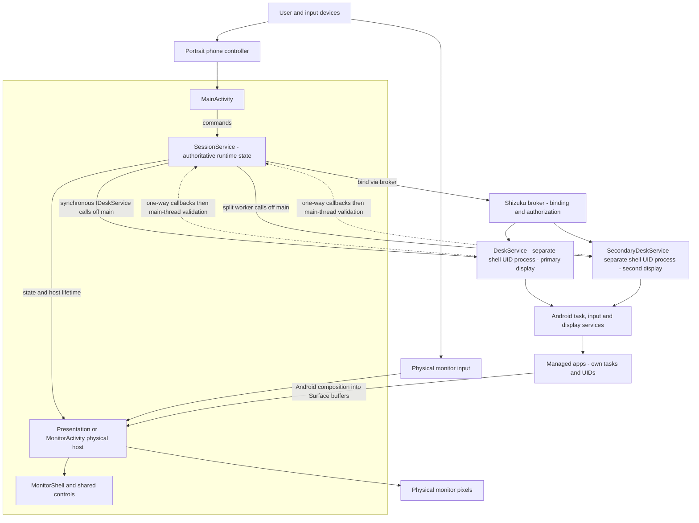
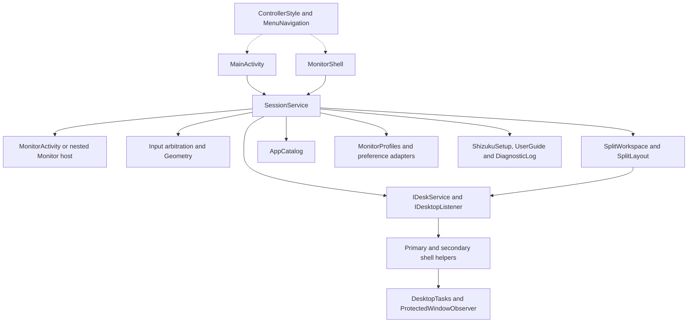
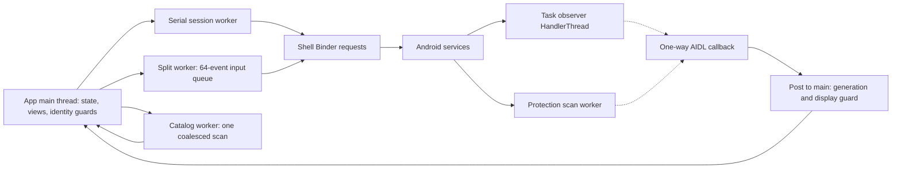

# Code overview and feature architecture

Start here before choosing files to change. This is a navigation map of the current
source and intended contracts, not a claim that every path passes acceptance.
[Detailed architecture](../ARCHITECTURE.md) owns compatibility rationale/invariants;
[feature contracts](../specs/README.md) own observable behavior and stable IDs.
Current acceptance and retained diagnostic failures are recorded in the
[release change record](../changes/release-0.12.1.md) and
[evidence index](../../testresults/0.12.1/README.md).

## System and process boundaries

The box encloses the same app process and app UID: controller, session, physical
host and widgets. The shell helpers outside it run in separate shell-UID processes.

MonitorActivity is an independent task in the same app process, not another
privileged process. Shizuku supplies shell identity, not root. The shell helpers
own virtual displays; the app host owns the physical window/TextureViews. Solid
command arrows and dotted observer callbacks do not carry app frames.

## Components to change together

| Area | Source owners and responsibility | Architectural consequence |
| --- | --- | --- |
| Phone entry | [MainActivity](../../app/src/main/java/dev/dexdroid/MainActivity.java), [ScreenInsets](../../app/src/main/java/dev/dexdroid/ScreenInsets.java) | UI listener ownership, phone-only focus, pad and dialog lifetime |
| Session | [SessionService](../../app/src/main/java/dev/dexdroid/SessionService.java) | Main-thread state, generation/display identity, Shizuku, input arbitration and host lifetime |
| Physical host | [MonitorActivity](../../app/src/main/java/dev/dexdroid/MonitorActivity.java), SessionService.Monitor | Same service-owned content via eligible Activity or OEM Presentation fallback |
| Shared UI | [ControllerStyle](../../app/src/main/java/dev/dexdroid/ControllerStyle.java), [MenuNavigation](../../app/src/main/java/dev/dexdroid/MenuNavigation.java), [LauncherControls](../../app/src/main/java/dev/dexdroid/LauncherControls.java), [LayoutPanel](../../app/src/main/java/dev/dexdroid/LayoutPanel.java) | Shared widgets/navigation; service owns actions/state, style is not a command broker |
| Monitor interaction | [MonitorShell](../../app/src/main/java/dev/dexdroid/MonitorShell.java), [MonitorSearchKeyboard](../../app/src/main/java/dev/dexdroid/MonitorSearchKeyboard.java), [IdleDesktop](../../app/src/main/java/dev/dexdroid/IdleDesktop.java) | Modal and edge ownership, local search keyboard, idle covering of retained buffers |
| Shell boundary | [IDeskService](../../app/src/main/aidl/dev/dexdroid/IDeskService.aidl), [IDesktopListener](../../app/src/main/aidl/dev/dexdroid/IDesktopListener.aidl), [DeskService](../../app/src/main/java/dev/dexdroid/DeskService.java), [SecondaryDeskService](../../app/src/main/java/dev/dexdroid/SecondaryDeskService.java) | Synchronous requests and one-way observers, permission and helper compatibility |
| Split and input | [SplitWorkspace](../../app/src/main/java/dev/dexdroid/SplitWorkspace.java), [SplitLayout](../../app/src/main/java/dev/dexdroid/SplitLayout.java), [Geometry](../../app/src/main/java/dev/dexdroid/Geometry.java), [InputEvents](../../app/src/main/java/dev/dexdroid/InputEvents.java) | Pane/contact/key ownership; native layout, Fit/rotation, rollback and bounded split input |
| Discovery and observation | [AppCatalog](../../app/src/main/java/dev/dexdroid/AppCatalog.java), [DesktopTasks](../../app/src/main/java/dev/dexdroid/DesktopTasks.java), [ProtectedWindowObserver](../../app/src/main/java/dev/dexdroid/ProtectedWindowObserver.java) | Separate workers, stale results, event coalescing and privacy |
| Persistence | [MonitorProfiles](../../app/src/main/java/dev/dexdroid/MonitorProfiles.java), [MonitorProfilePreferences](../../app/src/main/java/dev/dexdroid/MonitorProfilePreferences.java), [SplitLayoutPreferences](../../app/src/main/java/dev/dexdroid/SplitLayoutPreferences.java), SessionService preferences | Stable monitor bindings and durable settings; never persist live display IDs or picker tokens |
| Guidance and diagnosis | [ShizukuSetup](../../app/src/main/java/dev/dexdroid/ShizukuSetup.java), [UserGuide](../../app/src/main/java/dev/dexdroid/UserGuide.java), [DiagnosticLog](../../app/src/main/java/dev/dexdroid/DiagnosticLog.java) | Shared recovery text/actions and bounded content-free events |
| Verification/tooling | [DeviceChecks](../../app/src/androidTest/java/dev/dexdroid/DeviceChecks.java), [tools](../../tools/run_device_checks.py), [requirements](../requirements.json) | Test fixtures are not shipped architecture; coverage mapping is separate from execution |

## Component dependencies

Solid arrows show runtime dependency/commands, dotted arrows shared construction.
This is an ownership map, not a generated list of every class or call.

## Thread, queue and callback model

The session worker uses an **unbounded LinkedBlockingQueue** with selective move/
scroll shedding; do not infer a global queue bound from the bounded split worker.
Task observation coalesces notifications; protected-window scans run independently
of input/task workers. UI callbacks validate their current owner before applying
results. Remote waits, surface preparation/resize and cancellation have different
owners; see the linked feature sequences before changing their ordering.

## State and resource ownership

| Lifetime | State/resources | Invalidated by |
| --- | --- | --- |
| Service lifetime | AppCatalog, display listener, primary Shizuku connection, diagnostic log and loaded preferences | Service onDestroy; Stop may retain the service/cache/binding |
| Desktop generation | Virtual display ID, host/Surface, input ownership, task/protection episode state | Stop, dependency loss or disconnect; late callbacks are guarded |
| Split workspace | Secondary binding tag, pane virtual IDs, geometry transaction, held contact/key owners | Replacement/End/Stop; stale callbacks cannot adopt a new workspace |
| Picker/menu | Captured generation/display/workspace/pane, latest picker serial, subscriptions and keyboard | Replacement, Close/outside, geometry changes or teardown |
| Persistent | Per-app settings, confirmed monitor profiles/bindings, saved split geometry | Explicit save/reset/update; transactional preview must not leak into confirmed state |

Phone backgrounding does not mean Stop. Phone-task destruction and OEM removal of
a Presentation are separate cases. An empty desktop hides retained buffers; it
does not prove underlying remaining-app redraw is correct. Forced privileged root
migration left stale Samsung composition; fresh ordinary phone-launch acceptance
passes its task/state, pixel and input checks. Preserve that mechanism distinction
and the original diagnostic failure; see the release evidence above. The source map describes current responsibilities; it does not
propose a wholesale decomposition of the large SessionService/MainActivity/MonitorShell.

## Feature diagram atlas

Every row of the [feature ownership inventory](../specs/README.md) has one page
below. Each page contains a component overview, representative sequence, source
owners and failure/change boundaries. Sequences deliberately abstract low-level
branches; consult source and requirement checks for the affected scenario.

| Feature owner | Overview and sequence |
| --- | --- |
| Desktop session and compatibility | [desktop-session](features/desktop-session.md) |
| App launcher, discovery and task handoff | [app-launcher](features/app-launcher.md) |
| Touchpad, monitor input, gestures and search | [input-and-navigation](features/input-and-navigation.md) |
| Display configuration and per-app settings | [display-and-app-settings](features/display-and-app-settings.md) |
| Shared controls, menus, icon and version | [controller-ui](features/controller-ui.md) |
| Shizuku setup and offline guide | [setup-and-guide](features/setup-and-guide.md) |
| Named monitor profiles and remembered bindings | [monitor-profiles](features/monitor-profiles.md) |
| Protected-content detection and guidance | [protected-content](features/protected-content.md) |
| Diagnostics and status visibility | [diagnostics](features/diagnostics.md) |
| Two managed panes and transactional layout | [split-view](features/split-view.md) |
| Debug-only two-pane feasibility experiment | [two-pane-prototype](features/two-pane-prototype.md) |
| Verification, evidence, review and release | [verification-and-release](features/verification-and-release.md) |
| Local command supervision and observation | [local-monitoring](features/local-monitoring.md) |
| Daily coding and architecture review loop | [coding-practice](features/coding-practice.md) |

## Using the atlas for a task

Read the owner page, inspect current graph/source and state architectural impact
in the change record. Follow [architecture preflight](../WORKFLOW.md#architecture-before-implementation)
for possible or uncertain impact. Update the owner page and system map when
boundaries change; render/inspect affected diagrams. New feature owners get a
[feature architecture page](../templates/feature-architecture.md) and links in both
indexes. Do not treat this source map as a release Graphify update.
