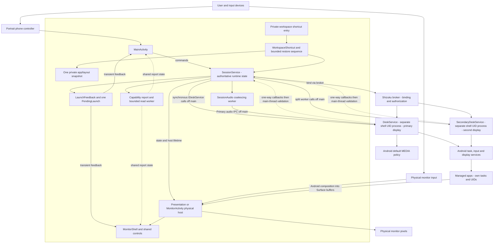
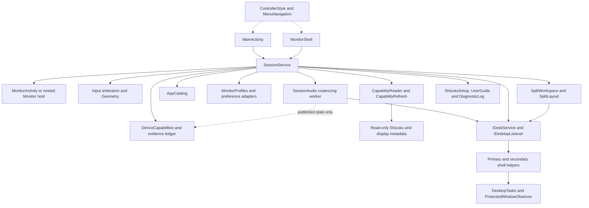
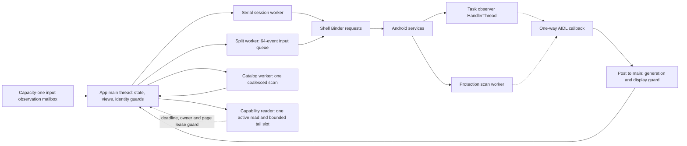

# Code overview and feature architecture

Start here before choosing files to change. This is a navigation map of the current
source and intended contracts, not a claim that every path passes acceptance.
[Detailed architecture](../ARCHITECTURE.md) owns compatibility rationale/invariants;
[feature contracts](../specs/README.md) own observable behavior and stable IDs.
Current Kotlin migration acceptance and retained diagnostic failures are
recorded in the [migration record](../changes/kotlin-migration.md) and
[phase evidence](../../testresults/0.13.0/kotlin-migration/README.md). Published
release evidence remains available through the [evidence index](../../testresults/README.md).

## System and process boundaries

The box encloses the same app process and app UID: controller, session, physical
host and widgets. The shell helpers outside it run in separate shell-UID processes.

MonitorActivity is an independent task in the same app process, not another
privileged process. Shizuku supplies shell identity, not root. The shell helpers
own virtual displays; the app host owns the physical window/TextureViews. Solid
command arrows and dotted observer callbacks do not carry app frames.

## Components to change together

| Area | Source owners and responsibility | Architectural consequence |
| --- | --- | --- |
| Saved workspace | [WorkspaceShortcut](../../app/src/main/kotlin/dev/dexdroid/WorkspaceShortcut.kt), [WorkspaceRestore](../../app/src/main/kotlin/dev/dexdroid/WorkspaceRestore.kt), [WorkspaceSnapshot](../../app/src/main/kotlin/dev/dexdroid/WorkspaceSnapshot.kt), private entry and shared panel | One saved value record, bounded eligibility/restore, current-owner completions and retained replacement cleanup |
| Phone entry | [MainActivity](../../app/src/main/kotlin/dev/dexdroid/MainActivity.kt), [ScreenInsets](../../app/src/main/kotlin/dev/dexdroid/ScreenInsets.kt) | UI listener ownership, phone-only focus, pad and dialog lifetime |
| Session | [SessionService](../../app/src/main/kotlin/dev/dexdroid/SessionService.kt) | Main-thread state, generation/display identity, Shizuku, input arbitration and host lifetime |
| Physical host | [MonitorActivity](../../app/src/main/kotlin/dev/dexdroid/MonitorActivity.kt), SessionService.Monitor | Same service-owned content via eligible Activity or OEM Presentation fallback |
| Shared UI | [ControllerStyle](../../app/src/main/kotlin/dev/dexdroid/ControllerStyle.kt), [MenuNavigation](../../app/src/main/kotlin/dev/dexdroid/MenuNavigation.kt), [LauncherControls](../../app/src/main/kotlin/dev/dexdroid/LauncherControls.kt), [LayoutPanel](../../app/src/main/kotlin/dev/dexdroid/LayoutPanel.kt) | Shared widgets/navigation; service owns actions/state, style is not a command broker |
| Monitor interaction | [MonitorShell](../../app/src/main/kotlin/dev/dexdroid/MonitorShell.kt), [MonitorSearchKeyboard](../../app/src/main/kotlin/dev/dexdroid/MonitorSearchKeyboard.kt), [IdleDesktop](../../app/src/main/kotlin/dev/dexdroid/IdleDesktop.kt) | Modal and edge ownership, local search keyboard, idle covering of retained buffers |
| Shell boundary | [IDeskService](../../app/src/main/aidl/dev/dexdroid/IDeskService.aidl), [IDesktopListener](../../app/src/main/aidl/dev/dexdroid/IDesktopListener.aidl), [DeskService](../../app/src/main/kotlin/dev/dexdroid/DeskService.kt), [SecondaryDeskService](../../app/src/main/kotlin/dev/dexdroid/SecondaryDeskService.kt) | Synchronous requests and one-way observers, permission and helper compatibility |
| Split and input | [SplitWorkspace](../../app/src/main/kotlin/dev/dexdroid/SplitWorkspace.kt), [SplitLayout](../../app/src/main/kotlin/dev/dexdroid/SplitLayout.kt), [Geometry](../../app/src/main/kotlin/dev/dexdroid/Geometry.kt), [InputEvents](../../app/src/main/kotlin/dev/dexdroid/InputEvents.kt) | Pane/contact/key ownership; native layout, Fit/rotation, rollback and bounded split input |
| Session media | [SessionAudio](../../app/src/main/kotlin/dev/dexdroid/SessionAudio.kt), [AudioRouter](../../app/src/main/kotlin/dev/dexdroid/AudioRouter.kt), [AudioPolicyLease](../../app/src/main/kotlin/dev/dexdroid/AudioPolicyLease.kt), [AudioPanel](../../app/src/main/kotlin/dev/dexdroid/AudioPanel.kt) | Primary-only global policy, bounded work, baseline ownership and independent audio epoch |
| Device capabilities | [DeviceCapabilities / evidence ledger](../../app/src/main/kotlin/dev/dexdroid/DeviceCapabilities.kt), [CapabilityRefresh](../../app/src/main/kotlin/dev/dexdroid/CapabilityRefresh.kt), [CapabilityReader](../../app/src/main/kotlin/dev/dexdroid/CapabilityReader.kt), [CapabilitiesPanel](../../app/src/main/kotlin/dev/dexdroid/CapabilitiesPanel.kt), SessionService | One shared passive projection; owner-scoped memory-only facts, bounded read/deadline/close leases and sanitized explicit diagnostic export |
| Discovery and observation | [AppCatalog](../../app/src/main/kotlin/dev/dexdroid/AppCatalog.kt), [DesktopTasks](../../app/src/main/kotlin/dev/dexdroid/DesktopTasks.kt), [ProtectedWindowObserver](../../app/src/main/kotlin/dev/dexdroid/ProtectedWindowObserver.kt) | Separate workers, stale results, event coalescing and privacy |
| Persistence | [MonitorProfiles](../../app/src/main/kotlin/dev/dexdroid/MonitorProfiles.kt), [MonitorProfilePreferences](../../app/src/main/kotlin/dev/dexdroid/MonitorProfilePreferences.kt), [SplitLayoutPreferences](../../app/src/main/kotlin/dev/dexdroid/SplitLayoutPreferences.kt), SessionService preferences | Stable monitor bindings and durable settings; never persist live display IDs or picker tokens |
| Explicit debugging shutdown | [DebuggingOffPanel](../../app/src/main/kotlin/dev/dexdroid/DebuggingOffPanel.kt), [DebuggingPolicy](../../app/src/main/kotlin/dev/dexdroid/DebuggingPolicy.kt), [DebuggingControl](../../app/src/main/kotlin/dev/dexdroid/DebuggingControl.kt), SessionService | Retained attempt lifetime, display/audio barriers, fixed primary-only off writes and interrupted receipt |
| Guidance and diagnosis | [ShizukuSetup](../../app/src/main/kotlin/dev/dexdroid/ShizukuSetup.kt), [UserGuide](../../app/src/main/kotlin/dev/dexdroid/UserGuide.kt), [DiagnosticLog](../../app/src/main/kotlin/dev/dexdroid/DiagnosticLog.kt), [DiagnosticsPanel](../../app/src/main/kotlin/dev/dexdroid/DiagnosticsPanel.kt) | Shared recovery, safe bounded memory events and explicit immutable copy/phone sharing |
| Verification/tooling | [DeviceChecks](../../app/src/androidTest/kotlin/dev/dexdroid/DeviceChecks.kt), [tools](../../tools/run_device_checks.py), [requirements](../requirements.json) | Test fixtures are not shipped architecture; coverage mapping is separate from execution |

## Component dependencies

Solid arrows show runtime dependency/commands, dotted arrows shared construction.
This is an ownership map, not a generated list of every class or call.

## Thread, queue and callback model

The session worker uses an **unbounded LinkedBlockingQueue** with selective move/
scroll shedding; do not infer a global queue bound from the bounded split worker.
Task observation coalesces notifications; protected-window scans run independently
of input/task workers. UI callbacks validate their current owner before applying
results. Remote waits, surface preparation/resize and cancellation have different
owners; see the linked feature sequences before changing their ordering.
The capability reader has its own worker and two-second UI deadline. An expired
read keeps its slot until terminal completion; one pending intent can then hand
off through a capacity-one executor queue. It never runs on input/audio workers.
Capability facts use a separate capacity-one input completion mailbox, not a new
queue of per-event diagnostics.

## State and resource ownership

| Lifetime | State/resources | Invalidated by |
| --- | --- | --- |
| Service lifetime | AppCatalog, display listener, primary Shizuku connection, diagnostic log and loaded preferences | Service onDestroy; Stop may retain the service/cache/binding |
| Desktop generation | Virtual display ID, host/Surface, input ownership, task/protection episode state | Stop, dependency loss or disconnect; late callbacks are guarded |
| Split workspace | Secondary binding tag, pane virtual IDs, geometry transaction, held contact/key owners | Replacement/End/Stop; stale callbacks cannot adopt a new workspace |
| Picker/menu | Captured generation/display/workspace/pane, latest picker serial, subscriptions and keyboard | Replacement, Close/outside, geometry changes or teardown |
| Capability report | Three memory-only facts, current metadata, identity ticket and visible page leases | Stop/dependency/target/geometry changes retire facts and metadata; last-page close rejects late reads; service destruction closes worker and leases |
| Persistent | Per-app settings, confirmed monitor profiles/bindings, saved split geometry | Explicit save/reset/update; transactional preview must not leak into confirmed state |

Phone backgrounding does not mean Stop. Phone-task destruction and OEM removal of
a Presentation are separate cases. An empty desktop hides retained buffers; it
does not prove underlying remaining-app redraw is correct. Forced privileged root
migration left stale Samsung composition; fresh ordinary phone-launch acceptance
passes its task/state, pixel and input checks. Preserve that mechanism distinction
and the original diagnostic failure; see the release evidence above. The source map describes current responsibilities; it does not
propose a wholesale decomposition of the large SessionService/MainActivity/MonitorShell.

## Feature diagram atlas

Every row of the [feature ownership inventory](../specs/README.md) has one page
below. Each page contains a component overview, representative sequence, source
owners and failure/change boundaries. Sequences deliberately abstract low-level
branches; consult source and requirement checks for the affected scenario.

| Feature owner | Overview and sequence |
| --- | --- |
| Passive device capabilities | [device-capabilities](features/device-capabilities.md) |
| One saved workspace shortcut | [workspace-shortcut](features/workspace-shortcut.md) |
| Session media output | [session-audio](features/session-audio.md) |
| Desktop session and compatibility | [desktop-session](features/desktop-session.md) |
| App launcher, discovery and task handoff | [app-launcher](features/app-launcher.md) |
| Touchpad, monitor input, gestures and search | [input-and-navigation](features/input-and-navigation.md) |
| Display configuration and per-app settings | [display-and-app-settings](features/display-and-app-settings.md) |
| Shared controls, menus, icon and version | [controller-ui](features/controller-ui.md) |
| Shizuku setup and offline guide | [setup-and-guide](features/setup-and-guide.md) |
| Named monitor profiles and remembered bindings | [monitor-profiles](features/monitor-profiles.md) |
| Protected-content detection and guidance | [protected-content](features/protected-content.md) |
| Diagnostics and status visibility | [diagnostics](features/diagnostics.md) |
| Two managed panes and transactional layout | [split-view](features/split-view.md) |
| Debug-only two-pane feasibility experiment | [two-pane-prototype](features/two-pane-prototype.md) |
| Verification, evidence, review and release | [verification-and-release](features/verification-and-release.md) |
| Local command supervision and observation | [local-monitoring](features/local-monitoring.md) |
| Daily coding and architecture review loop | [coding-practice](features/coding-practice.md) |

## Using the atlas for a task

Read the owner page, inspect current source/tests and state architectural impact
in the change record. Follow [architecture preflight](../WORKFLOW.md#architecture-before-implementation)
for possible or uncertain impact. Update the owner page and system map when
boundaries change; render/inspect affected diagrams. New feature owners get a
[feature architecture page](../templates/feature-architecture.md) and links in both
indexes. Keep this source map reconciled with current source and verification scope.

- [Explicit debugging shutdown](features/debugging-off.md): cleanup barriers, fixed shell mutation and private attempt receipt.
