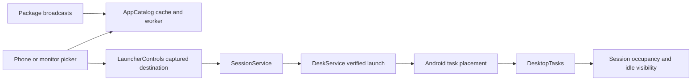
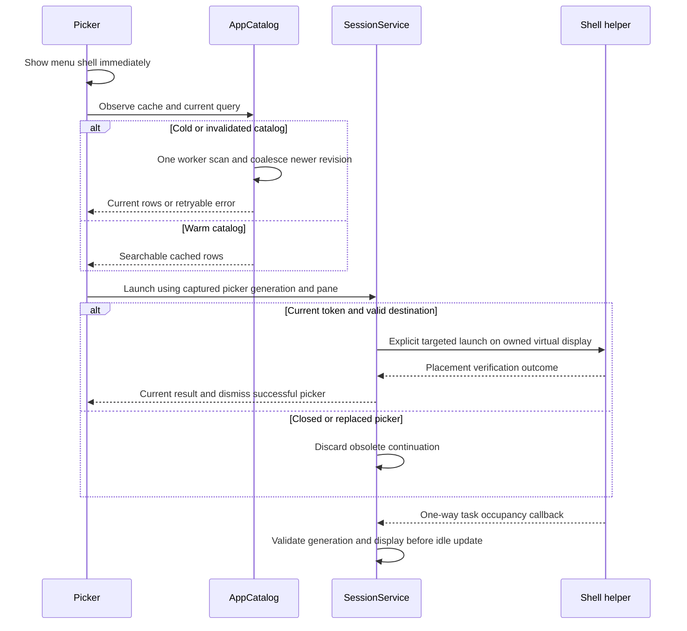

# App launcher, discovery and task handoff

[Code map and atlas](../README.md) | [Owning contract](../../specs/app-launcher.md)

## Scope and source

AppCatalog is service-owned, prewarmed and revisioned. Each menu owns a subscription and captured launch choice. DesktopTasks observes only its owned display and does not reparent phone tasks.

Source entry points: [AppCatalog.java](../../../app/src/main/java/dev/dexdroid/AppCatalog.java); [LauncherControls.java](../../../app/src/main/java/dev/dexdroid/LauncherControls.java); [SessionService.java](../../../app/src/main/java/dev/dexdroid/SessionService.java); [DeskService.java](../../../app/src/main/java/dev/dexdroid/DeskService.java); [DesktopTasks.java](../../../app/src/main/java/dev/dexdroid/DesktopTasks.java). Read current symbols and requirement checks
before changing behavior; this page is a high-level map, not an exhaustive call graph.

## Component overview

## Representative sequence

## Change and verification boundaries

Catalog errors retain previous rows and permit retry; dismissed subscribers cannot reopen a menu. Phone task handoff is observed, never stolen back automatically. Samsung forced root-task migration remains an unresolved privileged diagnostic: logical placement can disagree with rendered composition. Ordinary exported app-entry phone launch is the user acceptance trigger and passes the current focused child suite; its task/state, pixels and native input are all checked. See the release record for current consolidated scope.

See [requirements and explicit gaps](../../requirements.json). Diagram arrows
describe current responsibilities/intended paths, not successful runtime verification.
