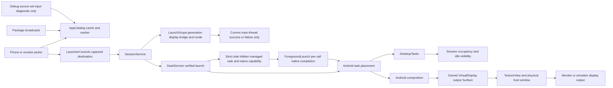
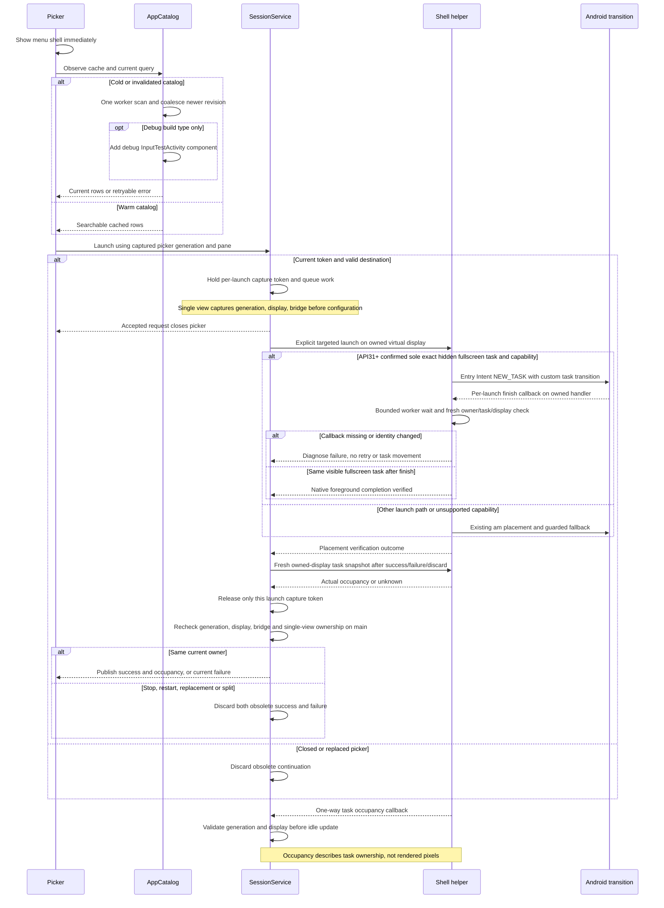

# App launcher, discovery and task handoff

[Code map and atlas](../README.md) | [Owning contract](../../specs/app-launcher.md)

## Scope and source

AppCatalog is service-owned, prewarmed and revisioned. Each menu owns a subscription and captured launch choice. DesktopTasks observes only its owned display and does not reparent phone tasks.

The [saved workspace shortcut](workspace-shortcut.md) resolves top/private child
identities to public launcher entries before saving, validates them before
replacement and sequences the existing launch path with explicit completion.
Single/Split launch callbacks expose success/failure to that service-owned sequence;
ordinary picker behavior and shell placement verification remain shared.

Source entry points: [AppCatalog.kt](../../../app/src/main/kotlin/dev/dexdroid/AppCatalog.kt); [LauncherControls.kt](../../../app/src/main/kotlin/dev/dexdroid/LauncherControls.kt); [SessionService.kt](../../../app/src/main/kotlin/dev/dexdroid/SessionService.kt); [LaunchScope.kt](../../../app/src/main/kotlin/dev/dexdroid/LaunchScope.kt); [DeskService.kt](../../../app/src/main/kotlin/dev/dexdroid/DeskService.kt); [ForegroundLaunch.kt](../../../app/src/main/kotlin/dev/dexdroid/ForegroundLaunch.kt); [DesktopTasks.kt](../../../app/src/main/kotlin/dev/dexdroid/DesktopTasks.kt). Read current symbols and requirement checks
before changing behavior; this page is a high-level map, not an exhaustive call graph.

## Component overview

## Representative sequence

## Change and verification boundaries

Catalog errors retain previous rows and permit retry; dismissed subscribers cannot
reopen a menu. Phone task handoff is observed, never stolen back automatically.
Samsung forced root-task migration remains an unresolved privileged diagnostic:
logical placement can disagree with rendered composition. Ordinary exported
app-entry phone launch is the acceptance trigger. Historical source/device-bound
passes do not waive failed attempts, including the API34/35 remaining-app failure
also reproduced from Java source on API34. The narrow foregrounding
candidate uses a separate strict task/component/visibility snapshot, a per-call
callback and finite worker wait. Its callback never acquires the service monitor
or queries tasks. Timeout, interruption or moved ownership closes its callback
thread and terminates without falling back after the start RPC. Already-visible,
fresh, phone-fallback and API30 launches retain their existing route; unsupported
native capability is diagnosed before the original route is used. Raw pre-completion
phone overlap remains a failing platform diagnostic, not a completed-launch pass.
The original child scenario and its fresh remaining-app contact pass on API34/35
with frozen generationv4. Native input/Stop overlap remains separately unverified.
Single-view launch success/failure checks LaunchScope before its RPC and at the
actual main-thread status mutation; generic reporting is unchanged. Split uses
its existing current-workspace guard. Task/window metadata alone
does not verify composition; independent emulator output and monitor-window
capture must identify their actual targets. See the
[handoff investigation](../../changes/handoff-rendering.md) and release evidence
for their separate scopes.

See [requirements and explicit gaps](../../requirements.json). Diagram arrows
describe current responsibilities/intended paths, not successful runtime verification.

Each accepted Single launch also retains an independent main-owned capture token
through configuration, dispatch and fresh owned-display reconciliation on the serial
worker. Requested components are published only after native work; failure/discard
queries actual occupancy. Generation teardown retires tokens, and an earlier
completion cannot unlock capture while a later request is outstanding. Saved-workspace
capture independently queries both owned helpers before launcher canonicalization;
see its [capture sequence](workspace-shortcut.md#representative-sequence).

The input diagnostic Activity and manifest declaration live in `src/debug`.
Shared discovery adds its string-identified component only when DEBUG is true
and the build type is debug; official and release-variant diagnostic builds omit
that row. Phone/monitor pickers consume the same list. Legacy task-parser identity
strings do not load the class and remain for safe owned-display cleanup.
