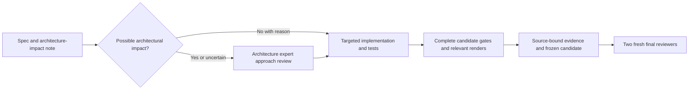
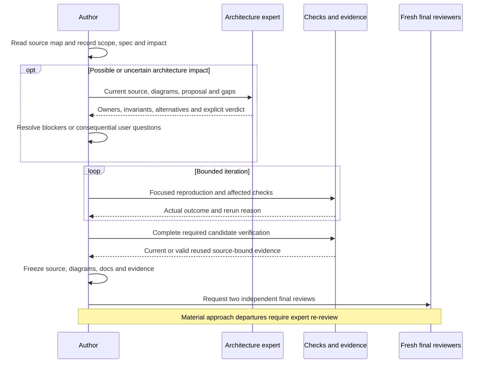

# Daily coding and architecture review loop

[Code map and atlas](../README.md) | [Owning coding practice](../../CODING_PRACTICE.md)

## Scope and source

The agent session owns risk screening, expert decisions and evidence reuse. Coding practice selects focused iteration without removing completed-candidate gates. Architecture and UI preflights are upstream roles; neither is a final candidate approval.

Source entry points: [Workflow](../../WORKFLOW.md); [Agent contract](../../../AGENTS.md); [Architecture skill](../../../.agents/skills/architecture-review/SKILL.md). Read current symbols and requirement checks
before changing behavior; this page is a high-level map, not an exhaustive call graph.

## Component overview

## Representative sequence

## Change and verification boundaries

Sources of policy: docs/CODING_PRACTICE.md, WORKFLOW.md and AGENTS.md. Do not reuse evidence after relevant source/configuration changes or reuse final approvals after any candidate change. Efficiency claims require actual timing boundaries; no device rerun is needed for a documentation-only architecture map.

See [requirements and explicit gaps](../../requirements.json). Diagram arrows
describe current responsibilities/intended paths, not successful runtime verification.
