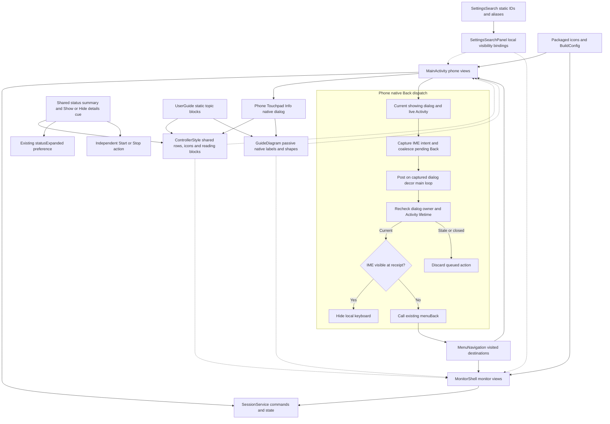
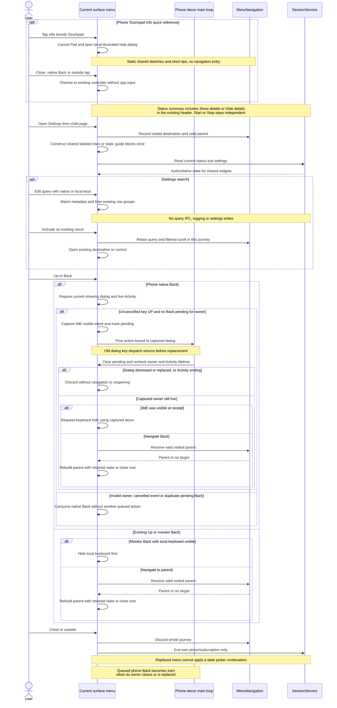

# Shared controls, menus, icon and version

[Code map and atlas](../README.md) | [Owning contract](../../specs/controller-ui.md)

## Scope and source

Phone and monitor construct separate native views using shared style/actions backed by one service. MenuNavigation owns visited destinations; each surface retains its own editor/scroll/menu lifetime. The launcher icon is a packaged resource; Settings reads installed BuildConfig version.

Source entry points: [MainActivity.kt](../../../app/src/main/kotlin/dev/dexdroid/MainActivity.kt); [MonitorShell.kt](../../../app/src/main/kotlin/dev/dexdroid/MonitorShell.kt); [ControllerStyle.kt](../../../app/src/main/kotlin/dev/dexdroid/ControllerStyle.kt); [MenuNavigation.kt](../../../app/src/main/kotlin/dev/dexdroid/MenuNavigation.kt); [LauncherControls.kt](../../../app/src/main/kotlin/dev/dexdroid/LauncherControls.kt); [ScreenInsets.kt](../../../app/src/main/kotlin/dev/dexdroid/ScreenInsets.kt). Read current symbols and requirement checks
before changing behavior; this page is a high-level map, not an exhaustive call graph.
Settings discovery adds [SettingsSearch.kt](../../../app/src/main/kotlin/dev/dexdroid/SettingsSearch.kt)
and [SettingsSearchPanel.kt](../../../app/src/main/kotlin/dev/dexdroid/SettingsSearchPanel.kt).
Phone-only `MainActivity.touchpadHelp` reuses the existing ControllerStyle reading
blocks and [GuideDiagram](../../../app/src/main/kotlin/dev/dexdroid/GuideDiagram.kt)
touchpad sketch in a native help dialog. It cancels Pad input before opening;
fixed Close/header and scrollable content add no MenuNavigation destination,
service command or persistent state. Native Back/outside dismissal stays local.
The existing shared-style/passive-sketch overview already covers this ownership.
`MainActivity.beginMenu` owns each phone dialog's native Back listener and pending
flag. It captures the keyboard-visible intent at receipt and posts one pending
action to that dialog's decor/main loop, leaving the old key dispatch before
`menuBack` can replace a window. MenuNavigation remains the shared route owner;
the queue stores no new destination or service state.

## Component overview

## Representative sequence

## Change and verification boundaries

Phone controls stay portrait/IME-inset safe; monitor omits the phone pad. Keep status/action semantics shared without sharing mutable view instances or icon bounds. Architecture diagrams do not approve actual renders. The installed icon/version paths are static build resources and do not require shell IPC.

Reading helpers create local TextViews, decorative vector ImageViews and paragraph
spans. They own no commands, subscribers, saved state or input targets. Existing
surface updaters keep their view references and update values in place; refresh
does not reconstruct guide blocks or reacquire capability leases. GuideDiagram's
drawn contacts/arrows are passive; adjacent native text wraps with font scaling.
It has no gesture recognition, network, service lookup or animation loop.

SettingsSearch is a pure static metadata/matcher owner. SettingsSearchPanel owns
only per-menu native view bindings, a fixed version/search/feedback area and an
editor watcher. Filtering updates existing row visibility and empty section
headings; it does not reconstruct controls or call service commands. Grouping the
native-keyboard row and Retry composes filtering with the panel's own eligibility
refresh. All tokens match case-insensitively against titles, sections and aliases;
live status text is deliberately excluded. Input is bounded to 200 characters.

Phone MenuEntry retains Settings query just as visited launcher query/scroll;
rebuilding a child/parent removes the old watcher. Monitor retains settingsQuery
independently of launcherQuery, and its local editor validates the owning page
and current editor before requesting keyboard/focus. Surviving journey rebuilds
restore text before scroll, with keys hidden. Close/outside/fresh root and destroy
clear the journey; detached watchers cannot mutate new menus. Search uses no
preferences, background tasks, shell IPC or new privileges. The renamed Developer
Mode page keeps the existing service operation and confirmation/readback contract.

The native phone Back guard checks exact dialog identity, showing state and
Activity finishing/destroyed state both before scheduling and before execution.
Repeated key-UP events while that owner has a pending action are coalesced.
Dismissal, Close, replacement and Activity teardown invalidate execution through
these lifetime checks; they do not redirect a stale callback to a newer dialog.
This is guarded main-loop deferral, not a new background worker or a separate
navigation stack. Header Up retains its existing parent action; Close/outside
retain whole-journey dismissal. Keyboard-first Back, parent filtering, picker
ownership, parent query/scroll restoration and layout remain unchanged.

Architecture impact: documentation reconciliation of the approved phone Back
dispatch/owner-lifetime approach. The shared navigation and service ownership
boundaries remain intact. The observed Samsung PhoneWindow missing-content crash
motivates the dispatch change; its exact OEM cause is not established. Native
Back and deterministic duplicate/Close/replacement checks in
[PhoneMenuAcceptance](../../../app/src/androidTest/kotlin/dev/dexdroid/PhoneMenuAcceptance.kt)
require their own current test reports; this page claims no runtime pass or fix.

See [requirements and explicit gaps](../../requirements.json). Diagram arrows
describe current responsibilities/intended paths, not successful runtime verification.
