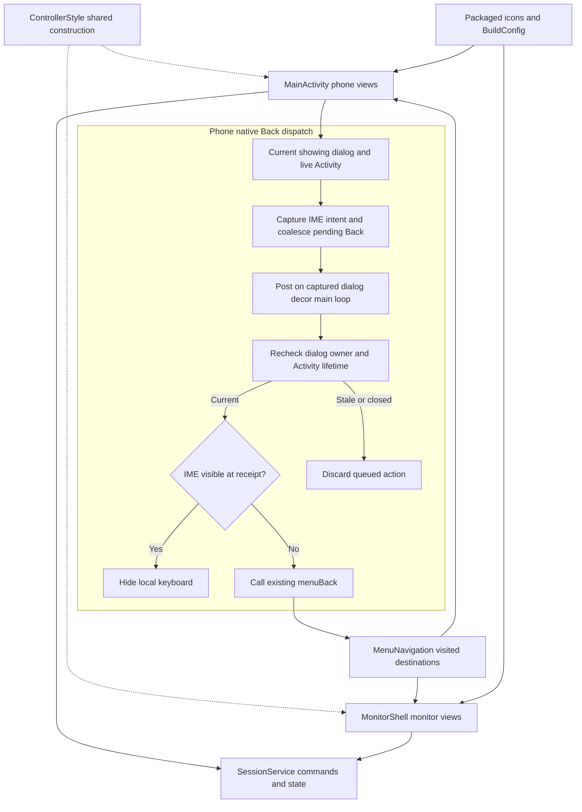
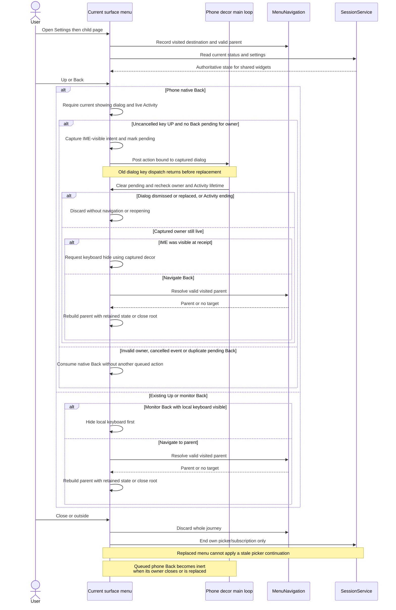

# Shared controls, menus, icon and version

[Code map and atlas](../README.md) | [Owning contract](../../specs/controller-ui.md)

## Scope and source

Phone and monitor construct separate native views using shared style/actions backed by one service. MenuNavigation owns visited destinations; each surface retains its own editor/scroll/menu lifetime. The launcher icon is a packaged resource; Settings reads installed BuildConfig version.

Source entry points: [MainActivity.java](../../../app/src/main/java/dev/dexdroid/MainActivity.java); [MonitorShell.java](../../../app/src/main/java/dev/dexdroid/MonitorShell.java); [ControllerStyle.java](../../../app/src/main/java/dev/dexdroid/ControllerStyle.java); [MenuNavigation.java](../../../app/src/main/java/dev/dexdroid/MenuNavigation.java); [LauncherControls.java](../../../app/src/main/java/dev/dexdroid/LauncherControls.java); [ScreenInsets.java](../../../app/src/main/java/dev/dexdroid/ScreenInsets.java). Read current symbols and requirement checks
before changing behavior; this page is a high-level map, not an exhaustive call graph.
`MainActivity.beginMenu` owns each phone dialog's native Back listener and pending
flag. It captures the keyboard-visible intent at receipt and posts one pending
action to that dialog's decor/main loop, leaving the old key dispatch before
`menuBack` can replace a window. MenuNavigation remains the shared route owner;
the queue stores no new destination or service state.

## Component overview

## Representative sequence

## Change and verification boundaries

Phone controls stay portrait/IME-inset safe; monitor omits the phone pad. Keep status/action semantics shared without sharing mutable view instances or icon bounds. Architecture diagrams do not approve actual renders. The installed icon/version paths are static build resources and do not require shell IPC.

The native phone Back guard checks exact dialog identity, showing state and
Activity finishing/destroyed state both before scheduling and before execution.
Repeated key-UP events while that owner has a pending action are coalesced.
Dismissal, Close, replacement and Activity teardown invalidate execution through
these lifetime checks; they do not redirect a stale callback to a newer dialog.
This is guarded main-loop deferral, not a new background worker or a separate
navigation stack. Header Up retains its existing parent action; Close/outside
retain whole-journey dismissal. Keyboard-first Back, parent filtering, picker
ownership, parent query/scroll restoration and layout remain unchanged.

Architecture impact: documentation reconciliation of the approved phone Back
dispatch/owner-lifetime approach. The shared navigation and service ownership
boundaries remain intact. The observed Samsung PhoneWindow missing-content crash
motivates the dispatch change; its exact OEM cause is not established. Native
Back and deterministic duplicate/Close/replacement checks in
[PhoneMenuAcceptance](../../../app/src/androidTest/java/dev/dexdroid/PhoneMenuAcceptance.java)
require their own current test reports; this page claims no runtime pass or fix.

See [requirements and explicit gaps](../../requirements.json). Diagram arrows
describe current responsibilities/intended paths, not successful runtime verification.
