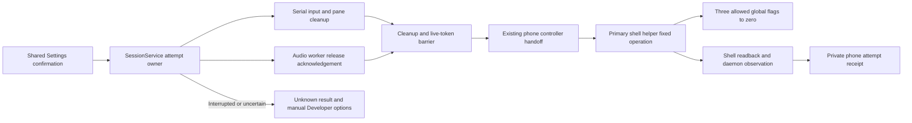
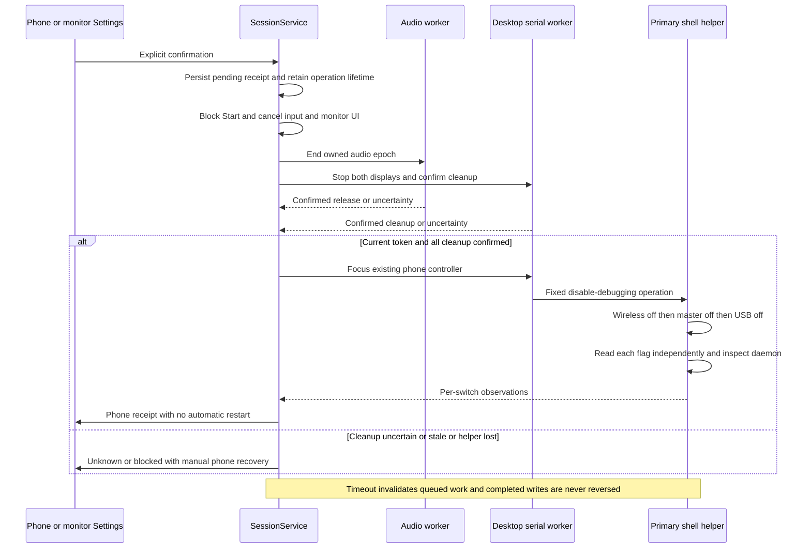

# Explicit debugging shutdown

[Architecture atlas](../README.md) | [Contract](../../specs/debugging-off.md)

## Scope and owners

Intended contract for the in-progress implementation. Settings shares one panel;
SessionService owns the attempt and service lifetime. SessionAudio acknowledges
actual worker cleanup. The primary DeskService exposes only a fixed no-argument
one-way disabling operation. No general settings or shell executor is exposed.

Source: [SessionService](../../../app/src/main/kotlin/dev/dexdroid/SessionService.kt),
[SessionAudio](../../../app/src/main/kotlin/dev/dexdroid/SessionAudio.kt),
[DeskService](../../../app/src/main/kotlin/dev/dexdroid/DeskService.kt),
[MainActivity](../../../app/src/main/kotlin/dev/dexdroid/MainActivity.kt),
[MonitorShell](../../../app/src/main/kotlin/dev/dexdroid/MonitorShell.kt).

## Overview

## Sequence and failure boundaries

## Invariants and verification boundaries

Retain foreground/start ownership until terminal result or bounded timeout; bound
UI alone is insufficient. Recheck operation token immediately before helper entry.
Desktop/audio uncertainty prevents writes. Helper loss after writes is unknown,
not success. A direct master-flag write is not the Android Settings UI controller
cascade. Legacy TCP ADB may exist while adb_wifi_enabled is zero; report daemon
observations separately. Product never enables a switch or clears remembered
pairing/authorizations. Another app or later Shizuku startup may enable flags.

Diagrams describe the intended contract, not current runtime verification. See
[change record](../../changes/debugging-off.md) for actual checks and gaps.

DebuggingOffPanel keeps recovery disclosure state local to the page. Generic
manual checks link to the phone's main Settings with ACTION_SETTINGS; the collapsed
Use the desktop again section describes deliberate later setup. Neither navigation
nor disclosure calls the privileged helper. Named OEM examples stay in UserGuide.
No permission, service or persisted-state boundary changes in this UI follow-up.
