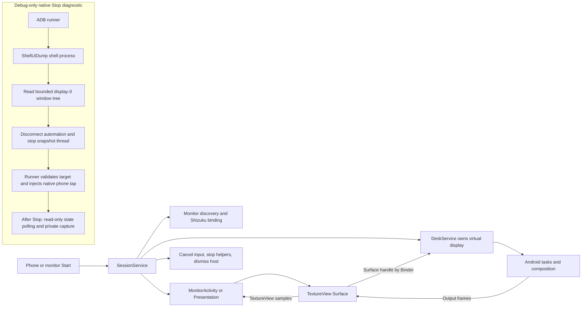
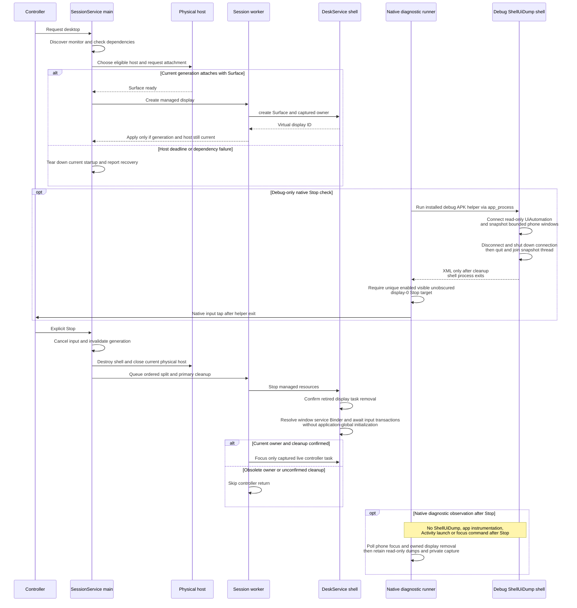

# Desktop session and compatibility

[Code map and atlas](../README.md) | [Owning contract](../../specs/desktop-session.md)

## Scope and source

SessionService owns requested/running state, generation, host and helper bindings. Android display IDs and Surface wrappers are runtime identities. The physical host may be an eligible API 36+ Activity or an OEM Presentation fallback.

Source entry points: [SessionService.kt](../../../app/src/main/kotlin/dev/dexdroid/SessionService.kt); [DeskService.kt](../../../app/src/main/kotlin/dev/dexdroid/DeskService.kt); [MonitorActivity.kt](../../../app/src/main/kotlin/dev/dexdroid/MonitorActivity.kt); [DesktopTasks.kt](../../../app/src/main/kotlin/dev/dexdroid/DesktopTasks.kt). Read current symbols and requirement checks
before changing behavior; this page is a high-level map, not an exhaustive call graph.
The separate [native Stop runner](../../../tools/check_stop_focus.py) uses
[ShellUiDump.kt](../../../app/src/debug/kotlin/dev/dexdroid/ShellUiDump.kt) from
the installed debug APK in an `app_process` shell-UID process. The helper is absent
from production APKs and is not an app instrumentation session or session owner.

## Component overview

## Representative sequence

## Change and verification boundaries

Backgrounding, phone-task destruction and OEM Presentation removal are distinct.
Keep host-attachment deadlines, stale-generation rejection, owner-aware teardown
and confirmed explicit-Stop return. These diagrams establish no native Stop pass
or resolution of the retained initial child/split diagnosis; use the separate source/device-
bound acceptance records for actual outcomes.

Task-occupancy callbacks and rendered output are independent paths. A remaining
task can be RESUMED/visible/HAS_DRAWN while captured host pixels retain a departed
app. Current API34/35 diagnostics therefore compare monitor-window PixelCopy
with independently identified emulator output before cleanup. The emulator's
second display is virtual; a hard-coded HWC-display1 lookup supplies no independent
frame. gRPC emulator display identifiers, Android logical IDs and SurfaceFlinger
physical IDs remain distinct. This diagnostic does not authorize speculative
Surface detach/resize, host replacement or desktop recreation; those lifetime
changes require evidence and renewed review.

`ShellUiDump.main` requires shell UID 2000 and no arguments. It reads only display
0, with bounded window/node/depth/traversal limits. After a bounded event-quiet
settling hint, it polls for a nonempty display-0 window list with a two-second
discovery deadline. Only then does a new snapshot object start the independent
ten-second traversal deadline, using the same read-only UiAutomation connection.
The existing bounded-snapshot diagrams cover these separate discovery/traversal
budgets; they do not establish measured end-to-end latency. Its nested cleanup disconnects
UiAutomation, shuts down the connection and terminates the snapshot thread before
successful XML can leave the process. The runner waits for that shell command to
finish, validates the target against window layers and bounds, then issues native
display-0 input. Cleanup or target-selection failure prevents the tap. The helper
calls no input-injection or focus-changing API. It is used before each native action,
including Stop; after Stop the runner observes focus/display removal and collects
private evidence without reopening the controller or running the dump helper.
The production SessionService/DeskService cleanup remains the separate runtime
path shown above. Real app/device XML, logs and captures remain private local
evidence under the [privacy policy](../../PRIVACY.md).

Architecture impact: documentation reconciliation under the approved preflight,
making the existing debug-only shell/UiAutomation lifetime and its separation from
production session ownership explicit. No new helper, runtime behavior or
acceptance verdict is introduced by this documentation.

See [requirements and explicit gaps](../../requirements.json). Diagram arrows
describe current responsibilities/intended paths, not successful runtime verification.
