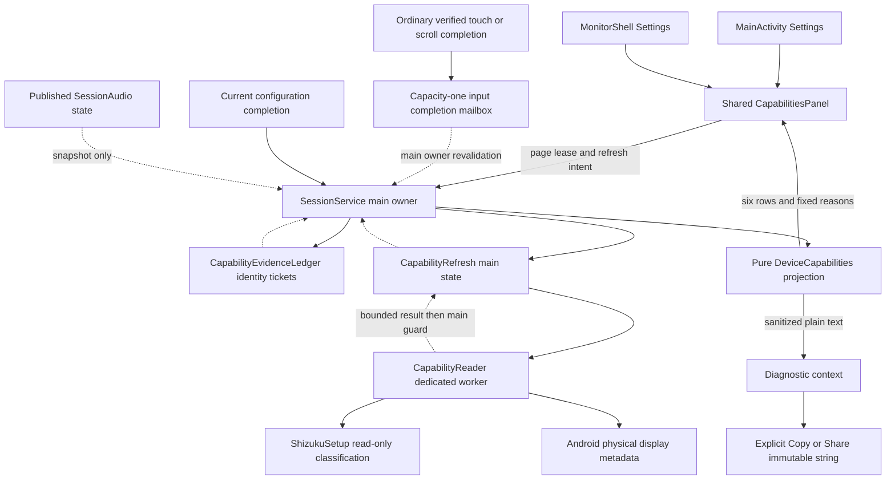
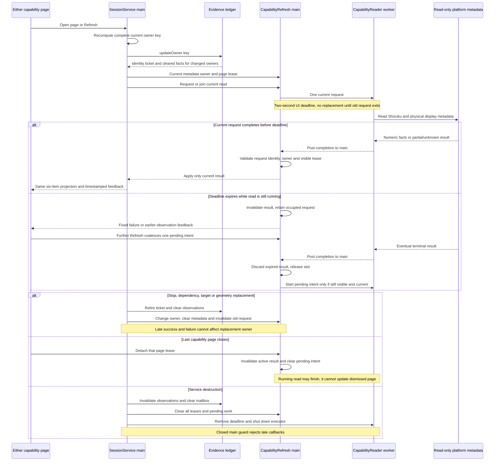

# Device capabilities

[Code map](../README.md) | [Contract](../../specs/device-capabilities.md)

## Scope and source

FR-040 / DX-CAPABILITY-001 adds one passive Settings report shared by phone and
monitor: Shizuku, Monitor, Desktop, Input, Rotation + split, Audio selection.
The implementation reports current prerequisites and exact session observations;
it does not certify hardware, app response, rendered pixels or audible sound.
Guided tests, active probes, OEM allowlists and persistent observations are deferred.

The app-process owners are:

| Owner | Responsibility and boundary |
| --- | --- |
| [SessionService](../../../app/src/main/kotlin/dev/dexdroid/SessionService.kt) | Main-owned `syncCapabilityOwner`, report projection, configuration observations, input completion mailbox and diagnostic context |
| [DeviceCapabilities / CapabilityEvidenceLedger](../../../app/src/main/kotlin/dev/dexdroid/DeviceCapabilities.kt) | Pure six-item projection, fixed reasons and sanitized text; three bounded memory-only input/rotation/split facts guarded by identity tickets |
| [CapabilityRefresh](../../../app/src/main/kotlin/dev/dexdroid/CapabilityRefresh.kt) | Pure main-owned read state, page leases, one active request, one coalesced pending intent and stale-result rejection |
| [CapabilityReader](../../../app/src/main/kotlin/dev/dexdroid/CapabilityReader.kt) | Dedicated single-worker metadata executor, capacity-one tail queue, two-second UI deadline and fixed timestamped feedback |
| [ShizukuSetup.capability](../../../app/src/main/kotlin/dev/dexdroid/ShizukuSetup.kt) | Read-only package/binder/permission classification; failed reads preserve Unknown rather than inventing Stopped |
| [CapabilitiesPanel](../../../app/src/main/kotlin/dev/dexdroid/CapabilitiesPanel.kt), [MainActivity](../../../app/src/main/kotlin/dev/dexdroid/MainActivity.kt), [MonitorShell](../../../app/src/main/kotlin/dev/dexdroid/MonitorShell.kt) | Shared passive rows and Refresh/Diagnostic log actions; each page owns a close lease within existing navigation |
| [SessionAudio](../../../app/src/main/kotlin/dev/dexdroid/SessionAudio.kt) | Existing published audio state only; capability refresh never queries, selects or reconciles audio policy |
| [DiagnosticsPanel](../../../app/src/main/kotlin/dev/dexdroid/DiagnosticsPanel.kt) | Explicit Copy/Share captures the current diagnostic string, including the sanitized report, before handing it to Android |

All new report state stays in the app UID. The reader does not use the desktop,
split-input or audio workers and introduces no privileged IPC. Existing ordinary
input and configuration operations supply observations through their current owners.
No report operation starts/binds Shizuku, requests permission, launches an app,
injects input, rotates, resizes or changes audio/device settings.

## Component overview

The physical signal, refresh rate and advertised modes are reported separately
from virtual resolution, logical UI DPI and rotation. Physical DPI is the reported
average of X/Y values only when both pass the 30–600 bound; it is not measured
panel density. At most 16 reported modes are retained, with truncation disclosed.
Absent/invalid numbers remain unknown. Metadata timestamps and earlier-reading
feedback belong to the reader rather than to historical diagnostic events.

## Representative sequence

The sequence abstracts Android metadata getter details and ordinary operation
internals. A timeout is a UI deadline, not proof that a framework call was
interrupted. A blocked read remains the sole active request; replacement reads
wait for its terminal callback. The executor's capacity-one tail queue permits
that bounded handoff while the previous runnable exits. Repeated presses join
the current request; they do not grow a work queue. Closing one of two visible
pages preserves the other page's lease. Closing the last page or the service
prevents its obsolete result from being adopted; no polling is introduced.

## Evidence and lifetime boundaries

The local owner signature includes generation, bridge identity, physical display
identity/ID, primary and secondary virtual display IDs, split-workspace identity,
virtual dimensions/DPI/rotation, Shizuku state and current split geometry/selection.
The signature never enters exported text. Value-equal current keys reuse their
ticket; any changed key advances identity, and an explicit invalidation advances
it even when the next key is equal. Returning from owner A to B to A cannot
revive A's retired ticket. Both successes and failures must pass the current
ticket check after returning to main.

Metadata collection has a separate owner token from the operation evidence ticket.
Fresh Shizuku loss, unknown or recovery retires operation facts synchronously at
the terminal read callback, even if cached service fields have not changed. This
does not restart metadata collection or discard its new reading. Configuration
captures its post-commit evidence ticket before the existing 250ms settle delay;
an intervening owner/readiness change rejects that delayed confirmation.
The [published-audio projection](../../../app/src/main/kotlin/dev/dexdroid/CapabilityAudio.kt)
maps only established permission/API failures to Unavailable; uncertain/failed
reads remain Not checked and no audio query is added.

Input completion uses one atomic mailbox and one posted-main flag, coalescing
observations without per-MOVE diagnostic tasks. Only verified ordinary touch or
scroll returns can confirm Android injection acceptance. A void relay supplies
no accepted-input fact; a transport failure is inconclusive rather than proof
Android rejected injection. Configuration completion records rotation and split
as separate facts. Neither saved settings nor configuration success proves visible
layout. Audio confirmation requires published available/current policy readback;
it does not establish acoustic output, and optional audio restrictions do not
change Desktop availability.

The pure export uses fixed labels/reasons and bounded numeric facts. It accepts
no device/app names, endpoint addresses, typed text or arbitrary exception text.
Diagnostic Copy/Share obtains an immutable current string only on the explicit
action; subsequent state changes cannot rewrite that export. Historical events
remain labelled separately and never promote capability confirmations.

## Change and verification boundaries

Preflight and authorized scope are recorded in the
[change record](../../changes/device-capabilities.md). Pure tests target report
truthfulness, metadata/privacy bounds, independent audio, partial observations,
owner identity, coalescing, deadlines and stale completion. Device acceptance
must separately inspect both surfaces, navigation/close leases, four monitor
rotations, Fit, refresh behavior and diagnostic export. Source/tests and these
diagrams do not establish current rendered or performance acceptance; actual
commands, results and remaining gaps belong to the change/evidence records.
