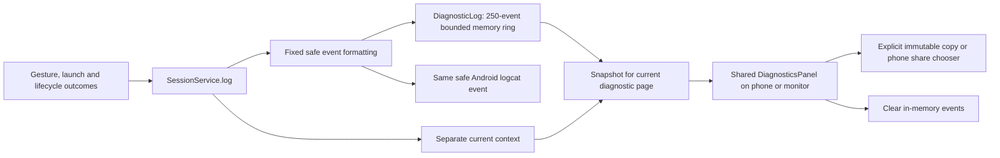
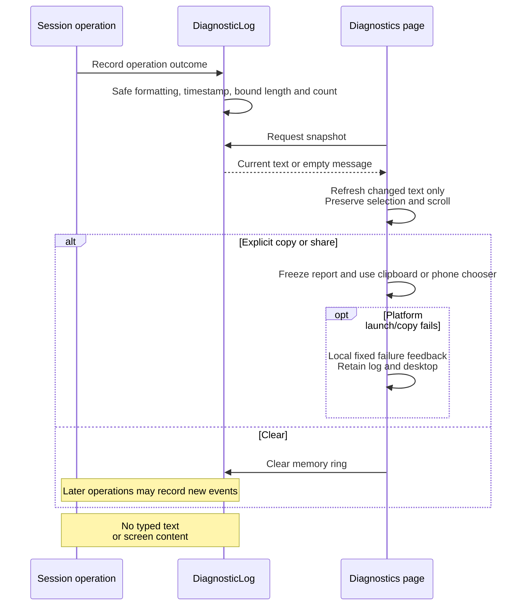

# Diagnostics and status visibility

[Code map and atlas](../README.md) | [Owning contract](../../specs/diagnostics.md)

## Scope and source

DiagnosticLog keeps at most 250 timestamped, length-bounded in-memory events.
Its safe formatting boundary discards arbitrary suffixes and retains only fixed
diagnostic reasons and allowed numeric/navigation fields. SessionService sends
the same safe event to logcat and exposes a report with separate current context.
Shared DiagnosticsPanel owns Copy/Share/Clear and local export feedback; both
screens retain existing menu lifetime/refresh cleanup. No new worker, probe,
privileged interface, persistence or automatic network/file export is introduced.

Source entry points: [DiagnosticLog.kt](../../../app/src/main/kotlin/dev/dexdroid/DiagnosticLog.kt); [SessionService.kt](../../../app/src/main/kotlin/dev/dexdroid/SessionService.kt); [MainActivity.kt](../../../app/src/main/kotlin/dev/dexdroid/MainActivity.kt); [MonitorShell.kt](../../../app/src/main/kotlin/dev/dexdroid/MonitorShell.kt). Read current symbols and requirement checks
before changing behavior; this page is a high-level map, not an exhaustive call graph.
Shared presentation: [DiagnosticsPanel.kt](../../../app/src/main/kotlin/dev/dexdroid/DiagnosticsPanel.kt).

## Component overview

## Representative sequence

## Change and verification boundaries

Do not expand logs to typed/screen content or unbounded storage. A registered gesture event differs from successful remote effect; retain failure results and correlate source/configuration externally for acceptance. Debug raw ADB evidence is separate from the content-free product log.
The report does not attach the current session identity to earlier worker events:
current context is explicitly separate; event-specific display IDs are retained
only when captured by their producer. Clearing history changes no pending work.
Share is user initiated ACTION_SEND text/plain via the display-0 chooser; cancellation
does not mutate session state. Menu close removes existing refresh callbacks.

See [requirements and explicit gaps](../../requirements.json). Diagram arrows
describe current responsibilities/intended paths, not successful runtime verification.
