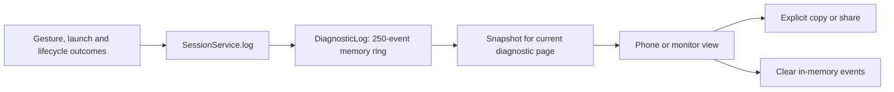
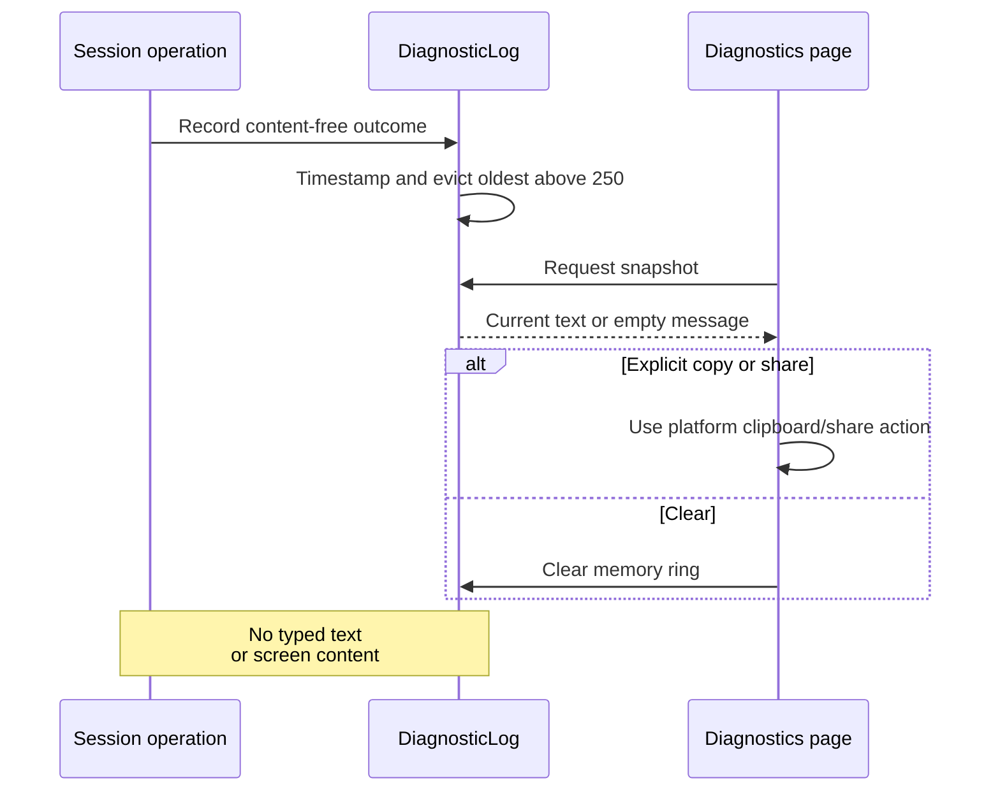

# Diagnostics and status visibility

[Code map and atlas](../README.md) | [Owning contract](../../specs/diagnostics.md)

## Scope and source

DiagnosticLog keeps at most 250 timestamped in-memory events. SessionService records outcomes and exposes a snapshot. Phone/monitor menus share readable status and explicit copy/share/clear actions.

Source entry points: [DiagnosticLog.java](../../../app/src/main/java/dev/dexdroid/DiagnosticLog.java); [SessionService.java](../../../app/src/main/java/dev/dexdroid/SessionService.java); [MainActivity.java](../../../app/src/main/java/dev/dexdroid/MainActivity.java); [MonitorShell.java](../../../app/src/main/java/dev/dexdroid/MonitorShell.java). Read current symbols and requirement checks
before changing behavior; this page is a high-level map, not an exhaustive call graph.

## Component overview

## Representative sequence

## Change and verification boundaries

Do not expand logs to typed/screen content or unbounded storage. A registered gesture event differs from successful remote effect; retain failure results and correlate source/configuration externally for acceptance. Debug raw ADB evidence is separate from the content-free product log.

See [requirements and explicit gaps](../../requirements.json). Diagram arrows
describe current responsibilities/intended paths, not successful runtime verification.
