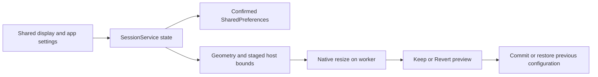
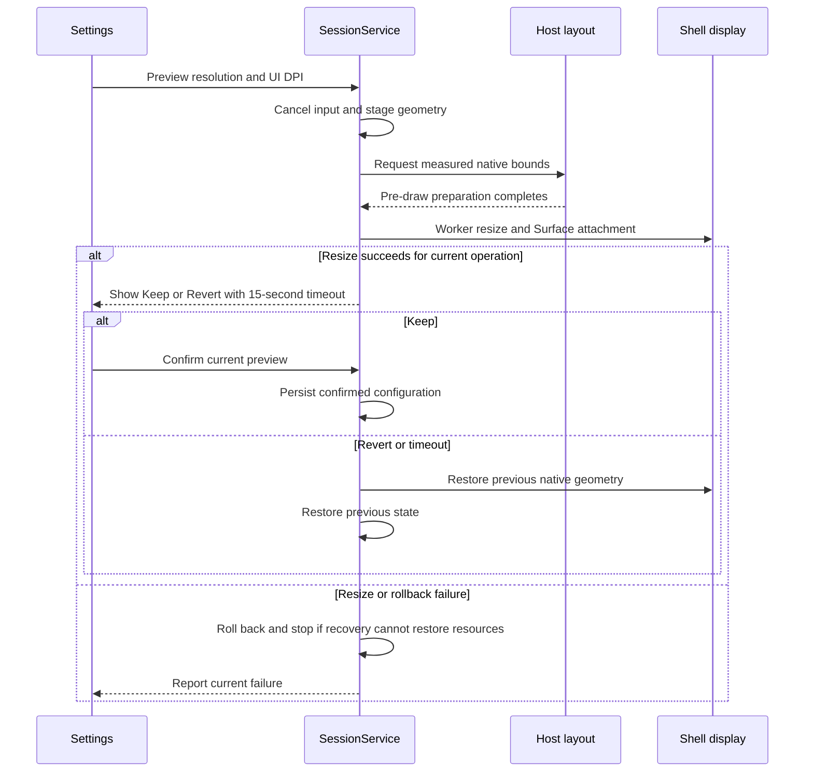

# Display configuration and per-app settings

[Code map and atlas](../README.md) | [Owning contract](../../specs/display-and-app-settings.md)

## Scope and source

SessionService owns selected output geometry, reversible display preview and per-app rotation/scroll preferences. Geometry maps both pixels and input; physical signal modes, rendering dimensions and UI DPI are distinct.

Source entry points: [SessionService.java](../../../app/src/main/java/dev/dexdroid/SessionService.java); [Geometry.java](../../../app/src/main/java/dev/dexdroid/Geometry.java); [DeskService.java](../../../app/src/main/java/dev/dexdroid/DeskService.java); [ControllerStyle.java](../../../app/src/main/java/dev/dexdroid/ControllerStyle.java). Read current symbols and requirement checks
before changing behavior; this page is a high-level map, not an exhaustive call graph.

## Component overview

## Representative sequence

## Change and verification boundaries

Persist only confirmed settings; configuration changes cancel pending picker/input work. Keep native buffer dimensions, transformed layout and hit mapping consistent. Signal-mode support remains OEM-dependent; resolution/Fit combinations require explicit verification, not inference from a mode list.

See [requirements and explicit gaps](../../requirements.json). Diagram arrows
describe current responsibilities/intended paths, not successful runtime verification.
