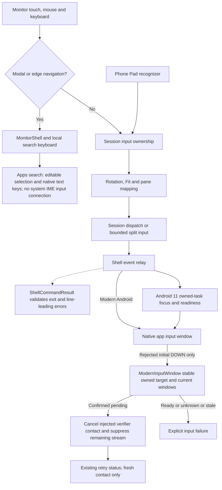
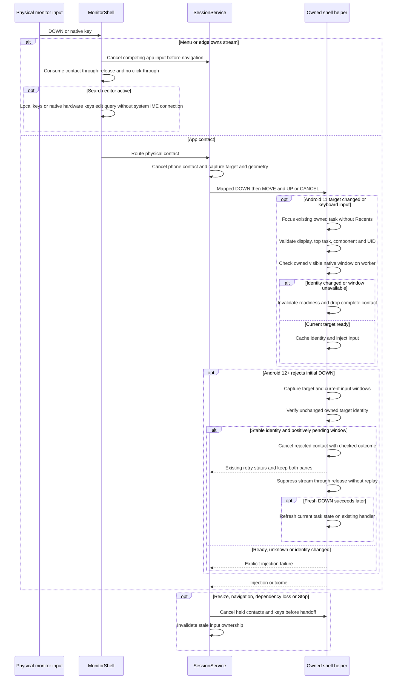
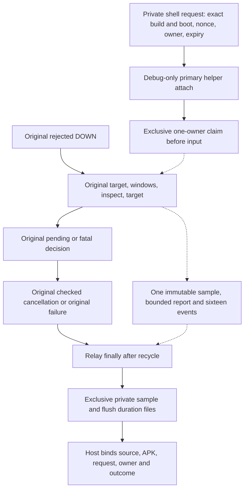
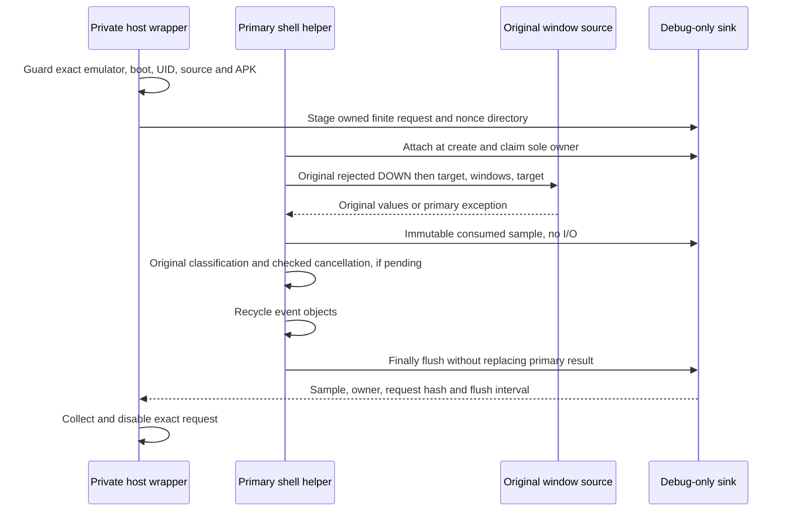
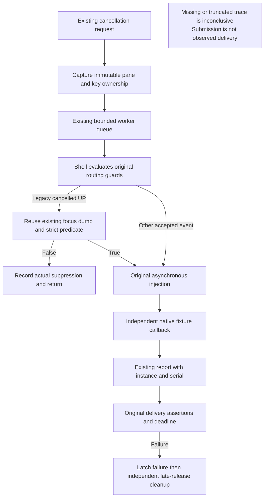
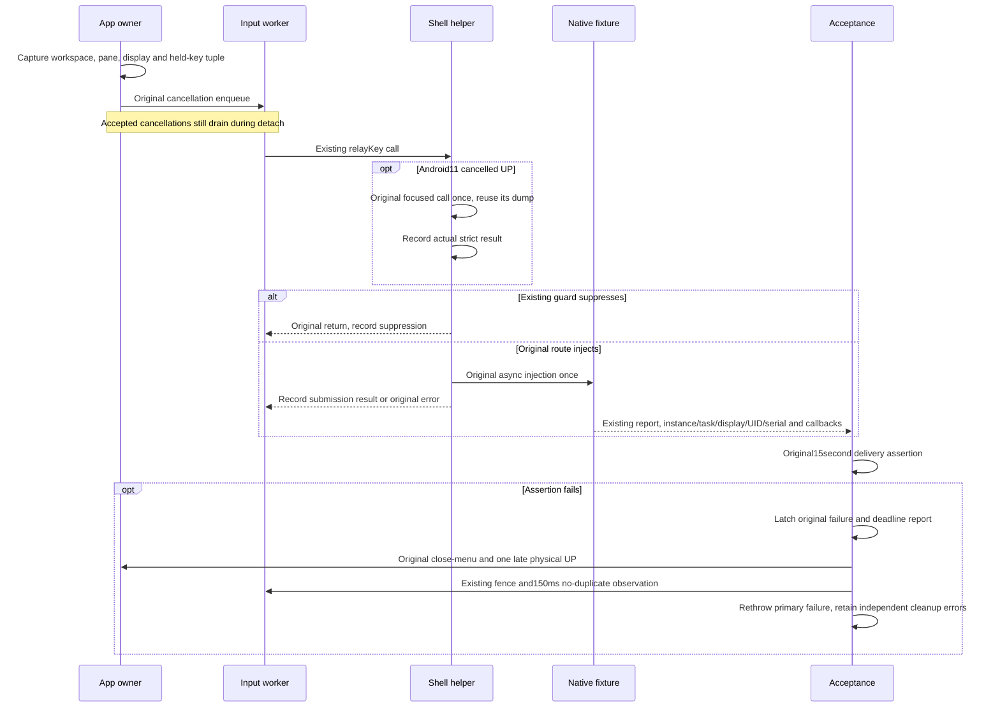

# Touchpad, monitor input, gestures and search

[Code map and atlas](../README.md) | [Owning contract](../../specs/input-and-navigation.md)

## Scope and source

The phone Pad recognizes gestures; SessionService arbitrates phone and physical input. MonitorShell owns modal/edge navigation. Complete native events cross the shell boundary; local monitor search edits its own field rather than mirroring arbitrary-app IME.

Source entry points: [MainActivity.kt](../../../app/src/main/kotlin/dev/dexdroid/MainActivity.kt); [SessionService.kt](../../../app/src/main/kotlin/dev/dexdroid/SessionService.kt); [MonitorShell.kt](../../../app/src/main/kotlin/dev/dexdroid/MonitorShell.kt); [Geometry.kt](../../../app/src/main/kotlin/dev/dexdroid/Geometry.kt); [InputEvents.kt](../../../app/src/main/kotlin/dev/dexdroid/InputEvents.kt); [MonitorSearchKeyboard.kt](../../../app/src/main/kotlin/dev/dexdroid/MonitorSearchKeyboard.kt). Read current symbols and requirement checks
before changing behavior; this page is a high-level map, not an exhaustive call graph.

## Component overview

## Representative sequence

## Change and verification boundaries

Fit bars reject touches; physical contact wins over phone input and hides the pointer. Preserve pointer IDs, down-times, key ownership and cancellation ordering. Android 11 focus arbitration is separate from modern independent focus. The generic session queue is not globally bounded; only the split queue has an explicit 64-event bound.

[LegacyInputWindow.kt](../../../app/src/main/kotlin/dev/dexdroid/LegacyInputWindow.kt)
focuses an existing task without Recents activation. Native child/Up/Back navigation
must preserve phone foreground choice; root exit clears only that pane. Readiness
queries remain off the UI thread. Legacy key admission does not require the ROM
FocusedWindows list to include the native display: targeted keys can be delivered
while it names only the phone. Keyboard input still focuses and revalidates the
owned task. Cancellation ownership uses the separate strict focused() predicate. The polling deadline is not a strict end-to-end
latency limit because native queries have their own bounds.

[ModernInputWindow.kt](../../../app/src/main/kotlin/dev/dexdroid/ModernInputWindow.kt)
and [ModernInputWindowState.kt](../../../app/src/main/kotlin/dev/dexdroid/ModernInputWindowState.kt)
diagnose only rejected initial DOWN on modern Android. They never focus a task or
cache readiness. Recognized complete display-window metadata plus stable top
task/component/UID allow pending recovery. Unknown/missing metadata stays fatal;
recovery before diagnosis may conservatively stay fatal too. A rejected DOWN can
retain dispatcher verifier state: cancel that exact injected stream before
suppressing its physical continuation, without replaying app input. Successful
fresh DOWN clears retry via the existing observer's current snapshot, not a cached
component. Stop releases per-helper state; resize first cancels app input.

MonitorShell's first Back hides served system IME and local keys and explicitly
focuses the non-editor root. Search query/editor survive; the next Back follows
the existing Activity/Presentation dispatch and menu stack. No global IME setting
or predictive-Back policy is changed. The noninteractive root disables default
focus highlight so retained focus cannot tint the composed desktop; actionable
controls retain normal feedback.

See [requirements and explicit gaps](../../requirements.json). Diagram arrows
describe current responsibilities/intended paths, not successful runtime verification.

## Debug-only rejected-DOWN capture

[ModernInputWindow](../../../app/src/main/kotlin/dev/dexdroid/ModernInputWindow.kt)
optionally reports its exact consumed target/window/target tuple to
[ModernInputDiagnostics](../../../app/src/debug/kotlin/dev/dexdroid/ModernInputDiagnostics.kt).
The latter is a development source, reflectively attached only in debug builds.
It binds one primary shell helper to one explicit synthetic API35 request and
accepts only the InputTest target, or partial null/exception paths. It never
changes classification, focuses, retries input or queries a second report.
The request/owner files are private local emulator diagnostics, not a product UI,
public evidence or persistent service. Other helpers/builds are unarmed. The
exclusive owner claim happens at create, before input; report I/O happens after
the relay's original routing/cancellation decisions. This may delay RPC return,
Stop or subsequent UP and is not timing-equivalence evidence. An expired,
missing, truncated or wrong-generation sample is inconclusive.

## Debug-only held-key diagnosis

[KeyDiagnostics](../../../app/src/main/kotlin/dev/dexdroid/KeyDiagnostics.kt)
records only synthetic fixture key sequences in debug builds, with128bounded
records including an explicit truncation marker. No text or unrelated window
names are recorded. This observes the existing routing; it does not fix the
Android11 hardware cancellation failure. Legacy focus diagnosis reuses the
existing dump; modern shell focus tracing is N/A. App queue and independent
fixture observations also run on the Android16 emulator.

The fixture caches one initial task identity query in onCreate; later task freshness
still belongs to existing nativeReady checks. Lifecycle logs activate at the synthetic
key sequence and include independently available destroy callbacks. The fixture
retains the last32content-free lifecycle/focus/key callbacks per
instance. Sequence down-times and each event-time are fresh. During key acceptance,
reports from a different instance/task/display/UID or older serial cannot replace
the bound observation; these reported fields are diagnostic metadata, not sender
authentication. Callback retention is checked against the sequence baseline.
Missing/truncated evidence prevents a conclusive diagnosis, never converts a
failed assertion into a pass. Instrumented performance is diagnostic only.
