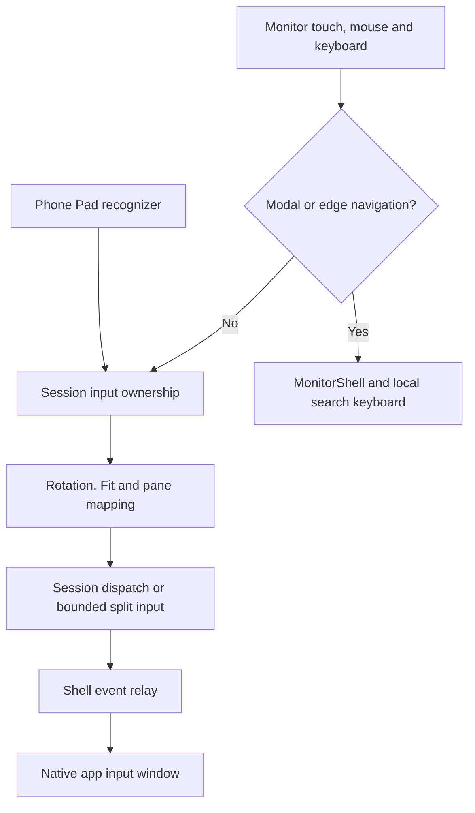
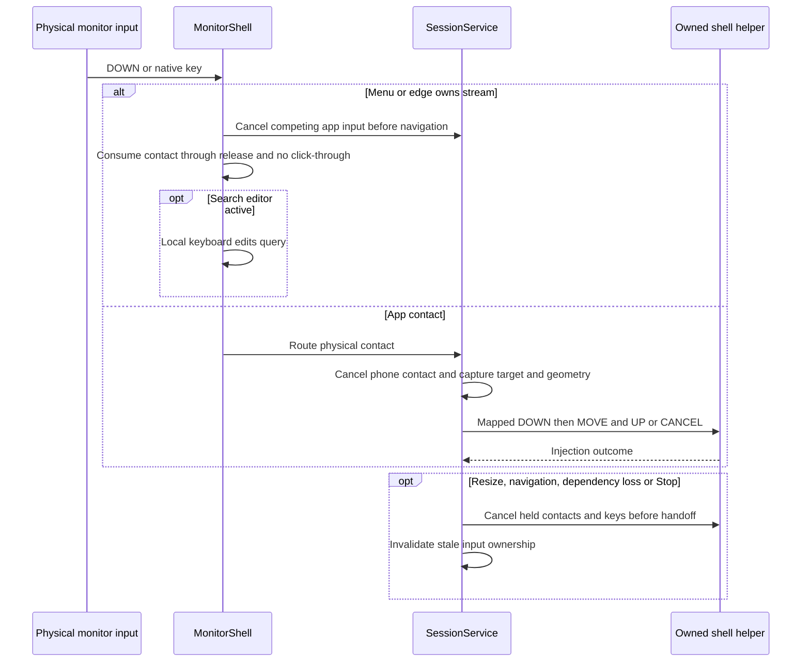

# Touchpad, monitor input, gestures and search

[Code map and atlas](../README.md) | [Owning contract](../../specs/input-and-navigation.md)

## Scope and source

The phone Pad recognizes gestures; SessionService arbitrates phone and physical input. MonitorShell owns modal/edge navigation. Complete native events cross the shell boundary; local monitor search edits its own field rather than mirroring arbitrary-app IME.

Source entry points: [MainActivity.java](../../../app/src/main/java/dev/dexdroid/MainActivity.java); [SessionService.java](../../../app/src/main/java/dev/dexdroid/SessionService.java); [MonitorShell.java](../../../app/src/main/java/dev/dexdroid/MonitorShell.java); [Geometry.java](../../../app/src/main/java/dev/dexdroid/Geometry.java); [InputEvents.java](../../../app/src/main/java/dev/dexdroid/InputEvents.java); [MonitorSearchKeyboard.java](../../../app/src/main/java/dev/dexdroid/MonitorSearchKeyboard.java). Read current symbols and requirement checks
before changing behavior; this page is a high-level map, not an exhaustive call graph.

## Component overview

## Representative sequence

## Change and verification boundaries

Fit bars reject touches; physical contact wins over phone input and hides the pointer. Preserve pointer IDs, down-times, key ownership and cancellation ordering. Android 11 focus arbitration is separate from modern independent focus. The generic session queue is not globally bounded; only the split queue has an explicit 64-event bound.

See [requirements and explicit gaps](../../requirements.json). Diagram arrows
describe current responsibilities/intended paths, not successful runtime verification.
