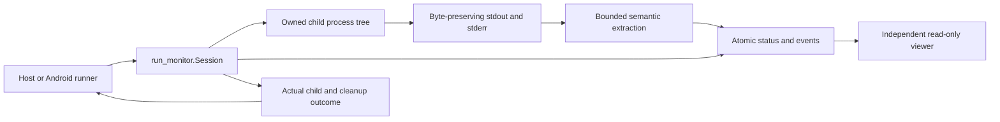
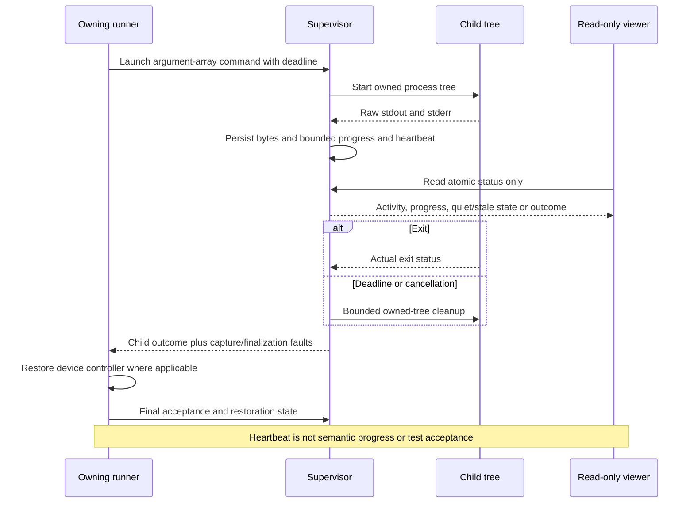

# Local command supervision and observation

[Code map and atlas](../README.md) | [Owning contract](../../specs/local-monitoring.md)

## Scope and source

The runner owns acceptance and device restoration. run_monitor.Session owns launched child lifetime, raw output, bounded extraction/status and deadlines; its read-only viewer does not launch, retry or cancel work. Device suite data and supervisor data occupy separate namespaces.

Source entry points: [Supervisor](../../../tools/run_monitor.py); [Device runner](../../../tools/run_device_checks.py). Read current symbols and requirement checks
before changing behavior; this page is a high-level map, not an exhaustive call graph.

## Component overview

## Representative sequence

## Change and verification boundaries

Sources: tools/run_monitor.py and tools/run_device_checks.py. Legacy suites may buffer assertions; unknown progress stays unknown. Capture/finalization/restore faults cannot certify a pass. This is local observation, not a paid monitoring backend, model telemetry collector or automatic retry loop.

See [requirements and explicit gaps](../../requirements.json). Diagram arrows
describe current responsibilities/intended paths, not successful runtime verification.
