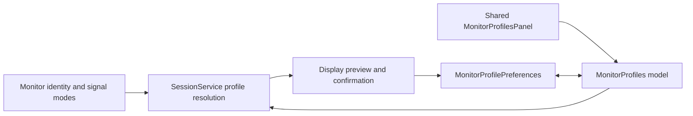
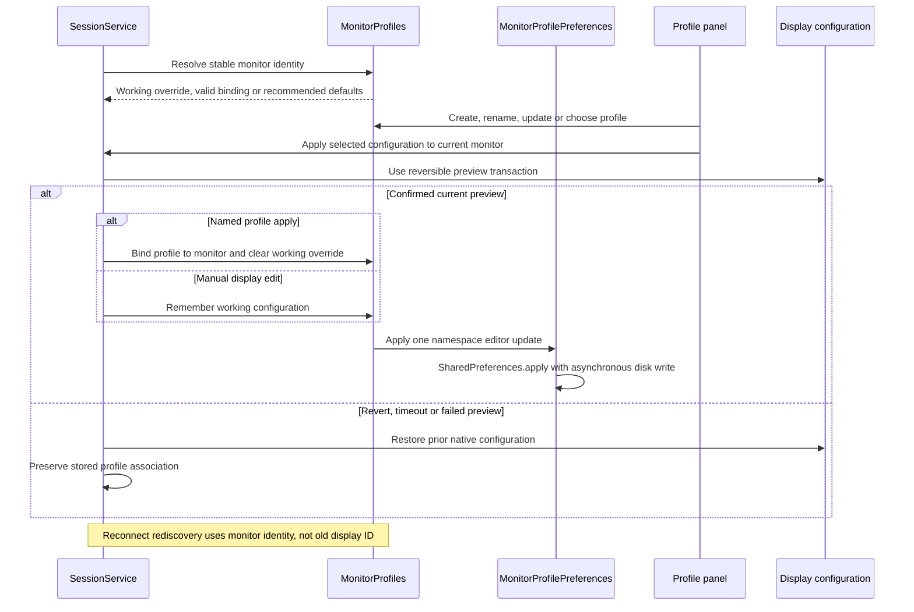

# Named monitor profiles and remembered bindings

[Code map and atlas](../README.md) | [Owning contract](../../specs/monitor-profiles.md)

## Scope and source

MonitorProfiles is the pure profile/binding model; MonitorProfilePreferences applies its namespace in one SharedPreferences editor operation; disk persistence is asynchronous. SessionService resolves discovered monitor identity, working configuration and apply/preview lifecycle. Display IDs are never persistent monitor identity.

Source entry points: [MonitorProfiles.java](../../../app/src/main/java/dev/dexdroid/MonitorProfiles.java); [MonitorProfilePreferences.java](../../../app/src/main/java/dev/dexdroid/MonitorProfilePreferences.java); [MonitorProfilesPanel.java](../../../app/src/main/java/dev/dexdroid/MonitorProfilesPanel.java); [SessionService.java](../../../app/src/main/java/dev/dexdroid/SessionService.java). Read current symbols and requirement checks
before changing behavior; this page is a high-level map, not an exhaustive call graph.

## Component overview

## Representative sequence

## Change and verification boundaries

Validate names and missing/deleted bindings; rejected previews retain the stored association. SharedPreferences.apply does not acknowledge durable disk success, so this sequence does not promise synchronous persistence-failure reporting. Monitor identity fallback and port/adapter changes can require reassignment. Profile confirmation uses existing display preview behavior rather than inventing another resize path.

See [requirements and explicit gaps](../../requirements.json). Diagram arrows
describe current responsibilities/intended paths, not successful runtime verification.
