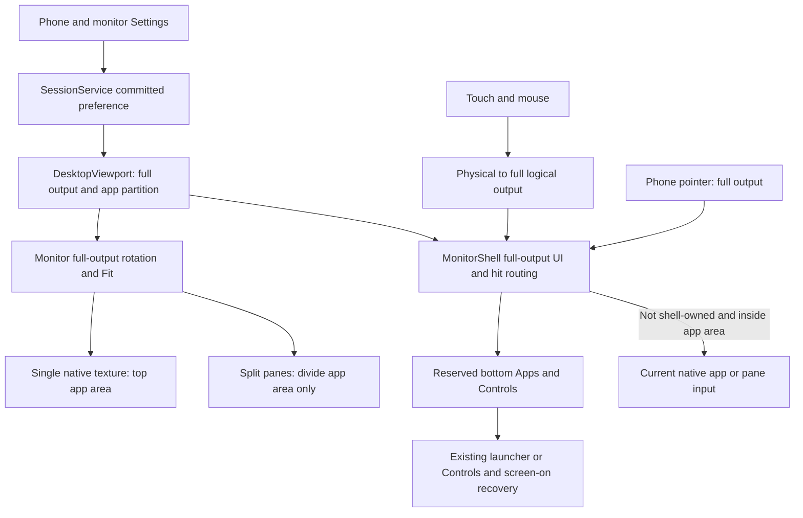
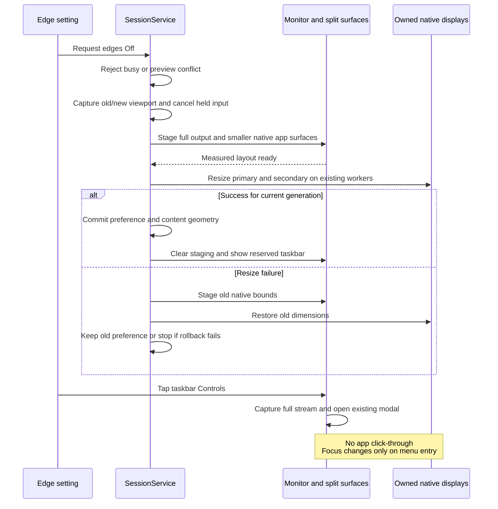

# Reserved monitor taskbar

[Contract](../../specs/monitor-taskbar.md) | [Code map](../README.md)

## Scope and source

FR-045 / DX-TASKBAR-001 adds monitor navigation without edge gestures. User chose
reserved bottom space. Fresh expert `/root/reserved_taskbar_arch` approved this
contract at 2026-11-13T16:42:30Z; this is architecture preflight, not acceptance.

[DesktopViewport](../../../app/src/main/kotlin/dev/dexdroid/DesktopViewport.kt)
partitions full output into top-aligned app content and a bottom strip when edges
are Off: round(4% × min(output width,output height)), independent of app DPI.
MonitorShell passes this pixel height to icon-only controls; targets, glyphs and
spacing use that same scale, including on reappearance after geometry changes;
the partition and transaction ownership stay unchanged.
[SessionService](../../../app/src/main/kotlin/dev/dexdroid/SessionService.kt)
owns committed preferences and native display resize. `width()/height()` retain
full-output semantics for Geometry/Fit, shell, cursor and phone normalization;
`appWidth()/appHeight()` define native content. No derived dimensions persist in
monitor profiles. [MonitorShell](../../../app/src/main/kotlin/dev/dexdroid/MonitorShell.kt)
owns [MonitorTaskbar](../../../app/src/main/kotlin/dev/dexdroid/MonitorTaskbar.kt)
and all shell input. [SplitWorkspace](../../../app/src/main/kotlin/dev/dexdroid/SplitWorkspace.kt)
divides only content, while mapping physical points through full output first.
[IdleDesktop](../../../app/src/main/kotlin/dev/dexdroid/IdleDesktop.kt) hides its
Apps child independently from its background using one shared preference.

## Component overview

## Representative sequence

## Change and verification boundaries

Native texture height and native display height must agree; cropping a full-height
buffer is outside this design. Staging separates full-output transform dimensions
from native content measurements. Edge changes use the existing fenced resize,
generation guards and rollback; stopped preference changes apply on next create.

Physical inverse mapping always uses full output. Shell routing precedes app-touch
enablement and app admission. App contacts crossing out of content cancel and
cannot resume without a fresh Down; taskbar contacts retain shell ownership through
release/cancel. The entire strip consumes input, including blank space. Generic
mouse/wheel paths also enter shell routing before the split path. Menus remain
modal with existing keyboard-first Back, Up, Close and outside dismissal.

Phone-screen restore remains in Controls even when its optional button preference
is Off. Taskbar visibility depends on edge navigation alone. No Power interception,
new IPC/worker, root permission or global keyboard shortcut is introduced.

Required evidence: exact native content sizes, actual bottom app input, single and
split/maximum layout, four rotations/Fit, touch/pointer/mouse and cancelled streams,
toggle rollback, empty backgrounds, keyboard/focus and screen-on recovery. Unrun
dimensions remain gaps; source diagrams do not establish runtime correctness.
