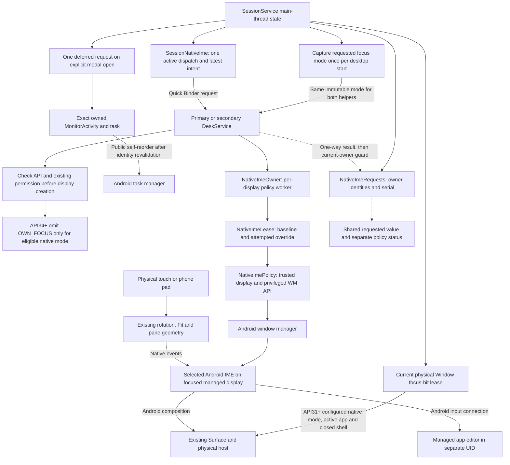
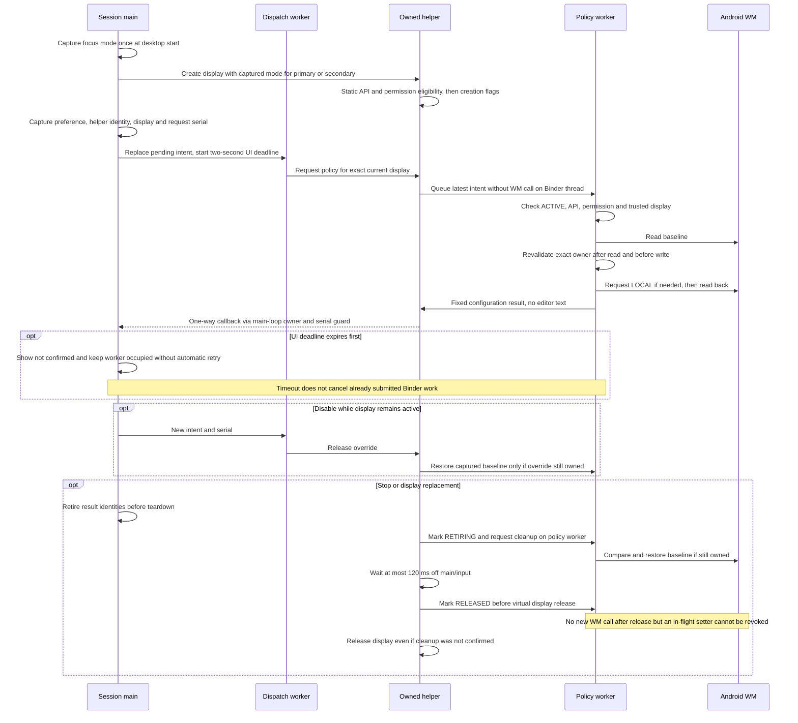
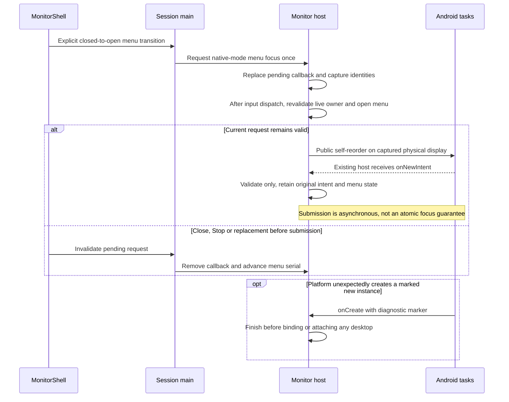

# Native monitor keyboard

[Code map](../README.md) | [Contract](../../specs/native-monitor-keyboard.md) |
[Current change and acceptance](../../changes/native-monitor-keyboard.md)

## Scope and owners

The selected Android IME renders on a trusted managed app display and edits that
app through Android's normal input connection. DexDroid requests placement; it
does not capture the phone keyboard or relay typed text. Local Apps search and
profile-name keys remain separate. Policy readback is configuration evidence,
not proof that a keyboard is visible or that typing reached an editor.

Source owners:
[SessionService](../../../app/src/main/kotlin/dev/dexdroid/SessionService.kt),
[SplitWorkspace](../../../app/src/main/kotlin/dev/dexdroid/SplitWorkspace.kt),
[SessionNativeIme](../../../app/src/main/kotlin/dev/dexdroid/SessionNativeIme.kt),
[NativeImeRequests](../../../app/src/main/kotlin/dev/dexdroid/NativeImeRequests.kt),
[DeskService](../../../app/src/main/kotlin/dev/dexdroid/DeskService.kt),
[NativeImePolicy](../../../app/src/main/kotlin/dev/dexdroid/NativeImePolicy.kt),
[NativeImeOwner](../../../app/src/main/kotlin/dev/dexdroid/NativeImeOwner.kt),
[NativeImeLease](../../../app/src/main/kotlin/dev/dexdroid/NativeImeLease.kt),
[NativeImeHostFocus](../../../app/src/main/kotlin/dev/dexdroid/NativeImeHostFocus.kt),
[MonitorActivity](../../../app/src/main/kotlin/dev/dexdroid/MonitorActivity.kt),
[IDeskService](../../../app/src/main/aidl/dev/dexdroid/IDeskService.aidl) and
[one-way result](../../../app/src/main/aidl/dev/dexdroid/IKeyboardPolicyListener.aidl).

## Component overview

No per-key Binder configuration, text queue or polling loop is introduced. Android
owns IME insets inside the virtual display; DexDroid continues mapping the full
display surface. A single native IME normally follows the focused editor, including
between split panes. The platform and keyboard determine final presentation.

`SessionService.nativeKeyboardFocusMode` captures the requested preference once
when starting a desktop. Primary recreation and `SplitWorkspace` use that same
value; changing the preference cannot create two panes with different requested
focus contracts. Each shell helper statically resolves both WM method signatures
and checks its existing permission before creating the display, without WM IPC.
On API34+, eligible native mode omits OWN_FOCUS so the native IME follows the
globally focused editor when switching panes. Ordinary mode retains OWN_FOCUS;
Android11 retains all original flags. Trust and actual policy read/write/readback
still require the separate worker. Static eligibility cannot predict OEM policy
rejection or globally enabled per-display focus.

An ordinary API34+ desktop cannot change that creation flag in place. Enabling
the preference reports "Applies on next desktop start" until a user-initiated
Stop/Start creates the new mode. No running app is silently restarted. Off releases
the policy now; the created focus contract remains until the next desktop start.
The authorized release retains this implemented application behavior and the Off
default for missing preferences; stored user choices are preserved.

On API31+, the current closed physical host leases FLAG_NOT_FOCUSABLE only while a
managed app and configured native placement exist. Physical touches still relay;
the host no longer takes global IME focus when the contact is aimed at a native
keyboard key. SessionService validates the exact shell/window identity and releases
the bit for menus, idle, disable, Stop and replacement. Main owns these window
operations. The shell close animation must finish consuming its stream before
passive hosting resumes. Other window flags remain untouched. Hardware keys then
use Android's focused-app route rather than closed-host relay; split/modifier/
cancelled-release behavior needs its own evidence. Android11/unavailable paths do
not acquire this focus lease. Both host types use monitorWindow(); a shared code
path is not proof of acceptance on an untested Presentation/OEM.

Restoring a focusable flag alone does not bring global hardware input to a menu.
For the Activity host, an explicit closed→open transition schedules one public
REORDER_TO_FRONT/NO_ANIMATION self-start after originating input dispatch. It
revalidates exact Activity/window/task/display/generation/token/menu serial and
native-mode eligibility. There is no SINGLE_TOP, new-task/multiple-task flag,
periodic request, input replay or retry. Close, destruction and Stop invalidate
the pending callback. An unexpected marked new instance finishes before service
binding; onNewIntent never adopts the request as the original host identity or
reopens a menu. Accepted Activity starts are asynchronous and cannot be revoked.
The actual focused Window and pre-touch key destination require device evidence.
Presentation hosts have no Activity task and remain unverified for this handoff.

## Request and cleanup sequence

## Compatibility and failure boundaries

### Modal focus sequence

API31+ uses `getDisplayImePolicy`/`setDisplayImePolicy` with LOCAL=0 after checking
the existing shell permission and trusted display. Both methods resolve before
mutation. Android11 reports unavailable and retains existing desktop routing;
this feature does not add trusted flags or permission grants there. OEM rejection,
missing APIs and mismatched readback are optional feature failures, never reasons
to stop an otherwise usable desktop. A two-second feedback deadline is not a
native-call cancellation guarantee.

Each disposable display owns its lease and worker. Restoration compares current
policy with DexDroid's attempted override and preserves later external changes.
A timed-out or dead helper leaves cleanup unconfirmed; display destruction still
proceeds. Released-owner and post-read guards prevent new operations on a reused
display ID, but cannot revoke an already submitted platform call. No global IME,
default keyboard, developer settings or persistent permission grants change.

The app IME may remain dimmed behind an open shell menu. The modal shell owns
every contact: outside tapping dismisses without typing into the keyboard behind
it. Retapping the app editor after closing restores native typing. Existing local
launcher/name keys remain independent. Restoring host focus eligibility alone is
not proof of global focus, keyboard disappearance or hardware key destination.

## Verification boundaries

[NativeImeLeaseTest](../../../app/src/test/kotlin/dev/dexdroid/NativeImeLeaseTest.kt),
[NativeImeOwnerTest](../../../app/src/test/kotlin/dev/dexdroid/NativeImeOwnerTest.kt)
and [NativeImeRequestsTest](../../../app/src/test/kotlin/dev/dexdroid/NativeImeRequestsTest.kt)
cover pure ownership, partial outcomes, readback, rollback and blocked-worker cases.
[NativeImeAcceptance](../../../app/src/androidTest/kotlin/dev/dexdroid/NativeImeAcceptance.kt)
uses a separate-UID editor, actual selected IME accessibility keys, physical host
contacts and observable text changes. It waits for opening-animation key bounds
to settle within the current managed display; an accessibility node existing
outside that display is not a touchable key. Current runs, failures, visual review
and exclusions belong to the linked change record. Diagrams establish no runtime pass.
