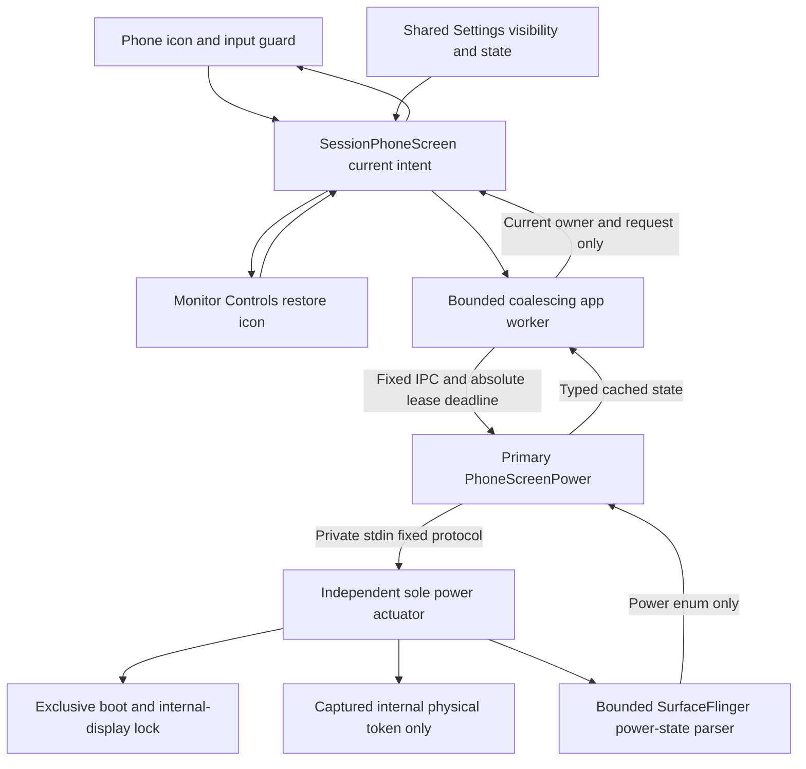
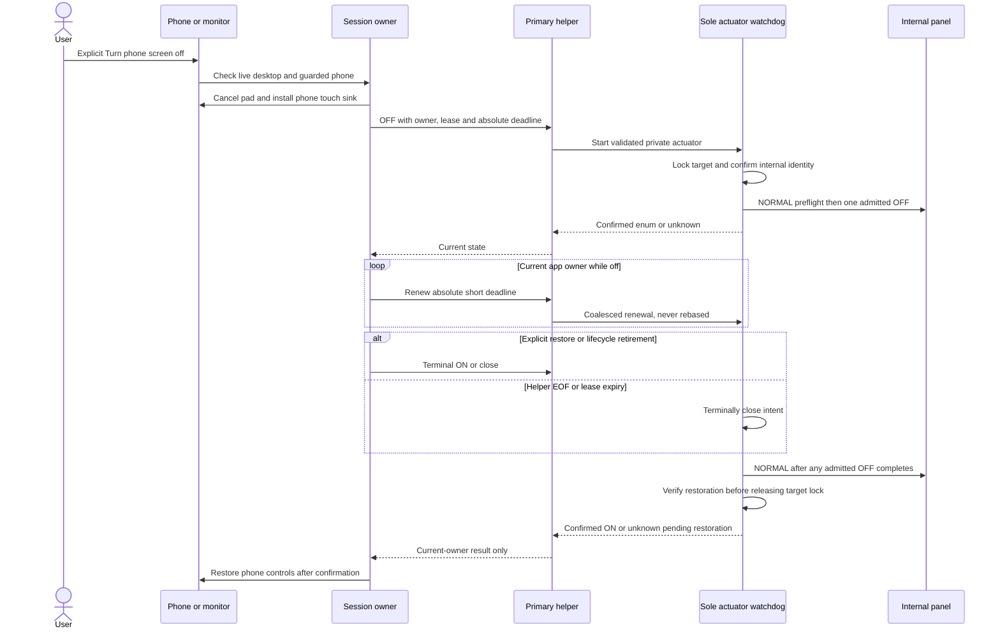

# Phone screen power

[Code map](../README.md) | [Contract](../../specs/phone-screen-power.md)

## Scope and source

FR-044 / DX-PANEL-001 is implemented with focused Xiaomi Android 16 acceptance;
other OS/ROM coverage and human visual acceptance remain open. Session-only
off intent and identity stay in memory; only Show phone screen button persists.
The user approved true panel off with monitor-button recovery after physical
double-tap and Power trials failed on Xiaomi Android 16. Neither gesture ships.

With edge navigation Off, [reserved taskbar Controls](monitor-taskbar.md) provides
the same restore entry without a top-edge swipe. Its visibility and restoration
are independent of centered Apps and optional phone-screen button preferences.

Owners: [SessionService](../../../app/src/main/kotlin/dev/dexdroid/SessionService.kt)
and SessionPhoneScreen coordinate main-thread state and a bounded worker;
MainActivity installs the phone input guard. PhoneScreenButton/PhoneScreenPanel
render shared state on phone and monitor. PhoneScreenPower is primary-helper-only;
PhoneScreenWatchdog is a separate shell-UID process and the sole power actuator.
IDeskService carries fixed commands and typed state, not arbitrary shell text.

## Component overview

## Representative sequence

## Change and verification boundaries

Fresh expert `/root/panel_product_arch` approved this approach on 2026-11-13.
All actuator power writes are serialized. CLOSE/EOF/expiry permanently prohibit
later OFF; a late native OFF is followed by NORMAL from the same owner. Retain the
exclusive target lock through native stalls or unconfirmed restoration. App
timeouts are unknown, not cleanup success. No watchdog kill on client timeout.
No helper-generated heartbeat: app-main absolute deadlines expire on app stalls.

Restore cannot depend on monitor presence or current desktop eligibility. Helper
owner death/destroy/Stop latch close before other cleanup locks. Phone controller
pause/guard loss restores without changing ordinary background desktop support.
Readback exports no dump/layer/app data and rejects truncation/ambiguity. Missing
hidden APIs or unsupported format make this optional feature unavailable.

Deterministic host policy/protocol/readback checks and real Xiaomi tests are
required for explicit restore, Stop, disconnect, controller loss, app/helper death
and stale work. Four monitor rotations/Fit/menu/input remain affected selection
dimensions. Android 11 and other ROMs are unverified until exercised. A hung OS
compositor or simultaneous termination of all shell processes prevents a promised
finite recovery time; no lock/security settings are altered to hide that limit.

Every result has a complete typed six-field schema and exact positive request
lease. CHECK confirms On with boot/internal-physical receipt. The app stores that
immutable receipt before asking OFF; the watchdog rejects a changed identity
before any power write. Replacement-helper ON accepts only the same receipt and
cannot introduce OFF. Unavailable responses never clear an outstanding possible
OFF. Automatic restore is idempotent; explicit retry is a separate intent. Guard
admission waits for its current visible, laid-out, attached full-bounds touch-modal
window, and detach/dismiss/Pause restores; a stale ready
callback after Pause/Stop/cancellation cannot power off.

The real device rejects a global-keyboard-focus admission rule while the monitor
is active. Architecture review approved using actual modal pointer ownership
instead: keyboard focus is independent of touch hit testing. Native phone contact
checks before OFF and while dark must show no pad/button forwarding. This does
not intercept Android's system overlays or reserved gestures; global monitor focus
changes alone are not loss of the phone touch sink. Renewal checks guard validity.

After primary-helper loss, SessionService permits one already-authorized Shizuku
reconnect attempt per recovery lease. SessionPhoneScreen changes only the transport
and logical routing ID: boot, physical target, owner and positive lease remain
immutable. A replacement helper can construct a restore-only adapter before its
desktop exists; that adapter cannot admit OFF. The independent child remains the
first restoration path. Real helper-kill and app-force-stop checks observed internal
On/external On; these do not establish broker-death or compositor-stall recovery.
