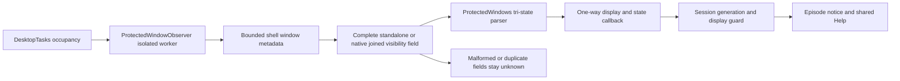
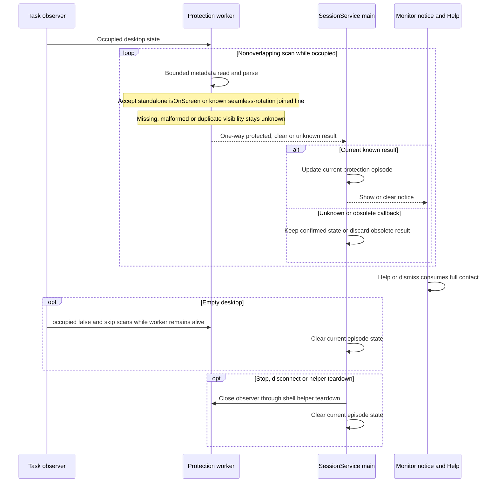

# Protected-content detection and guidance

[Code map and atlas](../README.md) | [Owning contract](../../specs/protected-content.md)

## Scope and source

The shell observes visible secure-window metadata only while its desktop is occupied. It emits a three-state result through IDesktopListener. SessionService owns notice state; shared guide text neither identifies Chrome mode nor changes protection flags.

Source entry points: [ProtectedWindowObserver.kt](../../../app/src/main/kotlin/dev/dexdroid/ProtectedWindowObserver.kt); [ProtectedWindows.kt](../../../app/src/main/kotlin/dev/dexdroid/ProtectedWindows.kt); [DeskService.kt](../../../app/src/main/kotlin/dev/dexdroid/DeskService.kt); [SessionService.kt](../../../app/src/main/kotlin/dev/dexdroid/SessionService.kt); [ProtectedScreenGuide.kt](../../../app/src/main/kotlin/dev/dexdroid/ProtectedScreenGuide.kt). Read current symbols and requirement checks
before changing behavior; this page is a high-level map, not an exhaustive call graph.

## Component overview

## Representative sequence

## Change and verification boundaries

Never retain window content, titles, URLs or screenshots in product detection. Metadata denial is unknown, not proof of no protection. The notice owns only its hit region; modal Help/outside dismissal cannot click through. Browser flags remain a user-controlled troubleshooting choice.

Android14's native dump can join `isOnScreen` to its seamless-rotation diagnostic.
The parser accepts that complete field and the legacy standalone form. It requires
one unambiguous field per window; malformed/truncated/duplicate/conflicting tokens
stay unknown. Current-display, surfaced-window and secure-flag checks remain
independent. This does not identify incognito or enable secure capture.

See [requirements and explicit gaps](../../requirements.json). Diagram arrows
describe current responsibilities/intended paths, not successful runtime verification.
