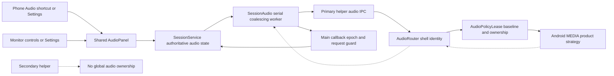
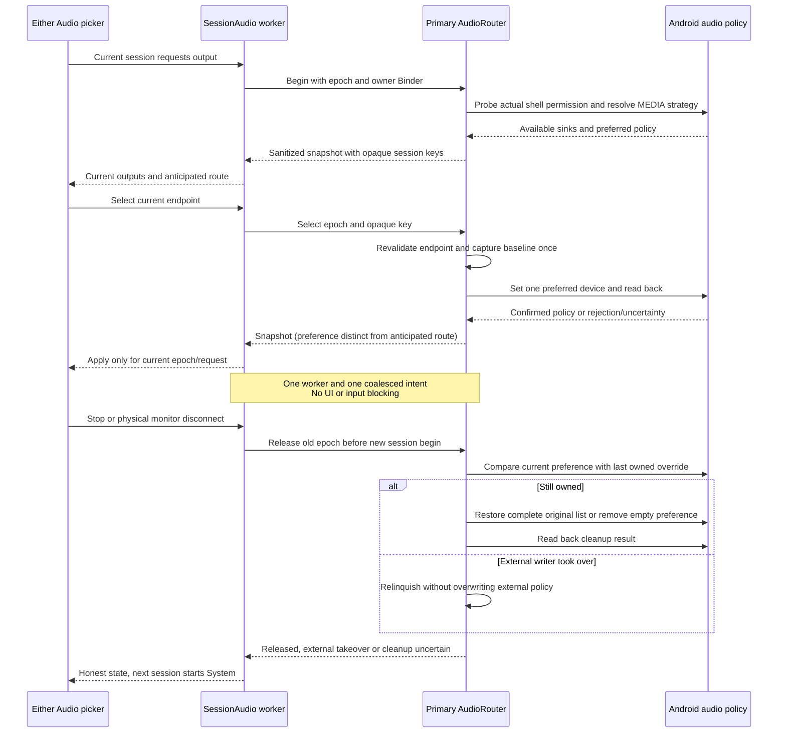

# Session media output

[Code map](../README.md) | [Contract](../../specs/session-audio.md)

## Scope and source

This is phone-wide default MEDIA policy, not per-display audio isolation. Android
product strategy APIs are hidden/privileged and capability-gated. Source:
[SessionAudio](../../../app/src/main/kotlin/dev/dexdroid/SessionAudio.kt),
[AudioRouter](../../../app/src/main/kotlin/dev/dexdroid/AudioRouter.kt),
[AudioPolicyLease](../../../app/src/main/kotlin/dev/dexdroid/AudioPolicyLease.kt),
[SessionAudioState](../../../app/src/main/kotlin/dev/dexdroid/SessionAudioState.kt),
[AudioPanel](../../../app/src/main/kotlin/dev/dexdroid/AudioPanel.kt),
[IDeskService](../../../app/src/main/aidl/dev/dexdroid/IDeskService.aidl).
SessionService starts audio after a current primary display attaches and ends it
at desktop teardown. Display resize and split-secondary lifetime do not own it.

## Component overview

## Representative sequence

## Failure and lifetime boundaries

Privileged calls clear/restore incoming Binder identity. A dedicated app audio
worker performs synchronous audio IPC, not the UI, session-input or split worker.
It retains one desired session, one coalesced pending selection/refresh and one
in-flight operation. New sessions release a captured old helper before beginning.
Main callbacks reject obsolete serial/epoch/target results. Stop cannot cancel an
already-executing system Binder call; serial cleanup compensates afterward. A failed old end retains its actual epoch
for retry before any replacement begin; errors stop the drain until a new intent
or poll rather than spinning.

Only DeskService's exact primary class admits audio IPC. Its display `stop()` is
not audio session end: `create()` calls that method and secondary inherits it.
Explicit helper destruction attempts audio cleanup. The independent audio owner
Binder also attempts cleanup on app-owner death while the helper survives.
Platform preferred strategy state has no death-token or atomic compare-and-set.
A helper killed first can strand an override; recovery may require Android sound
settings or reboot. No guaranteed crash rollback or cross-process recovery journal.

Endpoint addresses stay private inside the helper. Opaque keys are session-local;
current type/address (or current port fallback) is revalidated, never persisted.
Polling coalesces every two seconds; selected endpoint removal releases the owned
override and follows System without automatic reselection. External preferred
policy takeover similarly relinquishes ownership. Calls, microphone, casts and
explicit per-player routing are excluded. Anticipated route is not acoustic proof.

## Verification boundaries

Actual preflight `/root/audio_arch_preflight` approved the bounded approach and
Xiaomi API35 shell read access; [change record](../../changes/session-audio.md).
Host lease tests target original multi-device baseline, rejection, external writer
and failed cleanup. Focused device acceptance uses a separate-UID silent PCM
fixture and its actual routed device, plus shared menus/four rotations. It does
not establish audible sound, Bluetooth/connection-order behavior, all OEMs or
Android11/12 capability. Current outcomes remain separate from this diagram.
