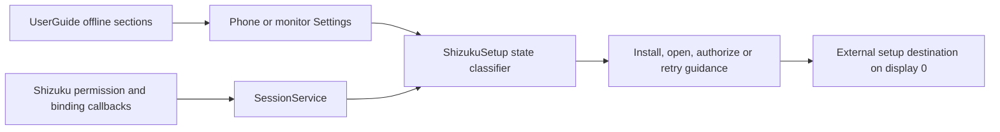
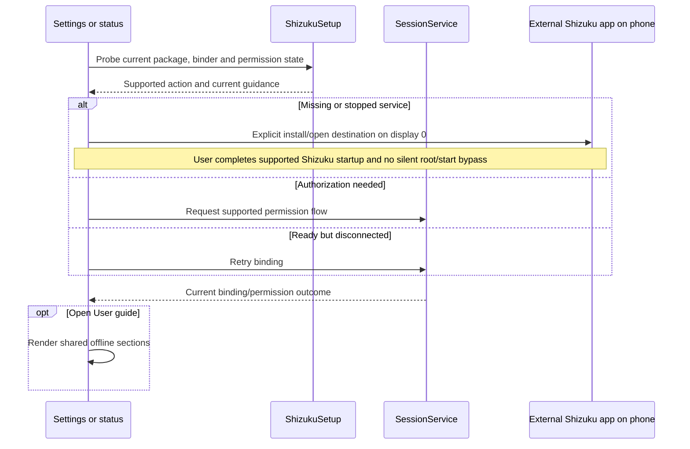
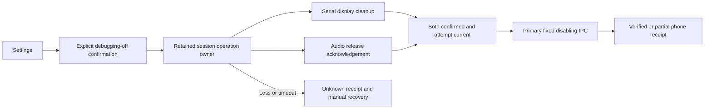

# Shizuku setup and offline guide

[Code map and atlas](../README.md) | [Owning contract](../../specs/setup-and-guide.md)

## Scope and source

ShizukuSetup classifies missing/stopped/permission/connection states and builds shared guidance. SessionService owns permission/binding and retry. UserGuide supplies offline content to both Settings menus.

Source entry points: [ShizukuSetup.kt](../../../app/src/main/kotlin/dev/dexdroid/ShizukuSetup.kt); [UserGuide.kt](../../../app/src/main/kotlin/dev/dexdroid/UserGuide.kt); [SessionService.kt](../../../app/src/main/kotlin/dev/dexdroid/SessionService.kt); [MainActivity.kt](../../../app/src/main/kotlin/dev/dexdroid/MainActivity.kt); [MonitorShell.kt](../../../app/src/main/kotlin/dev/dexdroid/MonitorShell.kt). Read current symbols and requirement checks
before changing behavior; this page is a high-level map, not an exhaustive call graph.

## Component overview

## Representative sequence

## Change and verification boundaries

Startup after reboot still depends on supported Shizuku startup. No automatic permission bypass, APK download/install or unrestricted shell access is implied by opening guidance. Setup on the monitor must not accidentally launch an external settings app into a managed desktop.

See [requirements and explicit gaps](../../requirements.json). Diagram arrows
describe current responsibilities/intended paths, not successful runtime verification.

## Explicit shutdown exception

The separately confirmed [Turn off debugging](debugging-off.md) page reuses this
Settings entry surface but owns a distinct mutation flow. SessionService holds
started/foreground ownership through serial display cleanup, an audio-worker
acknowledgement and durable pending/terminal receipt. Only the primary helper can
turn the three fixed flags off. Setup still never enables flags or starts Shizuku.

