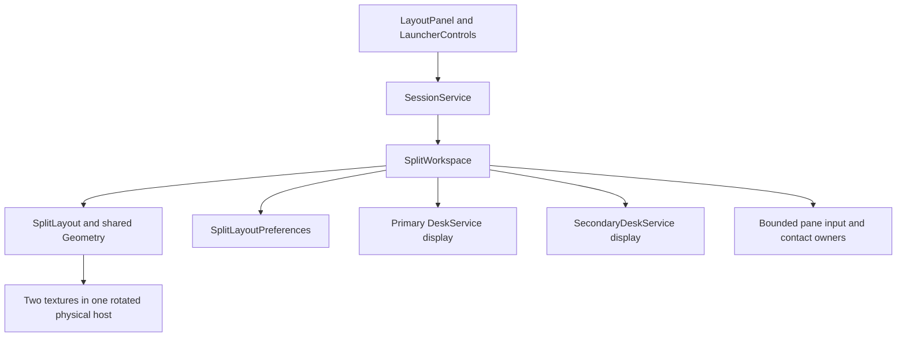
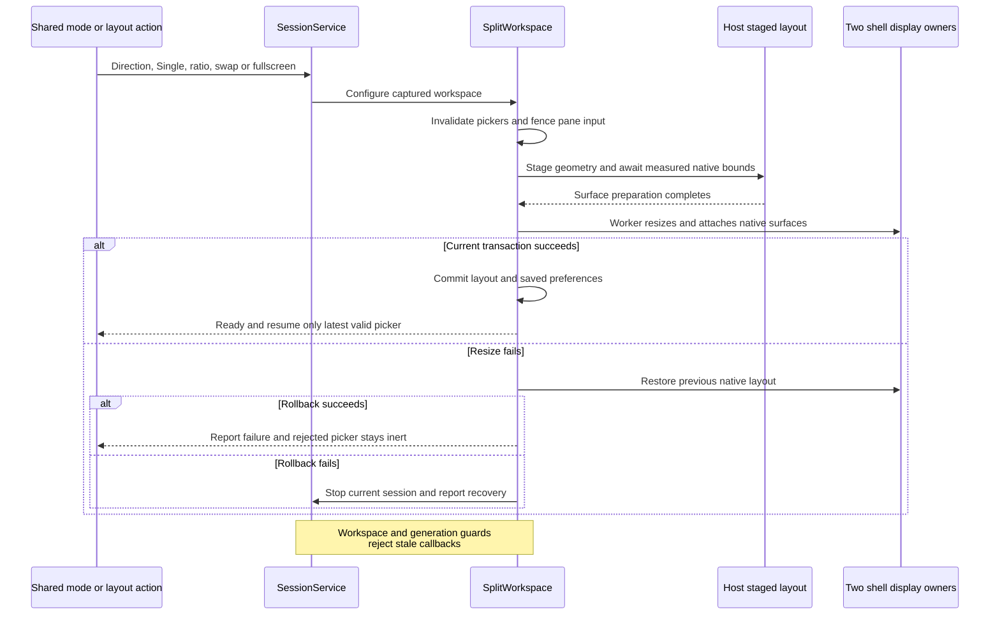
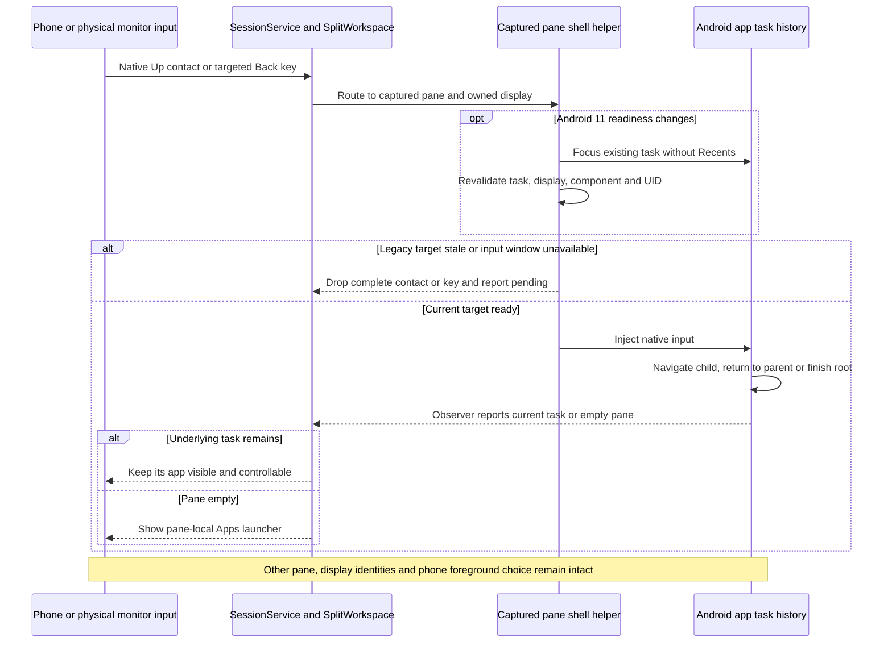

# Two managed panes and transactional layout

[Code map and atlas](../README.md) | [Owning contract](../../specs/split-view.md)

## Scope and source

One physical host contains two TextureViews and one monitor shell. SplitWorkspace owns the second helper/display, staged layout and pane input. SplitLayout is pure geometry; confirmed enabled/direction/ratio/order are durable, native IDs and picker/contact state are transient.

Source entry points: [SplitWorkspace.java](../../../app/src/main/java/dev/dexdroid/SplitWorkspace.java); [SplitLayout.java](../../../app/src/main/java/dev/dexdroid/SplitLayout.java); [SplitLayoutPreferences.java](../../../app/src/main/java/dev/dexdroid/SplitLayoutPreferences.java); [LayoutPanel.java](../../../app/src/main/java/dev/dexdroid/LayoutPanel.java); [LauncherControls.java](../../../app/src/main/java/dev/dexdroid/LauncherControls.java); [SecondaryDeskService.java](../../../app/src/main/java/dev/dexdroid/SecondaryDeskService.java); [SessionService.java](../../../app/src/main/java/dev/dexdroid/SessionService.java). Read current symbols and requirement checks
before changing behavior; this page is a high-level map, not an exhaustive call graph.

## Component overview

## Representative sequence

## Change and verification boundaries

Native navigation stays within the selected app's Android task history. The
[legacy readiness helper](../../../app/src/main/java/dev/dexdroid/LegacyInputWindow.java)
focuses the existing owned task without Recents activation and validates its
display, top task, component and UID before accepting readiness. App root exit
does not release either pane display or restore the phone controller over an app
the user intentionally opened there.

Callbacks and picker continuations validate workspace, generation and operation serial. Actual surface waits, Android 11 compositor-detachment fencing and fresh secondary binding tags are detailed in ARCHITECTURE.md. Contact/key target ownership survives selection changes. Earlier Android 11/16 consolidated full-suite runs are historical context; the current navigation candidate's outcomes and gaps are in the [change record](../../changes/legacy-navigation-focus.md). Forced privileged root migration remains a separate unresolved Samsung diagnostic; physical hardware latency and during-Fit static appearance remain gaps. These sequences are not a compatibility guarantee.

See [requirements and explicit gaps](../../requirements.json). Diagram arrows
describe current responsibilities/intended paths, not successful runtime verification.

Modern initial-DOWN rejection uses the same per-pane DeskService ownership. The
[input sequence](input-and-navigation.md) details stable target/window diagnosis,
checked verifier cancellation, complete-stream suppression and fresh retries.
Unknown failures retain explicit teardown rather than claiming safe recovery.
