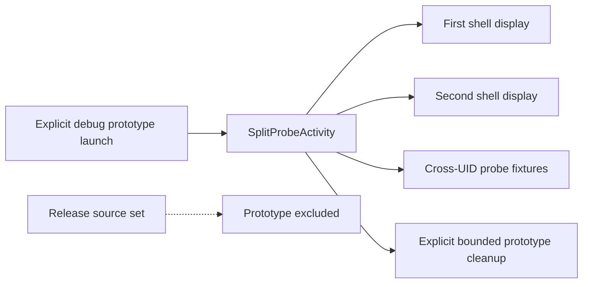
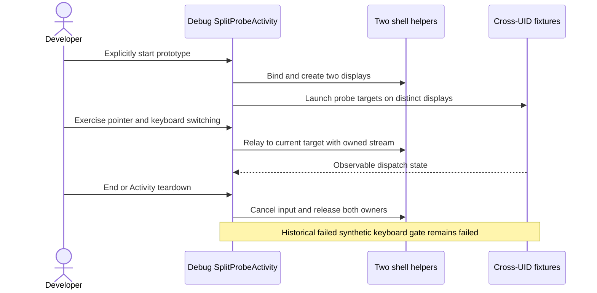

# Debug-only two-pane feasibility experiment

[Code map and atlas](../README.md) | [Owning contract](../../specs/two-pane-prototype.md)

## Scope and source

This is the historical debug-source-set prototype, not the product SplitWorkspace. It has an explicit Activity lifetime and two authorized shell bindings. Synthetic repeated key injection failed in retained runs; the separate Bluetooth user report does not turn those runs into passes.

Source entry points: [SplitProbeActivity](../../../app/src/debug/java/dev/dexdroid/SplitProbeActivity.java); [SplitProbeChecks](../../../app/src/androidTest/java/dev/dexdroid/SplitProbeChecks.java). Read current symbols and requirement checks
before changing behavior; this page is a high-level map, not an exhaustive call graph.

## Component overview

## Representative sequence

## Change and verification boundaries

Use src/debug SplitProbeActivity and src/androidTest SplitProbeChecks/fixture sources; none ship as product release behavior. Keep experimental assertions/evidence separate from product compatibility. Do not infer current performance from a prototype or bypass the main session invariants.

See [requirements and explicit gaps](../../requirements.json). Diagram arrows
describe current responsibilities/intended paths, not successful runtime verification.
