# Verification, evidence, review and release

[Code map and atlas](../README.md) | [Owning contract](../../specs/verification-and-release.md)

## Scope and source

Agent sessions settle requirements and real reviews. Deterministic host/device tools produce outcomes and provenance; Git records compact summaries/attestations while raw evidence stays in verified archives. CI does not authenticate agent identity or provide unattended model reviewers.

Source entry points: [Review gate](../../../tools/review_gate.py); [Release tools](../../../tools/release.py); [Quality workflow](../../../.github/workflows/quality.yml). Read current symbols and requirement checks
before changing behavior; this page is a high-level map, not an exhaustive call graph.
The shared [privacy guard](../../../tools/check_privacy.py) owns path/signature
policy; [evidence tools](../../../tools/evidence.py) own archive/member integrity.
`release.archive_release` checks uncompressed current-host input before sealing.
`release.validate_evidence` verifies ZIP integrity before checking each verified
member's relative path and first 16 uncompressed bytes without extraction. It also
enforces source/report bindings. `release.publish` completes archive, privacy and
package/report validation before its first GitHub call.

## Component overview

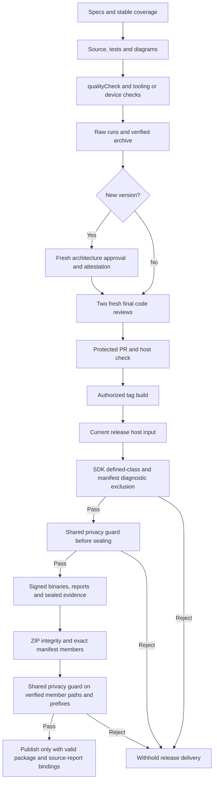

## Representative sequence

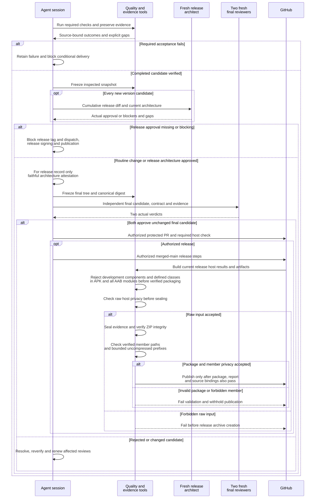

## Native setup and coherent observations

The native [runner](../../../app/src/androidTest/kotlin/dev/dexdroid/DeviceChecks.kt)
and [support](../../../app/src/androidTest/kotlin/dev/dexdroid/DeviceTestSupport.kt)
run setup on the instrumentation thread. A live Shizuku binder can precede its
initialized service interface; use the initialized sticky notification, a bounded
wait and listener cleanup. The permission check remains on instrumentation.
Profile acceptance samples service-owned monitor identity and related conditions
on main, matching production ownership. A missing monitor is a failure even when
testing an absent profile binding. These are test observers, not new runtime owners.

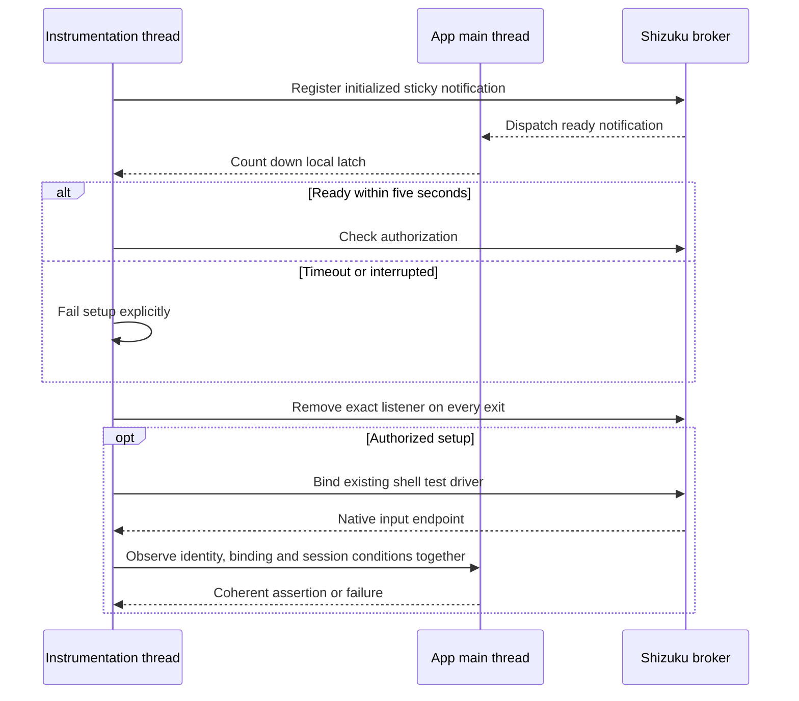

## Standalone fixture runtime

The test APK also runs fixture Activities under its own UID, outside instrumentation's
combined classloader. [Build configuration](../../../app/build.gradle.kts) resolves the
same pinned JVM Kotlin runtime as the app, validates that selected version as a task
input, and copies the whole byte-identical JAR under a distinct basename. Both the
path and basename matter: AGP subtracts tested-app dependencies, while Gradle's
classpath-normalized DEX transform identity still uses the filename. An ordinary
module dependency, original cache path or same-basename copy can be excluded again.
The generated file is test-only and declares its Copy-task dependency explicitly.

[The host guard](../../../tools/check_fixture_runtime.py) inspects definitions in
every test-APK DEX, requiring representative Kotlin classes, the runner and all
fixture manifest component classes. Type references cannot satisfy it. Missing or
malformed input and failed/empty SDK inspection fail closed. This sentinel does
not prove every linkage; full-JAR byte identity and actual separate-UID native
launch/input checks remain required. Production APK/AAB fixture exclusion is separate.

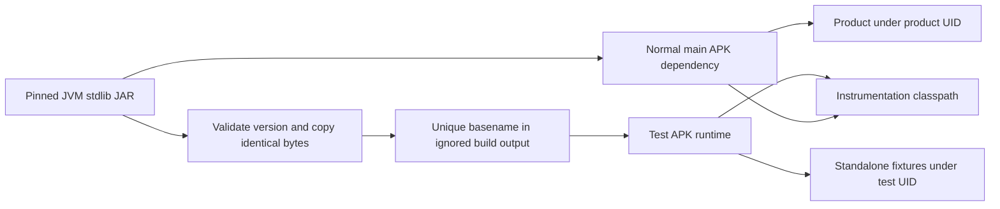

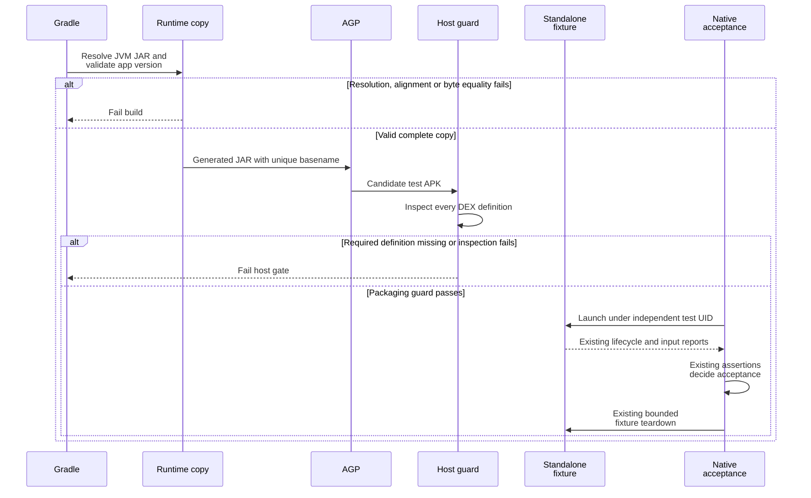

## Change and verification boundaries

Sources: tools/review_gate.py, evidence.py, release.py, release_report.py and workflows. Publication is conditional on user authorization and valid evidence, never a consequence of a diagram. Current 0.12.1 Android 11/16 acceptance passes the source-bound suites and native Stop checks recorded in the private evidence index. Fresh release architecture and final code approvals, protected PR, release CI and production smoke remain subsequent gates; these diagrams imply neither publication nor installation.

The release path above is distinct from routine host CI: the quality workflow
guards its raw current-run directory before generic evidence packing/upload; it
does not invoke the release archive-member privacy validation. Generic evidence
packing remains available for private local device evidence. Hashes establish
integrity, not permission to publish; the bounded path/signature guard does not
detect all semantic private text or encoded content. Rejection withholds delivery
rather than silently changing evidence or counting it as verified.

Architecture impact: documentation reconciliation under the approved preflight,
reflecting existing privacy ownership and release validation ordering. No process,
schema, runtime behavior or delivery permission is added by this documentation.

See [requirements and explicit gaps](../../requirements.json). Diagram arrows
describe current responsibilities/intended paths, not successful runtime verification.

Every new version requires the [release architecture checkpoint](../../RELEASING.md#release-architecture-review).
The inspected snapshot precedes its attestation; final reviewers approve the full
canonical tree including that record. Missing approval blocks the release agent,
not a newly implemented CI architecture-judgment service.


`release.verify_production_content` enumerates debug/androidTest source identities,
rejects their identifiers in binary XML/protobuf manifests and uses SDK35 dexdump
class definitions across every DEX, including secondary DEX and bundle modules.
Nested development classes are rejected; harmless task-parser strings and type
references are not treated as definitions. Missing/failed class inspection fails
closed. This check runs before signed artifacts become verified release packages.


## Child-fixture observation boundary

Before Child or full Split starts its controller/scenario launches,
[DeviceTestSupport.isolateNavigationFixtures](../../../app/src/androidTest/kotlin/dev/dexdroid/DeviceTestSupport.kt)
establishes only the declared Parent/Reader starting state. The existing strict
fixture parser captures sole current-user family roots; each removal requires
fresh root/task/display agreement and an accepted shell result. The original
five-second absence check includes captured task IDs. The helper throws on failed
checks itself, and the recorder only retains setup evidence. It runs once before
receiver/controller setup, never during navigation/handoff or after a failure.
Full Split uses the same helper; navigation-only skips it. This preserves later
same-task restoration rather than assuming an already-retained private child is
a fresh parent. No production reset or broad task cleanup is introduced.

[ChildLaunchAcceptance](../../../app/src/androidTest/kotlin/dev/dexdroid/ChildLaunchAcceptance.kt)
observes the parent/reader/exit family only. The navigation fixture shares the
report action/UID but owns a separate observation contract. Keep its task alive:
fixture task cleanup deliberately owns only the Parent/Reader roots. Split
acceptance intentionally consumes both families and retains its existing contract.
Admission uses action, fixture UID metadata and a fixed family, never the currently
awaited page or any asserted display/task/geometry/focus/count. Wrong observable
values from an expected producer still fail. This test protocol does not authenticate
senders or change product input/security boundaries.

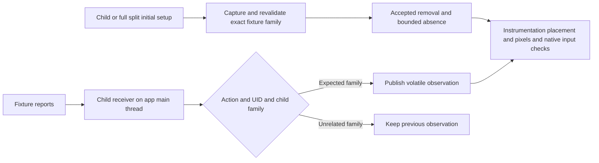

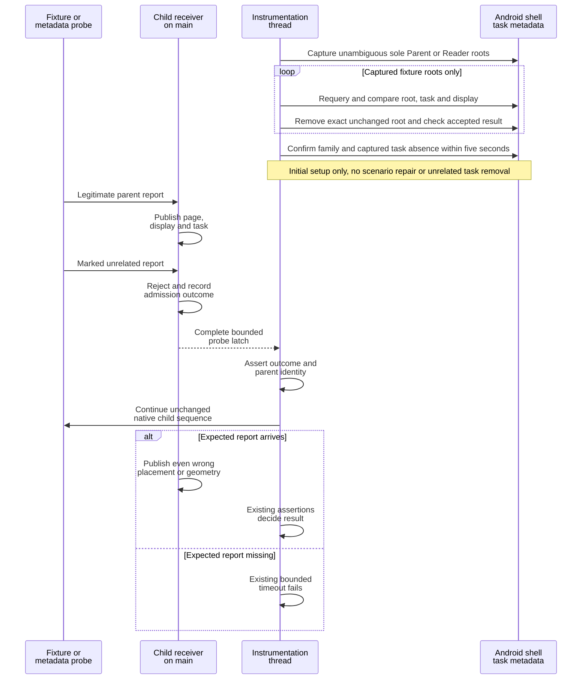

Probe completion is an explicit receiver-delivery barrier; no sleeps, state repair
or task killing hide failed admission. Snapshot the outcome inside the callback so
a later legitimate report cannot erase an incorrect probe acceptance. Historical
API 30 emulator exceptions do not apply to this observer regression.


## Legacy-navigation fixture teardown

[LegacyNavigationAcceptance](../../../app/src/androidTest/kotlin/dev/dexdroid/LegacyNavigationAcceptance.kt)
finishes its known final fixture only after successful assertions. Task/UID/display
are validated before native Up, and the same parent task/display must return.
Root Back must clear occupancy and remove that exact task from a recognized,
error-free snapshot before Stop. This isolates the producer without changing split
launch behavior or Parent/Reader task-removal ownership. Unknown failure states
receive no blind keys. Stop/cancel, unregister and unbind are separately attempted;
teardown errors attach to the primary failure rather than hiding it.

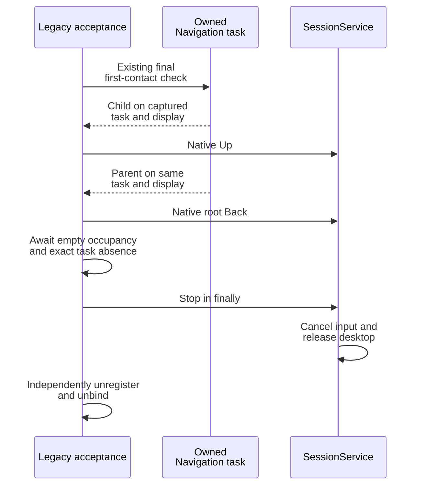


## Standalone shell snapshot lifecycle

[ShellUiDump](../../../app/src/debug/kotlin/dev/dexdroid/ShellUiDump.kt) is a debug-only
raw `app_process` entry, separate from app and instrumentation initialization.
The [standalone check](../../../tools/check_shell_snapshot.py) verifies the selected
device, installed APK hash and shell UID, then invokes it exactly once without
input, installation or settings changes. Failure and partial timeout output remain
private alongside independent logcat/window/process diagnostics.

Android 16's [AccessibilityInteractionClient](https://android.googlesource.com/platform/frameworks/base/+/refs/heads/android16-release/core/java/android/view/accessibility/AccessibilityInteractionClient.java)
creates a Handler using the process-main Looper. A raw shell process must prepare
that queue before UiAutomation connects. This compatibility repair does not create
an Application or run a main dispatch loop. The queue creates no extra thread and
lives until the CLI process ends; it cannot legally be quit. The existing
helper-owned callback HandlerThread still quits and joins after disconnect/shutdown
before successful XML output. UiAutomation owns its internal callback machinery.
Timeout or process death is a failed observation, never cleanup verification.

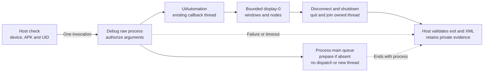

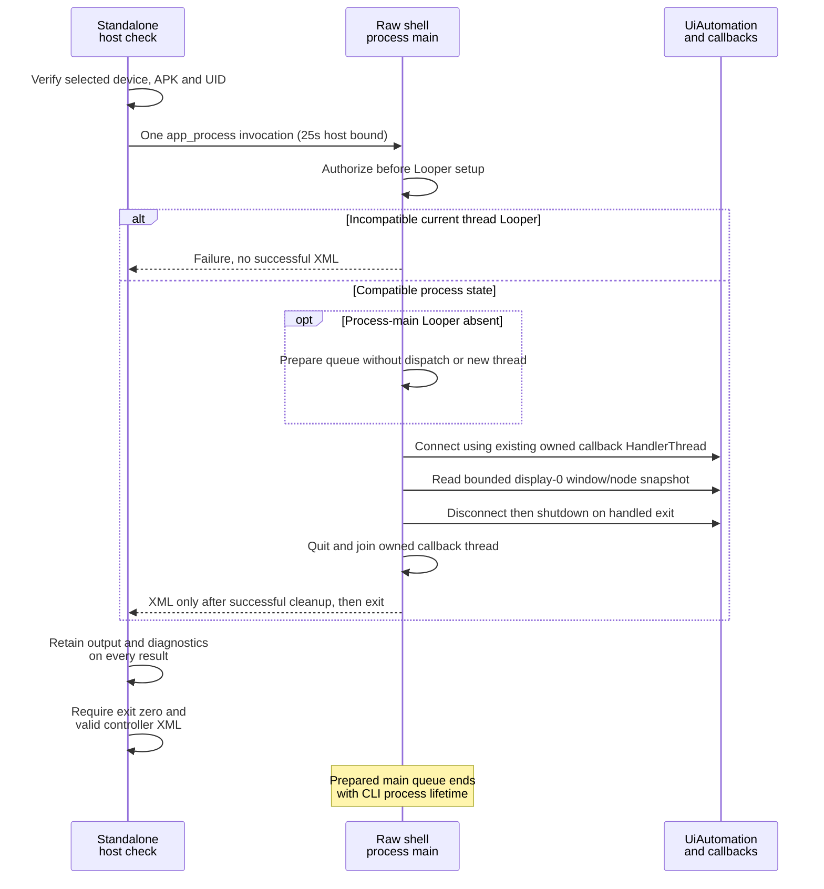


## Literal build metadata boundary

[app_metadata.app_version](../../../tools/app_metadata.py) owns the shared bounded
version reader used by [release.app_version](../../../tools/release.py),
[run_device_checks.result_version](../../../tools/run_device_checks.py) and the
[native Stop runner](../../../tools/check_stop_focus.py). It reads exactly one
app script, lexes UTF-8 comments/strings and balanced delimiters, and requires
independent `android/defaultConfig` ownership. The whole defaultConfig body must
fit its six-property scalar allowlist; versionName/versionCode are required once.
Computed, conditional, nested or alternate mutation forms fail closed. This is
a supported literal grammar, not Gradle evaluation. Gradle still owns the actual
build; APK/AAB metadata and signing verification remain independent.
The device runner's explicit safe `--version` label bypasses app metadata reading;
it labels evidence only. Release preparation and native Stop always read metadata.

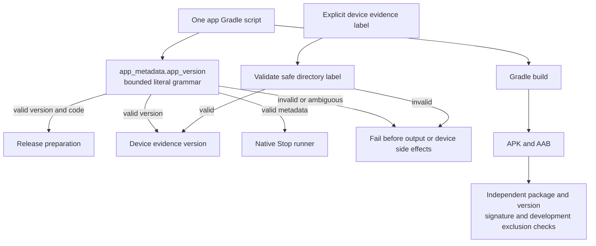

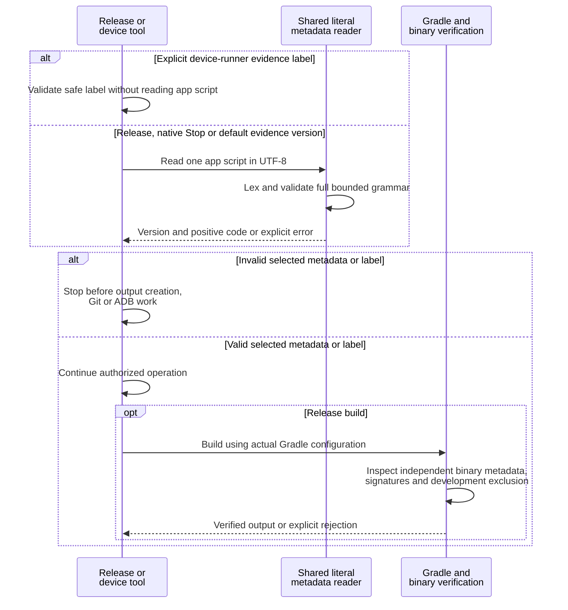

The reader owns no app runtime, preferences, display identity or input queue.
Its tests exercise both supported script forms, malformed/unsupported ownership
and expressions, consumer agreement and rejection before side effects. These
tests do not certify arbitrary Gradle semantics or signed production delivery.

## Private production-to-test handoff

This is the planned, guarded migration verification procedure, not a product
installer or a claim that hardware acceptance has run. The host owns artifact
admission, evidence and recovery. Runtime Stop ownership remains in
[desktop-session](desktop-session.md). The production app keeps its UID and data,
test fixtures retain a different UID even when both APKs use the same certificate.
The ordinary runner's installed/local hash checks remain authoritative.

Source boundaries: [SessionService.onCreate and Stop](../../../app/src/main/kotlin/dev/dexdroid/SessionService.kt),
[MainActivity binding](../../../app/src/main/kotlin/dev/dexdroid/MainActivity.kt),
[native Stop observer](../../../tools/check_stop_focus.py), and
[device runner](../../../tools/run_device_checks.py). Exact private operation
scripts and artifact hashes are bound by the tracked
[operation contract](../../changes/kotlin-migration-operations.json); raw scripts
stay in private migration evidence, never credentials.

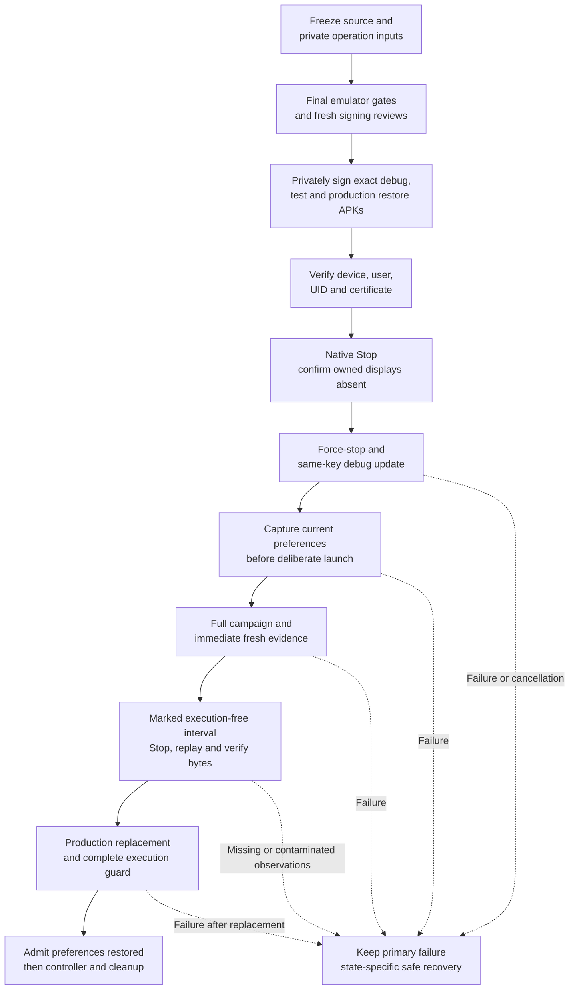

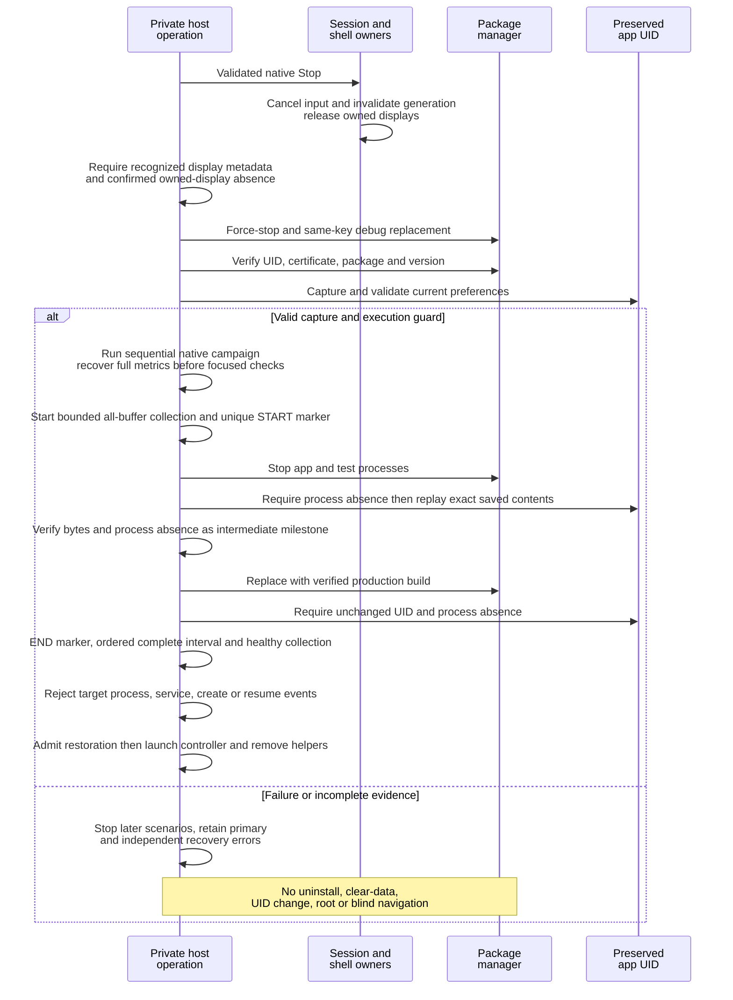

The snapshot is **post-update, before deliberate launch**. The previous
production build is not debuggable, so its prior preference bytes cannot be read
or compared. Capture all validated preference XML/backup members before Activity,
service or instrumentation launch: SessionService startup already edits a legacy
key. A permission-protected ShizukuProvider can be invoked externally, retain
process/component/event observations and reject observed target execution before
capture rather than claiming a manifest guarantees none. The Android
[replacement path](https://android.googlesource.com/platform/frameworks/base/+/android-11.0.0_r1/services/core/java/com/android/server/pm/PackageManagerService.java)
and [run-as implementation](https://android.googlesource.com/platform/system/core/+/android-11.0.0_r1/run-as/run-as.cpp)
explain the intended boundaries, actual JoyUI identity/data checks remain required.

The private native-Stop wrapper may project only its module ROOT onto exact
app-script/APK copies. Strict metadata reading and installed/local SHA equality
remain unchanged, imported command execution keeps the real repository cwd.
Do not use the diagnostic mismatch bypass or modify ordinary build outputs.
Establish Single through validated UI before its three cycles, then restore the
saved layout with the other preferences. Physical disconnect needs a real cable
change, emulator display removal does not establish that hardware result.

Restoration keeps `preferences_restored` false until exact replay bytes, production
identity, process absence and the entire marked execution interval pass. Missing
markers, an unhealthy collector or target execution prevents launch. If production
was already replaced, retain the snapshot and exact recovery stage for reviewed
recovery; a byte-replay milestone cannot admit a nondebuggable retry. Collector
teardown errors remain secondary and cannot replace an original failure.

Every action journals its result and retains primary plus independent evidence
or cleanup failures. Missing capture/restoration is a failure, not a successful
upgrade. A return to an older stable APK is a separate guarded downgrade attempt,
rejection never permits uninstalling the app or clearing its data. Signing and
device execution still need their own exact-input reviews and actual outcomes.

## Configuration-contact acceptance prerequisite

[DeviceChecks](../../../app/src/androidTest/kotlin/dev/dexdroid/DeviceChecks.kt)
owns the test-only prerequisite, [DeviceTestSupport.settledInputWindow](../../../app/src/androidTest/kotlin/dev/dexdroid/DeviceTestSupport.kt)
observes task and native window ownership. Rotation, Fit and resolution-preview
contacts wait for captured task/component/UID/display, current dimensions and an
unobscured native touchable window. This never focuses or injects while polling.
Service busy=false alone does not exclude an Android transition snapshot.
Preview contacts also fail if their conservative pre-request 15-second deadline
expires or display/rotation/base geometry/DPI changes before or after contact.
Product relay admission, asynchronous delivery and rollback timers stay unchanged.

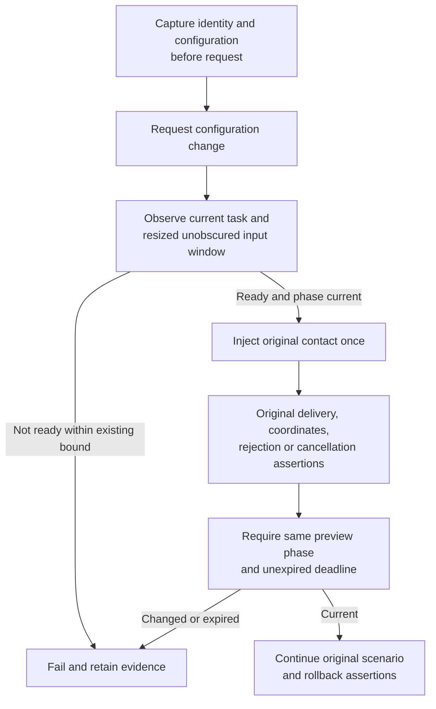

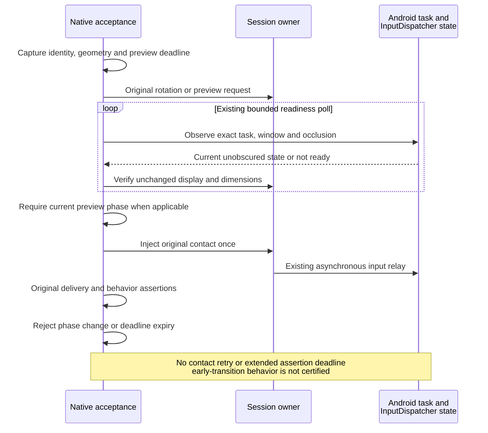


## State-specific binary replay recovery

The initial physical campaign passes ten suites and fails the split modifier
cancellation assertion; performance is unrun. This is separate from the failed
host shell-stdin replay, whose CRLF normalization corrupts current preferences.
The original validated snapshot remains intact. The
[recovery contract](../../changes/kotlin-migration-recovery.json) binds the
one-off private helper, original approved candidate/state/artifacts and diagnosed
malformed tar. This is planned recovery until actual execution is recorded.
It neither changes runtime input routing nor admits more tests or a release.

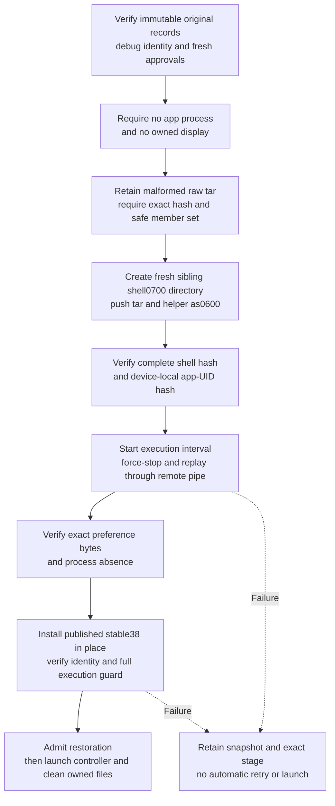

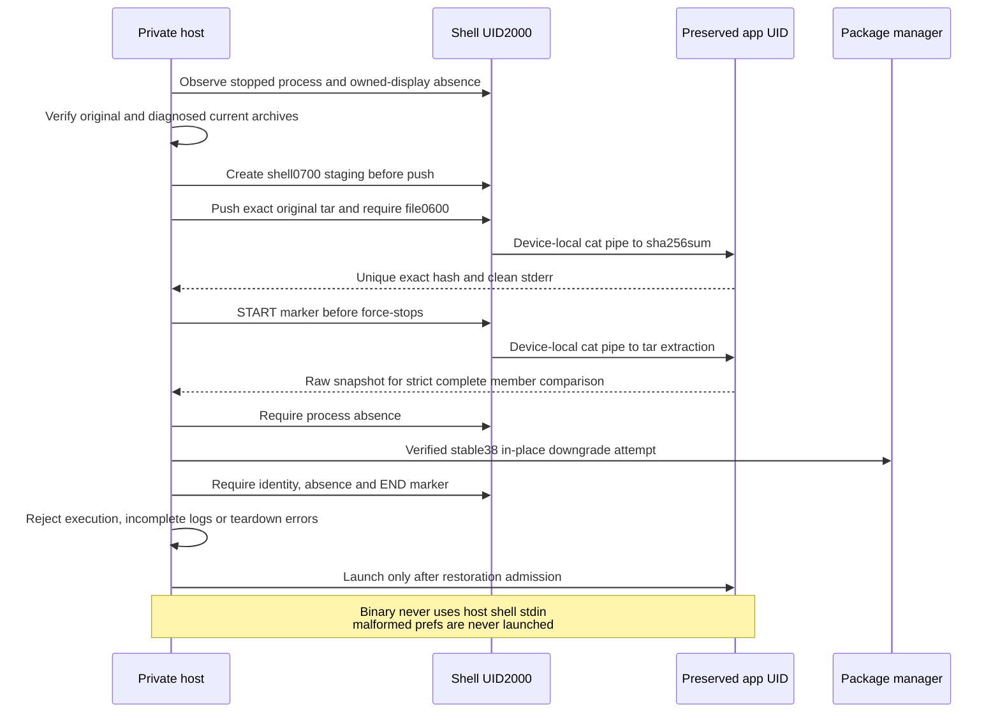

Original scripts and state stay immutable; recovery journals a separate generation.
A missing display/process observation fails before any controller launch. Remote
pipelines use only the validated fixed path and retain both output streams and
last-command status; exact hash/member outcomes are required independently of
that status. A failed downgrade never permits product uninstall or data clearing.
The old helper directory is observed0777 and never trusted for execution. Verify
all ancestors, create a fresh shell0700 sibling before either push, and use only
its verified helper.apk after admission. Old files are inspected only for exact
scoped cleanup; unexpected content remains untouched. Restoration and cleanup
results remain separate. Private staging is removed only after successful
recovery/controller verification.

## Active-controller recovery generation

The stopped-state generation refused execution at its owned-display guard before
any mutation. The user confirmed opening DexDroid/reconnecting during review.
Its current preferences are valid defaults; the intact original saved snapshot
remains authoritative. The separate [active recovery contract](../../changes/kotlin-migration-active-recovery.json)
binds new private helpers, original records, fresh readiness and metadata-only
source rebinding. This planned operation does not admit migration tests or release.

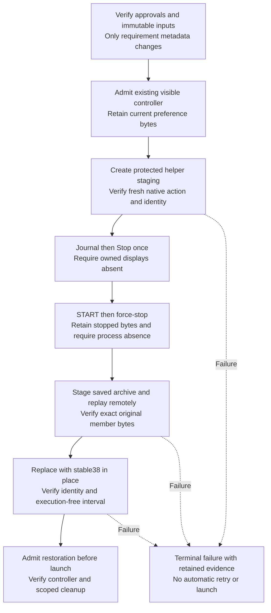

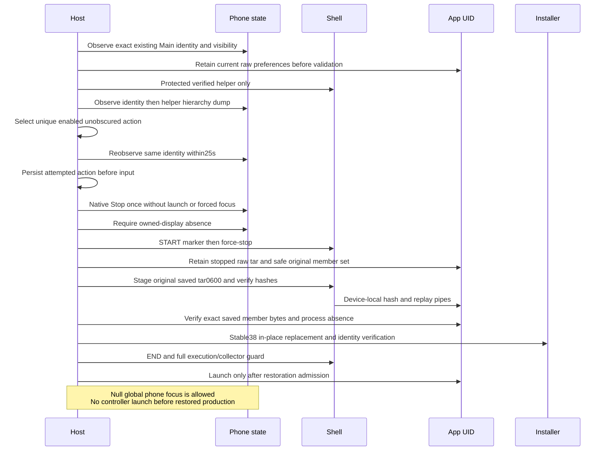

The new metadata freeze retains all130other source hashes and both unsigned APK
bytes. Admission verifies the original requirements copy before comparing the
single DX-MIGRATION-001 criterion append. All old scripts, states, authorization,
artifacts and failed journals remain immutable. The new helper repeats staging
type/owner/mode/no-link/hash checks for every execution, journals attempted native
actions before input, and separately records restoration and cleanup. Synthetic
calibrations are private procedure checks, not product acceptance or OS proof.

## User-directed non-restoring migration verification

User2026-10-19 ends automatic recovery work. Historical failed recovery states,
backups and evidence remain immutable; the separate FR-015 generation does not
admit itself through those old gates. It preserves identity/data through in-place
updates and makes no restored-preference or execution-free-window claim. Existing
native checks remain acceptance owners; debug traces observe actual decisions.
The current private helper implements isolated signing, preparation and sequential
suites only. The [new hardware contract](../../changes/kotlin-migration-hardware-operations.json)
admits exactly the debug/test pair, with no production signing or preference
archive/replay path. Current source/configuration/import/runner hashes and the
unchanged staged review gate precede credentials or device writes. A focused split reproduction runs first; a native failure blocks
dependent work. A passing reproduction admits the still-required full eleven
suites, then ordered navigation and optional disconnected-controller checks.
Controller admission positively parses physical monitor absence on the same
phone, retaining the original monitor fingerprint. Read-only locked/wrong-device
admission rejects before consuming an operation. Chrome and
production-delivery steps below are intended acceptance tails, not implemented
or admitted by this helper yet.

```mermaid
flowchart TB
    G[New frozen source, artifact and device contract<br/>Fresh exact architecture and two reviews] --> S[Sign debug and test only<br/>Verify cert package and payload]
    S --> P[Admit phone, shell Shizuku and stable monitor<br/>Protected helper and native Stop]
    P --> I[In-place debug and test update<br/>Verify UID signature and installed hashes]
    I --> T[Focused split then full eleven and navigation<br/>Native900s per suite and bounded filtered capture]
    T --> E[Private fresh evidence and optional controller<br/>Manual cable change and verified physical absence]
    E --> D[Planned conditional delivery<br/>Require actual outcomes and evidence]
    D --> C[Verify nondebug identity<br/>Scoped test-package and helper cleanup]
    P -. Failure .-> F[Retain exact stage and independent errors<br/>No automatic retry or preference replay]
    T -. Failure .-> F
    D -. Failure .-> F
```

```mermaid
sequenceDiagram
    participant H as Host
    participant P as Installer
    participant A as App
    participant S as Shell
    participant T as Native tests
    H->>H: Admit source and reviews before each action
    H->>H: Debug and test signing with independent checks
    H->>S: Verify phone and shell Shizuku identity then bound monitor
    H->>S: Verified shell0700 helper staging
    H->>A: Existing native Stop
    H->>P: Same-key debug39 and test update in place
    H->>H: Verify installed bytes, UIDs and certificate
    Note over H,A: No replay or preservation-equality claim
    H->>S: Recheck privileges and same monitor before connected suites
    H->>S: Start filtered capture and unique interval markers
    H->>T: Focused split, then full and focused checks
    T-->>H: Actual outcomes and fixture observations
    H->>S: Safe expected-folder cache collection
    H->>H: Bind clock freshness and exclusions
    opt User disconnects cable after connected suites
        H->>S: Require known phone and positively parsed physical absence
        H->>T: Optional controller-only suite and normal controller return
    end
    H->>T: Separately planned native Chrome checks
    H->>H: Require all acceptance and evidence before delivery
    H->>P: Planned in-place production39 update
    H->>H: Verify nondebug identity before scoped cleanup
```

Process-local runner APK paths refer to exact private signed artifacts, retaining
its normal installed/local equality checks. Native Chrome uses the unchanged tool
with a bound source/metadata/APK ROOT projection, not a mismatch exception. Raw
logs, captures and tar members stay private. Missing diagnostic records cannot
manufacture a native pass or root cause. Main-source DEBUG gating and exclusion of
actual development source-set definitions are reported separately.
The filtered collector reuses run_monitor.Session's bounded output and owned
process cleanup. Planned cancellation still requires an empty CommandResult.error;
reader/extractor/finalization faults are retained independently of native results.
First-seen producer PIDs are sampled against UID/process names before trace
interpretation; missing identity or reported transport loss stays inconclusive.
Portable member names, case aliases, resolved containment and exclusive writes
protect private cache extraction on Windows. Device epoch freshness remains
limited to one-second precision; stale members are listed and excluded.
Monitor admission hashes canonical uniqueId/name/type/integer address model from
exactly one physical EXTERNAL/HDMI DisplayDeviceInfo. The immutable historical
reference is itself hash-bound; current observation, contract and operation state
must match before preparation mutations and each suite. Logical display/mode IDs,
geometry, rotation and fps are intentionally excluded. This matches Android's
reported identity, not cryptographic authentication of monitor hardware.

## Android 12-15 emulator acceptance extension

The final private owner holds one Windows job across startup, native campaign and
shutdown on each dedicated API31/33/34/35 Google APIs x86_64 AVD. The suspended
launcher enters the job before resuming, so ordinary QEMU descendants share its
lifetime. No emulator detachment is assumed. Actual executor child/grandchild and
empty-job canaries verify the ownership primitive; emulator behavior still needs
its own results. The user stopped further Android12-14 testing on2026-10-20;
the retained matrix is historical evidence, and final targeted readiness checks
run onAPI35 only. This changes verification configuration, not product ownership.
The [maintained runner](../../../tools/run_device_checks.py),
[native entries](../../../app/src/androidTest/kotlin/dev/dexdroid/DeviceChecks.kt)
and [shell display owner](../../../app/src/main/kotlin/dev/dexdroid/DeskService.kt)
retain assertions, input behavior and app/shell identities.

The v1 package-only permission gate was inconclusive: package metadata returned
denied even on images with earlier native desktop passes. V2 records that query
separately, then runs one frozen, hash-verified read-only shell2000 DEX probe of
`IActivityManager.checkPermission(permission,pid,uid)` on the exact AVD/API/boot.
No application/Looper bootstrap, grant, display creation or input occurs in the
probe. Reflection/transport/identity errors halt acceptance as inconclusive.
Only a measured caller denial blocks dependent native stages. Exact guarded file
cleanup is independent, preserves mismatches and retains the unique directory;
host output-size validation is not an adversarial memory bound.

```mermaid
flowchart TB
    F[Frozen identical APKs and source bindings] --> J[One owner holds Windows job through campaign]
    J --> A[Admit exact AVD API boot and shell2000 before mutations]
    A --> I[Install frozen pair and verify remote hashes and UIDs before launch]
    I --> Q[Record package metadata separately and run bounded AM caller probe]
    Q --> P{Measured shell caller permission}
    Q -->|Probe failure| E
    P -->|Granted| N[Original eleven suites then modern legacy and split navigation]
    P -->|Denied| B[Record twelve capability blocked entries and run icon]
    N -->|Native and evidence pass| C[Disconnected controller with independent secondary restoration]
    B --> C
    N -->|Failure| E[Preserve failed prefix and unrun dependent tails]
    C --> S[Graceful stop only exact recorded AVD and boot]
    E --> S
    S --> Z[Independent owned job teardown and verify active count zero]
    Z --> R[Review collected private cache and renders]
    R --> G[Keep native capture cleanup and compatibility gaps separate]
```

```mermaid
sequenceDiagram
    participant H as One private owner process
    participant J as Owned Windows job
    participant E as Dedicated emulator
    participant T as Maintained native runner
    H->>J: Assign suspended launcher before resume
    J->>E: Own launcher and QEMU descendants
    H->>E: Admit actual AVD API boot shell and configured display
    H->>E: Install frozen pair then verify remote hashes and UIDs
    H->>E: Authorize ordinary Shizuku and launch verified app
    H->>E: Record package metadata and verify frozen probe hashes
    H->>E: One bounded shell2000 AM PID and UID permission query
    H->>E: Independent exact guarded probe-file cleanup
    loop Selected stages while prior native and evidence pass
        alt Measured caller permission granted
            H->>T: Main eleven-suite campaign or next focused navigation stage
        else Measured caller permission denied
            H->>H: Record twelve capability blocked entries
            H->>T: Independent icon stage only
        end
        T-->>H: Native result and normal controller restoration
        H->>E: Independently collect bounded fresh private stage cache
    end
    alt Selected native and evidence pass
        H->>E: Remove only emulator secondary display
        H->>T: Disconnected controller and independent private cache
        H->>E: Restore secondary independently in finally
    else Failed prefix or collection
        H->>H: Retain failure and unrun tails without retry
    end
    H->>E: Graceful stop only matching recorded AVD API and boot
    H->>J: Independently terminate remaining owned descendants if necessary
    J-->>H: Active process count zero before handle closure
    Note over H,T: No root product execution or physical phone mutation
```

Native outcome, original pull results, independent private collection and cleanup,
visual inspection and performance remain separate. Epoch observations preserve
one-second freshness ambiguity. Failure or unknown identity cannot become a pass;
there is no automatic retry or trusted-display bypass. Modern focused legacy
navigation applies on API31+ where capabilities permit; API30 retains its original
branch. Native Chrome Stop uses separate synthetic no-account emulator scope;
real cable/Bluetooth and unavailable Android11 hardware remain unverified.

## Final focused migration verification

The user stopped further Android12-14 checks on2026-10-20 and subsequently asked
to finish the targeted readiness corrections before release. A separately frozen
API35-only run uses the unchanged runtime APK and rebuilt instrumentation APK.
The final user-selected Xiaomi14 Android15 procedure attempts native Single setup
and three [Chrome Stop cycles](../../../tools/check_stop_focus.py) before instrumentation.
It stops before Chrome launch because the visible row has no clickable target in
the native dump. That check stays incomplete. A separately bound generation closes
the exact known picker, establishes a guarded stopped boundary and independently
runs focused [input and keyboard checks](../../../tools/run_device_checks.py).
The original complete API35 and Xiaomi campaigns retain their old APK bindings;
a source-level dependency record distinguishes unaffected early-return suite
routes from the changed input/controller and keyboard paths. This is reuse,
not execution of the new test APK. Other-OS failures remain community gaps. The earlier API35 controller result keeps
its original APK attribution; a fresh disconnected-controller check is excluded
from this physical run to keep the monitor connected. Only the debug instrumentation
APK is re-signed with the existing certificate and updated in place; product APK,
app UID and data remain unchanged. No production signing occurs in this check.

The settled-input waiter in
[DeviceChecks](../../../app/src/androidTest/kotlin/dev/dexdroid/DeviceChecks.kt)
uses its original predicate and captured task/display/geometry. A false observation
resets the positive streak; two positives admit within the existing polling
policy. Native queries retain their own duration bounds. Five deterministic
fake-clock cases exercise the same helper in the existing native prelude. No
production input path changes; generic await remains unchanged. Failure samples
and bounded streak/elapsed context stay private and cannot replace native errors.

```mermaid
flowchart LR
    F[Frozen unchanged runtime and rebuilt tests] --> O[User-selected Xiaomi14 Android15]
    O --> S[Native Chrome attempt stops before launch]
    S --> B[Admit known picker and first guarded Stop]
    B --> I[Independent input and keyboard]
    I --> E[Guarded Stop and verify controller usable]
    B -->|Unsafe or unknown| X[Preserve primary and unrun tails]
    I -->|Failure| X
    X --> E
    E --> R[Private evidence and release reviews]
```

```mermaid
sequenceDiagram
    participant H as Private API35 owner
    participant E as Xiaomi14 Android15
    participant N as Native Stop checker
    participant T as Instrumentation
    H->>E: Admit frozen APKs device boot shell2000 and monitor
    H->>N: Guarded Single setup then Chrome launch selection
    N-->>H: No clickable row, zero cycles and no Chrome or Stop input
    H->>E: Separately bound known-picker Close and first guarded Stop
    Note over H,N: Keep incomplete Chrome result, no selector relaxation or native retry
    H->>T: Input with coherent readiness then keyboard
    T-->>H: Original assertions plus readiness outcomes
    H->>E: Guarded Stop and verify usable controller
    Note over H,T: Record native, collection and cleanup separately
```

## Coherent monitor search acceptance observation

Test-only correction to
[MonitorSearchAcceptance](../../../app/src/androidTest/kotlin/dev/dexdroid/MonitorSearchAcceptance.kt):
[MonitorShell](../../../app/src/main/kotlin/dev/dexdroid/MonitorShell.kt) updates its
adapter model before Android necessarily lays out matching children. A count-only
predicate cannot establish visible-row readiness. Capture the shell/editor/list/
adapter owner on main before typing, and replace that existing ten-second wait
with a coherent query/count/visible-row observation. The original native keys,
rendered-row assertion and selection checks remain. No production state or UI
layout changes. The current failed run demonstrates an observation weakness;
it does not prove that timing caused this particular failure.

```mermaid
flowchart LR
    T[Instrumentation thread<br/>Existing polling deadline] --> M[Main thread<br/>Captured shell editor list adapter]
    M --> Q[Expected query and count<br/>Visible attached measured row]
    Q -->|Same owner and ready| N[Original rendered assertion<br/>Then native input and selection]
    Q -->|Pending| T
    M -->|Observed owner replacement| F[Sticky rejection<br/>Bounded latest failure sample]
    T -->|Deadline| F
    F --> E[Preserve original assertion<br/>Capture errors remain secondary]
```

```mermaid
sequenceDiagram
    participant T as Instrumentation owner
    participant U as Android main thread
    participant L as Existing ListView and adapter
    T->>U: Capture current shell editor list and adapter
    T->>U: Existing native typing actions
    U->>L: Existing model update and notifyDataSetChanged
    Note over U,L: Count can change before child layout
    loop Existing ten-second polling bound
        T->>U: Observe same owner query count and visible tagged row together
        U-->>T: Ready or latest bounded content-free state
        Note over T,U: Poll sleep off main, no input replay
    end
    alt Same owner rendered row ready
        T->>U: Original rendered-row assertion
        T->>U: Continue original native keyboard and selection checks
    else Deadline or observed owner replacement
        T->>T: Preserve original failure and latest state
        Note over T: Snapshot errors suppressed, no native repair or retry
    end
```

## Failure observations during compatibility acceptance

The test-only [phone observer](../../../app/src/androidTest/kotlin/dev/dexdroid/PhoneMenuAcceptance.kt)
evaluates its existing page/Back predicates on the UI thread against the captured
Activity. It retains one content-free owner sample, with task identity captured
once. The instrumentation thread still owns polling, assertions, failure writes
and cleanup. No owner reacquisition or product navigation repair occurs.
The [input helper](../../../app/src/androidTest/kotlin/dev/dexdroid/DeviceTestSupport.kt)
optionally records one caller-owned sample of its existing task/input/window
queries. Other callers retain the observer-free default. Acceptance uses complete
reports; bounded retained decoded text marks truncation and unqueried fields.

[SplitAcceptance.launchButton](../../../app/src/androidTest/kotlin/dev/dexdroid/SplitAcceptance.kt)
also observes menu readiness on main. One existing fifteen-second await captures
the current session, expected ready page/dialog, root and attached/shown search
together, sets one query, then discovers the current enabled/measured action.
Every poll rejects owner/search replacement and replaces or clears its row View;
an earlier candidate cannot survive a later absent row. It does not acquire a new
owner after capture, retry menu/input actions or change intentional stale-button
scenarios. The instrumentation thread still owns the aggregate deadline and final
assertion; a blocked UI thread remains subject to the outer runner bound.

```mermaid
flowchart TB
    P[Instrumentation polling and unchanged deadline] --> U[Main thread: same captured Activity<br/>Existing phone page or Back-ready predicate]
    U --> O[One latest bounded owner sample<br/>Symbolic tags and numeric identity only]
    P --> I[Input prerequisite: existing queries only<br/>Optional fresh sample per polling attempt]
    I --> R[Same task parser geometry and overlap conditions<br/>Short-circuit query order unchanged]
    R --> S[One latest bounded decoded-text sample<br/>Unqueried and truncated scope explicit]
    O --> F{Original assertion fails?}
    S --> F
    F -->|Yes| W[Private failure write before screenshot or preference cleanup]
    W --> E[Preserve primary failure<br/>Attach independent write failures]
    E --> C[Original teardown and separately bound collection]
    F -->|No| N[Continue existing acceptance<br/>Diagnostics grant no success]
```

```mermaid
sequenceDiagram
    participant T as Instrumentation
    participant U as Captured Activity main thread
    participant Q as Existing shell observations
    participant E as Private evidence
    loop Existing polling interval and predicate
        T->>U: Evaluate existing page or Back-ready predicate
        U-->>T: Boolean and one bounded owner snapshot
    end
    Note over T,U: Task identity captured once, no reacquisition or per-poll task IPC
    loop Input readiness with optional caller-owned observation
        T->>Q: Original task/input/window query, only if its branch reaches it
        Q-->>T: Original decoded response used for acceptance
        T->>T: Retain bounded copy, mark skipped fields unqueried
    end
    alt Original failure
        T->>E: Write latest sample before screenshot or teardown
        E-->>T: Success or independent write failure
        T->>T: Preserve original error and perform existing cleanup
    else Original success
        T->>T: Continue existing assertions, clear invocation sample
    end
```

`runOnMainSync` can block on a stalled UI thread; the ten-second polling deadline
is not a hard end-to-end guarantee. The outer runner deadline remains. Input
samples are decoded text, not original stdout bytes. A failed input invocation's
optional `input-readiness` cache is collected separately; missing evidence cannot
manufacture native success or establish a specific cause. Runtime/shell routing,
monitor controls and production persistence are unchanged.

The API33 `DeviceChecks` pointer caller now explicitly permits either exact zero
input configuration or lone `NOT_FOCUSABLE`. The task/component/UID, parser,
frame/region, overlap and final task guards still apply, followed by unchanged
native touch/Fit/cancellation assertions. Other callers and SDKs remain strict;
this grants no keyboard readiness. Original failed attempts stay retained.

## Reconstructed Java compatibility control

The Android14 child-handoff investigation compares the published Java source
with the [current native child scenario](../../../app/src/androidTest/kotlin/dev/dexdroid/ChildLaunchAcceptance.kt).
An isolated clean worktree builds its own matching debug/test pair and runs its
own unchanged [published runner](https://github.com/PhiLong-Ho/DexDroid/blob/dbadbf9dce7b23bfb111a153a03cfd71037325a9/tools/run_device_checks.py) entry. These are
reconstructed debug artifacts, not the original published binaries. Frozen source,
APK/certificate, package UID, boot and shell-helper identity bind each attempt.
The private adapters and raw results remain in the evidence bundle; no permanent
runtime owner, user-data replay, root product/test execution or automatic native
retry is added. Scoped root cache reads remain evidence collection only.

```mermaid
flowchart TB
    J[Clean published Java source<br/>Isolated matching debug and test APKs] --> B[Cold-boot dedicated API34<br/>No old DexDroid helpers]
    B --> I[In-place matching pair install<br/>Verify hashes version and package UID continuity]
    I --> S[New shell UID2000 Shizuku and desktop<br/>Same boot and original child assertion]
    S --> O[Keep native result and independent collection<br/>Setup failures leave native unrun]
    O --> Z[Seal control streams status and raw evidence<br/>Before replacing either APK]
    Z --> R[Independent recovery journal<br/>Stop fixed emulator and cold-boot current Kotlin pair]
    R --> G[Report control and recovery separately<br/>A baseline pass cannot prove a preceding multi-suite failure absent]
```

```mermaid
sequenceDiagram
    participant H as Private operation owner
    participant E as Dedicated API34
    participant J as Unchanged Java acceptance
    participant A as Private archive
    H->>E: Cold boot and prove no old app or desktop helper
    H->>E: Install matching code38 pair and verify source APK UID bindings
    H->>E: Start new shell2000 helper and record normal identity
    alt Setup complete
        H->>J: Run original child suite once
        J-->>H: Native result and cleanup outcome
        H->>E: Scoped read-only fresh cache collection
    else Setup guard fails
        H->>H: Preserve original error, native remains unrun
    end
    H->>A: Seal raw control streams and outcomes
    H->>E: Stop only fixed emulator, cold boot again
    H->>E: Independently install and verify current Kotlin pair
    E-->>H: Controller launch request or separate recovery failure
    Note over H,E: Launch success does not certify rendered input or preference restoration
```

The emulator intentionally outlives its startup helper, so the emulator is
owned by the fixed outer operation rather than a per-command kill-on-close job.
The native runner keeps its existing supervised lifetime. Every premature helper
exit terminates and waits for that helper; control and recovery observers are
independent. Failures in capture/finalization remain failures even after successful
commands. UID parsing retains its consumed decoded rows before normalizing CRLF;
it does not claim byte-identical preservation of the original ADB stream.

## Measured monitor input viewport

The shared native [DeviceTestSupport](../../../app/src/androidTest/kotlin/dev/dexdroid/DeviceTestSupport.kt)
samples the attached monitor content frame, screen origin and current desktop
geometry on main, then revalidates that snapshot before DOWN. Signal mode is not
the event viewport: the Xiaomi Android15 monitor signals1920x1200 while its logical
frame is1920x1242. Test injection translates the mapped window-local coordinate
to screen space; the expected virtual coordinate and two-pixel tolerance remain
independent. Production mapping and input arbitration are unchanged. Parameterized
[GeometryTest](../../../app/src/test/kotlin/dev/dexdroid/GeometryTest.kt) covers this
extra height across four rotations and three virtual sizes. The replacement-device
[overview and sequence](../../changes/xiaomi-migration-acceptance.md#architecture)
show the private test-only update boundary, native execution and terminal failures.
An emulator old/new causal comparison passes with the override subsequently reset;
it is separate from physical Xiaomi acceptance and does not fill Android11 gaps.
Mapped finite contacts bind the original snapshot through UP/CANCEL; keyboard
input has an independent snapshot. Monitor/search/idle/profile/protection/legacy
fixtures share the coordinate owner, including logical PixelCopy extents and
origin-subtracted pixel indices. Split's existing decor fixtures explicitly reject
nonzero screen origins. Genuine mode/status assertions and intentional invalid
contacts remain separate from normal mapped input. Main-thread work inlines when
already on main; no helper silently waits, reacquires or retries a contact.

Focused [LegacyNavigationAcceptance](../../../app/src/androidTest/kotlin/dev/dexdroid/LegacyNavigationAcceptance.kt)
selects the original API30 predicate or existing strict modern readiness on API31+.
Its immutable fixture snapshot distinguishes parent from nested child, binds task,
UID/display/geometry and revalidates before DOWN. It preserves5s/40ms polling and
native outcomes, with bounded failure-only consumed observations before cleanup.
The5s poll is not a hard end-to-end query bound. Unchanged eleven-suite execution
may be reused only with exact original APK/run attribution and a dependency record
proving this LegacyOnly branch is excluded; fresh focused navigation is separate.

Before API31+ Back, the focused-navigation fixture waits for its existing focused report with immutable page/task/UID/display/window geometry and revalidates on main before one queued key. API30 keeps its existing behavior. This separates settled-key acceptance from the retained immediate-transition canceled-key failure; the latter remains unverified. No product key path is changed.

The [debug diagnostic sink](../../../app/src/debug/kotlin/dev/dexdroid/ModernInputDiagnostics.kt) has two fixed profiles: existing emulator primary/InputTestActivity and a state-specific exact Xiaomi API35 secondary/navigation-child UID10362. Its pure selection owner skips intentional parent rejections only for Xiaomi, consumes child/null once and preserves emulator consumption order. It observes the existing reactive rejected-DOWN callback; it adds no native query or input decision. Protected request publication, exclusive ownership, bounded consumed output and exact disarm belong to the private host procedure shown in the [replacement-device diagrams](../../changes/xiaomi-migration-acceptance.md#architecture). Production APK/AAB exclusion is independently verified; diagnostic timing and missing samples are explicit limits.

On Xiaomi, hard-link request publication was denied before native execution. The isolated v9 procedure adopts the existing v8-installed APKs read-only and uses the exact tested noclobber publisher. Because it creates the request before copying completes, no consumer may exist or start until successful publisher exit and exact file validation. Partial/colliding publication remains terminal, with exact disarm independent from collection. It adds no install/signing/permission or input change.


The v9 staged-publisher verification failed before native execution because shell text reads expanded LF toCRLF. Its terminal evidence remains. The isolated v10 host reader uses binary transfer, strict pre/post canonical path and protected file metadata, exact byte length and matching remote/local SHA-256 before/after transfer. Exit zero alone cannot authorize publication, collection or exact request deletion. This is a private trusted write-once fixture boundary (at most2MiB), not an adversarial memory-bound claim or product input change.
