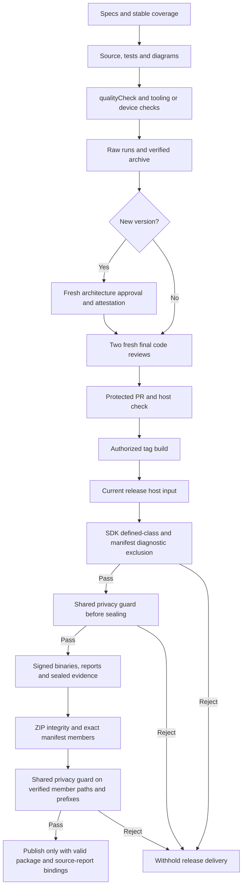
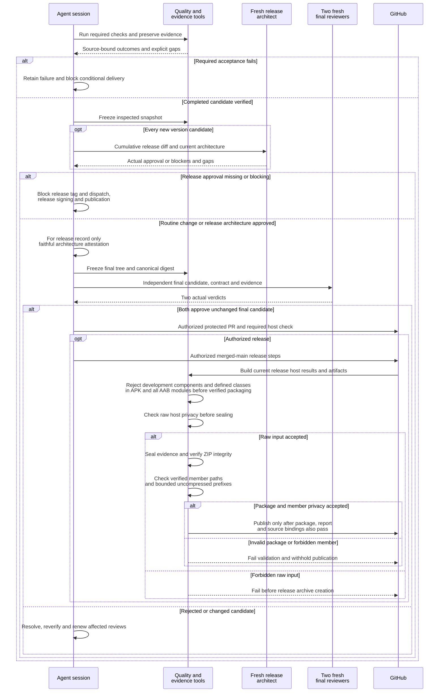

# Verification, evidence, review and release

[Code map and atlas](../README.md) | [Owning contract](../../specs/verification-and-release.md)

## Scope and source

Agent sessions settle requirements and real reviews. Deterministic host/device tools produce outcomes and provenance; Git records compact summaries/attestations while raw evidence stays in verified archives. CI does not authenticate agent identity or provide unattended model reviewers.

Source entry points: [Review gate](../../../tools/review_gate.py); [Release tools](../../../tools/release.py); [Quality workflow](../../../.github/workflows/quality.yml). Read current symbols and requirement checks
before changing behavior; this page is a high-level map, not an exhaustive call graph.
The shared [privacy guard](../../../tools/check_privacy.py) owns path/signature
policy; [evidence tools](../../../tools/evidence.py) own archive/member integrity.
`release.archive_release` checks uncompressed current-host input before sealing.
`release.validate_evidence` verifies ZIP integrity before checking each verified
member's relative path and first 16 uncompressed bytes without extraction. It also
enforces source/report bindings. `release.publish` completes archive, privacy and
package/report validation before its first GitHub call.

## Component overview

## Representative sequence

## Change and verification boundaries

Sources: tools/review_gate.py, evidence.py, release.py, release_report.py and workflows. Publication is conditional on user authorization and valid evidence, never a consequence of a diagram. Current 0.12.1 Android 11/16 acceptance passes the source-bound suites and native Stop checks recorded in the private evidence index. Fresh release architecture and final code approvals, protected PR, release CI and production smoke remain subsequent gates; these diagrams imply neither publication nor installation.

The release path above is distinct from routine host CI: the quality workflow
guards its raw current-run directory before generic evidence packing/upload; it
does not invoke the release archive-member privacy validation. Generic evidence
packing remains available for private local device evidence. Hashes establish
integrity, not permission to publish; the bounded path/signature guard does not
detect all semantic private text or encoded content. Rejection withholds delivery
rather than silently changing evidence or counting it as verified.

Architecture impact: documentation reconciliation under the approved preflight,
reflecting existing privacy ownership and release validation ordering. No process,
schema, runtime behavior or delivery permission is added by this documentation.

See [requirements and explicit gaps](../../requirements.json). Diagram arrows
describe current responsibilities/intended paths, not successful runtime verification.

Every new version requires the [release architecture checkpoint](../../RELEASING.md#release-architecture-review).
The inspected snapshot precedes its attestation; final reviewers approve the full
canonical tree including that record. Missing approval blocks the release agent,
not a newly implemented CI architecture-judgment service.

`release.verify_production_content` enumerates debug/androidTest source identities,
rejects their identifiers in binary XML/protobuf manifests and uses SDK35 dexdump
class definitions across every DEX, including secondary DEX and bundle modules.
Nested development classes are rejected; harmless task-parser strings and type
references are not treated as definitions. Missing/failed class inspection fails
closed. This check runs before signed artifacts become verified release packages.
