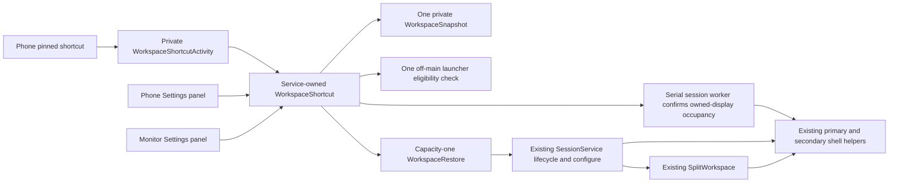
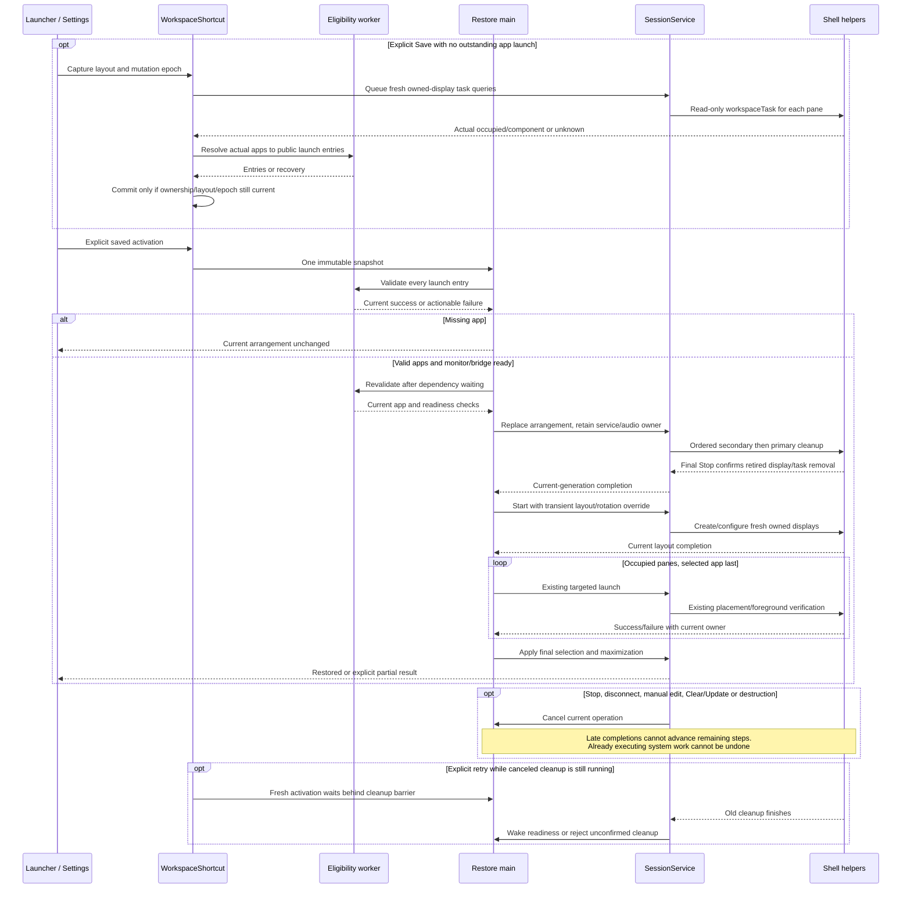

# Saved workspace shortcut

[System map](../README.md) | [Feature contract](../../specs/saved-launch-shortcut.md)

## Ownership and component overview

The private [WorkspaceShortcutActivity](../../../app/src/main/kotlin/dev/dexdroid/WorkspaceShortcutActivity.kt)
submits the saved action before reopening the phone controller. Its fixed Intent
accepts no app component or privileged command. Android's publisher-owned pinned
shortcut can enter the unexported Activity; ordinary external apps cannot.
The private entry installs native starting content before binding, then retains
request-before-controller order. It adds no minimum delay. Restore state supplies
feedback on the phone while monitor teardown is in progress; an existing/new
MonitorShell reads the same current phase without extending host lifetime.

[WorkspaceShortcut](../../../app/src/main/kotlin/dev/dexdroid/WorkspaceShortcut.kt)
belongs to SessionService. It owns one private saved record, one off-main app check
and [WorkspaceRestore](../../../app/src/main/kotlin/dev/dexdroid/WorkspaceRestore.kt)'s
capacity-one main-thread sequence. [WorkspaceSnapshot](../../../app/src/main/kotlin/dev/dexdroid/WorkspaceSnapshot.kt)
is versioned value data, not a task/process/content snapshot. A private top Activity
is resolved to an enabled public launcher entry before save; all entries are checked
again before replacement. Both panels use the same owner and values.

## Representative sequence

## Invariants, failure and compatibility

- Persist no display/task IDs, Binder/Surface objects, arbitrary Intent extras or app content.
- Save only stable committed occupancy/layout. Reject busy, preview, divider and
  outstanding Single launches before either Single/Split capture. Each accepted
  Single launch has its own token until ordered native work and fresh occupancy
  reconciliation complete. Success, failure and current-generation discard release
  only their own token; teardown retires the generation. Requested components are
  not committed occupancy. Single→Split keeps the primary guard until work drains.
- Save queries each owned helper through `IDeskService.workspaceTask` on the serial
  session worker, reusing DesktopTasks' task-root query. The read-only RPC cannot
  launch/move apps or access unowned displays. Unknown queries preserve the previous
  record and permit retry; legacy event-coalesced callbacks are not capture authority.
  Ownership/layout comparison plus the mutation epoch rejects stale off-main save
  results, including edits that return to an equal value. Launcher checks remain on
  their separate eligibility worker; neither RPC nor PM work runs on main.
- Preflight all apps before destructive replacement. An internal replacement retains the service,
  foreground ownership, wake lock and same primary audio helper. Ordinary Stop retains its existing
  behavior. Cleanup failure prevents fresh display creation and releases retained session resources.
  Intermediate app-close warnings are logged; final Stop confirmation is authoritative,
  matching secondary cleanup. A failed final Stop or secondary cleanup remains a failure.
- Transient startup layout avoids changing ordinary durable defaults merely to restore Single.
  Existing monitor profile controls resolution/DPI; saved rotation does not rewrite profiles.
- Explicit cleanup, configuration and launch completions advance the sequence. No sleeps, UI status
  polling or `!busy` inference establishes completion. Existing generation/display/bridge/workspace
  guards remain authoritative; the restore step identity rejects duplicate and obsolete callbacks.
  Cleanup also captures the activation epoch. Every barrier release notifies the current
  coordinator; failed old cleanup cannot silently unblock a newer waiting restore.
- A partial app failure stops further steps with usable controls. Closed app content cannot be rolled
  back. Coalesced pending taps and a bounded deadline prevent accumulated replay.
- UI requests pinning on the phone through Android's launcher, which may add directly or ask
  for confirmation, and reports request versus installation honestly.
  Clear does not claim to remove a launcher-owned icon. New runtime state never survives process death.
- Shared status keeps an ephemeral restore notice and full last result independently of routine
  service reports. Active notices persist; terminal notices expire once after ten seconds.

This overview describes implementation intent/current seams, not runtime acceptance.
See [change/evidence](../../changes/saved-launch-shortcut.md) and [coverage](../../coverage.md)
for actual runs and remaining Xiaomi/OS/OEM/pinning/input/performance gaps.
