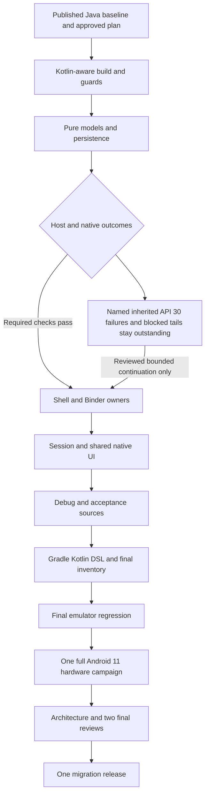
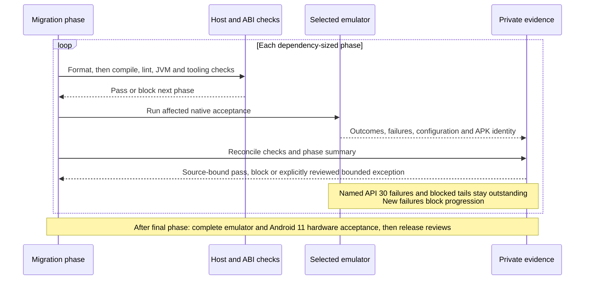

# DexDroid Kotlin migration plan

Status: conversion complete; selected regression complete. Release approvals are
recorded separately in the release architecture and final candidate records.
Requested 2026-10-18. Single migration release: **0.13.0 / code 39**,
based on the published 0.12.5 tag. No intermediate migration releases.
Architecture preflight approved the approach; its actual record is retained below.

## Outcome and scope

Convert all 82 maintained Android Java files to Kotlin: 38 main, 6 debug, 13 JVM
test and 25 device test/fixture files, totaling 27,598 lines at planning time. Convert the Gradle
scripts to Kotlin DSL in a separate phase. Preserve package/class identities,
manifest and AIDL contracts, preferences, behavior, native Views and visual design.
Keep Android 11 minimum/API 36 target. Generated AIDL Java remains generated;
AIDL, XML, Python, shell scripts and assets retain their formats.

Keep this a language migration: architectural decomposition, Compose, coroutines,
new features and SDK/AGP upgrades belong in subsequent changes. Give every source
file an owner, phase and migration status. Counts measure conversion progress;
regression outcomes establish acceptance. Retain known Android 17 baseline
failures explicitly; conversion does not establish that they are fixed.

## Release order

1. Finish stable 0.12.5: compatibility decision, fresh architecture review, two
   fresh final reviews, protected-main PR/host gate, publication and artifact
   verification. Preserve phone preferences during in-place production delivery.
2. Create a separate migration branch from the published Java tag. Update SPEC
   first, then record and stage the approved plan and traceability before conversion.
3. Complete the phases below, passing each host/emulator gate before continuing,
   subject only to the two bounded outstanding API 30 signatures recorded below.
   Keep local phase snapshots; publish no intermediate migration version.
   Phase snapshots use staged trees/source hashes and verified private evidence,
   with one final commit/PR after the release review gates. Intermediate commits
   would need their own approvals under this repository's change contract.
4. After the final phase, run complete emulator regression followed by one full
   Android 11 hardware campaign with the attached real monitor. Failures require
   fixes and applicable retests under the normal workflow; do not hide failures to
   preserve the one-campaign target. Reuse unaffected evidence and rerun checks
   whose inputs changed. One planned campaign cannot guarantee one clean attempt.
5. Freeze the final candidate, obtain fresh release architecture approval and
   exactly two fresh final approvals, then PR/CI/release once. Install verified
   production in place and remove test packages and development fixtures.

## Phases and gates

| Phase | Scope | Emulator gate after host checks |
| --- | --- | --- |
| 0 | Published Java baseline, source/APK/build identity and known failures | Reuse only verified matching source/APK/test/harness/configuration results; API 30 has targeted results, not a complete emulator baseline. Preserve Android 17/API 37 failures separately |
| 1 | Kotlin plugin, JVM 17, formatter, mixed compilation; Kotlin-aware coverage, release/privacy guards and graph/evidence inventory; one pure leaf and its test | API 30/36 startup/Stop, input and keyboard smoke; test-discovery and forbidden-class guard tests |
| 2 | Pure geometry, layout/state models, parsing, profile persistence and JVM tests | API 30/36 input, profiles, split geometry, four rotations, Fit and rollback |
| 3 | AIDL implementations, shell/app_process helpers, reflection, event relay and display owners | API 30/36 input, child navigation, keyboard, ownership/cancel/readiness and Stop; Android 17/API 37 comparisons against its explicit baseline |
| 4 | Shared UI leaves, then Activity/monitor hosts, then session/workspace orchestration; each subgroup has its own checkpoint | API 30/36 UI, monitor, keyboard, idle/lifecycle and split as affected; actual phone/monitor render comparison across four rotations |
| 5 | Remaining debug helpers, custom runner, fixtures/acceptance and JVM tests; remove maintained Java | API 30/36 complete eleven-suite runs, native shell drivers, test inventory parity and production fixture exclusion |
| 6 | Gradle Kotlin DSL, tooling/docs/source links and final inventory | Final complete API 30/36 regression and host/release/privacy/coverage gates; final rendered review; then one full physical Android 11 campaign |

Split a phase into smaller dependency groups when necessary. Reassess material
boundary changes with the architecture expert. Preserve assertions, native event
injection and observations; do not weaken tests or add blanket retries. State
which configurations ran rather than claiming every combination. Use targeted
regression during a phase and complete runs at consolidation gates.

Every behavior-affecting phase and final consolidation also exercises the
identified Android 17/API 37 emulator against its recorded configuration baseline.
Known failures remain failures or unverified compatibility, never passes inferred
from another renderer. Do not require unrelated failing platform scenarios to be
silently rewritten before unrelated conversion can be assessed.

The eleven-suite `--suite all` runner is not the complete acceptance inventory.
The final emulator/device campaign also includes the disconnected-controller
setup suite, focused legacy-navigation (Android11 only) and split-navigation
(applicable legacy/modern Android) suites, and native
Chrome Stop through `tools/check_stop_focus.py`. Select affected focused checks
at earlier phase gates. Record explicit exclusions or hardware prerequisites.

Phase 4 checkpoints are mandatory: (4a) shared visual/control leaves; (4b)
MainActivity, MonitorShell and MonitorActivity; (4c) SessionService and
SplitWorkspace. Keep existing Java instrumentation until these product subgroups
pass; only then convert the remaining device harness in phase 5.

## Build and tooling

Retain AGP 8.10.1, Gradle 8.14.6 and JVM target 17 initially. Candidate Kotlin
plugin: pinned 2.2.21, subject to dependency resolution and build verification.
Use a pinned Kotlin formatter through Spotless. Preserve warnings-as-errors and
the existing lint debt baseline; fix genuinely new API use without regenerating
it. Evidenced pre-existing calls newly identified by Kotlin analysis require the
narrow manual migration record and independent review below, not broad suppression.

Compatibility sources:

- [Kotlin Gradle compatibility](https://kotlinlang.org/docs/gradle-configure-project.html)
- [Android Kotlin compiler support](https://developer.android.com/build/kotlin-support)
- [Kotlin JVM interoperability](https://kotlinlang.org/docs/java-to-kotlin-interop.html)

Support Java and Kotlin during intermediate phases. Coverage currently inventories
only Java/Python and parses Java-shaped JUnit/run/onStart declarations. Update it
before conversion, preserving case identity and explicit scenario gaps. Reconcile
renamed checks in requirements.json and regenerate both coverage files after every
test change. Verify Windows/Linux canonical fingerprints and release reports.

The production-content guard currently derives forbidden debug/test identities
from Java filenames. Extend and test it for Kotlin declarations, file facades,
companions and nested classes before converting fixtures. Prove it rejects
synthetic Kotlin leakage and accepts a clean production APK/AAB.

Gradle DSL conversion must atomically update release.py, run_device_checks.py,
check_stop_focus.py and their tests: all currently read app/build.gradle with
Groovy literal patterns. Prefer one shared strict metadata reader supporting
literal Kotlin assignments, rejecting missing, ambiguous or computed versions.
Verify graph navigation with an actual Kotlin canary; file inclusion alone does
not prove correct symbol parsing. Graphify still updates only during release.

## Invariants during conversion

- Preserve JVM names, Android/Shizuku constructors, Binder/AIDL signatures and
  static app_process main methods. Add explicit JVM annotations where needed;
  inspect bytecode with javap rather than assuming interop equivalence.
- Keep DeskService inheritable for SecondaryDeskService; preserve the nonstatic
  SessionService.LocalBinder outer-instance relationship. Preserve debug public
  static volatile fields until their Java callers have migrated. Private reflected
  worker/bridge/secondBridge/args/dialog fields and methods retain exact names.
- Preserve reflected names/primitive types, shell classloading without Application
  initialization, UID guards and checked framework failures.
- Preserve float/int arithmetic, event times, pointer IDs/action bits, event copies,
  platform nullability, regex escaping, equality and collection iteration.
- Preserve queues, locks, Handler/worker ownership, callback generation/identity,
  cancellation, teardown and stale-display rejection.
- Preserve preference keys/defaults/serialization and monitor bindings. Verify
  in-place upgrades keep user data and signing identity.
- Preserve source-set boundaries: official APK/AAB excludes all development code.
- Preserve phone portrait, four monitor rotations, Fit bars, pane ownership,
  local monitor keyboard, cursor rules and explicit Stop focus behavior.

## Architecture and execution overview

The [system/component map](../../docs/ARCHITECTURE.md) and
[feature atlas](../../docs/architecture/README.md) remain the ownership contract.
Convert within those boundaries; do not introduce a replacement runtime.

## Evidence and completion

Each phase records source/tree fingerprints, APK hashes, commands, outcomes,
timings and gaps. Raw logs/captures stay in ignored versioned runs and verified
private bundles; Git keeps concise summaries/descriptors/links. Public Actions and
release evidence contains only privacy-guarded host results. Retain failed runs.

Update SPEC, requirement checks/coverage, architecture/component/feature links and
diagrams, onboarding, concise README and changelog. Appearance should stay the
same, so no new layout decision is needed; actual phone/monitor renders still need
bounded review. Never auto-promote screenshots or invent a full golden catalog.

Completion requires zero maintained Android Java files, Kotlin DSL build scripts,
passing host/tool/release guards and emulator regression (or the explicitly
reviewed residual API 30 exceptions and blocked scenarios), the final Android 11
campaign, explicit visual/performance/platform gaps, fresh architecture and two
final approvals, and one verified migration release.

## Architecture preflight record

Reviewer `/root/kotlin_migration_preflight`, 2026-10-18 07:13:33 UTC:
**APPROVE APPROACH** after the five requested plan corrections and inspection of
both rendered diagrams. Inspected plan SHA256:
`ecfdbee56eaa88b841f39e8d392c41f54b22b851774c39549ad243397218beae`.
This approves post-publication planning only, not stable-release publication or
unrun migration acceptance. Source conversion has not started; the stable
candidate remains separate and unchanged. The draft header above describes its
status before this appended faithful review record.

Execution clarification approved by the same architecture expert during this
session: staging the spec/plan before conversion and retaining uncommitted phase
snapshots preserves spec-first ordering. One final reviewed commit/PR avoids
unnecessary intermediate publication gates; no runtime ownership changes.

## Implementation checkpoints

The [per-file inventory](kotlin-migration-inventory.json) records every maintained
source owner and phase. Its conversion status is separate from acceptance.

Phase 1 passed: pinned plugin/formatter, Kotlin-aware coverage and development-class
guards, and `ShellCommandResult` with its three JVM cases. All 148 JVM cases passed;
tooling had 169 passes and one platform skip. API 30/36/37 each passed input,
keyboard and idle/Stop smoke. API 37 used the recorded software renderer, retaining
the published host-renderer limitation. The [checkpoint](../../testresults/0.13.0/kotlin-migration/phase-1/summary.md)
links exact private source/APK/configuration evidence; no physical device was used.

Phase 2 converts eleven models/preferences/parsers and ten JVM test files. All
148 JVM cases passed, and bytecode inspection retained 94 original non-private
member descriptors/static calling shapes across twenty named owners. Visibility
expansion required by Kotlin and extra generated members are not byte identity.
The scoped architecture expert `/root/kotlin_migration_preflight` audited profile
identity/persistence, navigation, split geometry and the preference adapter against
the Java tag and found no remaining concrete source blockers after repairs.
Selected emulator acceptance passed on the final frozen pair: API 30 AOSP and
API 36 each passed input/profiles/full split, while API 37's software baseline
passed input/profiles. Retain the observed API 30 profile input ANR:
both the saved pre-conversion APK and the unchanged Kotlin APK subsequently passed
profiles. Closing two idle emulators increased free host memory from approximately
2.5 to 14 GiB; concurrent load is a confound, not an established failure cause.

The offline IDE converter's older engine cannot read Kotlin 2.2 metadata. The
architecture expert approved an immutable full-Java `v0.12.5` snapshot for draft
generation instead. Selected current Java bytes must match that tag, copied
sources/generated interfaces/libraries are hash-bound, network/device access is
blocked in the converter process, and it never rewrites live usages. Drafts are
manually repaired and accepted only by the pinned 2.2.21 compiler, source/ABI review
and phase tests. This does not claim current mixed-project PSI validation.

The expert also approved a private unsigned production-variant probe using
`androidComponents.finalizeDsl` in an ignored init script to clear release signing.
It must use explicit project/opt-in guards and `--no-configuration-cache`, retain
source/script hashes, and verify unsigned/non-debug/development-exclusion output.
It does not use the production key for signing; normal configuration may still
read local signing metadata. Normal CI/release signing and approval gates remain.

### Native harness corrections found by phase 2

Fresh architecture expert `/root/kotlin_test_readiness_arch` approved the bounded
Shizuku readiness approach at **2026-10-18 09:10:58 UTC**, after inspecting the
cached 13.1.5 source/AAR/runtime bytecode and the two API 36 failures. Shizuku
publishes its low-level binder before its initialized service; `pingBinder` alone
does not establish readiness. The helper now waits at most five seconds on the
instrumentation thread for the initialized sticky notification, checks permission
there and removes the exact listener in `finally`. The existing ten-second input
driver binding remains. Timeout, denial, interruption and later service death
remain failures. Cold API 36 input subsequently passed; final harness regression
is still required. No production Shizuku behavior changed.

The same fresh expert approved coherent profile observations at **2026-10-18
09:16:37 UTC**. An API 36 profile run passed 161 labels before an off-main read
dereferenced a null bound profile after Stop/restart. The service's main-thread
`detect` temporarily clears its identity while rebuilding it on display events;
separate volatile lifecycle reads do not make that compound observation atomic.
Profile checks now read identity/binding and related confirmation/rotation
conditions together on main, require a present monitor even for unbound checks,
and fail explicitly on a missing expected binding. Alternate-profile creation also
uses main to serialize its read-modify-write with production writers. Assertions
and waits were preserved, without retries. The Java-model control passed its
profile run; the source race is supported, but that does not establish the cause
of every earlier failure. The corrected Kotlin-model profile run passed on API 36.

Both explicit Java harness deltas were saved beside the immutable converter
drafts and must be retained during their phase-5 Kotlin port. Their native entry
points are mapped to DX-MIGRATION-001. No app feature or layout was changed.

Formatting is completed in a separate Gradle invocation before verification.
The later build recompiled formatted Kotlin and changed the product DEX, so the
earlier unchanged-APK reuse condition did not hold. Preserve the earlier API 30
software split pass under its original hashes; rerun it on the current frozen
pair rather than claim byte identity or reuse as current acceptance.

### Bounded API 30 acceptance exceptions

Architecture expert `/root/kotlin_test_readiness_arch` approved bounded
continuation at **2026-10-18 09:37:15 UTC**, requiring this explicit contract
revision before dependent conversion. Ordinary API 30 profiles remain
**FAILED / OUTSTANDING**: current product `d8ce99c6...dfd37` and harness
`f73ad6be...3a7569` failed a physical-display MOVE after profile preview/Revert;
the exact harness with the earlier Java-model product `bfc0d97e...63088` failed
the same signature (`20261018T093333.290861Z`). The timing-corrected diagnostic
captured idle main, RenderThread and session worker while instrumentation waited
for native injection. This supports no application lock cycle at that instant;
it establishes neither the cause nor that physical devices are unaffected.

The initial exception covered only that profile signature. Fresh independent
architecture reviewer `/root/kotlin_api30_gate_arch` inspected the source,
configuration and matched controls and approved the explicit amendment below at
**2026-10-18 09:48:55 UTC**, against pre-amendment plan SHA256
`73197b3a5b4d7a56734cd75e791d6310c8d6fbfb0893096865c76703adab3e34`.
This approves bounded conversion progress, not phase acceptance or release.

The second signature is specific to the recorded Google API 30 environment:
current split run `20261018T093717.271959Z` and the same-harness Java-model control
`20261018T093927.767499Z` both fail controller visibility after reader handoff
after 1,499 PASS labels. The real phone capture is black and MainActivity's window
is GONE with no surface; this is not evidence to relax a stale-object assertion.
SessionService, SplitWorkspace, MainActivity, DeskService and SplitAcceptance
remain unchanged Java owners at this boundary. Root cause remains unknown.

Split's protected-content, End/re-enable, obsolete-binding cleanup, Stop/restart,
picker invalidation and later launcher/background tail is **UNRUN** in these failed
runs. Profiles likewise leave later rotation/Keep/Forget/timeout/restart cases
unexecuted after the failure. Earlier labels and API 36 outcomes do not pass those
API 30 scenarios. Keep all blocked tails explicit, without weakening assertions.

Only these two signatures/configurations qualify; new, earlier or different
failures, missing observables or changed workloads block the phase. Rerun both
workloads after phase 3, affected 4b hosts, 4c orchestration and the phase-5 harness
port. Host/ABI and affected API 36/37 checks remain required, with API 37's
separate existing limitation. API 30 input, child navigation, keyboard,
cancellation/readiness and Stop remain gates. Recheck affected profile resize,
rollback and monitor dispatch owners after conversion. Preserve native event
sequences, assertions and deadlines without blanket retries or product changes
merely to accommodate the emulator. Conversion status is separate from acceptance.

The final ordinary API 30 campaign must execute all applicable suites, running
later suites separately after a failure. Full final Android 11 hardware acceptance
including profiles/split/rotations/Fit/rollback/input/lifecycle must pass; failures
block release and require correction/retesting. Hardware does not retroactively
pass an emulator. Any residual ordinary emulator failure requires the fresh
release architect and both final reviewers to assess it explicitly; no all-green
emulator or complete-compatibility claim is allowed.

The bounded window-dump diagnostic (`20261018T093642.059609Z`) completed profiles,
but is not clean acceptance because collection perturbed the failing workload.
The false-vsync probe failed setup while its secondary display was absent, so it
provides no workload comparison. Vsync was restored before a fresh zygote and the
secondary display returned. Original failures/configurations/traces are retained;
no more speculative timing/property probes are planned.

The ordinary AOSP API 30 image comparison was separately approved by
`/root/kotlin_test_readiness_arch` at **2026-10-18 09:42:20 UTC**. Its installed
package is `system-images/android-30/default/x86_64`, package.xml revision 11
(embedded source.properties says 10; both are retained), emulator 37.2.12,
`swiftshader_indirect`, 1920×1200/160 secondary, default vsync and LatinIME.
Shizuku is verified shell UID 2000. Its Java-model/current-harness input passed,
profiles reproduced the MOVE timeout, and full split passed
(`20261018T094604.773621Z`). The final frozen current pair separately passed input
(`20261018T095048.872917Z`), full split including the later tail
(`20261018T095121.646830Z`) and profiles (`20261018T095550.291259Z`). Use this
ordinary AOSP configuration as the primary API 30 phase environment, per the
conditional expert decision. These are candidate passes; retained Google-image
and AOSP-control failures remain historical configuration/instability evidence
with unknown cause. No general split exception is required for this passing gate.
Future failures must be assessed under the narrow signature/configuration rules,
and the final campaign/review obligations remain unchanged.

Phase 2's final selected gate therefore has eight passing suites across the three
recorded configurations, not a full regression claim. All 148 JVM cases passed;
structured tooling has 169 passes and one platform skip. An earlier PowerShell
redirection wrapper returned failure despite an OK unittest footer; the UTF-8
structured rerun is authoritative and both outputs are retained. Kotlin CRG
navigation returned the actual helper/test symbols; graph edges remain hints.
Bounded current phone/monitor render inspection and injected-DOWN timing are
recorded separately. The [checkpoint](../../testresults/0.13.0/kotlin-migration/phase-2/summary.md)
retains the full failed/control/diagnostic history privately. No physical phone
was used in either implementation phase.

### Phase 3 inherited lint records

Fresh architecture/build-gate reviewer `/root/kotlin_lint_arch` approved the
specific manual correction at **2026-10-18 10:02 UTC**, after source/graph/AIDL/
architecture and failed-lint inspection. Source comparison used `git show
v0.12.5:app/src/main/kotlin/dev/dexdroid/DeskService.kt`, Java blob
`eb87f5ba153c87972dfb5d74e11c7ae333df33a2`, peeled commit
`dbadbf9dce7b23bfb111a153a03cfd71037325a9`. Annotated tag object
`41a27329cdc81a948ffb41e7b502ba36ef02c476` is not a commit; the reviewer corrected
that initial identity label without changing inspected source or verdict.

`phase-3-quality-repair1` compiled the eight owners, assembled both debug APKs and
passed all 148 JVM cases, but genuinely failed two `PrivateApi` findings. Kotlin
reveals the existing InputManagerGlobal class lookup (Java 46–56 → Kotlin 43–59),
while the existing ActivityThread lookup (Java 75–101 → Kotlin 84–115) no longer
matches its Java baseline context. Preserve the original class-absence fallback,
member/primitive signatures, shell-context acquisition, API flags, observer and
failure cleanup. No reflection operation or privilege boundary was added.

Manually relocate only ActivityThread's baseline path/statement/location to its
reported Kotlin call and add exactly one record for the existing InputManagerGlobal
lookup. All other baseline entries/configuration stay unchanged, including old
unmatched task-manager records. No baseline regeneration or new source suppression
is authorized by this correction. Inspect the exact delta and rerun quality/lint;
this review does not pass unrun emulator gates or approve release. Hidden-API
compatibility remains an inherited risk: shell identity/fallback/API guards do not
guarantee framework or OEM compatibility.

### Phase 3 child-report isolation

Fresh expert `/root/kotlin_fixture_isolation_arch` approved the child-only admission
approach at **2026-10-18 10:12:24 UTC** after graph/source/failure review. The failed ordinary AOSP
API 30 run `20261018T100545.633233Z` reached the Fit-Revert relaunch check, then
observed `navigation-child` on display 0 instead of the expected parent. The prior
legacy-navigation fixture survives outside parent/reader-only task
cleanup and shares the same report action/UID. Its focus reports could replace the
child suite's unrelated observation. This distinct failure is outside both prior
emulator exceptions; idle/split/profiles in that group did not run.

Keep task cleanup and SplitAcceptance unchanged: split intentionally consumes both
families, and FixtureTaskIsolationTest deliberately excludes navigation roots.
Child acceptance now admits exactly action + fixture UID + parent/reader/exit
family, without filtering display/task/geometry/focus/count or currently awaited
page. Invalid expected placement still replaces state and fails existing checks.
Missing expected reports still time out. Five metadata-only broadcast probes
exercise navigation/unknown/absent pages and wrong UID through the registered
receiver. A latch confirms actual delivery; the receiver records admission outcome
synchronously so later legitimate reports cannot hide incorrect acceptance.
Assertions retain legitimate parent identity, then continue the unchanged native
navigation/input/render/exit sequence. UID here is diagnostic metadata, not sender
authentication or a production security boundary. This third Java harness delta
must also be preserved during phase 5 conversion.

The child-observation overview/sequence are maintained in
[verification architecture](../architecture/features/verification-and-release.md#child-fixture-observation-boundary).
Both were rendered and inspected; long sequence labels were wrapped after the
initial render overflowed. Final renders/source snapshot and the initial attempt
remain private under `phase-3-fixture-diagrams*`. Architecture readability is not
product visual acceptance. `phase-3-fixture-quality` passes formatting, compilation,
lint and all 148 JVM cases. Frozen product SHA remains
`360bd4c0bd4aba0e7fda7366576602ab643cc7b1378a2d9725b2deebfc2ff7bc`;
updated test APK is
`e1ba4ce011b881fe65f32da5f186484b88a39e7801a29b28d951a479e4ef3afa`.
The original failure and its newly reached/rechecked tails remain separate records.

### Phase 3 navigation-fixture teardown

Fresh re-review by `/root/kotlin_fixture_isolation_arch` approved the bounded
success-path cleanup at **2026-10-18 10:19:11 UTC**. The subsequent split run
`20261018T101639.640826Z` failed at `native navigation root ready`: the same task 81
left by legacy navigation now had its Child on top of the split pane. Normal
launch reuse preserved that child. Parent/Reader cleanup intentionally excludes
Navigation roots; survival of the legacy suite's final Child was an unintended
teardown omission. Do not change SplitAcceptance's fresh-parent requirement,
production launch flags or task-isolation ownership to conceal it.

After its existing final successful assertion, capture/validate fixture UID, task
and display, use native Up, assert the same parent task/display, use native root
Back, and require empty occupancy plus exact task absence in a recognized,
error-free snapshot before Stop. Unknown/failing scenarios never receive blind
cleanup keys. Stop/cancellation, unregister and unbind are independently attempted;
teardown errors are suppressed onto the original failure or fail cleanup directly.
No force-stop, retry or assertion weakening is added. Recheck the downstream
legacy/keyboard/child/idle/fullsplit sequence on the new harness, retaining both
original failures and unrun tails. Profiles independently passed at
`20261018T101817.173035Z` on the previous exact pair. This fourth accepted Java
harness delta must survive phase 5.

Before that rerun, `phase-3-retained-fixture-recovery` records one-time recovery of
the already retained sole fixture root/task 81 on emulator display 0. The exact
Navigation root/Child identity and sole task were revalidated immediately before
shell removal. This is isolated failed-run recovery, not a new suite cleanup path
or acceptance result; product launch flags and test ownership remain unchanged.
The successful-path native cleanup must still pass independently. Frozen final
phase-3 product stays `360bd4c0...ff7bc`; test APK is
`c3cc21b8629dd569a7e31c036578169f2dd3457461bc43688d7ebd4aa15e9cdb`.
`phase-3-teardown-quality` passes and retains the original compile/148-JVM/lint
obligations. Earlier unaffected input evidence remains bound to the same product
and unchanged input runner/helper sources; no native input behavior was changed
by the legacy-only delta. Downstream suites are rerun rather than inferred.

### Phase 3 profile-stage correction and bounded continuation

Fresh expert `/root/kotlin_profile_stage_arch` approved the factual correction and
bounded continuation at **2026-10-18 10:31:45 UTC**, conditional on the remaining
API 36/37 phase-3 gates. The inspected pre-correction plan SHA was
`9b509358acc6b337acbe1375afd2b7219789173fa994803e275d0c060fddd480`.

Current AOSP `20261018T102737.374424Z` genuinely failed after 8.273 seconds: first
Controls swipe after phone save/rename/dismiss, display-1 MOVE `(960,360)`, 5004ms
wait, PID27023 killed. Only phone-profiles.png was fresh; subsequent monitor and
preview/Keep/timeout/Stop/Forget cases were unrun in that attempt. No current-PID
trace survives, and `/data/anr` was empty. This was not covered by assuming every
profile failure happened after Revert.

The retained AOSP Java-model control `20261018T094524.173215Z` independently matches
that same first-Controls signature: product `bfc0d97e...63088` / test `f73ad6be...3a7569`,
8.313 seconds, PID3324 saves at09:45:25.777, renames at09:45:26.236, relays host focus
at09:45:26.363, then MOVE times out at09:45:31.385. Earlier preview messages belong
to PID2745. The previous blanket stage description "after preview/Revert" was
factually incomplete; retained archives remain unchanged. This correction adds
only that exact evidenced AOSP first-Controls signature alongside separately
evidenced preview/Revert failures, never arbitrary MOVE timeouts/configurations.

Profile acceptance, DeviceTestSupport and TestInputDriver sources match across
historical f73/current c3; only ChildLaunchAcceptance and LegacyNavigationAcceptance
changed. A composed Java-shell/current-harness control (d8ce99/c3) at
`20261018T102914.433979Z` passed; its provenance explicitly records mixed artifact
origins, not a freshly built whole tree. Current confirmation
`20261018T103020.277534Z` separately passed all196 labels/33.347s on exact360bd4/c3,
with six fresh captures. That run reaches the previously blocked tail but does
not erase the earlier failed attempt. Do not infer platform-only cause, absence
of an application lock or hardware compatibility. No product path, injection
mode, assertion, timing, property or renderer was changed to obtain confirmation.

The existing bounded obligations remain: recheck affected owners, complete final
ordinary emulator regression and the full final Android11 hardware campaign,
and require explicit release-architecture/two-final-review treatment of residual
failures. This conditional phase-continuation review is not release approval.

### Phase 5 preparation preflight (not adopted)

Fresh read-only architecture reviewer `/root/kotlin_phase5_port_arch` approved the
bounded later adoption approach at **2026-10-18 10:39:21 UTC**. All33 ignored drafts
were inspected for named/static/field/nesting contracts, with detailed parity
review of the four current Java harness deltas. Raw scope SHA is
`47d1200c3a865a7fb5cffd557edcd4eebf5b2b98db01e226e3e490889574725c`;
repaired source-only scope is
`55783db9c6282fc5959992d4f87c846e119907a5f227623a286dae143f72a4d5`
(case-sensitive sorted relative paths, NUL, file SHA and LF). Accepted Java hashes
match the private delta ledger. No product source adoption or compiler/device
acceptance is implied.

The preflight caught missing native bridges/fields that the original main/debug
ABI inventory did not contain, plus skipped properties on private inner-class
constructor lines. The repaired drafts now expose the intended24 static methods
and47 fields. Preserve named utility constructors, static/inner fixture identities,
volatile fields and the explicit Class monitor for exactly two synchronized
DeviceTestSupport methods. Keep all four accepted readiness/observer/teardown
ports, proxy null-varargs, SAM construction and callback-local return boundaries.

Keep Java instrumentation until phase4a/4b/4c gates finish. Phase5 still requires
actual compiler repairs, both saved ABI inventories, separately inspected field
flags/constructor nesting/Class-monitor bytecode, all148 JVM tests including the
same eight remaining cases, full native matrices and production fixture exclusion.
This review has no final-candidate, release, hardware or visual approval scope.

Phase3 selected gates are complete: seven API30 AOSP outcomes (one verified input
reuse), six API36 outcomes and four API37 baseline comparisons. The final frozen
360bd4/c3 pair passes the new child/legacy sequence and later split/profile tails;
failed attempts remain failed. See the [phase3 checkpoint](../../testresults/0.13.0/kotlin-migration/phase-3/summary.md)
for actual scope, timing, inspection, controls and residual obligations. This
closes the conditional phase-continuation gate, not final migration acceptance.

### Phase 4a shared UI leaves and inherited lint records

All13 shared leaves compile and retain the inspected23-owner/112-member JVM ABI.
The initial compiler attempt failed and remains retained; repairs preserve Java
float values, constructor nullability, Locale and CharSequence concatenation.
All148 JVM tests pass. The next quality attempt failed on38 lint reports; fresh
read-only reviewer /root/kotlin_ui_lint_arch approved the bounded manual migration
at2026-10-18 10:49:44 UTC. Exactly13 existing records move, six distinct inherited
Profile/Scroll/Rotation fragments are added and19 repeated occurrence entries
match consumptive lint baseline behavior. These are19 unique diagnostics/38 emitted
records, net25 additions; all22 other raw issue blocks remain byte-identical,
including phase3 PrivateApi corrections. No source suppression or baseline
regeneration was used. The UTF-8 findings and exact delta audit stay private in
phase-4a-lint-findings and phase-4a-lint-migration. Formatter and subsequent
qualityCheck/debug APK builds pass; current lint XML has no error/warning.
Native/rendered gates are pending; this approval is not release approval.

### Phase 6 draft architecture preflight (not adopted)

Fresh read-only /root/kotlin_dsl_preflight inspected the DSL/shared-reader drafts
at2026-10-18 10:56 UTC. Verdict: changes needed before adoption; bounded approach
approved after correction. The line-only draft reader can accept a multiline
computed suffix and does not enforce the owning android/defaultConfig block.
Replace it with a bounded lexical contract: exactly one app script, one top-level
android/direct defaultConfig, literal direct version statements, no extra
occurrences or computed suffixes, fail-closed unsupported/unclosed syntax. Full
fixtures and consumer agreement/failure-before-side-effect checks are required.
The Kotlin signing fallback must preserve Groovy null-or-empty environment
semantics; the ignored draft now uses takeIf(isNotEmpty). Test it with synthetic
values, never real secrets. Adopt scripts/reader/three consumers/tests atomically
in phase6, reconcile traceability and ownership diagrams, then compile/check.
The review confirms installed graph policy admits .kt/.kts; actual release Graphify
snapshot inclusion remains a separate final obligation. No phase6 acceptance,
production signing or final release approval is implied.

Phase4a API30 ui/monitor/keyboard/catalog/profiles pass on frozen42799e/910344.
Split105805 fails after73labels/12.458s at the existing exact touchpad-bounds
assertion following combined-launcher dismissal; later split cases are UNRUN.
No existing API30 exception covers this failure. Retain recovered fresh captures
and logs. Diagnostic addition will print the already-observed before/after Rect
without changing reads, synchronization, deadlines or the assertion (architecture
N/A: output only). A fresh architecture/debug review is requested before any
behavioral repair. Bind a new test APK and compare previous Java-UI control to
current product; no blind retries or generic failure waiver.

Fresh host/session preflight /root/kotlin_hosts_session_arch at2026-10-18
10:58:48 UTC approves the4b/4c approach with compiler-only repairs before adoption.
Five Java owners matchv0.12.5. Preserve typed SAM identity/local returns, captured
Monitor identity, PreDraw true returns, Long key masks, Consumer import and narrow
private-Monitor access. Draft scope manifest93c0201824d80f4d35dfb3ab965c580e5d8dbe806ba32f170d12285d88a228e7
identifies the reviewed19files. Each subgroup still needs its separate gate.

Fresh /root/kotlin_touchpad_bounds_arch at2026-10-18 11:02:20 UTC approved
output-only bounds diagnostics plus one bound Java-UI comparison. The diagnostic
run110243 measures equal valid Rect(37,665-1043,2242), passes that assertion, then
fails later at phone-controller return after reader handoff. Original105805
bounds are unknown, so no cause is inferred. The control110456 uses phase3
Java-UI360bd4 plus currentded3 diagnostic harness; composed origins are explicit.
The baseline measurement currently precedes menu restoration and ignores the
rectangle-validity Boolean; that source precondition gap needs a bounded repair
review, preserving exact equality and never waiting for rectangles to match.
Neither new failure is silently covered by a different configuration exception.

The same fresh bounds expert approved the stricter measurement approach at
2026-10-18 11:05:46 UTC: restore/verify the controller before capturing baseline;
admit completed layout and successful nonempty rectangle within the existing
await bound; after dismissal take one immediate valid rectangle and preserve
exact equality. Never poll for equality, reset view state or extend deadlines.
This repairs a source precondition gap; it does not prove the105805 cause or
waive110243 handoff failure. These observations still need full native acceptance.

The same-AOSP Java-UI control110456 passes3044labels/251.732s (supervisor252.873s),
including handoff/fulltail. No AOSP controller-return exception is granted. The
new admission harness compiles and all148 JVM/quality checks pass; frozen inputs
phase-4a-admission retain unchanged product42799e and testf85829e8...e7090.
All earlier non-split native sources remain unchanged. SplitAcceptance is the
fifth migration harness delta; its Java hash and ignored Kotlin port are recorded
privately in harness-deltas/phase4a-split-measurement.json. The earlier33-draft
phase5 review hash is historical and does not approve this additional port.

Phase6 ignored prototype source review at11:09UTC approved the six-scalar-field
reader contract subject to rejecting leading-zero Groovy numeric literals. That
repair and regression are prepared, with16 prototype cases passing; actualGroovy
andKotlin draft both parse0.13.0/39. This is not production adoption/host evidence.
Adopt app_metadata_strict.py as tools/app_metadata.py, not the historical original
reader. Integrate consumers/fixtures/coverage and render ownership diagrams in
phase6. Retain whole-Gradle-evaluation and binary metadata checks as independent.

Current AOSP full split111059 passes on42799e/f858 after the stricter measurement
precondition. Exact before/after equality, subsequent handoff and later native
scenarios remain required and executed. This is current-run verification, not a
cause claim for earlier failures. API36/37 gates remain before4b adoption.

Exact-source follow-up /root/kotlin_touchpad_bounds_arch at2026-10-18
11:17:05 UTC approves the stricter measurement repair/currentAPI30 gate and
source parity of its fifth ignored Kotlin port (Java10c1d219...797d2e,
draft771a3dae...83d6b2), not phase5 compiler acceptance. It independently verifies
all109active app/src files,108unchanged reuse paths,2runner hashes,6original
passing suite outcomes and79fresh recovered members. Current111059 passes
3047labels/255.760s including the full later tail. Continuation still requires
all7API36 gates and boundedAPI37 comparisons. NoAOSP waiver or fixed-root claim.
The earlier11:09:58 record was approach-only; exact review time is recorded
separately in the ledger. API30 dispatch sample:100injectedDOWN after10warmups,
p50 57ms/p95 63ms; excludes rendering/broadcast/await/physicalfinger latency.

Phase6 guarded integration preparation (not adopted): three DSL scripts, one
strict reader and three consumers plus fixtures/tests are prepared in ignored
phase-6-integration-drafts. Its live-inputs manifest guards six current Python
files against stale overwrite. Twenty-one focused prototype cases pass after
removing unintended alternate-script leftovers from mixed-language fixtures;
setter tests assert the specific mutation rejection. Earlier16/20 prototype
results do not establish those corrected subcases. Invalid metadata fails before
release Git/output, runner ADB/output and nativeStop ADB/output in these isolated
prototype checks. Explicit seven-file Ruff check passes after import sorting;
the earlier directory scan skipped ignored files and is not lint verification.
Normal host discovery/coverage, all consumers/DSL adoption and binary checks
remain phase6 work. No reusable workflow policy changed; these Android Gradle
metadata adapters do not apply to the language-neutral template.

Fresh source re-review /root/kotlin_dsl_preflight at2026-10-18 11:24UTC
approves the guarded phase6 integration drafts with no blocking source findings.
All6live Python hashes match its manifest; three Groovy before-hashes are added
for later adoption guards, and the per-file inventory now separately tracks all3
build scripts. The reviewed12-member hash list is preserved in the session
record; live-inputs manifest SHA at review wasb8029e...6faf0, before the faithful
addition of its3Gradle guard hashes. Recheck/rebase intervening source changes;
normal host/compiler/coverage/diagram/unsigned-binary gates remain pending.
No production signing or final approval is granted.

Release-graph collector verification (read-only, no development extraction):
agent-dev-template/tools/graph_release.py imports its shared graph_common inventory,
whose curated CODE policy explicitly includes.kt/.kts and excludes artifacts,
testresults, reviews, screenshots, local/secret config and generated/vendor paths.
The stable0.12.5 provenance binds the same release-only tool; final0.13 snapshot
must verify actual Kotlin file membership and record AST support separately.
Eligibility is confirmed, not a claim that a current development Graphify snapshot
exists. No template policy change is needed for these extensions.

Phase4a closes after all7selected API30 outcomes (6verified nonsplit reuses),
7API36 outcomes and3API37 software comparisons pass. Actual8renders were
inspected with stated limits. Final host quality and169toolingpasses/1skip are
retained; actual APK/app-source bytes match admitted inputs. See the
[phase4a checkpoint](../../testresults/0.13.0/kotlin-migration/phase-4a/summary.md).
Two native failures/control/stronger-gate acceptance remain distinct records.
No physical phone was used; next adopt4b only, followed by its separate gate.

Phase4a private checkpoint sealed: stagedtree41c458d143cd4b40980d43c355b5975c60ddd3c0,
1268members, SHA140e622a2c638a06c25afedf00c613d2707a6774f0a6cdcb3c5fa822397b156a.
Archive verification/docintegrity pass. Phase4b now adopts only MainActivity,
MonitorActivity and MonitorShell from the reviewed prepared drafts; pending
compiler/ABI/runtime gates. SessionService/SplitWorkspace and native tests remain
Java. No emulator or phone is active during compilation.

Phase4b host repair: fresh read-only /root/kotlin_host_lint_arch at2026-10-18
11:36:58 UTC approves seven inherited baseline relocations and three emitted
occurrences (two Kotlin duplicate concatenations, one existing decimal-format
diagnostic). The manual audit preserves all53 other raw issue blocks exactly,
including the unmatched Java monitor hint and earlier phase3/4a records;
60records become63. No regeneration, detector suppression or severity change.
Battery/accessibility/localization debt remains inherited and unresolved.
Current qualityCheck/debug APK builds pass; fresh lint XML has no Error/Warning.
All148 JVM tests pass and six named owners/56 ABI descriptors match; separate
javap inspection retains reflected dialog/listener fields, private menu overloads,
and outer-instance constructor identities. Compiler deprecation/nullable-generic
warnings are retained separately; zero lint findings is not warning-free compilation.
The failed compiler/lint attempts and exact audit stay private. Native/rendered
API30/36 gates and bounded API37 comparisons remain before phase4c adoption.

Phase4b frozen productf0fb0a42...7e304/testf85829e8...e7090 now passes all
eight selected input/ui/monitor/keyboard/catalog/profiles/split/idle suites on
API30AOSP software and API36host. API30 full split114512 passes3047labels/247.970s;
100injected DOWN samples after10warmups give p5053ms/p9564ms, excluding rendering,
broadcast/await and physical-finger latency. Nine current renders were actually
inspected across those configurations, with explicit limited parity comparison to
preceding phone Settings/monitor app-settings renders. No screenshot baseline was
promoted; the full reference catalog, animations and hardware remain unverified.
API37software comparison and final checkpoint host checks remain pending.

Phase4b closes after all21selected outcomes pass: eight each API30/API36 and
five API37software input/ui/monitor/keyboard/idle comparisons. OtherAPI37 suites
remain unrun. No native failure occurred in this checkpoint. All121bound input
paths and both final-built APKs match the admitted manifest. Fresh host quality
passes148JVM cases; structured tooling records169passes/1platform skip.
Requirements/coverage/privacy/Ruff checks pass. See the
[phase4b checkpoint](../../testresults/0.13.0/kotlin-migration/phase-4b/summary.md).
Preceding failures and their narrow decisions remain outstanding in the cumulative
record; current passes do not prove those historical causes. Next adopt4c only;
its orchestration/compiler/ABI/runtime gate precedes native-harness conversion.

Phase4b sealed stagedtree9f3f08c5b39a3b0e7f3db0fe06d587e7ce129db5,
882members, SHAde3a3ef708a82df08f27c90671481c51f67b632a444dc423fb89cf4e1177a97c.
Phase4c adopts the two reviewed orchestration drafts only; all38main sources are
now Kotlin, but these two remain pending native acceptance (49/82total sources).
Compiler repairs retain deferred Runnable startup/rotation-persistence/launch,
Java dereference assumptions, mutable rollback local and explicit outer integer
rotation rather than the View synthetic Float property. Two bounded helper guard
aborts and before-sources are retained, with the completed repair audit. Its
SessionService after hash is pre-format; final reviewed source hashes are
22050cc14b06c614ca369bbf060d9c1621bf4c1b5c76a6a0361cc518bbd1bcd7 and
cb846b9810b4b98c339aa3461c1c616447e4c07fdba2667de5d910f5fbe26b79.

Fresh /root/kotlin_session_lint_arch at2026-10-18 12:13:03UTC approves that bounded
repair approach and two manual baseline relocations, zero additions. Published
Java Paint(3) at2167 and wake-lock acquire at898 match currentKt2264:33/941:13.
All61other raw issue blocks stay byte-identical;63total records remain63. Existing
performance/battery debt is unchanged. Actual bytecode retains LocalBinder outer
identity, mutable foregroundPromotion, reflected Monitor/worker/bridge/generation
fields, local callback/PreDraw returns and64-bit key mask. No new owner, queue,
process or privilege. Currentquality/APKs and148JVM pass;10owners/219ABI members
match. Active lint errors/warnings are zero. Compiler warnings remain explicit.
Active source links/labels and source-directory prose are reconciled; unchanged
ownership diagrams remain applicable. Native/rendered gates are still required;
this is no release or final approval and grants no new failure exception.

Phase4c frozen productf29c8c20...b2ea8/testd5473b51...bd419 passes all11API30AOSP
monitor suites in121457 plus focused legacy122534, focused split122548 and
separate disconnected-controller122727. Native instrumentation remains Java;
its rebuilt APK bytes differ despite unchanged test source. No native failure.
Current API30 full split passes252.900s; printed100DOWN/10warmup summary is
p5049ms/p9562ms, excluding rendering. Raw capture collection began after the
focused split suite started:77fresh split members retained, two stale failure
images excluded, but history-before-input.txt/performance.json were already gone.
Their deletion is an evidence limitation, not a test failure or proof of timing
sample reproducibility; the complete full-run instrumentation log remains.
Future API30 all-runs must return and be collected before invoking focused suites.
Five actual current phone/monitor renders are inspected across four rotations,
with no golden promotion. API36 full/focused/disconnected and boundedAPI37 gates
remain pending. No physical device action has occurred during migration phases.

Phase4c API36 full-run122817 passes its first10suites, then split fails after
644labels/66.001s at nativeReady before keyRelay. Landscape geometry/state/task
are current, but retained Display36 fixture row0 has inputConfigNOT_TOUCHABLE;
window attrs/frame are otherwise visible/current. Later split tail, focused
navigation, disconnected controller and API37 are UNRUN. This new signature is
not covered by existing exceptions. Preserve complete failure/captures and obtain
fresh /root/kotlin_split_native_window_arch source/control preflight before any
dependent repair or continuation. No cause or platform-only claim is established.

Fresh /root/kotlin_split_native_window_arch approved one bound original4b
Java-orchestration control before its123855 start (full written verdict12:39:03).
Same API36host boot/configuration, unchanged fullsplit, originalf0fb0a42/f85829e8
pair: passes3134labels/209.123s including current-window admission, shifted/held
keys and fulltail. It does not reproduce the original ten predecessor suites;
no Kotlin-cause claim follows. Provenance verifies only the two orchestration
owners/lint differ; all other bound sources/tests/runners are identical.
The admitted4c pair/controller were restored without settings/source reset.

Follow-up /root/kotlin_split_native_window_arch at2026-10-18 12:43:27UTC approves
ONE unchanged current comparison in the original eleven-suite order rather than
targeted split. Run124328 is in progress on admittedf29c8c20/d5473b51, same boot/
host/settings, with intervening control/install/restore explicitly recorded.
Stage acceptance remains withheld pending actual full-order outcome, remaining
API36 focused/disconnected checks, boundedAPI37, host bindings and rendered review.
No predicate/timeout/focus/buffer/source change or newAPI36 exception is approved.
If this planned comparison fails, retain it and seek fresh scoped diagnostics;
do not repeat until green. Original122817 failure stays unreproduced/unexplained
even if a complete current comparison subsequently passes.

The ONE exact-order current comparison124328 passes all11API36 suites; split
3132labels/210.172s includes its complete later tail. Original122817 remains
failed/unexplained; no source change, fixed-cause claim or newAPI36 exception.
An author scheduling mistake then invoked Android11-only legacy-navigation on
API36:125348 fails its hardcoded legacy-window admission before native contact.
Fresh /root/kotlin_split_native_window_arch12:55:47UTC confirms the preexisting
docs/TESTING and DX-FOCUS-001 Android11 scope and incompatible modern inputConfig
format. Keep125348 FAILED off-platform; its later assertions are unrun, not passed.
Failure-time touchability is unknown;12:55:13 dumps are explicitly post-cleanup.
No Navigation fixture/task1212 remains, so no recovery mutation was performed;
unrelated reader1195 was retained. Correcting applicability does not waive any
product failure or alter test predicates. API30 legacy remains required/passed.

Applicable API36 focused split125541 and disconnected-controller125722 both pass.
Nine actual current API30/36 renders are inspected; failure renders are separate.
The approved bounded API37 comparison is next; host/binding checks and explicit
architecture checkpoint review of the complete outcomes remain before phase5.

Phase4c bounded API37 software comparison now passes all seven selected input,
ui, monitor, keyboard, profiles, child and idle suites (130102 through130628).
All34 selected current outcomes are indexed separately from two failed attempts
and the Java-orchestration control. Fresh host quality passes148JVM/no active
lint; tooling169passes/1skip and requirements/coverage/docs/privacy/Ruff pass.
All121bound paths and APK bytes remain unchanged. The visual record's original
12:27:57 timestamp applied only to five API30 images; later API36 timing was not
recorded independently. All four API36 images were freshly re-inspected by/root
at2026-10-18T13:09:12.718637Z, with faithful separate timing metadata. No backdating
or new baseline approval. Explicit architecture checkpoint decision remains pending.

Fresh phase5 read-only preflight /root/kotlin_phase5_adoption_arch at2026-10-18
13:06:25UTC approves guarded adoption and bounded parity/compiler repairs only
after phase4c acceptance/archive. Current33-draft scope is
0a82ae0c16167ec238d019e6eb53d84e62e155b885cb40ff1e3e91a80b7166c4.
All live Java matches the tag plus exactly five accepted corrections. Current
DeviceTestSupport draft01b45b82...40ddd9 differs from historicalbb501479...c1ffa0;
no reliable interim edit audit exists. Fresh source review confirms accepted
algorithm/readiness/Class-lock/cleanup intent but does not reconstruct provenance
or reuse historical approval for changed bytes. Other four accepted ports match.
The fifth Split port remains771a3dae...83d6b2. Draft inventory retains24static
bridges,47fields, two explicit Class locks and four instance synchronized methods.

That review requires16 receiver-timing repairs before native execution: Catalog's
async session::log, MonitorSearch pauseDesktop, five Idle and nine Split bound
session method references. Preserve Java's immediate receiver capture instead of
rereading the mutable session field in a later lambda. Synchronous dispatches also
retain this parity. Compiler repairs, actual field/volatile/nesting/monitor bytecode,
both ABI inventories,148JVM cases including eight remaining methods, complete
API30/API36 native campaigns and boundedAPI37 remain required. No adoption,
runtime, production-signing, final hardware or release approval is implied.

Fresh /root/kotlin_split_native_window_arch at2026-10-18 13:09:59UTC explicitly
APPROVES-PHASE4C-CONTINUATION after independent verification of121inputs/APKs,
all34outcomes,148JVM/219ABIshapes,169toolpasses/1skip, currentlint and bounded
actualrenders. No runtime architectural departure found; existing diagrams apply.
Original122817 remains failed/unexplained, offplatform125348 remains failed/N/A,
API30 raw-sample collection limitation and boundedAPI37 scope remain explicit.
This permits phase5 only after verified private checkpoint sealing. It is not
final hardware, production exclusion, release architecture or final approval.

Phase4c sealed private checkpoint: stagedtree80103a92a9943cf1707da239587e35d2b282d3b1,
1366members, SHA16d677e03cae2f5d73de71b282baeef04d7efdc7783471f4a1509ee1089088a0.
Documentation/archive-integrity validation passes. The guarded phase5 helper then
adopted33sources; all adopted before-texts match the independently reviewed draft
snapshot. All82maintained Android source files are now Kotlin, but33remain pending
compiler/native acceptance. Three Gradle scripts remain Groovy for phase6.
Sixteen bound receiver references now preserve immediate Java receiver capture.
Concrete requirement paths and both generated coverage artifacts are reconciled;
active documentation links follow the renamed sources. Initial debug-compiler
failures and bounded repairs are retained. No physical phone/signing action occurs.

Phase5 compiler repairs retain real Shizuku/Runnable SAMs, initialized Java array
assumptions, decimal StringBuilder/primitive concatenation, mutable loop/try locals,
Class locks and resource/callback cleanup. Actual compile now passes all82sources;
148JVM cases include the same FixtureTaskIsolation2 and ShizukuSetup6 methods.
Fresh /root/kotlin_phase5_lint_bytecode_arch13:18:41.788958UTC approved one inherited
TestView accessibility baseline relocation, Java70:24 toKt86:29. Zero additions,
63records remain63; all62other raw blocks byte-identical. Applied fullbaselineSHA
43f0773a915ea28dae4a31dcbaa36049f45500eed8e2ca69024d5128b199ff65 matches its
independent prediction. No suppression/regeneration or accessibility fix claimed.
Fresh quality passes, active lint errors/warnings zero;169tooltests pass/1skip.

The same independent reviewer at2026-10-18 13:20:18UTC APPROVES-COMPILED-PARITY and
bounded native execution. Actual bytecode retains47exposed fields,24static bridges,
24prior volatile fields, four instance synchronized methods, two explicit shared
Class-monitor paths including exceptional exits/reentrant cancellation, component
constructors, shell main, proxy/cause/finally and16immediate receiver captures.
Native ABI29owners102members has zero missing; earlier21/61 collection was
incomplete due dotted-package parsing, not full verification. Debug13owners94
members match plus ONE explicit generated synthetic PaneTexture outer-field
this$1-to-this$0 rename. Identical Pane descriptor/constructor/owner traversal and
no named source consumer permit this compiler-generated exception; the raw missing
report remains, with a separate actual reviewer decision. No helper contract was
weakened. Reviewed33-source scopebe094121...c747b and frozenmanifest42457c58...1a7
bind the compiled inspection. Native/rendered acceptance and final obligations
remain pending. Frozen pair82fb9fe6...00d8/96e607ab...795a starts API30 all11 at132030.

The approved local unsigned production probe also builds APK+AAB and independently
verifies package/version0.13.0/39,min30,target36,nondebug, plus absence of all62
inventoried development identities in manifests/DEX definitions. APKapksigner fails
and both artifacts have no signature entries; no signed-release claim. AGP's task
name signReleaseBundle still appears despite detached signing, so task naming is
not signature evidence. AAB metadata is independently decoded using cached AAPT
Resources.XmlNode. Init/source/decoder/binary hashes and exact outcomes stay in
phase-5-unsigned-production. Normal configuration can read signing metadata; this
probe does not use the production key to sign. Final actual signing remains gated.

Phase5 API30 first full-order run132030 passes input255labels/30.900s,ui473/31.974s,
monitor2534/111.465s,keyboard2405/52.696s, then idle FAILS with6reported passlines/
3.139s at description117: direct Object.toString on null contentDescription.
Later icon/profiles/child/catalog/protected/split were unrun. Cache was recovered
immediately before any next suite:16UI/28monitor/6idle freshmembers retained,
4oldidlefiles excluded. This is a concrete native-test port defect, not an OEM
exception or product-path change. Published Java uses String.valueOf(Object).
Audit of all12published valueOf occurrences finds exactly four nullableObject
sites in Catalog(2),Idle(1),MenuTextAssertions(1); eight primitivechar/int sites
retain semantics. Four exact calls now explicitly invoke java.lang.String.valueOf.
All comparisons/assertions/bounds remain; only3nativefiles change, no productcode.

Fresh /root/kotlin_phase5_lint_bytecode_arch independently approves bounded repair
and at2026-10-18T13:27:43.576081Z approves ONE fresh full API30 eleven-suite campaign.
Actual rebuilt bytecode invokes String.valueOf(Object) in allfour places, restoring
Java null text. Freshquality/148JVM passes and all121newinputs match. NewmanifestSHA
2a43c83bb652167187a18d0ccc0c0bdec1130329a0c4d04cbb4e23936c8db96c binds unchanged
product82fb9fe6...00d8 and revisedtest23f9f89c...48204. Run132755 starts on a fresh
ordinary AOSP/software boot. Old132030 remains failed with its later6suitesunrun.
No unrestricted retry or phase/release approval is granted. Current production
unsigned probe/main source/62developmentidentity inventory remain unchanged;
its content/metadata evidence is source-bound reuse, not fresh signed delivery.

The approved null-text comparison132755 passes its first seven suites, including
full idle recovery and profiles. Child then fails before its first parent report:
separate-UID fixture PID5298 crashes13:32:59 with NoClassDefFoundError for
kotlin.jvm.internal.Intrinsics in LaunchParentActivity.Companion.report/onResume.
Its standalone loader has only the test APK; instrumentation in the target had
access to main APK's Kotlin runtime. Catalog/protected/split tails are unrun.
Immediate recovery retains16UI/28monitor/13idle/3icon/6profile freshmembers and
zero freshchild captures, excluding18stalechildfiles. This is a test-package
runtime-delivery defect requiring fresh architecture preflight before a build fix.
The AVD is stopped; no retries or source behavior/UID changes are made. Added
FR-010/NFR-014 requirement for independently loadable fixture Kotlin runtime and
continued production exclusion. Fresh /root/kotlin_fixture_runtime_arch evaluates
minimal test-only packaging, duplicate-loader/version implications and verification.

Fresh /root/kotlin_fixture_runtime_arch approved the corrected test-runtime
packaging approach after13:36:54UTC, then APPROVED-IMPLEMENTATION-RECONCILIATION at
2026-10-18T13:47:44.846461Z. Official AGP8.10.1 source/cached bytecode subtracts
both tested artifact IDs and files. Gradle8.14.6 transform identity uses basename
even with Classpath normalization: a same-basename identical copy can alias its
main transformed location. Therefore only the distinct basename is approved:
standalone-fixture-kotlin-stdlib-2.2.21.jar in ignoredbuildoutput. No fixtureUID,
component, protocol, input ownership or production definition changes.

The nontransitive JVM configuration, explicit file builtBy Copy, selected-app
version task input, exactpin and byte-equality checks are implemented. Initial
Groovy Kotlin companion access failed beforeformat; equivalent typedAttribute.of
repairs interoperability without changing the agreed attribute. Clean quality
43.136s andcached9.134s both pass; cachedCopy is UP-TO-DATE. RuntimejarSHA
6558a3d233da56a20934b32159f9db5f86ed5816ef098f78a2c223dc6abb79dd matches copied
bytes. Host guard andsixnegative/multidex/definition unitcases now runinbothCI
workflows;175toolpasses/1skip,148JVM andcoverage/docs/privacy/Ruff pass. Guard
sees2058definitions/fourDEX andall14required runner/fixture/runtime identities.
This is a packaging sentinel, not proof of every linkage. Existing production
exclusion remains required. Futurephase6Kts block is source-parity reviewed and
its9live-input guards match; notadopted/compiled yet. Two actual runtime-boundary
diagrams were rendered/inspected; an initial right-edge label was reflowed with
original render retained. Reviewer independently inspected both final renders.
A possibleCIpipefailure finding was RETRACTED after exactBash execution proved
-errexit/pipefail propagates correctly; no fix was made for that false inference.

The clean productAPK differs from82fb inZIPentryorder only; all33ZIPmember
contents match. An initial unchanged-hash record guard aborted, and the corrected
binding accurately uses product1db421f8...84a004/teste688b7a7...b77873a. All127frozen
inputs match current source. Targeted child134535 passes the complete existing
rotation/private-reader/native sequence;18freshcaptures recovered before next
campaign. This verifies the previously crashing independent fixture path, not
visual acceptance or all other runtime scenarios.

The first complete currentpair API30 campaign134627 passes input255/31.248s and
ui473/33.554s, then monitorFAILS0reportedlabels/7.602s atfirstControlsMOVE:
physicaldisplay1,pointer7 at1152,150,dispatchwait5001ms. Instrumentation watcher
kills appPID3776, so no main-thread trace exists in/data/anr (directoryempty on
post-failure inspection). UI16freshcaptures retained;monitor0fresh/28stalefiles
excluded. Keyboard/idle/icon/profiles/child/catalog/protected/split are UNRUN in
this attempt. No retry, new waiver or cause claim. The earlier sameproductcode
phase5 monitor passes remain their own outcomes, not currentpassreuse. Fresh
/root/kotlin_phase5_monitor_anr_arch reviews source/threads/control diagnosis
before any dependent action. Existing profile-specific AOSP exceptions do not
cover this signature automatically. AVD remains alive for approved diagnosis;
no physicalphone action has occurred.

Fresh /root/kotlin_phase5_monitor_anr_arch at2026-10-18T13:51:23Z approves exactly
one signal-equipped diagnostic replay of unchanged1db421/e688b7 input/ui/monitor
prefix on the same live API30 boot. No source repair, unrestricted retry or new
exception is authorized. ActualJava/compiledKotlin keep the same synchronous
Class-monitor/Binder input path; no lock cycle is established from source. API30
ActivityManager finishes active instrumentation on input timeout before ordinary
ANR trace capture, consistent with the missing trace but not its root cause.
Zero reported labels is buffered-output loss, not zero executed assertions.
The bounded collector revalidates exact app/helper cmdline, UID and process
starttime, sends each oneSIGQUIT only if firstControls remains unrecognized after
about1.5s, and retains only newly created private traces. Signal-affected outcomes
are diagnostic, never clean acceptance/performance. Original134627 stays failed.
The replay preserves the immediate suite order, not identical device history:
targetedchild134535, the original failure and watcher/controller restoration are
explicit antecedents. A different failure or failed trace collection stops for
review; mixed-originJava control remains deferred.

The initial collector review required per-PID failure handling and a strict
candidate-relative signal cutoff; no operation ran before those corrections.
Fresh sameexpert at2026-10-18T13:56:52Z APPROVES-ONE-DIAGNOSTIC-OPERATION, actual
collectorSHAa9a0ea285ddbb854366c83ca5a91eb64a9167365e8354c77634b72c3351f01f1.
The copied diagnostic runner substitutes only its exact all-suite list with the
three-suite prefix; installedAPK verification, all assertions, timeout480s and
single final controller restoration stay unchanged. Bind both original and copied
runner hashes; this is diagnostic orchestration, not an edited acceptance suite.
Invocation135706 starts without install/reset. The earlier13:51:23 planverdict
and13:56:52 actualoperation approval are separate.

Diagnostic135706 completes input255/30.912s,ui473/32.457s,monitor2534/112.114s.
FirstControls is recognized before1.5s; zeroSIGQUIT, collectorerrors or traces.
Bothreaderthreads joined.16UI/28monitorfreshcaptures recovered before anynextsuite.
This no-signal observation leaves134627 failed/unexplained. Eight actual API30
renders inspected in two bounded sessions13:56:55/14:00:36UTC include phone
settings/status/nativeIME, childreader0/90 and monitorcontrols/180/270. Native
styles/text remain legible; no fullgolden/catalog, animation or hardware claim.
Reviewer now assesses continuation; no broad source repair or repeat was made.

At14:01:20UTC the monitorANRexpert approves bounded continuation after inspecting
the actual no-signalprefix: Controls candidate13:58:11.781, recognition.870
(89ms), commit.938. These are three current observed suites, not oneall11run.
At14:01:33UTC the expert approves replacing tail8-plus-laterall11 with exactly
oneordinaryunchangedall11 consolidation NOW: tailfirst adds no diagnostic
benefit and would duplicate eight required suites. This preserves the original
full-run contract and original134627failure; it grants no newexception orphase
acceptance. Ordinary140154 starts without install/reset/sourcechange. Recover
all currentcaptures before focusednavigation/controller checks on success; stop
andreview on failure.

Phase5 API30 ordinaryconsolidation140154 passes all11 on current1db421/e688b7.
Split reports3047labels/262.506s. Immediateprivatecache recovery retains
16UI/28monitor/13idle/3icon/6profiles/18child/5catalog/10protected/79split files;
6stalesplitmembers excluded. Fullsplit rawperformance.json andhistorysnapshot
are retained before focusedruns:100DOWNsamples/10warmups,p5059/p9580ms from
framework-injected physicalhost DOWN eventTime to differentUIDdispatchTouchEvent;
excludes rendering,broadcast/await andphysicalfingerlatency. No inferred speed
change or hardware/peripheral claim. Focusedlegacy141314,splitnavigation141328
anddisconnectedcontroller141515 pass. Fourfreshfocusedcaptures recovered with
79staleexcluded; fullrun originals remainretained. Monitor removed/restored only
through emulatorinfrastructure. ActualshellCLI phase-5-api30-shell-cli verifies
currentAPK+UID2000, compiledstaticapp_processentry, display0XML72nodes/3windows
andprocessexit0/0.626s. No nativeChromeStopclaim. API30 stopped; currentpair
API36 fullordinaryrun starts after coldphase-5-api36-start configuration.

CurrentAPI36ordinary141603 passes all11;split3134labels/222.161s. Immediate
freshcache recovery16UI/28monitor/13idle/3icon/6profile/18child/5catalog/
10protected/79split retains rawperformance/history,0stale.100frameworkDOWN/
10warmups,p509/p9521ms onhostGPU;same dispatch-only boundary, no crossAndroid
performance inference. Focusedsplitnavigation142644 anddisconnectedcontroller
142845 pass. Four actualAPI36renders independently inspected byroot14:28:22UTC
show nativephoneIME, Settingsversion0.13.0/build39, phoneLayout and rotated
two-paneLayout. Bounded parity only; fullcatalog/golden/hardware remainunverified.

The separateAPI36shellCLI observation thenFAILS14:28:54.866UTC: actualapp_process
entry exits137 after0.223s,stderr Killed,emptyXML. API30 sameentrypassed; current
API36all/focused passes do not certify this observer. Originalprobehelper bytes
are retained beside bothobservations witha80daf34...63632c1 binding. Rootorchestration
printed the failedcommand result without checking it, thenstartedAPI37 andstopped
API36 before collecting failure-timeplatformlogs. This is an avoidable collection
gap; missinglogcat/kernel evidence prevents cause inference. API37boot completed
thenwasstopped14:29UTC; NOAPI37testsrun. Noemulator remainsactive. Fresh
/root/kotlin_shell_cli16_arch reviews actualKotlin/Java shellentry/parity and
Android16contracts beforeany source repair/control/replay; phase5acceptance
andphase6adoption stayblocked. No newwaiver or successfulCLIclaim.

### Phase5 Android16 raw shell observer diagnosis and repair

Fresh `/root/kotlin_shell_cli16_arch` approved one logged unchanged replay and
one Java-helper-only CLASSPATH control before either ran. API36 replay PID2822
and Java control PID3635 both fail with the same AccessibilityInteractionClient
main-Looper null dereference and RuntimeInit self-termination. The Java control
uses the verified phase4c APK without installing or resetting the current pair;
this establishes an inherited helper compatibility defect for this image, not
whole Java-product parity. The original uncaptured failure remains unclassified.
Private diagnostic, replay and Java-control folders retain raw platform evidence.

Spec NFR014/feature FR011 and DX-MIGRATION-001 were updated before implementation.
The expert reviewed corrected concrete drafts and APPROVES-ADOPTION at
2026-10-18T14:47:01Z: public process-main Looper preparation only after shell
UID2000/argument authorization, incompatible-thread rejection, no Application
initialization/main dispatch; existing callback cleanup ownership stays intact.
The new read-only external check binds installed APK and UID, invokes once within
25seconds and retains independent diagnostics even after failure. Twelve host
cases cover XML structure, process failure/timeout, evidence failures and identity
guards. Initial draft review findings were corrected before adoption. Both final
source-bound overview/sequence renders were inspected by root at14:46:12UTC and
independently by the expert; labels and branches are readable. No product UI change.
Exact approved draft hashes are preserved in the private review-inputs manifest;
normal host/runtime, compiled unaffected-owner proof and phase acceptance remain
pending at adoption. Host timeout is not proof of remote process cleanup.

Postrepair host quality passes148JVM and no active newlint, tooling188run with
187passes/one platformsymlinkprivilege skip. All12newtests are mapped; coverage,
requirements, Ruff, documentation and privacy checks pass. Actualcompiledproof
matches137/139files; ONLY ShellUiDump and Companion differ. Old127source manifest
delta is debughelper and requirementmetadata, testAPK e688 unchanged. Staticmain
ABI1/1. Fresh unsigned production APK24210e6/AABb5bdb260 remain byteidentical to
prior probe and exclude62development identities; no productionkey was used.
Current repaired pair1c927d1/e688 is frozen with129source/tooling bindings.

Maintained currentAPI36rawCLI145328 passes exit0,2windows/56nodes/2.143s, all
independent diagnosticbytes retained. API30 first145406 exits0 but contains only
SystemUI windows and correctly FAILS strictcontroller admission; no evidenceerror.
After-dump controllerfocus/surface cannot establish prior discovery readiness.
Freshsameexpert at14:55:05UTC approves ONEunchanged observation onlyafter fresh
independent display0MainActivity focused/visible/shown/ready surface and resumed
exacttask evidence, without relaunch/install/reset/input. Initial readiness
collector rejects CRLF before anyhelpercall; rawcaptures retained. CorrectedLF
inspection with freshcaptures proves the preconditions, then single145559 passes.
The original145406 remainsfailed and no exactfirst-discoverycause is claimed.
This is no helper retry loop or relaxed XMLcheck. Phase5API37 bounded run follows;
finalcheckpoint acceptance/phase6/finalhardware/release gates remainpending.

Fresh `/root/kotlin_shell_cli16_arch` APPROVES boundedrepair acceptance at
2026-10-18T14:56:27Z after independently verifying settledAPI30readiness/task463,
exit0/0.626s/3windows72nodes, bothplatformobservations/hashes and allhost/source
proof. Scope permits honest137unaffectedcompiledfiles-based prior30/36native
reuse. It does not certify universalcold-start discovery, nativeChromeStop,
hardware/peripherals/performance, phase5 orrelease. `/root/kotlin_phase5_checkpoint_arch`
independently verifies the sameproof andfaithful distinctfailure sequence; its
checkpoint decision awaits bounded37/index/currentgap. No source repair/retry
loop follows the initialAPI30SystemUI-only result.

### Phase5 checkpoint acceptance

Fresh `/root/kotlin_phase5_checkpoint_arch` at2026-10-18T15:05:53Z
APPROVES-PHASE5-CONTINUATION, no architectural blocker. It independently verifies
34actualindexednativeoutcomes (27source-boundreuse30/36 plus7current37), actual
repairedCLI30/36,139compiled-fileproof, native29owners/102members and explicit
debuggenerated-field adjudication,148JVM/187toolingpasses+1skip, testmapping,
packagedruntime, unsignedproductionexclusion andreadable source-bounddiagrams.
129executedbindings remainimmutable;128stillmatchcurrent, requirementsgap-only
metadata reconciliation is independently checked withbothhashes. All32check
mappings remainintact. The33phase5inventory rows andsummary nowfaithfully record
thisactualdecision. Seal/verify privatecheckpoint beforephase6. No newtimeout
exception, universalcold-start, debugprototype, physical/peripheral, signing,
releasearchitecture orfinaldelivery approval is implied. Everyfailure andunrun
tail remains in the private evidence; finalphase6/hardware/releasegates remain.

### Phase6 adoption: final build and tooling inventory

Phase5 private checkpoint sealed/verified2720members, archiveSHA
54200816ab24ab3d2cae2b72ab6e97999fbd8520f152ece19924bcc63bfa84ee,
stagedtree0223c79fd2474e623627fc221baf35be3f6d225f. Descriptor is local-only;
no private bytes are authorized for publicupload. Earlier checkpoints remain
immutable. After actualphase5approval andverifiedseal, guarded phase6adoption
succeeds with all9livebeforehashes matching and all82sourcephasegates attested.
Three scripts become KotlinDSL; sixPythonintegration files, shared strictreader
and21hostcases are adopted atomically. Their concrete mappings join migration
andrelease requirements, withgeneratedcoverage updated/checked andinspected.

The priorfresh `/root/kotlin_dsl_preflight`11:24UTC sourceapproval and later
fixture-runtime expert review govern these exactdrafts; compiler acceptance
remains pending. UTF8/null-or-empty signingfallback, pinned toolversions,
source-set/copytask boundaries andsix-scalar metadata grammar stay intact.
Documentation guards preserve later adopted shellobserver architecture andCLI
runbook while adding sharedmetadata ownership/sequence and Kotlin onboarding.
No reusable language-neutral template workflow change is needed for these
Androidspecific adapters. Normal host, synthetic signingconfiguration (noactual
key), unsignedbinary, diagrams and final emulator/hardware gates follow.

Initialphase6format configurationcompile fails before formatting/appbuild at
Spotless eclipseWtp String-to-enum call. The actual pinned7.2.1JAR javap contract
requires EclipseWtpFormatterStep.XML; replacing the Groovy coerced string with
that enum retains XML4.21.0/configFile semantics. The next configurationcompile
fails at java.nio qualification shadowed by Gradle's java accessor; import Files
and retain the exact mismatch(input,copy)==-1L byte guard. These are compiler-only
name/type corrections with architectureN/A, no changed owner/task/action contract.
Both failures and commands remain in raw phase6format folders. Normaltooling
209run/208passes/one symlinkprivilege skip passes; all21newcases mapped, Ruff,
coverage/requirements/documentation/privacy pass. No compiled/runtime acceptance
is inferred from tooling; successful formatting/build remain separate.

Phase6 cleanquality passes66.412s,148JVM/0failures/0skips andnoactive newlint.
Normaltooling209run/208passes/one platformskip passes19.912s. Actual202compiled
outputs (129productKt/10productJava-generated/62nativeKt/1nativeJava-generated)
are byte-identical to saved phase5 outputs, noadded/missing files. ProductAPK
359426b...b4dff9 differs atcontainer level but all33member bytes, includingDEX,
manifest andsignaturemembers, match1c927phase5; testAPKremainse688exact. This is
content-equivalence evidence, not newdevice execution or fullAPKbyteequality.
Packaged test-runtime14sentineldefinitions pass. Four isolated exact-script
synthetic signingconfigurations (missingenv,emptyenv,nonemptyenv,novalues) pass;
onlyfake paths/values are used, noactualkey/signingtask. Bothmetadata overview/
sequence renders are actuallyinspected byroot15:10:44.614544UTC, readable and
sourcecorrect withhashbindings. Final ordinary-emulator andhardware campaigns
stillfollow; no productcode/testassertions change after phase5.

### Physical upgrade/test procedure preflight

Fresh `/root/kotlin_physical_upgrade_arch` approves the bounded preparation
approach at 2026-10-18T15:19:54Z, after source/manifests/current APK and CRG review.
This authorizes preparing a reviewable operation, not device actions or signing.
The host owns installation/evidence/recovery; runtime owners and fixture UID
boundaries stay unchanged. A production predecessor is not run-as-readable.
Force-stop only after validated native Stop and confirmed owned display removal;
replace once with the same-key debug build, then capture current preferences
before deliberate Activity/service/instrumentation execution. Include all prefs
and applicable backup files with safe member/XML/hash checks. It is a post-update,
pre-launch capture; byte-for-byte equality with inaccessible pre-update data
cannot be established. SessionService.onCreate removes a legacy key, so this
capture must precede execution. ShizukuProvider can be invoked by privileged
callers: retain process/component/event observations and reject observed target
execution, rather than claiming a manifest proves none.

The actual native Stop tool has no APK constant. A fresh private wrapper may
project ROOT onto exact hash-bound app script/signed APK copies; unchanged strict
metadata and installed/local equality remain, imported command() keeps real Git
cwd. No --allow-apk-mismatch, normal build-output replacement or Gradle execution
in the projection. The ordinary runner can bind its existing APK/TEST_APK globals
and must not use --install after the capture. Recover full raw metrics/cache
before focused suites, use run-as and no physical root, establish Single through
validated native UI before the three Chrome cycles, then restore original prefs.
An outer durable journal retains primary and independent evidence/recovery errors.
Normal restoration uses verified production39 in place. Any emergency stable38
return is a separate exact-byte guarded downgrade path; no uninstall/data-clear
fallback. Concrete scripts and final emulator evidence still need fresh private
signing architecture plus two fresh final approvals before any key use. Later
physical outcomes and final release reviews remain required. Operational overview/
sequence belongs in verification-and-release, linked to desktop-session teardown.

### Final API 36 preview-contact failure and bounded correction

Final API 30 run `20261018T151437.273104Z` passed all eleven suites;
immediate cache recovery retained full split history and 100 post-warmup dispatch
samples (p50 56 ms, p95 75 ms; excludes rendering and physical latency). Focused
legacy navigation, split navigation, controller-disconnected and standalone shell
checks also passed on frozen product `359426...b4dff9` / test `e688...73a`.

API 36 `20261018T153030.964838Z` failed its first input suite at the lower-resolution
preview contact (216 labels, 22.477 seconds); the ten later suites did not run.
Failure-time logcat records correct display/task/UID and mapped (400,640), but
InputDispatcher rejected DOWN/UP because a visible system transition snapshot
blocked the resized app. Post-cleanup dumps cannot establish failure-time state.
The existing strict settled-window prerequisite was used for rotation, but not
preview. Stable Java has the same readiness gap; this is inherited susceptibility,
not a reproduced Java failure or a waiver. Product APK contents remain equivalent.

Fresh expert `/root/kotlin_final_api36_input_arch` diagnosed the failure read-only
and approved the approach, then found two preview deadline gaps in concrete drafts.
At `2026-10-18T15:39:57Z` the expert explicitly approved draft SHA256
`1363def110a679c71dd33281ca5458ec2b787897f238f0262cf7dc6753ccca88`
for adoption and bounded host plus one ordinary input run each on API 30/36.
The identical rotation prerequisite is extracted and reused before Fit and lower
preview contacts. Both preview stages guard captured display/rotation/base size/DPI,
nonbusy state and a conservative pre-request fifteen-second deadline around each
complete contact. Original contacts, delivery bounds, coordinate/rejection/cancel
assertions, sixteen-second sleep and rollback timer remain unchanged. No product
input/lifecycle behavior changes, injected-contact retries or extended deadlines.
SPEC/FR-013 and DX-DISPLAY-002/DX-MIGRATION-001 mappings were reconciled first.
Fresh host checks, frozen inputs and ordinary input outcomes remain pending.

The adopted prerequisite formats normally. `phase-6-input-ready-quality` passes
in 32.493 s (11 tasks executed, 80 up-to-date). The first tooling run fails one
coverage-freshness check because formatting changed the test fingerprint after
coverage generation; its 209-case raw result is retained. Regenerating coverage
after formatting resolves that cause. `phase-6-input-ready-tooling-current` passes
208 cases with one Windows symlink-privilege skip in 20.428 s. Requirements,
coverage, packaged fixture-runtime definitions, documentation/privacy and Ruff
checks pass. No product source or assertion is changed for this tooling failure.

New frozen inputs retain product SHA256 `359426...b4dff9`; test SHA256 is now
`b7b91736b7a32a3cc7f5c34808619a159e6a41207e0f31b5285f291bf1250394`.
Actual source comparison differs only in DeviceChecks and requirement metadata.
Compiled comparison finds two changed test-class containers: DeviceChecks and
its connection inner class. Independent `javap -c -p` outputs for the connection
are byte-identical; executable change is confined to DeviceChecks. All product
compiled files and the exact product APK remain unchanged. These are bounded
reuse facts, not claims that earlier outcomes ran on the new test APK.
API 36 ordinary input `20261018T154249.573842Z` passes 273 labels in 32.742 s;
the ten remaining suites are running sequentially. New API 30 input is pending.

### Concrete private operation review

`/root/kotlin_physical_upgrade_arch` initially rejects the three ignored drafts
at 15:34 UTC for six concrete issues: optimized Python bypass, wrong Single
navigation, host/device clock mismatch, permissive recovery ordering, Windows
archive traversal and incomplete signed-input binding. The corrected scripts
reject optimization before operations, use validated Apps/Single/Close, record
exact-invocation device epoch plus monotonic coherence, require full cache before
focused work, make restoration terminal for tests, replay on debug recovery,
validate Windows containment/duplicates and revalidate all three signed payloads.
They also guard current frozen source hashes/membership before key use and require
visible enabled Apps/Settings controls after production restoration.

At `2026-10-18T15:45:59Z` the same independent expert explicitly approves draft
adoption after verifying all three operation hashes, eight artifact/input hashes,
131 frozen source hashes and complete app/src membership. Exact hashes are in
`artifacts/kotlin-migration/private-operations-draft.json`. The tracked operations
descriptor remains unadopted and execution gated. No signing or physical actions
have run; fresh private-signing architecture plus exactly two fresh final reviews
remain required. The user will install the Samsung stable build independently.
The user is available for the later real Android 11 disconnect/reconnect check;
leave its monitor connected until that check is reached.

All four handoff/readiness overview and sequence PNGs are actually opened by root
and independently by the expert; hashes/source binding and inspection scope are
retained in `phase-6-handoff-readiness-diagrams`. Initial Mermaid sequence parses
rejected semicolon separators; source punctuation was corrected and the recorded
render command passes. Diagrams describe intended ownership and failure paths,
not hardware, signed delivery, visual-catalog or performance verification.

### Final API 36 consolidation outcomes

All eleven suites pass on product `359426...b4dff9` / corrected test `b7b917...0394`,
as one ordinary input run followed by the ten previously unrun suites, not a
relabeling of the failed all-run. Exact run IDs and raw runner metadata span
`20261018T154249.573842Z` through `20261018T155005.639091Z`.

| Suite | Seconds | Recorded labels |
| --- | ---: | ---: |
| input | 32.742 | 273 |
| ui | 32.431 | 473 |
| monitor | 103.204 | 2418 |
| keyboard | 53.885 | 2405 |
| idle | 53.179 | 704 |
| icon | 2.022 | 29 |
| profiles | 37.367 | 194 |
| child | 26.441 | 290 |
| catalog | 12.418 | 134 |
| protected | 50.354 | 177 |
| split | 227.314 | 3134 |

Labels identify asserted outputs, not an exhaustive scenario denominator.
Immediate cache recovery before focused work retains 16 phone, 28 monitor,
13 idle, 3 icon, 6 profile, 18 child, 5 catalog, 10 protected and 79 split files;
no stale members are admitted. Full split history and all 100 post-warmup native
DOWN-to-different-UID dispatch samples are retained: p50 11 ms, p95 25 ms,
1920x1200/240 UI DPI/host GPU. These exclude rendering, real fingers and broadcast/
await time; they do not compare hardware or claim a performance improvement.

Focused modern split navigation `20261018T155513.490929Z` passes; four fresh
captures are recovered before later work. Standalone shell snapshot
`20261018T155651.040165Z-shell-snapshot` and disconnected controller
`20261018T155708.127613Z` pass. Emulator console display removal/addition is recorded
separately and is not a physical cable test. Legacy navigation is API 30-only.
Root actually opens twelve final API30/API36 captures: scrolled phone Settings,
monitor App settings at all four rotations, and empty-fullscreen split background
on each platform. Bounded inspection records and hashes are in
`phase-6-final-render-review`; no golden/catalog, animation or full Fit/font/DPI/
peripheral claim. The API30 captures use the identical product APK and older
unchanged-outside-input test binding, disclosed in the record.

### Emulator gate closure and evidence reuse

API 30 ordinary corrected input `20261018T155815.923663Z` passes 268 labels in 32.542 s on 359426/b7b917.
API 36 ordinary corrected input `20261018T154249.573842Z` passes 273 labels in 32.742 s on 359426/b7b917.
API 37 ordinary corrected input `20261018T160105.893639Z` passes 273 labels in 41.603 s on 359426/b7b917.

At `2026-10-18T15:58:44Z`, `/root/kotlin_final_api36_input_arch` independently
approves bounded source-bound reuse. All 202 compiled outputs are checked; only
DeviceChecks and its executable-equivalent connection container differ. All 139
product outputs and exact product APK remain unchanged; archived common setup
and suite dispatch source are byte-identical. The ten other branches and
controller return before the changed input code. Retain API30's ten unaffected
suites plus legacy/split navigation/controller/shell from phase6 original runs,
and API37's six unaffected phase5 UI/monitor/keyboard/profiles/child/idle results.
Current ordinary input is separately required and now passes on all three APIs.
Earlier input outcomes are not reused for the revised assertions. API37 retains
its recorded experimental software-rendered configuration and unrun scenarios.

`phase-6-selected-outcomes/selection.json` binds original run times, fingerprints,
APK hashes, metadata hashes and individual outcomes: 34 instrumentation outcomes
(15 new, 19 retained) plus two standalone shell observations (one new, one retained).
It references the verified phase5 archive for prior raw evidence. This is not a
claim of 34 fresh executions or a universal compatibility pass. All emulators are
stopped before signing reviews and the final hardware campaign. Read-only actual
unsigned APK/AAB verification with the configured JBR also confirms unsigned
outputs; source metadata/payload, optimized-Python rejection and production
exclusion calibration use no credentials, signing or device actions.

The final handoff freeze copies the exact emulator-verified 359426/b7b917 pair.
Only docs/requirements.json outcome metadata differs from its prior runtime
source manifest; all code/build/test sources and APK bytes match. The adopted
private operation descriptor binds this final provenance, all three scripts and
eight inputs. The common module changes only its frozen-provenance directory
literal (then SHA8070ffc2...); the reviewed sign/physical script bytes remain
unchanged. The earlier ca1472 common-module bytes are retained with a disclosed,
hash-verified one-literal reconstruction. The compact operations descriptor is stored under private-operations/manifest.json
to comply with the existing privacy allowlist; its path in the common module is
reconciled and the new exact hash is in that manifest. Fresh architecture/two-final
reviews must inspect this final module and frozen candidate before any key use.

Phase6 checkpoint is sealed with 2006 members, archive SHA256
`ddda68a76b5885cbd5c1e1ed29ae9a5646ffeb12dc5185f5663f41f381106884`.
Its packaging staged tree is `a989f4e4f9d4b790405804321e0ec4dd9c391ca4`;
this is a checkpoint identity, not the later final-candidate or release tree.
Actual current/prior 202 compiled files and their hash manifests are retained
inside this archive for independent equivalence audit. Phase5 and phase6 archives
are independently verified again. Final pre-signing Spotless check passes7.804s;
116-document integrity, requirements, current coverage, privacy and Python
format/lint checks pass. The actual final operations manifest is
`testresults/0.13.0/kotlin-migration/private-operations/manifest.json`.
Its source and artifact guards are validated before freezing the private signing
candidate. No key, physical test, commit, push or migration publication has run.

### Private signing review: two blockers and correction

Fresh `/root/kotlin_private_signing_arch` returns CHANGES-NEEDED at
2026-10-18T16:16:00Z for pre-attestation tree
`45fbaf7f609a5d689bce629d1bfca84b0ecdcd9a`, digest
`c55ea754657601d81af2470b9b88027d6482a64e6578424a6d7717452f55bee0`.
The prior claim that the ignored manifest was tracked was incorrect. No signing
or physical action ran. The expert independently verifies the prior archives,
source/compiled/runtime bindings and identifies two admission blockers:

- The ignored operation manifest is mutable outside the reviewed digest. Move its
  compact contract to tracked `docs/changes/kotlin-migration-operations.json`,
  require indexed membership, and preserve all hash guards. No ignore/privacy or
  canonical-digest exceptions are added.
- Restore could admit preference success before production replacement without an
  execution guard. Start all-buffer collection and a unique marker before both
  force-stops; retain process absence around replay and after replacement, exact
  member-byte verification, verified production identity, ordered end marker and
  rejection of target process/service/create/resume events. Replay is only an
  intermediate checkpoint. Full admission and collector teardown precede the
  restored flag and controller launch. Failures retain the snapshot/stage, with
  no automatic debug reinstall, uninstall or data clear.

The expert explicitly approves this minimal corrective approach. SPEC/FR012 and
DX-MIGRATION-001 are updated first. This is private verification procedure and
digest binding only; no runtime Android source or APK changes. A new freeze and
fresh architecture/two final reviews are required before key use. The original
phase6 archive remains immutable; corrections use a separate follow-up bundle.
The current post-correction contract is in docs/changes; the old ignored manifest
and its phase6 archive are historical inputs, not current execution admission.

Fourteen synthetic restore-branch outcomes pass without ADB/key/data actions:
ordered success, all four target event classes, missing end marker, dead collector,
three process-observation failures, install failure, byte mismatch, teardown
failure and nondebuggable state without admission. Initial calibration defects
(missing injected force_stopped binding, then an actual premature flag retained in
the multi-line checkpoint) failed and were corrected before the passing run.
The latter check verifies collector teardown errors cannot leave success set.
This is synthetic procedure admission evidence, not physical preservation proof.
Root opens both updated actual handoff diagrams and checks source consistency.
Documentation116, requirements50, coverage, privacy and Ruff pass. Existing
quality/JVM/tooling/emulator bindings remain applicable: only private operations
and documentation changed; no maintained Android/build/test source or APK changed.

### Architecture attestation: private signing admission only

- Target: 0.13.0/code39, cumulative migration from published
  v0.12.5/dbadbf9dce7b23bfb111a153a03cfd71037325a9.
- Fresh expert: `/root/kotlin_private_signing_ready_arch`, actual review
  2026-10-18T16:26:21Z; explicit **APPROVE for private signing and physical
  verification only**, no remaining admission blocker.
- Inspected pre-attestation tree
  `c918ad8824a88cda8af6e8da19db748959e0de3b`, canonical digest
  `8fdb7a503a436ce58d46f3a1dff0de2b5397826c3f7e394913e671772151076f`;
  exact private snapshot `phase-6-signing-ready-pre-attestation-links/snapshot.json`.
  The earlier ef089f9 snapshot received no verdict; the expert explicitly inspected
  the two summary/index link corrections before approving this final snapshot.
- Scope: current graph and actual cumulative runtime/build/test/tooling source,
  whole-product/component/feature diagrams, app/session and shell-UID/AIDL owners,
  lifecycle/generation/input cancellation/rollback/persistence/security/delivery.
  All 82 maintained sources and three build scripts use Kotlin/Kotlin DSL;
  manifest/AIDL contracts remain unchanged. Existing session-worker unbounded
  queue remains documented; split input retains its 64-event bound.
- Independently verified 3 operation/8 input/131 source hashes and complete app/src
  membership; phase5/phase6/correction archives have 2720/2006/152 exact members,
  sizes/hashes/CRC. All 202 current/prior compiled outputs match manifests; only
  DeviceChecks and its executable-equivalent connection container differ. All
  82 named JVM methods persist; retained JUnit XML has 148/0/0/0 outcomes.
  All 34 instrumentation selections/two shell observations match original run
  hashes/outcomes with reuse distinguished. Six actual diagram PNGs were opened.
- Prior blockers resolved: tracked operation contract participates in admission;
  restoration requires replay bytes, production identity, process absence,
  ordered markers, rejection of target execution and successful collection/
  teardown before success or launch. Fourteen synthetic actual-AST cases support
  admission only, not hardware preservation. Current summary links correctly
  identify the superseding correction and immutable original bundle.
- Gaps: physical Android11, real cable disconnect/reconnect, native Chrome Stop,
  actual upgrade/preferences preservation, production recovery/controller usability
  and signed delivery remain pending. Inaccessible pre-update preference equality,
  coarse one-second mtimes, experimental API37, full visual/peripheral and broader
  runtime fault-injection gaps remain explicit. Reviewer ran no private script,
  test, device or key operation and changed no files.
- This is faithful attestation only. Two different fresh final agents must inspect
  its sole delta and full canonical digest before key use. After hardware, a new
  release architecture review and two new final approvals are required before
  public release. This verdict does not authorize publication.

### Physical campaign failure and state-specific recovery

Actual private signing starts only after /root/kotlin_private_signing_ready_arch
and /root/kotlin_private_final_a (16:30:48Z) and _b (16:31:25Z) approve canonical
23c3871ab5849c61f104f8e81a042133cadb017b9798824cdb242e7a7e149c26.
Private authorization retains the approved tree and actual records. The three
signed APKs have identical non-signature payloads to their frozen originals.
The same-key debug update preserves user0/UID10760 and obtains a validated current
post-update/pre-deliberate-launch snapshot under the execution guard.

Physical Android11 run 20261018T163233.550867Z passes input, ui, monitor, keyboard,
idle, icon, profiles, child, catalog and protected; split fails after563labels in
75.907s: phone menu cancels app-held modifier. Remaining split scenarios and
performance were not reached. No full-run/focused-work admission flag is set.
Fresh /root/kotlin_hardware_modifier_arch at16:44:44Z confirms equivalent Java
baseline cancellation logic, identifies an inherited legacy focused-window
suppression assumption as leading hypothesis, and requires a bounded diagnostic
before a product correction. The actual suppression branch is not logged; no
proven Kotlin semantic regression or complete root cause is claimed.

The extra run-as cache tar fails with permission denied on JoyUI external storage;
ordinary runner pulls remain intact. Expert-approved read-only shellUID salvage
binds the failed invocation/device-clock and recovers fresh counts16phone,
28monitor,13idle,3icon,6profiles,18child,5catalog,10protected,27partialsplit, no
stale members. It does not change flags or invent performance data.

The expert-preferred unchanged approved stable38 restoration then fails before
installation: adb shell -T binary stdin tar reports short header. Saved tar4608
bytes is valid and unchanged. Read-only current snapshot shows its2152-byte XML
member exactly equals saved CRLF-normalized bytes padded with32NULs; original
has32CR/32LF, current0CR/32LF. Transfer corruption is substantiated; the precise
normalizing host/client/device component is unisolated. Current app remains
stopped/debuggable; preferences_restored is false, no install attempted. Preserve
malformed raw evidence and the original verified backup; do not launch this app.

Fresh /root/kotlin_tar_recovery_arch approves state-specific recovery approach at
16:47:53Z, refined at16:48:50Z: independently bound helper/state/contract, no change
to original three scripts/state/verified/backup/provenance. Require recognized
owned-display absence and process absence without Phone.stop, which could launch
malformed data. Restrict a new shell-owned staging directory0700 before push and
file0600, validate exact hashes and safe members, then remote-only cat-to-run-as
hash/replay pipelines bypass host binary stdin. No world-readable staging or
shared-validator relaxation. Require full exact-member/production/execution/
collector-teardown admission before stable38 controller launch. Pipeline last
exit alone is insufficient; reject stderr/ambiguous hash or mismatch. Fresh exact
architecture and two final approvals must precede recovery device mutations.
No new key use or publication is authorized by this recovery record. Product
modifier diagnosis and migration acceptance remain outstanding after recovery.

Read-only staging checks find the old helper directory0777, not assumed0755.
Fresh expert refinement16:53:38Z approves a new protected sibling, leaving old
paths unchanged and excluding old code from execution. Actual ancestors are
/data1000:1000:0771, /data/local0:0:0751, /data/local/tmp2000:2000:0771; all paths,
owner/group/type/modes and symlink absence are checked. The new helper APK also
uses0600 inside0700; only it serves post-admission shell inspection. Old entries
are removed only after exact path/regular-type/owner/original-hash checks and
empty-directory operations. No broad permission change or recursive removal.

The concrete file-recovery helper has30 passing synthetic actual operation-tail
calibrations: ordered success; display/process, ancestor/dir/file metadata,
symlink/existing-path, shell/app hash, stderr/status, replay bytes, downgrade,
all four execution-event classes, missing markers, collector health/stderr/
teardown and combined primary+secondary failures. Source/local admission,
actual certificates, OS transport and controller pixels are outside that synthetic
scope. A prior27-case draft is retained separately. No device mutation or key
use occurs during calibration. Documentation/requirements/coverage/privacy and
Python format/lint are checked; unchanged Android/build/test sources retain their
prior host/emulator bindings. Recovery remains pending exact fresh reviews.

### Architecture attestation: state-specific stable38 recovery

Fresh /root/kotlin_file_recovery_final_arch explicitly APPROVES architecture for
stable38 recovery only at2026-10-18T17:00:12Z. Baseline is published
v0.12.5/dbadbf9dce7b23bfb111a153a03cfd71037325a9. Exact inspected tree before
attestation:917303327ddecbc02bf31e16edd0ce1abe46fdbe, canonical digest
09a967b0845d2ccd8a3bf18642b5ae47aad9f62de2ebb7bc6bbd9c07cb3f49bc,
private snapshot phase-6-file-recovery-pre-attestation-final/snapshot.json.
No blocking architectural findings remain in this limited scope.

The reviewer independently verifies helper hash,153bindings (11recovery inputs,
3original operations,8original inputs,131source fingerprints), complete app
membership, and private archive SHA/size/all455members/hashes/recovery bindings.
Original authorization archive retains actual approvals for23c387...149c26.
Source preserves original state/provenance; current candidate gates precede exact
debug identity, stopped processes, no owned display and diagnosed malformed tar.
Fresh shell0700 staging, files0600 and remote-only pipes avoid both diagnosed
normalization and exposure through old0777 directory, which supplies no code.
Replay bytes, stable38 identity, execution observations and collector teardown
must all pass before launch. Failures retain a separate journal and prohibit an
automatic recovery retry. Both actual recovery diagram renders were inspected
and match source ownership/sequence. Runtime source and original delivery owners
remain unchanged; this recovery changes only private evidence/restore procedure.

Actual transport/replay, downgrade, OS observations and controller pixels remain
unverified;30synthetic cases cover only the operation tail. Hardware still has
ten passes and failed split; split tails/performance are unrun. Recovery does not
resolve that failure or establish migration acceptance. No device, recovery,
signing, build, test or file mutation occurred in review. This faithful attestation
is the only addition after the inspected snapshot; two different fresh final
agents must approve its final digest before recovery mutation. No signing,
further testing or publication approval is granted by this verdict.
### Active-controller recovery preparation

The approved stopped-state generation1786bb...a8d0 ran once and refused its
owned-display guard in2.732seconds, before any device mutation. Its original
state/authorization/script stay immutable. The user confirmed opening DexDroid
or reconnecting the monitor during review. Fresh read-only observations show the
already visible controller with valid defaults, differing from the intact saved
pre-test preferences. The new [active recovery contract](kotlin-migration-active-recovery.json)
binds a separate helper/journal generation, original immutable inputs, readiness
and131source metadata rebinding. Only DX-MIGRATION-001's criterion is appended;
all130other frozen sources, runtime/build/test bytes and unsigned APKs match.
The source guard verifies the old requirements copy and exact semantic delta;
no old gate is weakened and no canonical digest exclusion is introduced.

Architecture preflight /root/kotlin_active_recovery_arch approves the approach
at17:08:42Z and metadata rebinding at17:09:56Z on2026-10-18. Its concrete draft
review at17:17:08Z returns CHANGES NEEDED: retain initial raw state, stage only the
helper before Stop, verify the old requirement copy and drawn/non-exiting window,
repeat helper metadata checks, journal attempted actions before input and bound
whole-action freshness. All requested changes are implemented; this is not an
exact final architecture approval. That fresh role follows completed checks.

Native Stop uses only the existing visible display0 MainActivity after matching
user/UID/PID/activity/task/window and native surface visibility before/after the
helper dump. Global phone focus may be null. Unique enabled unobscured native
coordinates must be fresh within25seconds and attempted action is journaled before
input. Optional Close menus requires complete fresh Stop admission. No launch,
forced focus or Phone.stop occurs before restoration. The protected helper is
base.apk0600 inside a fresh shell0700 sibling; old0777 helper is never executed.
After native Stop and owned-display absence, START precedes force-stop, raw current
capture, safe member-set validation and saved-tar staging/hash/replay through
remote-only pipes. Current defaults/malformed bytes are retained, never the saved
source. Exact restored bytes, published stable38 identity, process/event interval
and healthy collector teardown precede restoration admission and controller launch.
Cleanup is separately journaled before attempts, with scoped owner/type/hash checks.

Actual read-only131bindings/app membership and3signed APK certificate/badging/
payload checks pass. Private calibrations:30visibility,10source-binding,2review-order,
38actual-tail cases;20maintained native-action tooling tests pass. These do not
prove OS recovery or pixels. An initial duplicate-resumed synthetic mutation was
outside display0; its failed calibration is preserved and corrected. Both current
diagram renders are inspected after shortening overflowing titles. Requirements,
coverage, documentation/privacy and helper Ruff checks pass. Reuse unchanged
Android/JVM/emulator evidence; no additional full Android suite for private helpers.
See [checkpoint](../../testresults/0.13.0/kotlin-migration/phase-6-active-recovery/summary.md)
and its verified private208member archive. Actual recovery is pending; no signing,
further tests or publication is admitted. Original10PASS/splitFAIL and unrun
split tails/performance are unchanged. No reusable-template change applies.

### Architecture attestation: active-controller stable38 recovery

Fresh /root/kotlin_active_recovery_exact_arch explicitly APPROVES architecture
at2026-10-18T17:22:08Z for one state-specific active-controller recovery to
publishedv0.12.5/code38 ONLY. Baseline dbadbf9dce7b23bfb111a153a03cfd71037325a9.
Inspected pre-attestation tree907dc53a850f666634b36c0b573b7d0af918c51c,
canonical digest232979916fc300ddd7fd1b6a8b74638cf3b2cf99cd6bc7815be2408a4bdf8e42.
Private snapshot phase-6-active-recovery-pre-attestation/snapshot.json retains it.
No blocking architectural findings remain within this limited scope.

The expert inspects NFR-014/FR-012/DX-MIGRATION-001, current system/component
architecture, actual private helpers/native action parser/shell snapshot helper
and SessionService Stop ownership. Host coordinates, existing app/service owns
native Stop, shell UID owns protected staging, app UID owns preference replay,
and PackageManager performs the same-key replacement. Existing visible display0
identity and native visibility are required before/after the hierarchy dump;
null global phone focus is allowed. Unique enabled unobscured coordinates obey
the freshness bound and attempts are journaled before input. Optional Close
requires fresh Stop admission. No pre-restoration launch or forced focus occurs.
Owned-display absence precedes START/force-stop/replay. Current raw bytes are
retained before validation; only the intact original snapshot is authoritative.
Fresh0700 staging, files0600, repeated owner/type/no-link/hash checks and remote-only
pipes preserve boundaries; old0777 helper supplies no executed code. Exact restored
members, stable38 identity, process absence, execution interval and collector
teardown precede restoration admission/launch. Failures and cleanup are separately
recorded/scoped; no automatic retry, product uninstall, clear or root is added.

Independently verified131source entries/app membership, exact criterion-only
metadata delta, unchanged130other sources/APKs, original operation/input bindings,
26current input bindings,2helper hashes and3signed certificate/badging/payload
comparisons. Both208member active and455member original hardware archives pass
SHA/size/manifest/member verification; original saved snapshot stays intact.
Both current renders match source sequence/trust boundaries. Reviewed30visibility,
10source-binding,2review-order and38tail outcomes plus maintained action-test source;
these are procedure checks only. Actual native Stop, transport/replay, downgrade,
OS observations, controller pixels and cleanup remain unverified. Hardware still
has10passes/1splitfailure; split tails/performance are unrun. Recovery does not
certify migration acceptance or resolve that failure. No device command, build,
signing, tests/calibration reruns or file edits occurred in review. This faithful
attestation is the sole post-snapshot change. Two different fresh final reviewers
must approve its full digest before recovery. No signing, further tests or
publication approval follows from this verdict.

### User-directed restoration handoff and cancellation diagnosis

User2026-10-19 explicitly ends restoration work and asks to finish migration/tests,
then summarize notable findings. No further recovery generation/replay is planned.
Actual active recovery3ed536...cf3d receives two fresh approvals at17:28:29Z/A
and17:28:38Z/B, then runs once17:29:08Z. Native Stop and exact saved replay pass;
published stable38 is installed with original UID/certificate/data. The guard fails
at missing START in its20k noisy all-buffer snapshot. Original continuous capture
has a late old-controller resume before force-stop and logd slow-reader losses;
full execution absence/current preference equality/controller usability/cleanup
remain unverified. Do not retroactively pass the operation. All original state,
backups and evidence stay intact. User handles recovery; phone tests continue
through identity-preserving in-place updates, without product uninstall/clear.

Architecture preflight /root/kotlin_modifier_diagnostic_preflight APPROVE-APPROACH
at2026-10-18T17:23:03Z for diagnosis only. Capture actual guard/injection decision
and existing dump, bounded content-free debug traces; app owner captures immutable
queue/held state, shell owns actual decision and independent fixture owns native
callback history. No AIDL/extra manager RPC/routing/deadline change. Preserve64event
queue and drain accepted cancellation during detach. Fixture instance/task/display/
UID/report serial and32callback history distinguish recreation/stale reports.
Fresh down-time per sequence and fresh event-time per event replace reused times.
Keep original15second await and all exact assertions. Latch primary failure before
independent late-UP/no-duplicate cleanup; never count late arrival as success.
Missing/truncated trace is inconclusive; diagnostic timing is not release performance.
First API30/36 full split with original prefix/order, then separately admitted
physical diagnosis. No product fix is approved before observing the actual branch.
No UI interaction change; UI expert/reference update N/A. Architecture sequences,
requirements/coverage and production exclusion are reconciled with this change.

Concrete V2 diagnostic architecture /root/kotlin_modifier_diagnostic_preflight
APPROVE-APPROACH at2026-10-18T17:46:16Z: bounded ASCII lifecycle logger, cached initial
task identity, no callback manager query/new broadcast, receiver identity-invalid
flag and retained-history secondary error preserve original deadline/outcome.
The expert explicitly permits one initial per-instance task metadata query;
current task freshness still comes from existing native readiness. Main runtime
routing is unchanged. V1 full API30split passes in256.526seconds; traces show the
helper suppressing the canceledUP while native Android delivers exactly one
matching canceled release. Do not remove that guard based on the phone failure
without actual OEM diagnosis. V1 collection starts during run with available
backlog, so it remains instrument validation. V2 first attempt ends before
instrumentation because the cold emulator has no installed target; standard
install is restored for subsequent invocation. Preserve both failures and raw data.

Non-restoring physical-pipeline architecture preflight
/root/kotlin_final_hardware_ops_preflight APPROVE-APPROACH2026-10-18T17:47:56Z
allows a new contract/freeze/journal and identity-preserving private campaign;
old restoration admission is not reused or required. Fresh exact reviews precede
key/device use. Existing runner hash equality and native acceptance stay intact;
protected shell helper/cache ownership, bounded filtered collection, coherent
freshness and primary/secondary errors remain explicit. Production39 delivery
requires all actual required results/evidence and exact installed nondebug identity
before scoped test-only cleanup. No product uninstall/clear/downgrade/replay.
The exclusion guard covers debug/androidTest definitions; main KeyDiagnostics
requires a separate DEBUG-gating claim and is not asserted absent from production.

### Diagnostic checkpoint before renewed physical verification

V2 runtime/test/build inputs are frozen in phase-6-key-diagnostic-v2-inputs:
132source bindings, debug APK1e76ec...afada and test APKa05e18...02ae.
Actual complete native split suites pass on API30 in257.164seconds and API36
in237.435seconds. The API30 filtered collector reaches its intentional fixture
trace cap during later performance focus callbacks; its parent diagnostic outcome
remains failed-or-inconclusive. Do not replace it with a whole-trace pass. The
native test passes independently. Actual retained histories on both emulators
show three fresh sequences/six callbacks, one current identity, exact canceled-UP
flags/time/repeat and the original late-UP/fence/150ms no-duplicate assertions.
API30 records legacy suppression followed by native cancellation; API36 has app
and fixture records but no shell-key trace. Emulator producer identities were not
sampled, so neither result proves lossless transport or the phone failure's cause.
API37's focused input suite passes in46.129seconds; its older experimental
teardown failure remains retained and this is not full Android17 acceptance.

Host tooling now passes208cases with one Windows symlink skip (209reported).
The earlier coverage-snapshot error followed formatter changes to test sources;
regenerating after formatting fixes it, with both targeted maintenance and the
fresh complete tooling run passing. Production unsigned APK/AAB guards pass;
debug helpers remain absent by source-set definition, while main diagnostics
are separately DEBUG gated. No signing has occurred for these new inputs yet.

The new private final_migration_ops helper implements sign/prepare/suite only.
Fresh contract kotlin-migration-final-operations.json binds helpers,132source
provenance, all three unsigned inputs and actual emulator/calibration evidence.
It does not reuse any failed recovery state. Concrete preflight
/root/kotlin_final_hardware_ops_preflight APPROVE-APPROACH at18:05:35Z inspects
SHA5f60b209...902611 after65synthetic cases. Collector CommandResult errors and
finalization failures are retained even on intentional cancellation; cache
extraction rejects portable-name/alias/link/containment errors. Native outcomes,
transport observations, PID/UID role samples and later trace truncation stay
separate. These synthetic checks do not establish signing or OS/device outcomes.
Fresh exact architecture and two final reviews still precede key/device use.

One focused physical split reproduction precedes the still-required full eleven
suites; failures block dependent work without automatic retry. Focused navigation
and controller tests follow full acceptance. Cable, native Chrome and conditional
production delivery are planned tails requiring concrete admission, not actions
implemented by this helper. No replay/downgrade/product uninstall/data-clear is
permitted. Current input and private-operation diagrams were rendered/inspected;
no user-facing design change or new UI reference approval is involved.
The [checkpoint](../../testresults/0.13.0/kotlin-migration/phase-6-final-diagnostic/summary.md)
and verified363member private archive retain the actual inputs/results, including
failed recovery execution. No public upload is authorized or performed. Android11
wireless ADB is currently offline; the user has been asked to re-enable it while
the remaining independent review gates proceed. This is app-specific migration
verification; there is no reusable template-workflow change.

### Exact architecture attestation: final private diagnostic generation

Fresh /root/kotlin_final_diagnostic_exact_arch APPROVES at2026-10-18T18:13:00Z
for private sign/prepare/suite only, target0.13.0/code39, baseline published
v0.12.5/dbadbf9dce7b23bfb111a153a03cfd71037325a9. Inspected pre-attestation
tree70403ad98fb117b98da2fd1cd73181ce6a5ba835 and canonical digest
05cf74585dbf2b4dd0043ffab6eac75aeaca68434aabe22d8b179c4cf205c247 are retained
in phase-6-final-diagnostic-pre-attestation/snapshot.json and candidate.zip.
No architectural blockers remain within this limited scope.

The expert inspects cumulative82source conversion/83current Kotlin owners,
Kotlin DSL, component/process/persistence boundaries, current source/tests,
64event split queue, accepted cancellation during detach and original key
assertions. The generic session queue remains unbounded with selective shedding.
Diagnostics retain immutable state and existing focus/injection calls; no routing
or privilege boundary changes. The exact contract verifies2helpers/19inputs,
132source bindings/110app membership entries. Protected staging, isolated signing,
in-place identity checks and terminal failure journals preserve delivery boundaries.
All363private archive data members and selected cumulative archives verify.
Retained148JVM,208tooling passes/one skip and65synthetic cases remain their actual
scopes. Read-only requirements/coverage/docs/privacy and unsigned production/test
runtime guards pass. Production KeyDiagnostics.synthetic compiles to false and
record has no Log.d call; this is separate from source-set definition exclusion.
Current rendered diagnostic/operation diagrams match actual and planned owners.

Original hardware10PASS/1splitFAIL, unrun tails/performance, API30 trace truncation,
API36 missing shell records, unsampled emulator producers and API37 focused-only
scope remain explicit. No hardware cause, lossless transport, restored preferences,
ordinary performance or full visual acceptance is established. No release,
publication or planned Chrome/cable/production-delivery approval follows.
No key/build/calibration/device action or edit occurs in review. This faithful
attestation is the sole post-snapshot delta; two different fresh final reviewers
must approve its inclusion before private signing/device actions.

### Final-review monitor admission correction

Candidate8d2ca115...22099f receives /root/kotlin_final_diagnostic_review_a REJECT
at18:16:49Z for missing exact monitor admission; /root/kotlin_final_diagnostic_review_b
APPROVE at18:18:14Z. There are not two approvals; no key/device action occurs.
Preparation previously accepted any EXTERNAL/HDMI and suites did not compare it.
No new product/runtime behavior is changed by the correction.

Architecture preflight /root/kotlin_final_hardware_ops_preflight approves the
narrow approach at18:17:40Z: canonical uniqueId/name/type/integer address model
from exactly one physical DisplayDeviceInfo, excluding mutable geometry/mode/logical
IDs/rotation/fps. ProductInfo and supported modes remain observations. The raw
historical physical dump is bound in the new contract; reference, contract,
observation and journal must match before preparation mutations and every suite.
This matches Android-reported identity, not hardware authentication. Missing,
malformed, duplicate/multiple or changed monitors fail before Stop/install/runner.
The concatenated physical-record format is handled without line-start assumptions.
87synthetic cases pass, including15identity parser/stability cases and7actual
prepare/suite admission cases. Previous65cases remain covered. Calibration/source
hashes are retained separately; original candidate/reviews/archives remain history.
Fresh exact architecture and two new final reviewers are required for the correction.
The [correction checkpoint](../../testresults/0.13.0/kotlin-migration/phase-6-monitor-admission/summary.md)
links the verified56member private bundle. All132runtime/test/build bindings are
unchanged; prior host/emulator evidence is reused at its recorded scope. Current
operation diagrams are rendered/inspected with admission before capture. No new
UI/user decision or template change applies to this local verification guard.

### Exact architecture attestation: corrected monitor admission

Fresh /root/kotlin_monitor_admission_exact_arch APPROVES at2026-10-18T18:25:10Z
for private sign/prepare/suite only, target0.13.0/code39, published baseline
v0.12.5/dbadbf9dce7b23bfb111a153a03cfd71037325a9. Pre-attestation tree
c12e0f3e0e4d5e1d474ecd8f1a725fc99d0cc0c6 and digest
e7177e503d7f4e3eebe90567fab9ca26b2a1d29c58e063bce8da76528e7673fc are retained
in phase-6-monitor-admission-pre-attestation. No architectural blockers remain
within this scope. Actual reference/contract/current/state monitor comparison
precedes preparation mutations and each suite; missing/malformed/multiple/wrong/
changed monitors fail closed. Cumulative ownership, shell/persistence/stale-work/
cancellation boundaries and64event split queue are preserved; generic session
queue remains unbounded. The expert verifies2helpers/21inputs/132sources/110app
members and all13archives/12647data members. Current requirements/coverage/docs/
privacy, production definition guards and14fixture-runtime sentinels pass;
production diagnostic synthetic returns false and record has no logging call.
Actual current operation renders match admission order and planned tails.

Original hardware10PASS/1splitFAIL/unrun tails, API30 trace truncation, missing
API36 shell records, unsampled emulator producers and API37 focused-only scope
remain. No hardware cause, lossless transport, recovery success, ordinary
performance or complete visual acceptance is established. No publication/release,
Chrome/cable/production-delivery or restoration approval follows. Review performs
no edits/build/calibration/key/device action. This faithful attestation is the only
post-snapshot delta; two different fresh final reviewers must approve its full
digest before private key/device actions.

### Actual signing and missing physical monitor

Fresh /root/kotlin_monitor_final_a APPROVE at18:28:39Z and
/root/kotlin_monitor_final_b APPROVE at18:28:57Z match candidate3fbb4a4c...312194
for private sign/prepare/suite only. The staged review gate passes. Isolated
signing then passes for all three APKs, preserving payloads and the original
certificate. Production definition checks pass; no release or delivery occurs.
Current source and signed hashes are in the
[actual checkpoint](../../testresults/0.13.0/kotlin-migration/phase-6-private-signing-monitor-block/summary.md).

Local ADB discovery refresh reveals the new working phone TLS port; read-only
observations confirm the requested unlocked Android11SHARK. Preparation18:29:44Z
fails before mutation because Android reports only the built-in physical display.
No helper staging, Stop, install, launch or native test occurs. The failed state
stays terminal/immutable; no automatic retry or flag reset is permitted. A fresh
reviewed consumer/journal must bind immutable signed inputs and current monitor
before further testing. The user is asked to connect the monitor. Original
hardware10PASS/1splitFAIL and unrun tails remain unchanged. User handles recovery.

The verified18member private bundle retains actual signing/observations/approvals;
no public upload occurs. The [notable findings](kotlin-migration-findings.md) are
written with final physical acceptance/publication clearly pending. This final
documentation update records actual outcomes only; architectural impact N/A,
with no new owner/interface/lifecycle or user interaction change. Prior limited
approvals are historical after this documentation delta, not current execution
approval. No reusable-template workflow change applies.

### Added Android 12–15 emulator acceptance

User2026-10-19 additionally requests Android 12 through15 acceptance. SPEC NFR-014,
feature FR-016 and DX-MIGRATION-001 are updated first. Existing concrete checks
are unchanged; requirement dimensions/coverage now include API31/33/34/35. Keep
Android12L/API32, physical OEM/cable/Bluetooth and existing Android11 hardware
failure explicitly outside this new emulator evidence. No UI redesign is proposed.

Fresh /root/android12_15_acceptance_preflight APPROVE-APPROACH at18:36:06Z
reviews actual runner/product/test architecture and frozen inputs. Runtime/app/
test/build ownership is unchanged. Dedicated new Google APIs x86_64 AVDs use
1080x2400/420phone and1920x1200/160secondary, softwareGPU, ordinary vsync and
infrastructure flags1739. All four use Presentation; modern input begins31,
exported receivers33 and special-use FGS/managed-display OWN_FOCUS34. These
platform branches warrant actual new runs. API31 dump-format uncertainty stays
a test risk, not permission to relax strict parsing/assertions.

Keep Shizuku/helpers/fixtures/instrumentation non-root; scoped su0 may collect
private emulator cache only. Run maintained all11 ordering once per OS, then
split-navigation and secondary-removed controller after successful full acceptance.
Legacy-navigation remains Android11-specific. Native Chrome remains separately
pending, not covered by all11. Failures retain prefixes and block that image's
dependent tails; independent OS images may continue. Preserve native outcome,
controller restoration, cache integrity, rendered review and performance separately.
Capture per-suite device clock intervals with read-only host observations, retain
tar/stdout/stderr, enforce safe bounded portable extraction and exclude stale
members. Seal full-run split evidence before focused reuse. Bind exact APK/source/
runner/orchestrator/AVD/image/revision/boot/display/GPU inputs and raw outcomes.
No prior phone journal is retried or reset. Evidence stays private local.

The implementation review initially requests changes: retain the emulator's
post-start configuration as well as its prelaunch configuration, and guarantee
secondary-display restoration after diagnostics fail. Both corrections precede
native execution. API31's original startup record remains immutable; a verified
supplement binds both configuration snapshots and explains the correction.
Nine new restoration fault cases pass; fifteen prior extractor cases are reused
through an identical function-source hash, rather than reported as new runs.
Fresh /root/android12_15_acceptance_preflight APPROVE-IMPLEMENTATION at
2026-10-18T18:44:40Z inspects orchestrator
aa8e4453a1c76aa848ca30245669048e237c04919777365f6e8094507b0362f5 and startup
7932349b9757013cefce7e49976e000c2b95fc3184b33617593e239e60332900. This
approval covers the private emulator procedure, not acceptance or publication.
The two new verification diagrams are rendered and inspected: native failure
retains its prefix, prevents dependent tails and allows independent OS campaigns.

API31's first native run 20261018T184508.406281Z fails desktop creation after
23 earlier geometry/Fit/binding passes. Android explicitly denies UID2000
ADD_TRUSTED_DISPLAY. Fresh read-only architecture diagnosis by
/root/android12_15_acceptance_preflight at18:49:03Z confirms the published Java
baseline requests the same trusted flag from API31. Stock Android12 Shell lacks
that permission; Android13 requests it. This is an inherited platform capability
limitation, not evidence of a Kotlin regression. Modern parsing was not reached.
API32 exposure is inferred from source only, not a tested outcome. No root/grant
bypass or untrusted-display fallback is added; those would change the contract.
The ten later suites and focused tails remain unrun on API31.

API33's independent first run 20261018T184845.229532Z creates the desktop and
passes monitor taps. It fails the unchanged native input prerequisite after
rotation1, after resize/task-ID/dimensions/window assertions pass. Failure-time
InputDispatcher state was not retained; separately named post-cleanup dumps
cannot prove its cause. This failure and unrun tails remain pending diagnosis.
Both original native archives verify, and no automatic retry occurs.

Fresh /root/android12_15_acceptance_preflight at18:50:42Z reports API33's
cause unresolved. The composite prerequisite also checks native task identity,
metadata/configuration, exact frame/region, overlap and unchanged session state.
Seventy passing prefix checks are not rotation1 delivery evidence. The Java
baseline contains the same predicate; no Kotlin regression is established. A
separate bounded diagnostic may retain existing predicate observations and first
rejection reason before teardown, preserving deadlines, failure and cleanup.
No product correction is justified from post-cleanup state alone.

API34's independent first run20261018T185022.845451Z passes input41.711s
and phone UI44.4s, then monitor30.887s fails the touch-On toggle after the
touch-Off check passes. Its680 monitor prefix passes do not complete that suite.
The eight remaining suites and focused tails stay unrun. Original and independent
fresh captures agree; the native archive verifies. Root inspects five retained
states: phone touchpad, scrolled Settings, app-search keyboard, monitor Controls
and Settings. Text/icons/plain headers are readable, keyboard is visible and no
obvious overlap appears in those states. This is bounded render inspection, not
four-rotation, complete catalog, user approval or performance acceptance.

API35's independent first run20261018T185334.209129Z passes input37.983s,
then UI31.073s fails the second repeated native Back return to Settings. Its195
UI prefix passes do not complete that suite. The pre-teardown failure PNG shows
Settings, but is captured after the last failed predicate and does not identify
the captured Activity/Dialog. No XML is produced by that capture helper. Native
full matrix initial outcomes are three passed and four failed executed suites;
37 planned all-suite invocations and eight focused tails remain unrun across the
four images. All four original native archives verify. No full OS pass is claimed.

Architecture re-review at18:55:02Z approves separately labelled API33/34
acceptance with ordinary immersive onboarding acknowledged. Original failures
remain; this neither proves their cause nor tests first-launch onboarding. Android's
confirmation button stores secure immersive_mode_confirmations=confirmed, and
the framework observes this value to hide its tutorial. The private adapters use
only dedicated user0 emulators, retain prior/new value and raw window snapshots,
bind the revised configuration and leave APKs/assertions/deadlines unchanged.
Root verifies the Android13/14 platform source. Implementation review precedes
execution; no product permission grant, obscuration exception or phone mutation
is introduced.

At18:56:55Z /root/android12_15_acceptance_preflight approves exact private
onboarding startup bbc592de6cb839f0934a0502229dd01a5945242bcdfc248e28023fd416acf624
and runner103e530e9e48d52ef1ed9637e3645c2547232765f7923b241339847e11c32405.
Extractor and secondary-restoration function source hashes are identical to their
calibrated originals; those outcomes are reused, not rerun. The expert's API35
read-only diagnosis identifies inherited instrumentation-thread UI reads in the
page and Back-ready predicates; no Kotlin-specific Back defect is established.
Its next proposed diagnostic keeps the same predicate/deadline but observes it
coherently on the UI owner and retains exact Activity/Dialog/task/window identity.
No product navigation correction follows from the later screenshot alone.

### Conditioned campaigns and bounded test observations

API33 onboarded run20261018T185826.105757Z still fails the same rotation1 input
predicate with no immersive prompt in its retained log. Its archive verifies;
onboarding did not resolve this failure. API34 onboarded run20261018T190000.176618Z
passes input, UI, monitor, keyboard, idle, icon and profiles, then child navigation
fails rendered remaining-app rotation0. Catalog/protected/split and focused tails
remain unrun. The monitor suite passes all four rotations; root inspects four
User guide renders with readable text/plain headers in the intended orientations.
This is bounded render inspection, not full visual/performance or hardware approval.

Fresh /root/android12_15_acceptance_preflight approves test-observation approaches
at18:59:18Z and19:00:45Z. Main owns phone UI predicates; instrumentation owns input
query observations and failures. No product behavior or user interaction changes;
UI expert N/A. At19:04:58Z the expert approves the three exact unapplied drafts,
requiring failure-only input artifact collection before diagnostic execution.
The drafts are applied only after the last frozen campaign ends. SPEC/DX contracts
precede maintained source edits; coverage follows formatting. Phone predicates,
native Back cycles, input predicates/query order, deadlines and primary errors
remain; new samples are bounded, private and non-authoritative. Other input-helper
callers keep their observer-free path. No Kotlin-specific cause is yet proven.

Current qualityCheck passes in21s, compiling the new test APK and linting it;
unchanged148JVM outputs are up-to-date reused results, not newly executed cases.
Tooling reports209cases:208pass/oneWindows skip. The first tooling launcher names
a nonexistent script and fails before tests; its raw failure is retained, then the
correct documented runner passes. Ruff, requirements/coverage/docs/privacy and
packaged fixture-runtime checks pass. New132-entry inputs bind three changed test
files plus requirement metadata. Product APK remains byte-identical1e76ec59...afada;
new test APK791415359f5a6701862feb5dda8f2aba702a10a02d12467b475755351d65a047.
Focused API33 input, API35 UI and shared API30/36 UI regression use separate
generation/configuration/evidence; they cannot relabel original failures.

### Android12–15 follow-up outcomes and Java control

At19:10:47Z /root/android12_15_acceptance_preflight approves exact observation
adapters after correcting API30 secondary flags to1227; later Google images use
1739. Focused API33 input run20261018T191151.876304Z fails its existing predicate,
but now retains the exact consumed matching-window response: lone NOT_FOCUSABLE,
matching task/component/UID/frame/region and parser-ready state. Overlap/final-task
queries were short-circuited, not verified. No truncation is present. Focused UI
passes on API35/30/36 in runs191309.910388Z/191539.490854Z/191742.337203Z.

At19:17:08Z the expert approves separately named API35 full acceptance with ordinary
immersive onboarding acknowledged. Run20261018T192037.760108Z passes input, UI,
monitor, keyboard, idle, icon and profiles, then fails child rendered remaining-app
rotation0. This matches API34's observable, without proving compositor cause.
Catalog/protected/split and focused/controller tails remain unrun.

Platform-source review distinguishes keyboard focus from pointer touchability.
At19:27:22Z the expert approves the narrow API33 DeviceChecks opt-in, specified
before test changes. Only exact0x0 or lone NOT_FOCUSABLE is admitted on that SDK
and caller; original task/component/UID/frame/region/parser/overlap/final-task,
delivery/coordinate/Fit/cancellation assertions and deadlines remain. Other callers
and SDKs retain strict defaults. No product source or keyboard contract changes.
Quality passes21s with unchanged148JVM results reused; tooling freshly reports
208pass/oneWindows skip. Ruff, fixture runtime, requirements/coverage/docs/privacy
pass. Product APK stays1e76ec59...afada; new test2063a4352ba4efbc1d3bfc69f55a4df085176bcec9217025e7bab66ea8af2be5.
The132-entry snapshot changes DeviceChecks/support/requirements versus the prior
observation generation. Exact private adapters receive approval19:29:34Z.

API33 run20261018T193052.991313Z now passes input37.114s, UI36.899s,
monitor107.182s, keyboard60.725s, idle46.837s, icon0.794s and profiles32.680s.
Child14.883s fails opening the private reader atrotation0. Its parent receives
handled ACTION_UP at960,600 but page/count remain parent/zero; no reader START
is observed. This differs from the later remaining-app failure on API34/35.
The exact touch/pressed/focus timeline is missing, so no click, focus, permission
or migration cause is established. Later three suites and focused tails stay unrun.

The same generation's independent input regression passes API30 in
20261018T193724.642278Z. API36 run20261018T193900.970130Z fails physical monitor
event0 after readiness and virtual targeted input pass. Original logcat shows
InputDispatcher rejects DOWN because display2 has no touchable window; explicit
Stop/MonitorActivity close occur afterward during cleanup. The physical host's
failure-time input/window state is absent. A missing optional input-readiness
cache also fails independent collection; that sample exists only for predicate
failure, which this is not. Earlier passing API36 runs remain historical, not a
replacement for this failed attempt. No blind rerun follows.

Fresh architecture review approves an isolated Java control approach at19:35:07Z.
Clean detached published dbadbf9 source builds matching code38 debug/test APKs
in its own outputs;285tracked source hashes stay unchanged. The first host build
launcher fails before Gradle on an unsupported env argument, then the corrected
build passes15s/61tasks. An initial freeze wrongly expects version metadata on the
test APK; the corrected freeze independently verifies test package/runner/target.
Both failed preparation attempts remain retained. Reconstructed APKs are
1b85dfd306563680d2bc88ace44c5301a7599e8d68d1e7c367c153e294ef5c31 and
eb15f26f447045d41b921748a298074c4a6b4865db7cfc99fe7fbfa9e8855fae.

Private-operation review catches and corrects Windows kill-on-close ownership,
sticky observer recovery, missing raw-stream sealing, full helper-lifetime cleanup
and observer-only exit status before execution. Approval19:40:06Z covers exact
v1 adapters. That attempt fails the CRLF UID parser before pair installation;
native remains unrun, and independent recovery hits the same guard. Sealed
failure54f66120...5baec is retained. Refined v2 persists consumed decoded UID rows
before normalization, applies the same parser in startup/runner/recovery and passes
39actual host cases,13per function. This is private procedure calibration, not
native acceptance or preservation of complete original ADB stdout.

The expert's19:43:06Z approval supersedes its19:42:32Z draft approval and inspects
startupccd968a9...7404, runnerd383d2ae...073e, recoverye6f4c007...de71 and
outer6d41466f...6e17b. All285Java/132current bindings and both frozen APK pairs
match. New dedicated API34 cold boot proves no old DexDroid helper; in-place
matching pair installation preserves app/test UIDs, hashes/version are checked
before launch, new desktop runs as shell2000, and the same boot is retained.
Client version38 is source-bound, not a remote service-version attestation.

Java native child run20261018T194412.640819Z reproduces rendered remaining-app
rotation0. The private native archive5be128f9...dd7e verifies; collection and
post-bindings pass. Root inspects departed-parent title/red pixels on the left1080
of1920, with black right area, matching the Kotlin14 observable. This establishes
that failure exists in the Java baseline without establishing its compositor/
capture cause or general equivalence. Raw control is sealed before replacing
either APK; independent cold-boot current Kotlin-pair recovery verifies hashes,
version39 and UID continuity, then requests controller launch. No preference replay,
rendered input or byte-equal restoration claim follows. Native failure and the
outer nonzero outcome remain. Dedicated emulators are stopped after testing.

Selected per-platform campaigns have21pass/4fail among25executed of44planned
suites,19unrun plus eight unrun focused tails, zero whole-platform passes.
They share product APK bytes but differ in test generations, explicitly recorded
per run. These are not uniform final-candidate acceptance. API32, real OEM12–15,
physical peripherals, complete visual/performance catalog and final Android11
campaign remain unverified. Root additionally inspects API35 phone Settings/search
keyboard, API33 monitor Settings and both new Java-control diagrams. Labels/icons
and keyboard are readable in those states; this is bounded author inspection,
not user/golden acceptance. No publication or new signing is performed.

At19:46:24Z /root/android12_15_acceptance_preflight approves the diagnostic
interpretation and both actual diagram renders/source bindings. It independently
inspects Java failure-time dumps and the PNG, which root also hashes against
Kotlin14: both areab9ac11100e88aaea6293cca7d8741653f16a3da81b89240152837d64f25e5ab.
No native failure waiver or architecture/publication approval is inferred.
The [follow-up evidence summary](../../testresults/0.13.0/kotlin-migration/android12-15-followup/summary.md)
binds the verified private archive (1762data files plus manifest) and current
checkpoint validation.

## Emulator handoff repair checkpoint, 2026-10-19

The user requests emulator repair of the remaining-app rendering error. The
[handoff investigation](handoff-rendering.md) records scoped architecture/UI
preflights, paired native probes and every failed attempt. Independent emulator
output reproduces the same departed-parent pixels as monitor-window capture.
Native transition finish can restore a captured Surface parent after a faster
phone-task move. A narrowly eligible API31+ background-task launch waits for its
own finish callback and verifies current ownership/placement; fresh/already-visible,
API30 and unsupported-capability paths retain their existing route. No task theft,
blind touch retry or desktop recreation is used as a repair. Arbitrary external
phone movement before completion remains a platform gap.

Frozenv4 original child acceptance plus its new single-contact remaining-app input
passes on API34/35, and normal input passes on both. These are new focused outcomes,
not replacements for the original failed campaigns. Additional split testing
exposes an inherited native visibility-line parser gap and then retained synthetic
reader state in a rerun's initial precondition. The parser now accepts complete
standalone/known joined visibility while ambiguous fields remain unknown; API34
dedicated protection passes. The original exact-family isolation is shared by
Child and full Split during initial setup only. Later state/navigation/handoff
assertions are unchanged. Single-view launch success/failure also gains a final
main-thread generation/display/bridge/mode guard so Stop cannot be overwritten by
an obsolete result. Generic reporting is unchanged.

Latest host quality has165 passing JVM cases across15 reports. Seven host gates
pass; unchanged tooling retains208 passes and one Windows skip. The first shared
helper mapping is rejected by coverage, retained, then corrected to actual native
run entry points without relaxing the tool. The project has87 maintained Kotlin
sources; all82 baseline Java sources remain converted. Four changed architecture
diagrams are rendered and inspected by root and the architecture expert. This
checkpoint has no final release review, publication or physical-device mutation.
Actual callback/input/Stop overlap, other platform-specific gaps and final
Android11 hardware acceptance remain separate work.

The later v7 API34 full split passes at `20261019T105631.956408Z` under the
maintained900s budget; the earlier private180s timeout remains retained. Its
100-contact injected-input sample reports14ms p50/35ms p95, excluding rendering.
API35 protection also passes. API35 split then fails on a rejected managed DOWN
and product teardown. A before-input snapshot is insufficient to justify changing
the reactive classifier: v8 adds a strictly armed debug-only, primary-helper
consumed-decision capture, with four host tests and169 total JVM passes. This
brings the current maintained Kotlin count to88. A hardlink setup attempt fails
before publication/native; a separately reviewed noclobber-script setup starts
one original API35 split scenario. Its outcome is pending at this checkpoint.
Both setup attempts and any diagnostic overhead remain distinct from acceptance.

That single original API35 split run passes natively at
`20261019T112107.884969Z` in245.752s, including the existing controlled pending
contacts on both panes. The capture is unverified because no admitted InputTest
rejection sample is produced; its wrapper fails collection explicitly and disables
the request. The prior v7 missing-DisplayInfo rejection remains an intermittent
failure, not a fixed classification case. No recovery/cancellation relaxation is
made. Root inspects two current split/protected-pane captures and final diagnostic
diagrams. The [detailed record](handoff-rendering.md) keeps native, diagnostic,
performance and visual scopes separate.

The user later substitutes Xiaomi14/Android15 for the unavailable Black Shark.
The [replacement-device record](xiaomi-migration-acceptance.md) retains fresh
installation, exact UID bindings, an OEM background-window denial and its isolated
permission correction. Focused split then passes; the full campaign fails first
input on an inherited1920x1200 test assumption against a1920x1242 logical viewport.
The test-only v9 correction retains independent expectations and tolerance,
passes181 JVM cases and an API35 old/new causal comparison. Product APK is
unchanged; physical test-only update/rerun and final release gates remain pending.

V4 test-only installation and focused input then pass on Xiaomi; the full campaign
passes input/UI and stops at the same signal/logical mismatch in MonitorAcceptance.
Shared DeviceTestSupport viewport ownership reconciles all audited affected
fixtures;193 JVM cases and the complete corrected API35 monitor suite pass after
the original Controls failure reproduces. The [replacement record](xiaomi-migration-acceptance.md)
keeps v4 terminal/native/collection failures, the proposed v5 test-only update,
exact inputs and remaining hardware/release gaps separate.

V5/v10 Xiaomi hardware then completes all eleven suites with fresh collection and
installed identity checks. Single-view navigation stops before contact because
its prerequisite unconditionally uses the Android11 input-report parser. The
test-only v11 SDK branch passes a complete old/new API35 navigation comparison.
Only that LegacyOnly source and requirements change;135 frozen dependencies and
the product APK remain unchanged, allowing explicitly attributed reuse of the
original v5 full campaign. V6 focused hardware verification and final release
decisions remain pending; the original Android11 path is still unverified.

## Final scope decision, 2026-10-20

The user stopped extensive Android12/13/14 checks because of maintenance cost and
requested community verification of other OS versions. Subsequent instruction
asks to complete the targeted readiness fixes and release the migration. This
supersedes the original final matrix/hardware target in phase6/step4: unavailable
Android11 hardware was explicitly replaced by Xiaomi14 Android15, whose all-eleven
and navigation results are retained. Current API35 completes all11 suites plus
focused legacy/split navigation and disconnected controller. Other-OS failures,
older Android11 gaps and the historical Xiaomi rejected-DOWN failure remain open.

The remaining corrections change test observations only: coherent main-thread
filtered-row readiness, two-positive post-resize input polling without early
false recheck failure, and safe nonclickable native-action snapshot polling.
Production app code/APK is unchanged by these corrections. The latest user instruction selects the actual Xiaomi14 Android15 for focused
input/keyboard/nativeChromeStop checks, keeping its monitor attached; the fresh
disconnected-controller check is excluded. These checks will run, followed by mandatory
host/evidence/architecture/two-agent review gates. No Android12-14 restart or new
broad device matrix is authorized. Reused outcomes keep their original APKs and
explicit excluded dependencies; they are not executions of the rebuilt test APK.
See [findings](kotlin-migration-findings.md) and the [Xiaomi record](xiaomi-migration-acceptance.md).

## Final physical readiness results

The final user-selected Xiaomi14 Android15 input run
`20261020T160518.012469Z` passes273assertions in31.993s. The keyboard-only
continuation `20261020T160845.434782Z` passes2405assertions in55.654s,
with native collection and independent guarded cleanup passing. Runtime SHA44ab
is unchanged; unsigned test4c4e and signed059736 are attributed separately from
the earlier full campaigns. The initial wording collision, Chrome selector
precondition and chat-interrupted outer run remain retained failures/incomplete
records; none is relabeled by these passes. No Android12-14 tests were restarted.

The [final evidence summary](../../testresults/0.13.0/kotlin-migration/final-acceptance/summary.md)
and [notable findings](kotlin-migration-findings.md) state the bounded acceptance
and remaining community-verification gaps. The
[release architecture attestation](kotlin-migration-release-architecture.md)
and two fresh final approvals remain separate from native acceptance.
