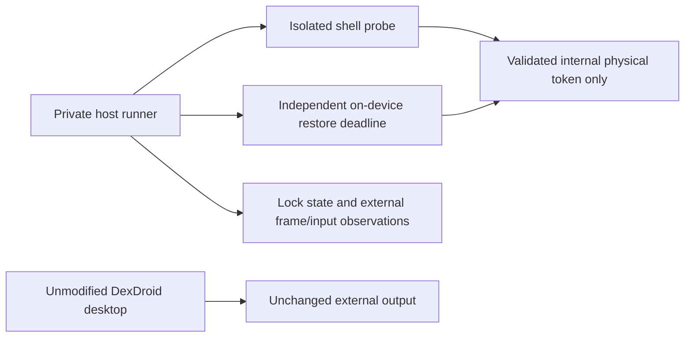
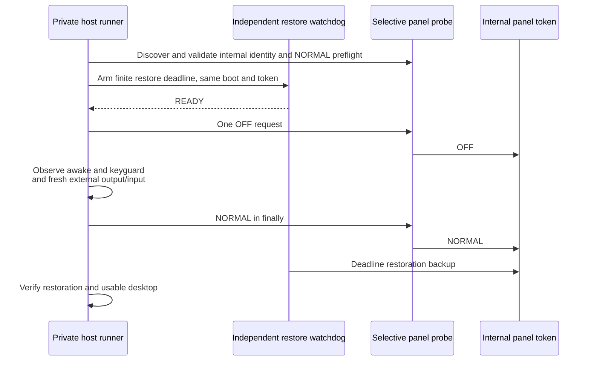

# Change: Phone screen power

## Approved production increment

Native acceptance found that global Dialog keyboard focus never becomes true
while the monitor owns focus, so the strict focus proxy correctly refused OFF but
prevented this use case. `/root/panel_product_arch` reviewed public WindowId/WMS
semantics and approved refining admission to the actual pointer-sink contract:
same resumed controller, shown/attached/laid-out full usable bounds, touch-modal
flags, complete pointer consumption, cancelled pad contacts, and restore on
detach/dismiss/Pause. Keyboard focus is not needed for touch interception. Tests
passively sample WindowId and prove native phone contact consumption before OFF
and while dark. System overlays/gestures remain Android-owned; no focus shifting,
privileged window dump or new permission is introduced.

On 2026-11-13 the user instructed: "Implement true phone screen off, restored using
button". FR-044 now specifies explicit true internal-panel off with monitor-button
restoration, default-Off visibility setting and no double-tap/Power remapping or
powered-black fallback. The prior optional title-row icon recommendation is the
implementation default: immediately before Settings on both controller surfaces.
The status card, four main actions and touchpad dimensions remain unchanged.

UI expert `/root/phone_screen_off_ui` approved pending/disabled/current-state
feedback, always-visible monitor recovery while off/unknown, no automatic off on
startup/toggle, and guide text explaining normal Power lock behavior. Production
rendered acceptance is recorded below; no human pixel baseline is approved.

Fresh architecture expert `/root/panel_product_arch` approved the service-owned
bounded intent, primary-helper-only fixed IPC and independent sole actuator in
the [production architecture](../architecture/features/phone-screen-power.md).
The actuator holds an exclusive boot/internal-target lock until confirmed restore;
OFF and NORMAL can never race between processes. Absolute app deadlines expire
without helper-generated renewal; CLOSE/EOF/expiry are terminal. Helper safety
close precedes global Stop/owner-death/destroy cleanup locks. Phone controller
pause/guard loss requests restore. Native stalls remain unknown rather than false
success. App/UI state and privileged ownership are separate implementation scopes.
No release/publication is authorized by this implementation instruction.

Implementation review by `/root/panel_product_arch` found and required correction
of recursive automatic restore on changed owners, UNAVAILABLE clearing possible
OFF, incomplete phone-guard readiness/focus loss, and incomplete Bundle decoding.
The approved correction uses exact positive request leases and six typed fields,
with a verified boot/internal-panel receipt captured by CHECK before OFF. OFF
and replacement-helper recovery must match that receipt. Automatic close becomes
idempotent, explicit retries remain separate, and focused guard admission is
asynchronous/current-owner checked. The tests cover cancelled guard readiness,
focus loss and Stop in addition to the core deadline/protocol/schema cases.

The only new hidden-API lint suppression is scoped to the shell-only control
loader for ClassLoaderFactory/loadLibrary0. The entry checks UID 2000 and refuses
OFF on unsupported capability/identity/readback. The lint baseline is unchanged.

### Current implementation verification — 2026-11-14

Installed development version 0.20.0 (53) on Xiaomi14 Android16. The phone-screen,
input, phone UI and monitor suites pass on the same production-source APK.
The latter suites required test-only count/hidden-optional-icon corrections;
earlier failed attempts remain retained. `qualityCheck` passes, including 313 JVM
tests; Python tooling reports 210 passes and one Windows skip. Requirement,
coverage, documentation, Ruff and privacy checks are recorded in the
[current evidence summary](../../testresults/0.20.0/summary.md).

The focused feature suite exercises all four rotations and separate Fit geometry,
native monitor off/on taps, native phone input isolation before/during OFF,
cancelled guard preparation, guard loss, Stop, background and pinned recovery.
Two separate deliberate fixture interruptions validate helper-kill and app-force-stop
recovery: internal Off/external On before interruption, both On afterward. The
first positive observations were 0.141s and 0.203s respectively, one trial each;
these are observations rather than a latency distribution or performance promise.
The interrupted fixture suites themselves are not counted as passes. Original
preference bytes were restored and verified after each interruption.

The architecture expert's final implementation review approved modal-pointer guard
readiness and receipt-preserving recovery transport; no implementation blockers
remained. Selected current phone/settings frames and four-rotation monitor crops,
plus four source-derived architecture diagrams, were author-inspected. Master
references live in `docs/ui-references/phone-screen-power.json`. No human pixel
baseline was approved. Android11/other ROMs, physical cable disconnect, broker
death, native compositor stalls, large fonts/TalkBack, keyboard combinations and
sustained power/performance remain unverified. Power and double-tap are excluded.

Raw evidence stays in a verified private local-only bundle. No commit, push or
release has been performed; final-candidate/release approvals are not claimed.
The test package is removed, the phone panel is On and the controller reopened.

## Historical prototype contract

The following sections describe the earlier prototype only. Statements about
unimplemented production behavior below are historical and superseded by the
approved increment and current verification record above.

FR-044 / DX-PANEL-001 is a prototype obligation, not shipped behavior. The
[feature contract](../specs/phone-screen-power.md) separates panel off, double-tap
wake and physical Power. Product UI placement remains open. No app source,
production APK or user security setting changes are authorized by these results.

## UI preflight

Expert `/root/phone_screen_off_ui` reviewed current title/status/main/touchpad
ownership. Recommendation: optional plain title-row icon before Settings, leaving
the status summary and four main actions unchanged; corresponding monitor Controls
screen-on action. The user's 2026-11-13 instruction authorizes an in-app control
and double-tap/physical Power prototypes. Final placement awaits results/decision.
Wake contacts must be fully consumed; a black powered guard is not panel off.

## Architecture preflight

Expert `/root/phone_power_arch` inspected SessionService, DeskService, shell
interfaces and existing display/input architecture; **APPROVE-APPROACH** for a
bounded shell-only first proof, before any phone touches. Gates: freshly map
display-0 INTERNAL to exactly one physical token; exclude monitor tokens; request
NORMAL first; arm an independent on-device 5–10 second restoration watchdog and
observe readiness before OFF; host backup/finally restoration; no OFF reapplication,
Power injection or settings changes. A later real-touch trial requires a separate
touch-catching fixture, never an invisible production Pad. Broader product owner,
IPC/lifecycle recovery and capability policy remain to be reviewed/implemented.

Current product owners remain unchanged: SessionService owns desktop lifecycle
and partial wake lock; DeskService owns one virtual display, not physical power.

## Acceptance

Initial prototype source: `53bf44a5bb9e04433d143feaa593137ed863f1e8`; at that stage only prototype
contract/records were added on this branch. Existing unrelated working-tree drafts
are preserved. Isolated sources, builds and device dumps stay ignored/private in
`.local/phone-power-prototype/`. No external upload or publication.

| Scenario | Result |
| --- | --- |
| Internal token and independent restore proof | Xiaomi Android 16: SurfaceFlinger internal Off/external On, then both On; independent deadline restoration request observed; physical panel appearance not human-confirmed |
| Monitor frames and fresh input while phone dark | Native monitor tap opens Apps from the inspected idle screen while internal power is reported Off; updated frame inspected privately |
| Guarded injected double tap, panel On then Off | Both pass: two consumed contacts, one WAKE, restored On; injected input does not prove physical touchscreen wake |
| Physical double tap with touch guard | Xiaomi Android 16 trial `guard-manual-20261113T142151Z`: no CONTACT/WAKE delivered; user confirms taps did nothing until automatic restore. Unsupported by this tested approach on this device |
| Natural physical Power behavior | Xiaomi trial `guard-manual-20261113T142500Z`: real KEY_POWER causes system sleep with reason power_button, keyguard and external Off; later Power wakes again. Fails DeX-style phone-only behavior |
| Android 11 and other ROMs | Unverified |
| Product UI, Stop/disconnect/helper-death recovery | Not implemented |

No production test suite has changed. The requirement remains deferred with no
automated-test mapping; prototype observations are not product coverage passes.

## Prototype findings and retained limits

2026-11-13 first proof `proof-20261113T135008Z` and guarded trials
`guard-on-20261113T135811Z` / `guard-off-20261113T135830Z` are private under the
working prototype directory above. The tested production desktop remains 0.19.0
(code 52); the temporary separate fixture targets API 36, min API 30. No production
package replacement, credential/security-setting change or general input filter.

The initial helper's inspect-only invocation returned its result then crashed
during native process shutdown. Explicit process exit resolved the observed V2+
runs. That first failure was observed in terminal output; no independent raw log
was captured for that invocation, and it is not a power-cycle pass. An initial guard
host attempt raced Activity startup and parsed Windows ADB CRLF incorrectly;
waited startup and corrected parsing resolved it before the guarded OFF trial.
No product performance claim follows from this development logcat bridge.

The architecture expert re-reviewed the guarded step and approved it after fixes:
OFF requires 3–10 seconds of remaining deadline; the watchdog restores in finally;
NORMAL restoration does not require the external monitor to remain connected.
The broker continuously latches cancellation, admits at most one OFF, terminates
on log-reader loss, and validates fresh fixture PID/focus before synthetic taps.
The guard becomes ready only while resumed/focused, consumes the whole wake
gesture and cancels on focus/lifecycle loss. No physical Power interception.

Both architecture diagrams were rendered and inspected. Requirement, coverage
and documentation validation pass; coverage is deliberately still deferred.
Product source/tests have not changed, so full Gradle/device regression is excluded
from this feasibility-only step. Final product placement, physical gesture/Power
results beyond the tested Xiaomi, Android 11, lifecycle/death recovery and production ownership remain open.

The manual trial `guard-manual-20261113T135912Z` timed out waiting for the Start
button, admitted no OFF request and confirmed internal On restoration. It supplies
no physical-input evidence. The temporary fixture is removed after the completed
automated trials; physical tests require a coordinated new trial with the user.

Evidence is sealed and verified in the [private experiment summary](../../testresults/0.19.0/phone-screen-power-prototype/summary.md).
The archive contains the final guarded sources/binaries; earlier helper revisions
were overwritten during iteration and are historical hash/observation records,
not reproducible archived binaries. No private evidence was uploaded.

### Coordinated physical double-tap trial

The user returned ready and started `guard-manual-20261113T142151Z`. The guard
logged READY → OFF → RESTORED over approximately ten seconds, with no CONTACT,
WAKE or CANCEL event. Android reported internal Off/external On, Awake and keyguard
false during the interval, then both panels On. The user explicitly reported:
"I tap but nothing happne until the test finish". This fails the physical
double-tap wake scenario for this guard/SurfaceControl approach on the tested
Xiaomi. The injected pass cannot be used as physical wake evidence. This does not
identify whether the driver or Android dispatch withheld the contacts; no raw
touch-node trace was captured during this trial. Physical Power is tested
separately; no change to locks, debugging or OEM double-tap preferences.

The first physical Power attempt (`20261113T142328Z`) timed out before Start and
admits no Power result. Subsequent coordinated trials allow up to five minutes
to press Start; this extends only the pre-OFF human waiting period. The independently
armed on-device OFF/restore deadline remains at most ten seconds.

### Coordinated physical Power trial

The user started `guard-manual-20261113T142500Z` and reported that Power immediately
turned off the phone. Passive `getevent` from the freshly identified pmic_pwrkey
node records two real DOWN/UP pairs. The OS records its last sleep at the first
DOWN with reason `power_button` and its last wake at the second DOWN. The guard
logs OFF, one CONTACT and CANCEL, then restoration. The CONTACT precedes the
guard cancellation and is not a double tap or wake success; its precise relation
to physical panel-off completion is not established.

The during snapshot reports internal Off/external On, Awake and keyguard absent.
The first restoration snapshot reports internal On/external Off with keyguard
showing. A later observation is Awake with keyguard absent after the user wakes
and unlocks. This is a failed phone-only Power behavior, not a phone shutdown
(ADB stays connected), and not a successful external-session continuity result.
The private harness exit 0 denotes completed observation/restore, not acceptance
of Power behavior. It never intercepted Power, dismissed keyguard or injected
compensating keys.

Recommendation pending user decision: genuine internal panel off with explicit
monitor Controls screen-on recovery. Double-tap wake and phone-only Power are
unsupported by this tested approach on Xiaomi. A powered black touch-catching
mode is a different optional design, not a silent fallback or battery-off claim.
Final product button placement and any such alternative still need a decision.

The [physical follow-up summary and verified private archive](../../testresults/0.19.0/phone-screen-power-physical/summary.md)
retain both observed failures and final cleanup; the first archive is unchanged.
