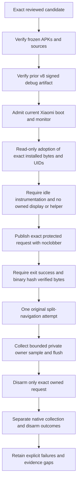
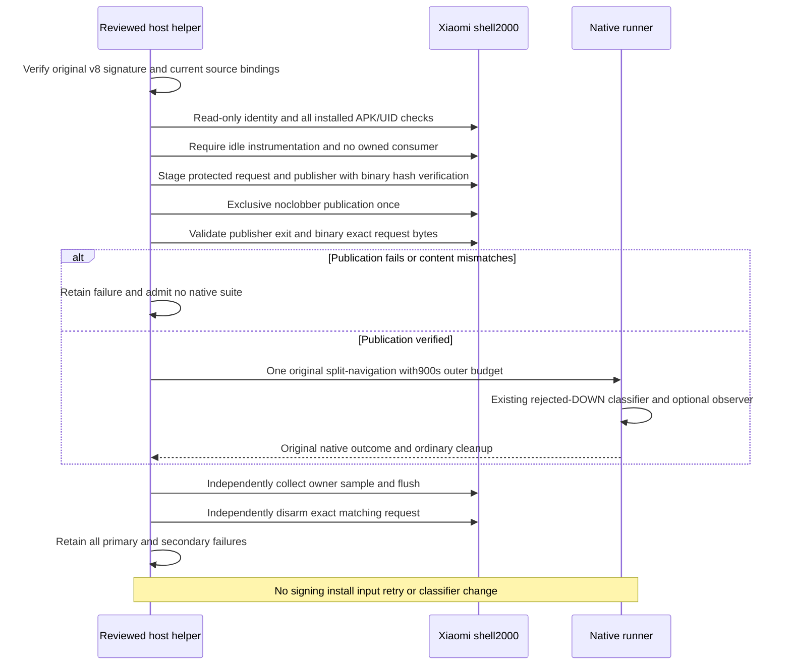

# Xiaomi replacement hardware acceptance

The user substitutes an unavailable Black Shark with a Xiaomi14. Read-only
admission identifies Android15/API35, model23127PN0CG, primary user0, shell2000,
no installed product/test/Shizuku packages, and the connected1920x1200 monitor.
Its identity and boot are recorded privately, not in portable tooling defaults.
This does not complete Android11 hardware acceptance. Earlier failures stay retained.

Architecture expert `/root/xiaomi_hardware_preflight` approves the approach at
2026-10-19T13:12:05Z: create a separate fresh-install generation, establish actual
UIDs, verify reused signed bytes independently and require exact operations reviews.
Do not weaken the old Black Shark guard or use its state/UIDs. No app source,
input classifier, navigation or UI changes are proposed; UI preflight is N/A.

The new private helper/contract will admit exact runtime/test sources, APKs,
device/boot, monitor and user; prepare Shizuku as shell without root; run focused
split, full eleven suites and focused navigation sequentially. Native failure
blocks dependent phases. Controller cleanup is not preference restoration or a
native Stop proof. Retain native, transport, fresh-cache and visual outcomes
separately. APK reuse requires certificate, manifest, payload and hash checks;
no new signing/key access is planned. Personal device evidence remains private.

The original preparation passes: product/test/manager install as distinct
UIDs10361/10362/10363, exact APK bytes verify, broker runs as shell2000 and product
authorization succeeds. The first split wrapper then fails before native execution:
its substring package query returns both product and test packages, while its UID
parser expects exactly one row. The12 command journals contain only read-only
admission/package queries. Preserve that terminal v1 failure; no split result exists.

The architecture expert approves a separate state-specific v2 approach at
2026-10-19T13:23:19Z. It strictly parses rows, selects the exact package and rejects
malformed/duplicate exact rows. Its `prepare` only adopts the bound successful v1
installation after rechecking exact UIDs, installed bytes, broker, boot and monitor.
No reinstall, broker-start replay, signing or data operation is included. The new
[v2 contract](xiaomi-migration-operations-v2.json) binds prior preparation/failure
records and current89-case calibration, including both observed row orders and
adoption failures. Native acceptance is still pending new exact operations reviews.
At2026-10-19T13:26:02Z the architecture expert inspects the actual v2 helper,
bound records,89-case calibration and both changed rendered diagrams and approves
the concrete approach without blockers for the new operations reviews. Its
approval is not native acceptance or release approval. The [v2 private packet](../../testresults/0.13.0/kotlin-migration/xiaomi-preflight-v2/summary.md)
is sealed before this faithful review attestation.

## HyperOS setup denial and isolated retry

The v2 verified adoption passes. Native split starts at20261019T132846.152793Z,
then emits no progress or desktop/split cache. Private system logs show a MIUI
permission-denied start of `dev.dexdroid/.MainActivity` from product UID10361 and
Activity start result102. The exact blocked Java frame is unverified; the evidence
is consistent with `startActivitySync` waiting for the rejected Activity. No split
behavior assertion is reached. The architecture expert approves one identified
instrumentation abort at2026-10-19T13:34:00Z. Root revalidates boot/UID/PID26400/
instrumentation, captures evidence and performs one package force-stop. The
original runner reports Process crashed/INSTRUMENTATION_CODE0 after357.616seconds,
then its existing controller launch succeeds. This is an operator-aborted setup,
not a natural900second timeout or a split assertion failure. Missing split cache
also fails collection independently. V2 stays terminal; later phases are unrun.

The actual DexDroid Other permissions UI shows **Open new windows while running
in the background → Deny**. The expert approves the one-control setup hypothesis
at2026-10-19T13:35:40Z. Root inspects the exact app/dialog and selects **Always
allow**; read-only app-op output changes MIUIOP10021 from ignore to allow. Overlay
remains default; lock-screen/autostart/other permissions are unchanged. Xiaomi's
[official guidance](https://www.mi.com/uk/support/faq/details/KA-497760/) names this
setting on another model; the local UI is the Xiaomi14-specific evidence. This
does not yet prove that startup is repaired.

The [v3 contract](xiaomi-migration-operations-v3.json) binds original/aborted records,
the observed UI permission delta and current94-case private calibration. Only a
new verified-adoption generation may run the original native suites after fresh
operations reviews. The helper rechecks the observed permission mode before each
phase; missing/denied/ambiguous state rejects admission. No app source, launch
code, assertions, timeouts, reinstall or signing is changed.
At2026-10-19T13:38:48Z the architecture expert inspects the concrete v3 delta,
permission UI evidence,94-case calibration and both actual diagram renders,
verifies the bindings and approves the approach without blockers for exact
operations review. Root corrects the native duration from rounded360 to357.616
seconds before freezing. Effectiveness of the permission remains unverified.
The current private calibration executes78 synthetic cases against the actual
helper, including suite clock discontinuity, native/cleanup/collection failures
and terminal failure recording. This is not hardware acceptance. An earlier
calibrator missing-import failure and superseded successful generations remain
private. A rendering invocation using unsupported `-w` fails before rendering;
the corrected `--size` invocation produces both inspected diagrams. Device-epoch
elapsed time must agree with host monotonic time within3seconds before fresh-cache
extraction; incoherent raw archives remain retained without freshness admission.
The same architecture expert inspects the corrected helper and calibration and
approves the concrete approach at2026-10-19T13:19:19Z, with no architecture blockers
for the two exact operations reviews. Hardware outcomes and release approval remain
separate. Both actual diagrams are inspected by root and the expert; the sequence
has minor label spacing but remains readable. The [private preflight packet](../../testresults/0.13.0/kotlin-migration/xiaomi-preflight/summary.md)
is sealed before this faithful review attestation; it does not contain a final
candidate approval or device-test result.

## Logical viewport correction and updated test preparation

The permission-bound v3 focused split run `20261019T134147.352944Z` passes
in215.819seconds (3136 PASS lines). Root inspects the phone Layout menu, all four
monitor rotations, protected pane and restored empty panes. They are readable and
consistent; this is an author visual inspection, not user or golden-catalog approval.
Injected-contact dispatch latency over100 contacts after10 warmups is p50=19ms,
p95=28ms, excluding physical peripherals, rendering and test result transport.

The subsequent full campaign `20261019T134547.412790Z` fails its first input suite
after4.931seconds. The remaining ten suites and navigation phases are unrun.
Native logs show Android's logical monitor frame is1920x1242 despite the1920x1200
signal mode. The old test injects center(960,600), which correctly maps through
Fit's21pixel letterbox to virtual(960,579). Its independent expected center is
(960,600). The same hardcoded assumption exists in the Java baseline. No product
arithmetic failure is demonstrated by this result.

The test now captures the attached monitor content frame and screen origin on the
main thread, revalidates the snapshot immediately before contact, and injects the
mapped logical point. Intended virtual coordinates and the original two-pixel
tolerance remain independent and unchanged. Product geometry, classifiers,
timeouts, navigation and APK are unchanged. Twelve parameterized JVM cases cover
the extra logical height across rotations/resolutions; qualityCheck passes with
181 JVM cases, zero failures/errors/skips. Coverage mappings are reconciled.

API35 emulator comparison `monitor-viewport-api35-comparison-v1` temporarily sets
logical1920x1242: the original test fails with(960,579), then the corrected test
passes268 PASS assertions in34.476seconds. Only its test APK is replaced; the
product APK is identical. The finally path resets and verifies the original
1920x1200 logical size. This proves the scoped test correction, not Xiaomi success.
Expert `/root/xiaomi_input_alignment_arch` approves the actual correction,
137 frozen v9 bindings and raw comparison/restoration evidence at
2026-10-19T13:58:07Z. Hardware and release approval remain separate.

The [v4 contract](xiaomi-migration-operations-v4.json) introduces a separate
test-only signing/update generation. It retains the installed product and manager,
verifies historical UIDs and APK bytes, proves idle instrumentation, and permits
one test-package force-stop followed by one replacement test install. Its signed
test payload/certificate/manifest and new candidate binding must verify before
focused input, the full eleven suites and navigation checks. Failures remain
terminal. Expert `/root/xiaomi_hardware_preflight` approves this approach at
2026-10-19T13:57:42Z, subject to concrete helper review and two fresh exact
operations approvals. The51 synthetic calibration cases exercise actual signing,
signed admission, update, phase and failure functions with mocked SDK/transports
and temporary dummy keys; no real key/device access occurs. They supplement the
unchanged v3 Device/suite calibration94 cases, not maintained acceptance totals.
No v4 real signing, install or native result is claimed by this preflight.
At2026-10-19T14:06:06Z, `/root/xiaomi_hardware_preflight` inspects the concrete
helper/contract/calibration/proof and both reconciled v6 diagram renders, approving
the approach without blockers before the two exact operations reviews. The
[private packet](../../testresults/0.13.0/kotlin-migration/xiaomi-viewport-preflight/summary.md)
contains1140 verified members; this faithful attestation and the expert-requested
contract-link correction follow its seal. This is not final release approval.

## Shared fixture viewport and second isolated update

V4 signs only the corrected test APK and updates it in place successfully;
product/test/manager UIDs10361/10362/10363 and other installed bytes remain exact.
Focused input `20261019T141021.549630Z` passes. Full run
`20261019T141110.821846Z` passes input and phone UI, then fails monitor Controls
settlement. The remaining eight suites and both navigation phases are unrun.
Logcat explicitly reports a1920x1242 frame and contact rejected outside the Fit
area: this suite independently maps its near-top edge from the1920x1200 signal,
placing DOWN at y6 inside the21px letterbox. The recognizer correctly refuses it.
Missing menu-text cache also fails collection separately; V4 remains terminal.

Expert `/root/xiaomi_input_alignment_arch` approves a shared test-only viewport
owner at2026-10-19T14:14:30Z and the corrected concrete delta at14:20:31Z.
`DeviceTestSupport` now owns the snapshot, main-thread capture/inline execution,
screen/inverse mappings and origin-aware inset clamping. Monitor, search, idle,
profiles, protection, legacy navigation and input fixtures reuse it. Finite mapped
contacts retain and revalidate their producing snapshot before DOWN and keep it
through UP/CANCEL. Keyboard keys capture an independent owner. PixelCopy extents,
pixel samples, centers and screen bounds use matching logical/screen spaces.
Existing split fixtures retain logical decor mapping and explicitly reject
nonzero screen origins. Signal-mode status assertions and deliberate Fit-bar,
busy/stale/cancellation scenarios retain their assertions and deadlines.

The concrete review catches and resolves intermediate center-sign, keyboard-owner
and snapshot-reacquisition mistakes before native execution. QualityCheck passes
in20seconds with193 JVM cases, zero failures/errors/skips; twelve new parameterized
edge cases preserve a6px virtual oracle and reject old signal-derived points.
V10 freezes137 source bindings, with eleven test/requirement changes from v9.
Its product APK remains byte-identical. Coverage and fixture-runtime checks pass.

The dedicated API35 comparison reproduces the original Controls failure in
`20261019T142117.265704Z` (5 PASS lines,17.843s); the updated full monitor suite
`20261019T142139.252799Z` passes2418 PASS lines in108.042s. The logical1242-height
override is reset and independently verified. This establishes the scoped native
correction, not hardware acceptance; retained pulled caches are not individually
freshness-certified by this comparison. Earlier quiet-output observation is
read-only and private. All original failed attempts remain retained.

The [v5 contract](xiaomi-migration-operations-v5.json) binds successful v4
preparation/current signed test and frozen v10 inputs. The helper changes only
separate generation paths and the first focused phase to monitor; signing remains
test-only, UID/idle/installed-byte/broker/permission guards and terminal behavior
remain intact. Expert `/root/xiaomi_hardware_preflight` approves that approach at
2026-10-19T14:21:53Z, subject to concrete review and two fresh exact operations
approvals. Actual renamed-function calibration passes51 mocked cases, separate
from the inherited94 Device/suite cases and maintained acceptance. V5 real
signing/update/native execution is still pending at this preflight.
At2026-10-19T14:26:27Z, `/root/xiaomi_hardware_preflight` inspects both final v8
diagram renders and reconciled documents and approves the complete concrete
approach without blockers before exact operations review. The
[private packet](../../testresults/0.13.0/kotlin-migration/xiaomi-shared-viewport-preflight/summary.md)
contains1880 verified members, sealed before this faithful attestation. No v5
hardware or final release approval follows from that verdict.

## Full campaign pass and focused navigation prerequisite

V5 test-only signing/update and focused monitor pass (2418 PASS lines,102.674s).
Full Xiaomi run `20261019T143258.560520Z` passes all eleven suites; native runner,
fresh-cache collection and installed UID/byte/broker checks all pass separately.
Injected dispatch samples are p50=20ms/p95=27ms over100 contacts after10 warmups,
excluding rendering, physical peripherals and broadcast/await transport.
Root inspects fresh phone Settings/search keyboard and monitor Controls/rotated
App settings captures: readable text/icons and no clipping in those selected
states. This is scoped author inspection, not full golden-catalog approval.

The subsequent focused single-view navigation run `20261019T144351.079448Z`
fails before contact after7.812s, at the existing readiness assertion. It calls
the Android11-format `InputWindowState.ready` unconditionally on Android15.
The consumed report was not retained, so a format mismatch is a source-supported
inference, not an observed parsed-field diagnosis. Collection has no errors;
ordinary controller cleanup remains separate. V5 stays terminal; split navigation
is unrun in that generation. This does not revoke its completed full-suite result.

Expert `/root/xiaomi_input_alignment_arch` approves the SDK-specific test-only
approach at2026-10-19T14:45:56Z and corrected concrete implementation at14:49:48Z.
API30 keeps its original report query/predicate. API31+ reuses the existing strict
modern helper with immutable task/UID/display/virtual geometry and the whitelisted
parent or nested child component. Raw geometry is captured on main before polling;
the View/idle prerequisite stays after readiness and the original waitForIdle.
The5second/40ms polling contract and all native outcomes remain; it is not a hard
end-to-end deadline because native queries retain their own bounds. API33 alone
uses the existing pointer-only focus flag option. Last consumed observations are
bounded and written privately on failure before cleanup, with independent write
errors suppressed onto the original failure. Missing old bytes stay missing.

V11 changes only LegacyNavigationAcceptance and requirements among137 frozen
bindings; runtime and other executed dependencies remain identical to v10.
QualityCheck passes in7s with193 cached JVM outcomes. API35 comparison retains
old prerequisite failure `20261019T145030.326636Z` (5 PASS lines,10.621s) and full
corrected navigation pass `20261019T145044.010892Z` (111 PASS lines,20.025s).
Original logical display geometry is restored and verified.

The [v6 contract](xiaomi-migration-operations-v6.json) binds successful v5
preparation/current test and a dependency record linking the original v5 full run,
its signed v10 APKs,135 unchanged source inputs and identical suite metadata.
DeviceChecks calls LegacyNavigationAcceptance only for legacyNavigationOnly,
which the full campaign does not select. Reusing that full result is explicitly
v5/v10 evidence, not a v11 all-suite rerun. V6 signs/updates only the new test,
then runs both focused navigation phases in order. Its45 actual-function mocked
cases pass; inherited94 Device/suite cases remain separate. Expert
`/root/xiaomi_hardware_preflight` approves this approach at14:51:15Z, subject to
concrete review and two fresh exact operations approvals. V6 real operations
remain pending at this preflight.
At2026-10-19T14:55:09Z, `/root/xiaomi_hardware_preflight` inspects the reconciled
documents and both v9 renders and approves the complete concrete approach without
blockers before exact operations reviews. The
[private packet](../../testresults/0.13.0/kotlin-migration/xiaomi-navigation-preflight/summary.md)
contains3237 verified members and is sealed before this faithful attestation.
Hardware outcomes and final migration/release approval remain separate.

## Architecture

This is an execution branch of the existing [verification architecture](../architecture/features/verification-and-release.md),
not a new runtime owner. The [reviewed contract](xiaomi-migration-operations-v10.json)
binds its private helper and inputs. The maintained [native runner](../../tools/run_device_checks.py)
retains suite ordering, deadlines, assertions and ordinary controller cleanup.

### Failure-only readiness collection correction

The first v6 operations pair inspected digest `d93776918c4435419a9b37074ba0c37f109ea9e702ddbec372a7c59abed72ed4`: `/root/xiaomi_v6_ops_review_a` approved at 2026-10-19T14:57:48.759612Z; `/root/xiaomi_v6_ops_review_b` rejected at 2026-10-19T14:57:50Z because the maintained runner did not collect the new failure-only readiness file. No v6 signing, installation or native execution occurred. Neither verdict applies to the corrected candidate.

The private v6 wrapper now collects only `legacy-navigation-readiness/consumed.txt` after the unchanged native runner, including its exception path. It retains the raw response, requires coherent run-clock freshness, rejects unsafe/unexpected members and bounds the archive/file to 10MiB/9MiB (eight fields of 262144 UTF-16 units, conservatively allowing four UTF-8 bytes per unit plus headers). Success permits confirmed absence or explicitly excluded stale data. Any failed legacy run conservatively requires a fresh report for operations acceptance; a later-stage failure may legitimately lack it, in which case collection is separately unverified/failed rather than inventing a report. The native primary exception/result remains intact. Collection failures stop the procedure. This read-only host correction changes no APK or maintained runner and does not alter the original v5 full-campaign reuse.

`/root/xiaomi_hardware_preflight` approved the approach at 2026-10-19T14:58:56Z. Actual-function synthetic calibration now exercises 66 cases, including 13 collection and eight wrapper combinations: success/absence/stale, failed-native/fresh or missing, invalid clock, malformed/oversized/unsafe archives, permission failure, primary-error preservation and split exclusion. Raw calibration is private; the updated sealed descriptor remains [navigation preflight](../../testresults/0.13.0/kotlin-migration/xiaomi-navigation-preflight/archive.json).

At 2026-10-19T15:01:19Z `/root/xiaomi_hardware_preflight` inspected the corrected collector, 66-case calibration and all2922bindings, and approved the concrete approach without blockers before two new operations reviews. It confirmed unchanged APK/runner/reuse ownership and current diagram semantics. This faithful attestation follows the corrected packet seal; it grants no device outcome or release approval.

### V6 immediate-transition failure and settled-focus test generation

The corrected v6 operations pair `/root/xiaomi_v6_collection_ops_a` (2026-10-19T15:04:09Z) and `/root/xiaomi_v6_collection_ops_b` (2026-10-19T15:04:06Z) approved operations digest `44180fc5d1b733c8a756ecb4888f848d6978039544c68f5d276267820f797fb8`. Test-only signing and preparation passed, preserving UIDs10361/10362/10363. Native legacy run `20261019T150452.451244Z` failed after48PASS lines/16.782seconds, after multiple successful parent/child contacts and Back. Its second-cycle Back DOWN reached the parent, parent UP was canceled, child focus arrived16ms later and child received an uncanceled UP without DOWN. This supports a transition-focus race hypothesis, not a proven Kotlin regression or product dispatch repair. V6 is terminal; split-navigation did not run.

The failure occurred outside the readiness capture boundary and produced no consumed.txt. The independent collector retained the raw malformed response and failed separately: exec-out merged the missing-directory diagnostic into tar stdout while reporting zero exit. No historical report is recovered. A read-only shell-v2/noPTY probe gives remote exit1, separate exact two-line stderr and a1024zero-byte empty archive. The v7 collector admits only those exact observed absence conditions after native success; all other errors remain failures.

The v13 test generation adds an API31+ Back prerequisite using the fixture's existing `focused` report, five seconds/40ms polling, immutable identity/geometry and atomic main-thread final validation before one key. API30 key behavior and every original cycle/outcome assertion remain unchanged. It tests settled-focus Back; immediate-transition Back remains unverified. API31-33 applicability is separately unverified. The product APK and all135unaffected full-campaign source dependencies remain unchanged. `/root/xiaomi_hardware_preflight` approved the source-based approach at2026-10-19T15:06:54Z; concrete v7 operations reviews and native results remain pending.

At2026-10-19T15:11:15Z `/root/xiaomi_hardware_preflight` verified all3405bindings, 66-case calibration, actual shell-v2 absence probe, unchanged full-campaign dependencies/attribution and both v10 rendered diagrams, approving the concrete v7 approach without blockers before two fresh exact operations reviews. Both emulator generations passed with geometry restored; immediate-transition Back and API31-33 applicability remain gaps. This is faithful post-seal attestation only, not native or release approval.

### V7 settled navigation pass and rejected second-pane DOWN

`/root/xiaomi_v7_ops_a` (2026-10-19T15:13:13Z) and `/root/xiaomi_v7_ops_b` (2026-10-19T15:13:34Z) approved operations digest `0cce9f3721e234d0402fb7e84271c937296f475c4985dfb068f6d3e403b6c5f6`. Test signing/update passed with unchanged product/manager and UID continuity. Legacy run `20261019T151435.961751Z` passed126assertions/11.226seconds; the noPTY collector correctly admitted confirmed absence on success. Split-navigation run `20261019T151550.464651Z` failed485assertions/37.028seconds: a relayed DOWN to pane2 was rejected, causing fail-stop; physical UP and cleanup CANCEL then failed after teardown. Native cache collection had no errors. V7 is terminal. The post-teardown dump cannot establish the shell classifier's consumed decision, and the original all-eleven pass remains separately attributed to v5/v10.

### Narrow debug-only consumed-decision diagnosis

`/root/xiaomi_hardware_preflight` approved the bounded capture approach at2026-10-19T15:17:30Z, child-only sample selection at15:19:13Z and the concrete selector/product-only update approach at15:22:11Z. The synthetic pending-parent test intentionally rejects an earlier contact, so the strict Xiaomi profile skips nonmatching parent/UID observations without consuming the slot. It captures the first exact child/UID10362 or null-before sample, with exact build/API35/shell2000/secondary-role, protected nonce/boot/expiry, exclusive owner and bounded private writes. Null/unknown/changed/error results remain evidence, not readiness. A null sample can consume the slot before the intended failure. Emulator consumption behavior stays unchanged. No query, input, classifier, retry or cancellation decision changes.

The diagnostic debug product APK changes to `44ab4c8b186a1bd5bf1fba32b47af02ce52326c264e4a190f26dbc9940eb1a66`; the test APK stays `1b7352fb6614a21b741ae7015de16840768b18d0a86cb8dae8e8f9554b69ff5e`. All200JVM tests pass, including seven new stateful profile/target/one-shot guards. Production APK and AAB exclude diagnostic definitions. V8 signs/updates only debug product in place after exact installed identities, idle instrumentation and one native Stop from the already-visible controller; no launch/forced focus or data replay. It verifies owned-display absence and that old helper PIDs have exited. It then exclusively publishes a protected request and runs one original split-navigation attempt. Owner/sample/flush are collected privately even on native failure, bound to request/build/boot/new-helper identity. Exact request disarm is independent; the unique output remains. Missing/truncated capture is inconclusive; timing-perturbed capture does not certify ordinary performance. Concrete operation reviews/native outcomes remain pending.

Concrete review first identified three v8 draft blockers: the wrong native focus-report shape, missing identity/focus revalidation after hierarchy selection, and error-record writes preventing later disarm. They are corrected before any signing/device mutation. Actual read-only Xiaomi focus and hierarchy bytes validate the real parsers; preparation revalidates exact identity and focus after the snapshot with a five-second freshness bound. Diagnostic cleanup attempts disarm even when error-record persistence fails. Calibration now passes85 actual-function cases (including those failure paths), and nontruncated report hashes/UTF16 lengths are verified. All4196operation bindings match; current diagrams remain source-consistent.

At2026-10-19T15:32:57Z `/root/xiaomi_hardware_preflight` verified the corrected v8 helper, all4196bindings, 85-case calibration, actual Xiaomi focus/hierarchy proof, production APK/AAB exclusion and consistent v12 diagrams, approving the concrete approach without blockers before two fresh exact operations reviews. It confirmed the three draft blockers resolved, independent disarm after record-write errors and report SHA256/UTF16 validation. This faithful post-seal attestation grants no signing outcome, hardware acceptance, input repair or release approval.

### V8 publication denial and isolated v9 adoption

Both `/root/xiaomi_v8_ops_a` (2026-10-19T15:36:48Z) and `/root/xiaomi_v8_ops_b` (2026-10-19T15:37:04Z) approved operations digest `2e1f9afc49ce9926b4b19d824a821b9b1217bd99ae31716fb45ba017e5b31d5a`. Debug signing and preparation passed: signed debug SHA `ca174da779cc9d4347f94009c186174262500149d17c86027c8f11552d69e178`, unchanged test `c639ec6803367aaf277aae6bfe9bf92e515e028029d0caaabecfac0dc7722730`, all UIDs unchanged, one native Stop succeeded and old helper29250 exited. Diagnosis then failed before native execution when Xiaomi denied hard-link publication (journal0043). No fixed request or sample was published; disarm recorded not-published/absent, collection independently recorded missing owner. V8 remains terminal, with no native diagnostic outcome.

At2026-10-19T15:40:40Z `/root/xiaomi_hardware_preflight` approved a separate v9 approach: read-only adoption of successful v8 preparation/signature and current installed identities; no signing, installation, launch, force-stop, permission or root change. Replace hard-link publication with the exact previously exercised noclobber script (SHA `532e81da5f735a911eec87245d1eeeaf93b7312e79f88b8e45b8bfe69a02956f`). Retained emulator duplicate-target evidence shows refusal with unchanged bytes; Xiaomi publication remains unverified. Require no consumer before publication, stage script/request with verified permissions/bytes, invoke once and admit no suite until exit0 and exact protected request validation. Partial/collision failure is terminal; never overwrite/retry/delete mismatched content. All original capture/disarm limits and errors remain separate. Source/APKs stay unchanged; v9 private calibration passes82 actual-function mocked cases including partial writes, collisions and no consumer after failed publication. Concrete v9 reviews and execution are pending.

At2026-10-19T15:44:19Z `/root/xiaomi_hardware_preflight` verified all5017bindings and138unchanged frozen sources, the v9 helper/preserved calibration copies and82actual-function cases, original v8 signature/adoption and exact publisher evidence, reconciled documentation and both readable v13 renders. It approved the concrete approach without blockers before archive verification and two fresh exact operations reviews. No signing/install action remains, and failed publication cannot reach the native suite. This faithful post-seal attestation grants no physical outcome, input repair, ordinary performance or release approval.

### V9 text transport failure and isolated v10 binary verification

The exact v9 operations candidate `d2eaf748699f765d52efe0a0e7b1ee1a21fd8a7870e19eea89294482a40c8c66` was approved independently by `/root/xiaomi_v9_ops_a` at2026-10-19T15:48:37Z and `/root/xiaomi_v9_ops_b` at2026-10-19T15:48:32.976494Z. On2026-10-20 the first read-only admission failed because the saved ADB endpoint was disconnected. No phase state or device mutation occurred; its journal remains under `xiaomi-hardware-v9-prepare-admission-offline`. Reconnecting the same endpoint recovered the same boot/build. Byte-identical reviewed preparation then passed, preserving all installed APKs/UIDs.

V9 diagnosis failed before fixed-request publication or native execution: the staged55-byte publisher was read as59bytes by `adb shell -T cat` (LF expanded toCRLF). The terminal result, independent missing-owner collection failure and not-published/absent disarm remain intact. A separate read-only comparison proves remote SHA-256, `exec-out` and `pull` match the original55bytes exactly; shell output is precisely the CRLF-expanded form. It does not establish any app input outcome.

Architecture expert `/root/xiaomi_binary_transport_arch` approved the v10 approach at2026-10-20T14:19:06Z. A distinct generation adopts the existing installation, replacing only protected-file reads with binary `exec-out` and strict pre/post realpath, owner2000/mode600/regular-file/size metadata and exact remote/local SHA-256 equality. Exit zero alone is insufficient. The source assumes trusted write-once fixture files bounded to2MiB; `capture_output` is not an adversarial memory bound. Existing noclobber publication, no consumer before complete validation, one original native attempt and independent exact guarded disarm remain unchanged. No signing/install/permission/root or input change is included. V9 remains terminal; v10 has its own paths/state.

Private calibration passes95 actual-function mocked cases, retaining prior protocol coverage and adding exact LF/binary data, CRLF expansion, same-length corruption, merged error output, malformed/wrong-path/changed hashes, changed path/metadata and transport failure. The earlier91-case pass and subsequent calibration-driver expectation failure are retained separately; only the corrected95-case record describes the current helper/producer. No maintained app/test source or APK changes, so the200JVM/208tool/one-skip evidence is source-bound reuse for unchanged executed inputs. Exactly one of138 provenance entries changes: requirements criterion metadata. Historical provenance remains intact; a derived snapshot binds this single documented delta plus137 unchanged entries, while current requirement/coverage/docs/privacy validation is separate. Exact operations approval and physical capture remain pending; missing/null/truncated capture can still be inconclusive.

At2026-10-20T14:23:13Z `/root/xiaomi_binary_transport_arch` approved the final concrete v10 procedure without architectural blockers: all5527bindings, exact current helper/producer and95-case v4 calibration, all138 derived provenance entries with the sole documented requirements metadata delta, intact historical provenance and both v14 diagrams. This supersedes its earlier concrete verdict. Scope remains private local operations, pending two exact-candidate reviews and physical outcome; no release approval.

### V10 actual outcome and normal repeatability plan

Both `/root/xiaomi_v10_ops_a` (2026-10-20T14:26:23Z) and `/root/xiaomi_v10_ops_b` (2026-10-20T14:26:34Z) approved exact operations digest `bbf4eda63d513a9bb3a20ec479642801b3807e6d1b1962809781c7b32a461585`. Preparation and binary-verified publication passed. Native run `20261020T142710.557054Z` passed1149assertions in84.823seconds. The secondary owner record binds PID20205/display104 to the protected request. Sample/flush are absent: capture is inconclusive, not proof that no eligible rejection happened, because observer errors remain secondary. Collection records the missing-sample failure separately (journal0107); exact guarded disarm passed. The generation remains terminal and is not retried. The earlier native rejected-DOWN failure remains unresolved, and this instrumented pass does not establish ordinary performance.

At2026-10-20T14:31:39Z `/root/xiaomi_binary_transport_arch` approved a separate bounded normal repeatability experiment: at most three predeclared fresh-session original split-navigation attempts, with the fixed request absent, no diagnostic observer startup, exact source/APK/boot/UID/monitor/broker identities and verified absence of both owned displays and shell helpers before each attempt. Stop on first admission/native/collection/cleanup failure; retain every original result and independent cleanup. This local test execution grants no signing/install, product input change or release approval. Current runner restoration may create a new primary desktop, so its visible controller must be stopped through one normally guarded native Stop before absence is established; no unknown owner may be killed or adopted. The concrete Stop boundary and experiments remain pending.

### Final Android12-15 matrix plan

Architecture expert `/root/emulator_final_matrix_arch` approved the separate private final-matrix approach at2026-10-20T14:30:46Z. Use only retained dedicated Google APIs AVDs API31/33/34/35 at fixed ports, one active platform campaign at a time, current identical frozen debug/test APKs and nonroot shell2000/Shizuku ownership. Bound startup; preserve image/config/boot/APK/UID identities and ordinary onboarding/permission records. Simulate1920x1200/160DPI external output; no trusted-display bypass or personal-app captures.

For API33/34/35, plan the original eleven-suite campaign plus applicable focused legacy/split navigation and no-monitor controller, retaining original failed prefixes and unrun dependent tails. API31's inherited missing trusted-display authority must be observed, not bypassed: ten desktop-dependent base suites (including UI) and both navigation suites are capability-blocked if unchanged. Icon and disconnected controller are independent. Remove only the emulator secondary display for controller and restore it independently in finally. Native Chrome Stop is a separate synthetic no-account prerequisite/gate; no instrumentation or launch request substitutes for it. Current rendered acceptance, collection and ordinary performance remain distinct. Implementation/execution and final migration/release approval are pending.

The normal adapter's three concrete findings were corrected before device execution: failed admission cleanup cannot tap Stop again, retained-primary identity is carried across attempt boundaries, and Stop absence recognizes both content description and first-line text. `/root/xiaomi_binary_transport_arch` approved concrete SHA `9bd1871f55cf724d61d7d9b1c26df126d75ec6748d20535f8428f174c794f497` at2026-10-20T14:37:20Z after all12 actual calibration cases and5527input/138provenance bindings verified. The three normal attempts all pass with independent collection and Stop-boundary cleanup: `20261020T143750.205335Z`, `20261020T143933.676982Z`, `20261020T144116.446881Z`. These are repeatability observations, not a repair of the retained historical failure. No further normal attempt is scheduled.

At2026-10-20T14:43:36Z `/root/emulator_final_matrix_arch` approved an integrated emulator owner approach, superseding the draft's unsupported detachment assumption. One process holds the Windows job across boot, native campaign and teardown. Install/launch admission is ordered, exact-boot graceful shutdown and owned-job cleanup stay independent, and startup failures retain their primary error even without completed configuration. The actual executor child/grandchild and empty-job canary passes with active count zero after cleanup;17 actual permission/extraction/secondary-restoration calibration cases pass. The first calibration producer's malformed oversized-tar construction is retained as a failed preparation; the corrected producer tests the size rejection without allocating a large payload. Concrete procedure review, diagram renders and emulator actions remain pending.

### Final emulator capability measurement correction

At2026-10-20T14:49:40Z `/root/emulator_final_matrix_arch` approved the concrete
integrated v1 owner/startup/runner after suspended job assignment, actual AVD
admission and rendered v3 diagrams were verified. API31,33,34 each passed icon
and disconnected controller with independent collection/post-bindings and owned
job cleanup. Their package-only permission gate returned-1, so twelve dependent
entries per image did not run. Those skipped entries are inconclusive: earlier
native desktop results on matching images conflict with treating this package
query as actual shell caller authority. V1 records remain intact; API35 v1 was
not run. No platform-wide denial or desktop pass follows from these six passes.

At2026-10-20T14:55:20Z the same architecture expert approved a distinct v2
read-only caller measurement approach. One frozen DEX invokes
`IActivityManager.checkPermission(permission,pid,uid)` as actual shell2000, on
exact AVD/API/boot/fingerprint. Package metadata remains separately recorded.
No app/Looper bootstrap, grant, display creation, input or root execution is
included. Reflection/transport/identity failures halt as inconclusive; a measured
caller denial blocks dependent stages. Unique staging uses verified host/source/
compiler/DEX and remote path/owner/mode/size/hash bindings. Exact file cleanup is
independent and refuses changed bytes/identity; retained directory and errors are
recorded. Buffered trusted output validation is not a hard adversarial bound.

Concrete review first requested evidence bindings and retained-staging disclosure;
these were corrected before any probe device execution. At2026-10-20T15:03:11Z
`/root/emulator_final_matrix_arch` explicitly approved v2 implementation after
20 actual-function probe protocol cases,17 matrix protocol cases, all138 source
bindings, both frozen APKs and both readable v4 diagrams. Reviewed owner SHA
`19ca2112b92084b899b594deb810b1bc0c867719830bb9ba3a5d682fdcaa17a3`,
startup `9f72f0792e8902aa347e652a595156cb16dc9da9a41a22dd1a150e419bedbbce`,
runner `a3237f91ffa52fe170ba047fd3a4bcbdcb9b3e1741fd3301538b5f139000389e`,
probe adapter `851c81a8526f6b74686f291df721f0c542c0a04785d50eb943381b719d9de8be`,
DEX `442419baf7870dab8a6a9e471f47e2061b7fc9d0cfe6171db23dba7d072e7ef3`.
Scope is sequential local procedure only; native, rendered acceptance and release
approval remain separate. V2 has new output paths and cannot reset terminal v1.

### Warm predecessor diagnostic plan

The architecture follow-up identifies one concrete state difference: the failed
historical sequence ran legacy navigation followed by split navigation, while
three later normal split attempts stopped desktop ownership before each trial.
A separate single warm predecessor experiment will run original legacy navigation
once, preserve ordinary maintained-runner restoration, then run original split
navigation once without an extra Stop between them. No diagnostic request,
observer, install, input retry or assertion change is permitted. Admission and
one final guarded Stop/independent collection remain; first failure halts the
tail. A pass is nonreproduction, not proof that the historical failure is fixed.
Concrete review/calibration is required before execution. This changes only
private test sequencing; no product architecture or user interaction change.

At2026-10-20T15:10:23Z `/root/xiaomi_binary_transport_arch` approved corrected
warm-sequence helper `bd98b540ee31a1d66cffd327dbc6da415262d573704ec47df837387f43fa2b48`
after seven actual-flow cases. Both stages require fresh read-only admission,
idle instrumentation and absent request; no overlapping native-run discovery
is permitted. The preceding concrete review's two findings are resolved.

At2026-10-20T15:08:11Z `/root/emulator_final_matrix_arch` approved retrospective
API33 recovery helper `a4880f6d8429676b9669c203fc577900798dccfdfe2a2ac3aba0c3703073c584`.
It reads only the existing fixed readiness file under a separately admitted new
boot, without install/launch/test/grants. Timestamp-compatible bytes alone do not
authenticate original-run provenance; stale/missing/oversized output remains a
gap. Native failure and owned-job cleanup stay separate.

At2026-10-20T15:10:24Z the same expert approved separate API34/35 native Chrome
Stop adapters: owner `0dba51ad3468606e8ce91e105020d1d53c72e05d202765059ec887a87daedeec`
(its subsequent message corrected a transcription typo), startup
`4c6db2b8d877d801f22deaf9d251a42bec734cbde50de7eaaecafb45d0e7beb0`,
adapter `4279ba8f0b699c8932bd397d4b19d22160552429299f3a8bee1f394b57de5ff9`.
Three original fifteen-second cycles require zero accounts, matching frozen APKs
and normal single-view/onboarding prerequisites. These are local procedure
approvals, not native/visual or release approvals; all executions remain pending.

### Completed scope and final targeted correction

API35 original frozen pair completed all11 suites plus legacy navigation, split
navigation and disconnected controller in the final v2 campaign; private
collection/post-bindings and exact-boot/job cleanup pass. Main run
`20261020T151205.778163Z`; focused runs `20261020T152321.468543Z`,
`20261020T152338.252998Z`, `20261020T152543.591117Z`.
Xiaomi warm predecessor runs `20261020T152622.628379Z` and
`20261020T152641.796025Z` pass with collection/final guarded cleanup. These do not
explain the historical rejected-DOWN failure.

API33 v1 retrospective recovery stopped before cache access because package-list
substring results included the test package. V2 exact-package parser passes5
cases and was approved by `/root/emulator_final_matrix_arch` at2026-10-20T15:27:53Z
(SHA `5c4e2ca5918204668551c183bb4a64870d32daf7cb2c85af112c21156a290eb6`).
It recovers67059bytes with matching pre/post metadata/hash, original-interval mtime
and clean job teardown. Cross-boot/timestamp provenance limits remain. The sample
has the expected task but no input window during resize; the short failed run
supports an early double-observation race hypothesis, not reconstructed causality.

Android14 native Stop v1/v2 stop at setup with zero cycles; v3 first completes
one15-second cycle, then fails selection because Chrome's visible/enabled label
has no clickable ancestor in that snapshot. No second Chrome tap or failed Stop
is inferred. The new selector may poll only one otherwise fully safe nonclickable
label within its original deadline; unsafe/ambiguous snapshots remain fatal.
Earlier attempts remain terminal. No further Android12-14 test is authorized.

The user stopped extensive other-OS checks and then requested finishing the fix
and releasing. `/root/emulator_final_matrix_arch` approved the reduced scope
at2026-10-20T15:39:25Z, then the final targeted selector/API35-only approach
at2026-10-20T15:41:05Z. Its prepared keyboard observation and narrow input waiter
approvals are2026-10-20T15:14:26Z and15:36:30Z. Actual Spotless/build succeeds;
22selector host tests pass. The runtime APK remains byte-identical, while the
rebuilt test SHA is `0af6f8a397a3465d84ba4b6e1c6f8e2ef40afc3c82101e7c74def276b2950588`.
A new138-entry snapshot binds5reviewed test/metadata changes and133unchanged
entries, preserving the original full campaigns and source-level early-route
exclusion proof. Current host gates pass; API35-focused execution and release
architecture/final approvals remain pending. No production predicate or native
input retry was added.

### Final physical readiness procedure

The user selected the actual Xiaomi14 Android15 instead of the proposed final
emulator run. The monitor stays connected; the fresh disconnected-controller
check is excluded, with its prior API35 result retaining its original APK.

At2026-10-20T15:55:47Z `/root/emulator_final_matrix_arch` approved the concrete
private adapter `a0ad722f33d925297944df0089ff93d5e1fa0ce1c597ac49152b3672ad0fa7d1`
and all14 bindings in the [final operation contract](kotlin-migration-final-focused-operations.json).
The two physical flow/sequence renders are readable and source-consistent.
Six actual-function host calibration cases pass for known old/new test selection,
unknown bytes, UID/path changes and nonempty tar stderr. These are procedure
checks, not native acceptance.

The procedure admits exact phone/boot/user/shell/monitor/package identities,
checks absent instrumentation/diagnostic request and existing Shizuku/OEM state,
then signs and updates only the new instrumentation APK with the existing key.
The release-certified debug product remains installed unchanged; its full
nonsignature payload equals the frozen44ab runtime. Credentials remain private.
Native Chrome Stop uses the unchanged checker cycle against the exactly verified
installed signed product, never a hash-mismatch override or replaced build file.
Three15-second focus checks precede one input and one keyboard suite. Independent
cleanup admits device and known installed old/new test state before any controller
launch; unknown state causes no cleanup input. Failed native input is never retried.
All phone captures stay private local. This procedure grants no release approval.

### Retained final-check preconditions and diagnostic wording

The first physical readiness generation signs/updates only test0af6 to signedf859
with unchanged UID10362. Chrome setup succeeds, but its first launch selection
never finds a clickable row; seven fresh observations end at the original10-second
deadline. No Chrome launch or native Stop input is sent. Its cleanup refuses Stop
conservatively and the terminal result remains failed.

At2026-10-20T16:00:49Z `/root/emulator_final_matrix_arch` approves the separate
remaining adapter `86a35d89d80fb13a81963765fdcae32d388041a9f43dd98fb6830e1314fa0e65`,
six current/fourteen parent bindings and138source/APK entries, including the
known-picker Close/first guarded Stop boundary. Input native run
`20261020T160141.526722Z` completes273assertions and native code-1 in32.497s,
but the unchanged strict host parser rejects the success message containing
"failure." Its runner result is failed, keyboard unrun, and guarded cleanup
passes. Optional failure-cache collection produces an invalid tar and stays
inconclusive; no missing observation is manufactured.

A local wording-only correction replaces that success description with
"transient readiness resets streak and continues polling." Architecture impact
is N/A for the string: no predicate, assertion, deadline, parser or production
code changes. New test SHA is
`4c4e82d55a2667d9aba347d998c835f907ade284f934e8ea64b329db1180c584`;
runtime44ab remains unchanged. The separately bound v2 test-only update/input/
keyboard procedure is pending concrete approval; Chrome will not rerun. Four
procedure functions are text-identical to the six-case calibrated v1 helpers;
this is a source dependency proof, not execution of the new adapter.

### Final focused pass and interrupted owner

At2026-10-20T16:04:09Z `/root/emulator_final_matrix_arch` approves adapter
`e49dfc736e4de5d55ed0b9b42e4efde45b35fdbe2b371248e1fe3e173b8b8a8c`,
16operation/138source bindings and unchanged predicates/classifier. The test-only
update verifies signed SHA
`05973636da8c14eda29c838b4140b5c9c44bb80880fd7cc62adb47fcc31e578e`.
Input `20261020T160518.012469Z` passes273assertions in31.993s.

Chat-turn interruption ends the outer owner before keyboard native invocation.
The original outer running metadata and keyboard preflight folder remain intact;
`xiaomi-release-interruption-v1` independently records owner absence, no keyboard
command directory, exact device/APK admission and no active instrumentation.
No cleanup or keyboard pass is inferred for that interrupted owner.

At2026-10-20T16:08:04Z the same architecture expert approves only the unstarted
keyboard continuation, adapter
`79becd34f7e43c9f6f656fc5c137b861019bed86cf9746c90de9e76e6f53b922`,
seven current/sixteen parent bindings and138source entries. Keyboard
`20261020T160845.434782Z` passes2405assertions in55.654s. Its collection and
independent final guarded cleanup pass. No further install/signing/input or
Chrome rerun occurs in that continuation. Chrome remains incomplete. Final
release architecture and two fresh candidate reviews are separate gates.
