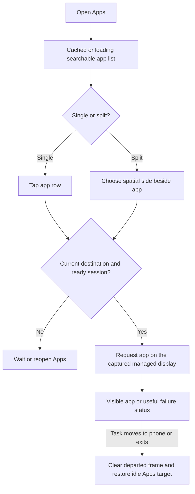

# Feature Specification: App launching, catalog and task handoff

**Feature Branch**: `chore/existing-feature-specs` (retrospective documentation)

**Created**: 2026-10-16

**Status**: Backfilled contract for existing behavior; verification remains scoped in the
requirement map.

**Input**: Find an installed app promptly, open it on the monitor, and recover the launcher when
that task leaves.

Uses the [Spec Kit-style template](../templates/spec.md). The [baseline](../../SPEC.md)
owns the complete numbered contract. IDs below refer to that baseline and are not
new feature-local requirements. This backfill adds no app behavior or test result.

The main Apps action directly opens a combined searchable launcher. Its mode
selector switches Single / Left-right / Up-down in place; split rows have explicit
spatial launch actions. Layout remains for advanced controls. See
[split view](split-view.md) for pressed feedback, parent navigation and saved geometry.

## User Scenarios & Testing

### User Story 1 - Find and open an app (Priority: P1)

Find an installed app promptly, open it on the monitor, and recover the launcher when that task leaves.

**Why this priority**: A visible and dismissible launcher is the entry point to the desktop.

**Independent Test**: Open cold/warm Apps on both surfaces, search by name/package, launch and
inspect actual task placement.

**Acceptance Scenarios**:

1. **Given** a fresh empty desktop, **When** the centered Apps icon is activated by monitor touch or
   phone pointer, **Then** the launcher opens.
2. **Given** no cached catalog, **When** Apps is requested, **Then** the shell shows Loading apps
   and a monochrome indicator while Close/Back/outside dismissal remains usable.
3. **Given** an installed launchable app, **When** name/package search then tap is used, **Then**
   the matching app opens fullscreen on the external desktop or failure is reported.
4. **Given** an app entry, **When** it is held and a one-time orientation is selected, **Then** that
   launch uses the choice without replacing saved preferences.
5. **Given** an accepted launch, **When** its worker or desktop startup is pending,
   **Then** app/destination feedback remains visible until its real completion,
   failure or cancellation. Picker dismissal and initial navigation are unchanged.
   A new request supersedes only displayed feedback; stale callbacks/timers cannot
   replace it. The monitor notice must pass native touch through its bounds.

### User Story 2 - Keep catalog and desktop state honest (Priority: P1)

Find an installed app promptly, open it on the monitor, and recover the launcher when that task leaves.

**Why this priority**: Stale app lists and retained app frames must not mislead users.

**Independent Test**: Invalidate the catalog during search and move the last desktop task to the
phone; verify both current and empty states.

**Acceptance Scenarios**:

1. **Given** a warm catalog and search query, **When** an app package changes, **Then** refresh
   retains the query, indicates pending state and ignores callbacks for dismissed menus.
2. **Given** a failed catalog load, **When** Retry is selected, **Then** a new load is attempted
   without an indefinite spinner.
3. **Given** the last external task, **When** it exits or moves to the phone, **Then** idle covers
   retained pixels within two seconds after the transition settles, with contacts/pointer cleared.
4. **Given** another task remains on the desktop, **When** one task leaves, **Then** the remaining
   app stays visible; DexDroid does not steal the phone task back.

### Edge Cases

- Failed placement retains usable idle/controls; task-query errors are unknown, not proof that the
  desktop is empty.
- Warm opens share a catalog; simultaneous requests share one load. App icons must not share mutable
  density sizing.

## Requirements

### Functional Requirements

- **FR-005** (DX-IDLE-001): No-app desktop shows a centered Apps action; touch and phone pointer
  launch it.
- **FR-018** (DX-LAUNCH-001): Apps search, tap launch and held one-time orientation work on both
  surfaces.
- **FR-025** (DX-HANDOFF-001): Actual desktop task occupancy restores idle when the last app moves
  to the phone or exits; remaining apps, state and relaunch remain usable without task stealing.
- **FR-026** (DX-CATALOG-001): Both Apps menus acknowledge promptly, load asynchronously with shared
  cache and visible pending/error state, and remain dismissible without stale callbacks.

### Key Entities

- **Catalog**: launchable components, names, icons, favorite priority, cache/loading/error state.
- **Task occupancy**: actual current-display tasks and selected component, scoped to one session.

## Success Criteria

### Measurable Outcomes

- **SC-001**: Cold/pending and warm menu timings include sample count, timing boundary and p50/p95
  before performance claims.
- **SC-002**: A verified successful launch hides idle without opening a control menu; a failed
  launch does not falsely report success.
- **SC-003**: App departure exposes idle within the specified two-second settled-transition boundary.
- **SC-004**: When a foreground app's reused task moves to the phone and another
  app remains, the monitor shows the remaining app and one fresh native monitor
  contact reaches that same task/display. Paired capture diagnostics identify
  their targets and retain failures before cleanup; metadata alone cannot pass
  rendering. Keep the original four-rotation/Fit scenario alongside a separately
  named minimal two-app reproduction, without app restart or desktop recreation.
- **SC-005**: A completion-aware return of an existing background monitor task
  reports success after its own native finish event and unchanged target task.
  Lost completion or movement during the wait produces a useful failure without
  retry/task theft. Launching an already-visible app remains usable. Synthetic
  phone movement before native completion is reported separately from completed
  launch acceptance and cannot be waived by a later passing capture.
- **SC-006**: Delayed single-view success and failure publish only to the captured
  generation/display/bridge. Stop, restart with a reused display ID, replacement
  bridge and switching to split leave no stale app occupancy or launch status.
- **SC-007**: Child and full split acceptance share initial guarded isolation of
  the exact synthetic Parent/Reader family. Capture/revalidate root/task/display,
  assert accepted removal and bounded absence, then preserve the original scenario
  and later state restoration. Other tasks/data and mid-scenario state stay intact.
- **SC-008**: Split launch-button acceptance captures the ready session/menu/search
  on main and sets one query. Its existing aggregate fifteen-second budget covers
  readiness plus action discovery; replacement of the captured owner/search fails
  rather than switching to a different menu or replaying input.

## Assumptions

- Apps may reject external placement/resizing or reuse one task; two independent instances of every
  app are not promised.
- Chrome, Firefox, ReVanced and Tachiyomi appear when installed. The synthetic input-test entry and Activity exist only in debug builds; official builds omit the code, component and row on both surfaces. Split destination
  rules are in split-view.md.

## Feature flow

Launch and handoff. This is a product-level flow; implementation ownership is in
[architecture](../ARCHITECTURE.md) and the [owning code](../../app/src/main/kotlin/dev/dexdroid/LauncherControls.kt).

## Verification and coverage

Launch-feedback touch-through acceptance uses a dedicated fullscreen native
fixture. Before injecting a contact beneath the notice, it verifies that the
contact lies inside the fixture's reported clickable content; an activity title
bar is not an equivalent navigation target.

The linked entries contain concrete checks, scenario dimensions and current gaps.
They are mappings, not passes; use an identified run for execution evidence.

| Stable requirement | Scenario/test coverage |
| --- | --- |
| DX-IDLE-001 / FR-005 | [Checks and gaps](../coverage.md#dx-idle-001) |
| DX-LAUNCH-001 / FR-018 | [Checks and gaps](../coverage.md#dx-launch-001) |
| DX-HANDOFF-001 / FR-025 | [Checks and gaps](../coverage.md#dx-handoff-001) |
| DX-CATALOG-001 / FR-026 | [Checks and gaps](../coverage.md#dx-catalog-001) |

Run commands: [testing runbook](../TESTING.md). Visual/performance scope:
[quality strategy](../QUALITY.md). Shared UI: [design](../DESIGN.md).
Implementation ownership: [architecture](../ARCHITECTURE.md).
Return to the [feature index](README.md).

## Implementation diagrams

See the [component overview and representative sequence](../architecture/features/app-launcher.md)
for source ownership, lifecycle/failure boundaries and current verification limits.
