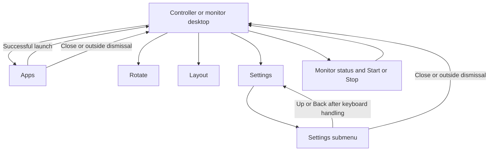

# Feature Specification: Shared controller UI, icon and installed version

**Feature Branch**: `chore/existing-feature-specs` (retrospective documentation)

**Created**: 2026-10-16

**Status**: Maintained contract, including compact controls and hierarchical menus;
verification remains scoped in the requirement map.

**Input**: Find consistent monochrome controls and current settings on either surface, including the
installed build identity.

Uses the [Spec Kit-style template](../templates/spec.md). The [baseline](../../SPEC.md)
owns the complete numbered contract. IDs below refer to that baseline and are not
new feature-local requirements. The original backfill added no app behavior;
subsequent amendments track implemented behavior without implying test results.

## User Scenarios & Testing

### User Story 1 - Use matching controls (Priority: P1)

Find consistent monochrome controls and current settings on either surface, including the installed
build identity.

**Why this priority**: Different menu behavior between screens makes the desktop unpredictable.

**Independent Test**: Inspect and operate both control panels, all child menus and the phone pad header.

**Acceptance Scenarios**:

1. **Given** phone or monitor controls, **When** the panel opens, **Then** Apps/Rotate/Layout
   form one equal row; desktop Start/Stop is in status and App settings is inside Settings.
2. **Given** phone touchpad, **When** Scroll, remote Back or Info is tapped in the touchpad header,
   **Then** the intended action occurs without a pad gesture.
3. **Given** monitor controls, **When** its header is inspected, **Then** Settings precedes
   Close; nested menus add leading Up. No touchpad is shown.
4. **Given** an option changes, **When** either surface is reopened, **Then** matching current
   values and selected states appear.
5. **Given** collapsed status, **When** the arrow is toggled or menus rebuild,
   **Then** the remembered shared state is used, details consume no collapsed
   height, and preview/protection/recovery controls remain reachable.

### User Story 2 - Read menus in constrained layouts (Priority: P1)

Find consistent monochrome controls and current settings on either surface, including the installed
build identity.

**Why this priority**: Content and dismissal must remain reachable.

**Independent Test**: Review full-height phone menus with keyboard/scrolling and monitor menus in
four rotations/Fit.

**Acceptance Scenarios**:

1. **Given** phone Settings or submenu, **When** it opens, **Then** a fixed header/Close and
   scrollable full-height page remain reachable in portrait.
2. **Given** phone Apps with keyboard shown, **When** results/search are used, **Then** IME resizing
   retains usable search, Close and results.
3. **Given** monochrome UI or launcher icon, **When** text, selected/disabled states and icon
   masks/sizes are inspected, **Then** labels/icons remain legible without encoding fragments; the
   robot-diving-into-monitor silhouette is recognizable.
4. **Given** Settings or any submenu on either surface, **When** its header is inspected,
   **Then** Back/Settings/Close have no resting fill, circle or border, retain independent
   48 dp accessible targets and bounded interaction feedback, and leave 8 dp title
   clearance. Long titles ellipsize without covering icons; Up and Close keep their
   distinct navigation behavior.
5. **Given** installed DexDroid, **When** Settings opens on either screen, **Then** version name,
   build number and debug identity appear immediately beneath the header.

### Edge Cases

- A managed app may hold keyboard focus while the phone controller is visible.
  Verify the phone window's visibility/display and its menu outcomes independently
  from global keyboard focus; do not require stealing focus from the external app.

- Long names, empty/populated results, overflow, disabled states and enlarged text require explicit
  review scope.
- App-provided icons/content need not be monochrome. A persistent external dock or Resume footer is
  not part of this UI.

### Compact controls and predictable menu navigation

1. **Given** the controller, **When** it opens, **Then** Apps/Rotate/Layout share
   one row; desktop Start/Stop is a plain white icon in status without a resting
   circle/border/fill. Its independent 48 dp target keeps a bounded pressed ripple
   and accessible Start/Stop description in either state. Save/Reset
   app and scrolling live in Settings > App settings. A small decorative chevron is centered
   within bottom padding of the tappable status body, with no separate row/circle
   or triple-dot shortcut. The normal collapsed card fits in 80 dp. Status toggle
   supports keyboard/accessibility; child actions do not toggle details. Phone Scroll left and
   Back right balance a centered Touchpad/Info group with 48 dp icon targets.
2. **Given** Settings > submenu, **When** Up/system Back is used (after hiding
   keyboard if present), **Then** Settings returns at its former scroll position.
   Close exits all menus. Main shortcuts start fresh roots; Monitor orientation and
   Pointer speed choices apply and return to the parent. Multi-setting/action pages
   (Scrolling, Layout, Settings, App settings) stay open so users can make several
   changes before Up/Back. Apps > orientation > Up retains the query without stale tokens.

## Requirements

### Functional Requirements

- **FR-001** (DX-UI-001): Phone and monitor submenus share Settings surfaces, typography, selection,
  icons and spacing.
- **FR-002** (DX-PHONE-001): Phone remains portrait; full-height menus keep Close reachable with
  scrolling and IME.
- **FR-003** (DX-TEXT-001): All menu labels, punctuation and icon descriptions render without
  encoding corruption.
- **FR-004** (DX-ICON-001): Android-diving-into-monitor icon is monochrome and survives masks and
  small sizes.
- **FR-024** (DX-VERSION-001): Phone and monitor Settings show the installed version name, build
  number and debug identity immediately using shared read-only styling.

### Key Entities

- **Shared control state**: monitor, Shizuku, desktop, operation, selected app and current
  input/display/profile values.
- **Build identity**: installed version name/code and debug marker, read-only on both surfaces.

## Success Criteria

### Measurable Outcomes

- **SC-001**: Both surfaces expose the same actions/current values with the intentional
  phone/monitor layout differences documented in DESIGN.md.
- **SC-002**: Back/hint/Close retain independent 48 dp targets; keyboard and scrolling do not hide
  required actions.
- **SC-003**: Rendered captures receive explicit review; automation success does not approve
  screenshot baselines.

## Assumptions

- DESIGN.md owns exact visual tokens; this spec does not introduce a second theme definition.
- Large-font/DPI/OEM variants and final human approval remain gaps unless an identified run supplies
  evidence.

## Feature flow

Controller and menu navigation. This is a product-level flow; implementation ownership is in
[architecture](../ARCHITECTURE.md) and the [owning code](../../app/src/main/java/dev/dexdroid/ControllerStyle.java).

## Verification and coverage

The linked entries contain concrete checks, scenario dimensions and current gaps.
They are mappings, not passes; use an identified run for execution evidence.

| Stable requirement | Scenario/test coverage |
| --- | --- |
| DX-UI-001 / FR-001 | [Checks and gaps](../coverage.md#dx-ui-001) |
| DX-PHONE-001 / FR-002 | [Checks and gaps](../coverage.md#dx-phone-001) |
| DX-TEXT-001 / FR-003 | [Checks and gaps](../coverage.md#dx-text-001) |
| DX-ICON-001 / FR-004 | [Checks and gaps](../coverage.md#dx-icon-001) |
| DX-VERSION-001 / FR-024 | [Checks and gaps](../coverage.md#dx-version-001) |

Run commands: [testing runbook](../TESTING.md). Visual/performance scope:
[quality strategy](../QUALITY.md). Shared UI: [design](../DESIGN.md).
Implementation ownership: [architecture](../ARCHITECTURE.md).
Return to the [feature index](README.md).

## Implementation diagrams

See the [component overview and representative sequence](../architecture/features/controller-ui.md)
for source ownership, lifecycle/failure boundaries and current verification limits.

### Native phone Back ownership acceptance

Back first hides the visible Android keyboard; otherwise it returns to the valid parent or dismisses the root. The dialog consumes the key and queues that action beyond its own key dispatch, capturing the keyboard intent at receipt. Closed/replaced dialogs and ending Activities cannot act on a replacement window. One owner may have only one pending Back continuation. Native Pointer speed to Settings after Preview/Revert is repeated; deterministic duplicate/Close/replacement/stale-owner races supplement that native path. Exact Samsung framework decor causality and broader teardown/OEM timing remain unverified.
