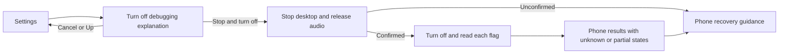

# Feature Specification: Turn off debugging

**Feature Branch**: `feature/debugging-off`

**Created**: 2026-10-21

**Status**: Implemented in development; controlled acceptance passed, actual flag/bank checks pending.

**Input**: Explicitly stop the desktop and disable debugging before opening banking
apps, without embedding ADB or granting DexDroid a permanent settings permission.

## User Scenarios & Testing

### User Story 1 - Turn off debugging deliberately (Priority: P1)

**Why this priority**: Some banking apps reject developer/debugging flags.

**Independent Test**: Confirm from either Settings menu and inspect each flag's
result on the phone, without logging into a banking app.

**Acceptance Scenarios**:

1. **Given** an active desktop, **When** Turn off debugging opens, **Then** explain
   the three switches, desktop interruption, impact on other ADB/Shizuku apps and
   retained pairing/authorization; Cancel, Up and Close make no changes.
2. **Given** explicit confirmation, **When** cleanup completes, **Then** release
   input, both panes and session audio before any privileged settings write.
   Keep the result on the phone after the monitor menu disappears.
3. **Given** a pending operation, **When** Start or another confirmation occurs,
   **Then** reject duplicate work and do not start another desktop.
4. **Given** helper results, **When** the operation completes, **Then** label each
   flag Off verified, Still on or Could not verify from shell readback. Report
   ADB daemon state separately; a flag value alone does not prove a listener stopped.
5. **Given** developer master is written off, **When** other flags remain on,
   **Then** explicitly disable those flags rather than assuming a cascade.
6. **Given** confirmed flags off, **When** HSBC/PayLah warning screens are checked,
   **Then** record their actual warning behavior and versions privately without
   credentials, transactions or a universal bank-compatibility promise.

### User Story 2 - Recover from unavailable privilege (Priority: P1)

**Why this priority**: Disabling debugging can remove the capability used to verify it.

**Independent Test**: Exercise unavailable, denied, partial and interrupted paths.

**Acceptance Scenarios**:

1. **Given** missing privilege or unconfirmed desktop/audio cleanup, **When** confirmed,
   **Then** perform no settings writes, retain the stopped desktop and show manual
   phone Developer options guidance.
2. **Given** transport loss, timeout or process death, **When** returning to DexDroid,
   **Then** retain an interrupted/unknown receipt, never a successful-looking result.
3. **Given** any outcome, **When** closing this flow or restarting the app, **Then**
   do not automatically re-enable flags or restart Shizuku. Starting again requires
   deliberate normal setup. Ordinary Stop does not disable debugging.

4. **Given** either surface, **When** the page opens, **Then** show generic manual
   switch checks and Open phone settings, targeting the phone's main Settings.
   Do not offer a Developer options shortcut that can silently refuse to open.
   A navigation error must not replace the last attempt's flag observations.
5. **Given** collapsed Use the desktop again help, **When** expanded, **Then**
   explain revealing hidden Developer options through About phone and Build number
   or the manufacturer's version entry, followed by deliberate Shizuku setup.
   This enables Developer options for a future session, not a banking turn-off
   step. Collapse hides the details; both states expose accessible expansion
   status, preserve confirmation/results and perform no settings writes.
   Manufacturer-specific paths are optional named examples in the User guide.

### Edge Cases

- Already-off flags remain off. No pairing, authorization timeout, Bluetooth,
  network, app permissions or unrelated developer settings are changed.
- OEMs and Android versions may reject writes or obscure verification. Unknown
  is observable; losing the ADB test connection is not a test pass.
- Shizuku itself may change settings on a later startup/boot; DexDroid cannot
  promise that other apps keep flags off.

## Experience review

- UI expert `/root/debugging_off_ui` recommended a separate shared Settings page,
  explicit Stop & turn off confirmation and phone results. User authorized this
  after the audio release; no new main-row controls or ordinary Stop changes.
- User chose Xiaomi installation/testing on2026-10-21. Official Play installs:
  HSBC Singapore5.0.0 and DBS PayLah7.3.0. Actual results remain separately scoped
  in the change/evidence record; no login or transactions.
- Back returns to Settings; Close dismisses. Both cancel before confirmation.
- Generic recovery proposal by `/root/debugging_generic_recovery_ui` was approved
  by the user with "proceed with this direction" on2026-10-21. No new grant or
  automatic re-enabling was authorized.

## Architecture links

See [overview and sequence](../architecture/features/debugging-off.md), including
helper identity, bounded operation lifetime and audio/display cleanup boundaries.

## Requirements

### Functional Requirements

- **FR-037** / DX-DEBUGGING-001: One-way explicitly confirmed disabling, independent
  readback, preserved pairing and honest interrupted/manual recovery.
- FR-017 retains ordinary Stop semantics; FR-036 retains session audio cleanup.

### Key Entities

- **Attempt receipt**: pending/interrupted/completed operation and per-flag result;
  an observation at the attempt time, not a permanent current-state guarantee.

## Success Criteria

### Measurable Outcomes

- No privileged writes before explicit confirmation and confirmed cleanup.
- No path writes an enabling value or grants DexDroid settings permission.
- Each result has a verified/partial/unknown outcome; a disconnected observer
  cannot certify success. Real bank outcomes remain separate from synthetic tests.

## Assumptions

- Existing user-authorized Shizuku shell capability is required for automation.
- No local ADB client, root service, automatic re-enable or bank detection is added.
