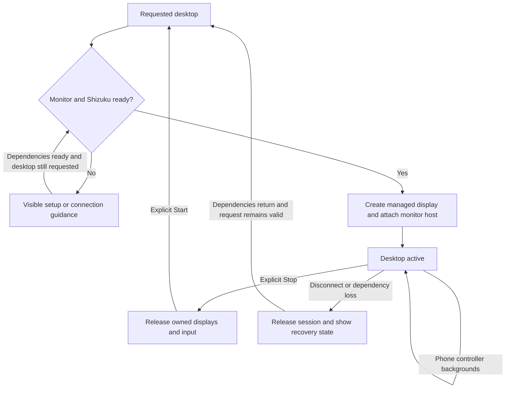

# Feature Specification: Desktop session and Android compatibility

**Feature Branch**: `chore/existing-feature-specs` (retrospective documentation)

**Created**: 2026-10-16

**Status**: Backfilled contract for existing behavior; verification remains scoped in the
requirement map.

**Input**: Connect a monitor and keep a usable non-root desktop while using the phone independently.

Uses the [Spec Kit-style template](../templates/spec.md). The [baseline](../../SPEC.md)
owns the complete numbered contract. IDs below refer to that baseline and are not
new feature-local requirements. This backfill adds no app behavior or test result.

## User Scenarios & Testing

### User Story 1 - Start and recover a desktop (Priority: P1)

Connect a monitor and keep a usable non-root desktop while using the phone independently.

**Why this priority**: App launching and input require an honest ready state.

**Independent Test**: Start with attached/detached monitor and available/stopped/unauthorized
Shizuku; observe status and recovery.

**Acceptance Scenarios**:

1. **Given** an unlocked phone, attached monitor and authorized Shizuku, **When** DexDroid opens,
   **Then** it connects and starts without a manual Connect step.
2. **Given** no monitor or unavailable Shizuku, **When** startup is requested, **Then** status
   identifies the missing dependency and permits supported recovery.
3. **Given** failed Activity-host startup, **When** attachment exceeds five seconds or service setup
   is rejected, **Then** busy state/resources clear and foreground reopening can retry; late
   callbacks cannot attach to a new session.

### User Story 2 - Use the phone independently (Priority: P1)

Connect a monitor and keep a usable non-root desktop while using the phone independently.

**Why this priority**: Backgrounding the controller should not silently end the desktop.

**Independent Test**: Background/reopen the phone, destroy its controller, then Stop and reconnect;
distinguish actual host type.

**Acceptance Scenarios**:

1. **Given** a running desktop, **When** phone Home or another app backgrounds the controller,
   **Then** monitor menus and input continue.
2. **Given** an independent Activity host, **When** the phone controller is destroyed and reopened,
   **Then** desktop state remains and one usable phone controller returns.
3. **Given** a Presentation-only OEM host, **When** Android removes its fallback window with the
   phone task, **Then** resources stop cleanly and reopening recovers, with the limitation reported.
4. **Given** a running or stopped desktop, **When** Stop then Start or an explicit launch is
   selected, **Then** Stop releases owned resources and startup can create a fresh session.
5. **Given** single or split apps and delayed display cleanup, **When** Stop is selected,
   **Then** the existing display-0 controller returns after cleanup and Android task migration, remains stopped, and
   Settings/Start respond. A newer session invalidates the old restoration; passive
   disconnect/dependency loss does not bring the controller forward. No absent controller
   is created and unrelated phone tasks are not closed.

6. **Given** either pane reports failed final cleanup, **When** Stop finishes, **Then**
   it reports uncertainty with phone-reopen guidance and does not move the controller
   forward without confirmed cleanup. An obsolete fault does not replace newer
   startup/session status. The explicit user reopening can recover.

### Edge Cases

- Shizuku loss, denied notification permission, monitor removal and rejected trusted display
  creation must be distinguished from successful startup.
- Reboot and Force stop do not promise session survival. Notification recovery targets phone display
  0; temporary display IDs are never monitor identity.

## Requirements

### Functional Requirements

- **FR-016** (DX-LIFE-001): Desktop/input MUST continue during normal backgrounding.
  Controller destruction MUST retain an independent host; Presentation fallback
  removal MUST clean up and support recovery as specified in the baseline.
- **FR-017** (DX-LIFE-002): Stop releases the desktop; reopening or launching starts it and reports
  connection state. Activity-host startup is bounded, cleans up on missing attachment and rejects
  late hosts/stale deadlines. Rejected foreground-service setup clears state and supports retry
  without escaping the main callback. Launcher reopening reuses the bound controller and retries
  startup; pending-request resume recovers, while focus restoration after explicit Stop remains
  stopped. Explicit Stop restores the existing controller only after both display
  cleanup operations, guarded against newer sessions and stale callbacks. Passive
  teardown does not foreground it. A Chrome single-view Stop must retain phone
  controller focus for 15 idle seconds, including reused tasks, without app
  instrumentation or menu input masking native background-return restrictions.
  The authorized shell focuses only the captured existing display-0 controller;
  no app Intent, new controller or arbitrary/shared task return is allowed.
- **FR-023** (DX-COMPAT-001): Compatibility MUST be exercised on identified Android
  16/17 emulator builds while retaining Android 11 support, modern target/service
  declarations, safe insets/Back, truthful app placement, private child navigation
  and session-scoped independent or fallback monitor hosting. Results require
  versioned evidence and do not certify every OEM or physical monitor.

### Key Entities

- **Desktop session**: dependency/readiness state, current monitor, owned displays and pending
  startup request.
- **Monitor host**: Activity or Presentation with distinct task-destruction guarantees.

## Success Criteria

### Measurable Outcomes

- **SC-001**: With dependencies ready, opening DexDroid reaches a usable desktop without manual Connect.
- **SC-002**: Stop removes owned desktop resources; obsolete startup callbacks cannot resurrect or
  stop a newer session.
- **SC-003**: Record Android 11, 16 and 17 outcomes separately, including host type and physical
  versus emulated output.

## Assumptions

- Android 11 minimum, API 36 target; compatibility requirements are obligations, not certification
  of every OEM.
- Shizuku is separately started/authorized; core desktop operation does not require root.

## Feature flow

Desktop lifecycle. This is a product-level flow; implementation ownership is in
[architecture](../ARCHITECTURE.md) and the [owning code](../../app/src/main/kotlin/dev/dexdroid/SessionService.kt).

## Verification and coverage

The linked entries contain concrete checks, scenario dimensions and current gaps.
They are mappings, not passes; use an identified run for execution evidence.

| Stable requirement | Scenario/test coverage |
| --- | --- |
| DX-LIFE-001 / FR-016 | [Checks and gaps](../coverage.md#dx-life-001) |
| DX-LIFE-002 / FR-017 | [Checks and gaps](../coverage.md#dx-life-002) |
| DX-COMPAT-001 / FR-023 | [Checks and gaps](../coverage.md#dx-compat-001) |

Run commands: [testing runbook](../TESTING.md). Visual/performance scope:
[quality strategy](../QUALITY.md). Shared UI: [design](../DESIGN.md).
Implementation ownership: [architecture](../ARCHITECTURE.md).
Return to the [feature index](README.md).

## Implementation diagrams

See the [component overview and representative sequence](../architecture/features/desktop-session.md)
for source ownership, lifecycle/failure boundaries and current verification limits.
