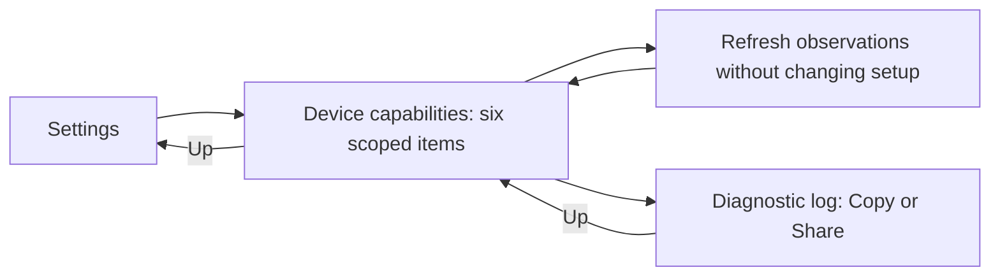

# Feature Specification: Device capabilities

**Feature Branch**: `fix/launch-feedback-android11-audio`

**Created**: 2026-10-28

**Status**: Implemented; scoped Android11 development acceptance, not released

**Input**: Explain whether this connected setup can run DexDroid features, using
current prerequisites and observations without expensive OEM-specific certification.

## User Scenarios & Testing

### User Story 1 - Understand this setup (Priority: P1)

Open Settings → Device capabilities on either screen to see six items: Shizuku,
Monitor, Desktop, Input, Rotation + split, Audio selection.

**Why this priority**: A missing optional privilege must explain one unavailable
feature without implying that the entire desktop or hardware is unsupported.

**Independent Test**: Inspect connected, not-started and missing-dependency setups;
check the six verdicts and reasons against actual current state.

**Acceptance Scenarios**:

1. **Given** a connected helper but unobserved input, **When** the report opens,
   **Then** it describes prerequisites and leaves app input response unverified.
2. **Given** shell audio routing is denied, **When** the desktop works,
   **Then** Audio selection explains its restriction while Desktop stays independent.
3. **Given** only rotation was configured, **When** its item is read,
   **Then** split remains explicitly not checked; saved settings prove neither.
4. **Given** a real ordinary operation completes, **When** its owners still match,
   **Then** only its exact observation is confirmed this session.

### User Story 2 - Refresh and share trustworthy information (Priority: P2)

Refresh without changing the desktop, then open Diagnostic log for existing
Copy/Share. Keep the shared monochrome menu style and existing Up/Close behavior.

**Why this priority**: Support needs useful evidence with clear limits and no
personal content or setup side effects.

**Independent Test**: Repeat Refresh, navigate to diagnostics and back, inspect
the immutable export, and replace/disconnect the session during an outstanding read.

**Acceptance Scenarios**:

1. **Given** Refresh is running, **When** it is pressed again or the page closes,
   **Then** work remains bounded and navigation stays responsive; late work cannot
   update a replaced owner or dismissed page.
2. **Given** a metadata read fails or times out, **When** earlier values exist,
   **Then** they are labelled earlier observations; missing values stay Not checked.
3. **Given** Stop/reconnect/helper replacement, **When** the next report renders,
   **Then** old confirmations and late success/failure are rejected.
4. **Given** explicit Copy/Share in diagnostics, **When** state later changes,
   **Then** the exported current report remains an immutable sanitized snapshot.
5. **Given** either surface and monitor rotation/Fit, **When** long reasons wrap,
   **Then** six sections and actions remain accessible without horizontal scrolling;
   Up from diagnostics returns here, then to Settings; Close exits the flow.

### Edge Cases

- No monitor/helper/desktop: explain missing prerequisites without launching setup.
- Physical DPI and mode reports may be unreliable; labels state reported/unknown.
- A void relay may defer/drop input; it supplies no accepted-input confirmation.
- Audio readback confirms policy only, not physical routing or audible sound.
- An old worker cannot alter a new session's result or cause indefinite work queues.

## Experience review

- `/root/capabilities_ui_preflight`: approves a shared scroll body beside Diagnostic
  log in Settings General, fixed plain Up/title/Close header, Refresh/Diagnostic log
  actions and six passive sections. User's “Let proceed” authorizes this scoped
  report; no new material decision remains.
- Status is text, not color alone. Refresh feedback is separate from the four
  verdicts; preserve scroll and focus. Actual rendered approval remains separate.

## Architecture links

[Capability overview and sequence](../architecture/features/device-capabilities.md).
SessionService owns scoped memory-only observations and a shared report projection;
no new shell API, persistence, active probe or background poll is authorized.
Architecture preflight `/root/capabilities_arch_preflight` approves this bounded
approach; precise input and audio evidence limitations are mandatory.

## Requirements

### Functional Requirements

- **FR-040 / DX-CAPABILITY-001**: Six truthful scoped items, bounded passive refresh,
  invalidation, shared navigation and sanitized explicit export as in the baseline.

### Key Entities

- **Verdict**: Available, Confirmed this session, Unavailable, Not checked.
- **Observation**: Exact operation and current owner scope; never persisted.
- **Report**: Six items, current context and any timestamped earlier metadata.

## Success Criteria

### Measurable Outcomes

- **SC-001**: Both surfaces show all six items with matching semantic state.
- **SC-002**: Missing audio privilege leaves core desktop verdict independent.
- **SC-003**: Stale success/failure cannot promote or downgrade a replacement session.
- **SC-004**: Opening/refreshing the report changes no setup, layout or media policy.
- **SC-005**: Explicit exports include safe facts and exclude personal content.

## Assumptions

- This is a readiness/observation report, not universal hardware compatibility proof.
- Guided testing, audio listening, OEM databases and active test screens are deferred.
- Current-state updates reuse existing service notifications/menu lifetimes.
