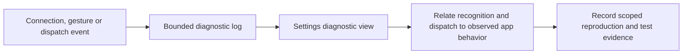

# Feature Specification: Diagnostics and current-state visibility

**Feature Branch**: `chore/existing-feature-specs` (retrospective documentation)

**Created**: 2026-10-16

**Status**: Backfilled contract for existing behavior; verification remains scoped in the
requirement map.

**Input**: Inspect connection and gesture outcomes to explain failures without recording typed or
screen content.

Uses the [Spec Kit-style template](../templates/spec.md). The [baseline](../../SPEC.md)
owns the complete numbered contract. IDs below refer to that baseline and are not
new feature-local requirements. This backfill adds no app behavior or test result.

## User Scenarios & Testing

### User Story 1 - Inspect and share a bounded log (Priority: P2)

Inspect connection and gesture outcomes to explain failures without recording typed or screen content.

**Why this priority**: Useful diagnostics distinguish recognition, dispatch and actual application
response.

**Independent Test**: Generate accepted/rejected gestures and errors, inspect live events, then
Copy/Clear/Close.

**Acceptance Scenarios**:

1. **Given** diagnostic logging is active, **When** gesture recognition accepts or rejects
   three-finger Back, **Then** movement/threshold and outcome are visible without typed/screen
   content.
2. **Given** a key was dispatched, **When** the log reports completion, **Then** dispatch is
   distinguished from proof that the app handled the key.
3. **Given** more than 250 events occur, **When** the log is viewed, **Then** only the bounded
   in-memory history remains.
4. **Given** Settings or diagnostics is open, **When** the user changes an option or copies/clears
   the log, **Then** current values refresh and Copy/Clear/Close remain usable.

### Edge Cases

- Connection/input errors must be visible without retaining text queries, URLs, screenshots or app
  screen content.
- Copy is an explicit user action; diagnostics do not promise persistence across process death.

## Requirements

### 0.15.0 improvement acceptance

1. **Given** empty or 250-event history, **When** the page opens on either screen,
   **Then** readable current context and Copy/Share/Clear precede selectable events.
2. **Given** user-controlled names, URLs, arbitrary errors or shell output,
   **When** an event/report is created, **Then** only fixed diagnostic categories
   and explicitly allowed numeric/navigation fields reach history and logcat.
3. **Given** explicit Copy/Share, **When** state later changes, **Then** the exported
   text remains that action's immutable report; Share routes to the phone and an
   unavailable target produces local feedback without stopping the desktop.
4. **Given** unchanged events or active selection, **When** refresh occurs,
   **Then** it does not reset the history text/selection. Clear retains context,
   immediately shows empty history and allows subsequent events.
5. **Given** accepted/rejected gestures and queued/dispatched/failed operations,
   **When** inspected, **Then** outcome/reason is readable and dispatch is not
   represented as proof of app response. Unknown details are explicitly omitted.

Use targeted Xiaomi hardware acceptance with four monitor rotations and a
constrained Fit configuration, plus host privacy/bounds tests. Other OS/OEMs,
physical peripheral diversity and product latency measurements remain gaps.

### Functional Requirements

- **FR-019** (DX-DIAG-001): Diagnostics show accepted/rejected gestures and connection/key outcomes
  without typed content.

### Key Entities

- **Diagnostic event**: timestamp, connection/input/recognition outcome and non-content details.
- **Current option values**: pointer speed, direction, monitor touch/navigation, background and
  profile state.

## Success Criteria

### Measurable Outcomes

- **SC-001**: The log retains at most 250 events and Clear removes the visible history.
- **SC-002**: Accepted and rejected gesture cases are distinguishable without interpreting a
  dispatch log as app-handling proof.

## Assumptions

- The log is a diagnostic aid, not a physical input latency/frame benchmark.
- Background exemption status reflects Android state and is refreshed on return.

## Feature flow

Bounded diagnostic observation. This is a product-level flow; implementation ownership is in
[architecture](../ARCHITECTURE.md) and the [owning code](../../app/src/main/kotlin/dev/dexdroid/DiagnosticLog.kt).

## Verification and coverage

The linked entries contain concrete checks, scenario dimensions and current gaps.
They are mappings, not passes; use an identified run for execution evidence.

| Stable requirement | Scenario/test coverage |
| --- | --- |
| DX-DIAG-001 / FR-019 | [Checks and gaps](../coverage.md#dx-diag-001) |

Run commands: [testing runbook](../TESTING.md). Visual/performance scope:
[quality strategy](../QUALITY.md). Shared UI: [design](../DESIGN.md).
Implementation ownership: [architecture](../ARCHITECTURE.md).
Return to the [feature index](README.md).

## Implementation diagrams

See the [component overview and representative sequence](../architecture/features/diagnostics.md)
for source ownership, lifecycle/failure boundaries and current verification limits.
