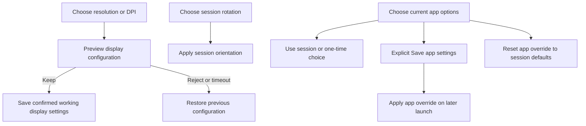

# Feature Specification: Display configuration and per-app preferences

**Feature Branch**: `chore/existing-feature-specs` (retrospective documentation)

**Created**: 2026-10-16

**Status**: Backfilled contract for existing behavior; verification remains scoped in the
requirement map.

**Input**: Choose readable monitor geometry and remember app-specific rotation/scrolling without
losing a working configuration.

Uses the [Spec Kit-style template](../templates/spec.md). The [baseline](../../SPEC.md)
owns the complete numbered contract. IDs below refer to that baseline and are not
new feature-local requirements. This backfill adds no app behavior or test result.

## User Scenarios & Testing

### User Story 1 - Configure and preview a desktop (Priority: P1)

Choose readable monitor geometry and remember app-specific rotation/scrolling without losing a
working configuration.

**Why this priority**: Users need reversible geometry changes on fixed-signal monitors.

**Independent Test**: Inspect modes/recommendation, select all four rotations and preview
resolution/DPI with Keep, Revert and timeout.

**Acceptance Scenarios**:

1. **Given** reported monitor capabilities, **When** display settings open, **Then** physical modes,
   virtual desktop size and logical UI DPI are distinguished; implausible physical DPI is unknown.
2. **Given** a physical monitor with fixed landscape signal, **When** 0/90/180/270 degrees is
   selected, **Then** the whole desktop rotates proportionally, portrait swaps virtual dimensions
   and phone rotation does not control it.
3. **Given** a working desktop, **When** a 480-4096 px and 120-480 UI-DPI configuration is
   previewed, **Then** image/input mapping updates together and Fit preserves aspect ratio.
4. **Given** an unconfirmed preview, **When** Revert is chosen or 15 seconds elapse, **Then** the
   previous working configuration returns; Keep confirms it.

### User Story 2 - Remember an app independently (Priority: P2)

Choose readable monitor geometry and remember app-specific rotation/scrolling without losing a
working configuration.

**Why this priority**: App overrides must not corrupt monitor defaults or other apps.

**Independent Test**: Use two apps with different rotations/scrolling and compare saved, one-time
and reset outcomes.

**Acceptance Scenarios**:

1. **Given** a DexDroid-selected app, **When** a launch orientation is chosen, **Then** one-time
   choice precedes saved app rotation, which precedes the session default.
2. **Given** a selected app, **When** scroll mode or 20/50/100 percent speed changes, **Then**
   current values update and persist immediately for that app.
3. **Given** an app without overrides, **When** it opens, **Then** Tachiyomi uses Swipe/20 percent
   and other apps Wheel/50 percent.
4. **Given** an app profile, **When** Save app, one-time launch or Reset app is used, **Then** only
   the intended app changes; one-time launch leaves saved preferences intact.

### Edge Cases

- Recommendation uses valid confirmed settings or reliable preferred/current output; largest
  advertised mode is not assumed native.
- Direction/speed apply to phone scrolling, not native monitor swipes. Split view uses workspace
  rotation and preserves saved single-view orientation.

## Requirements

### Functional Requirements

- **FR-012** (DX-SCROLL-001): Wheel/swipe mode and speed apply per app, including Tachiyomi
  defaults, and selected values persist.
- **FR-013** (DX-PROFILE-001): Saved rotation/scroll profiles remain per app; one-time launch and
  reset obey defaults.
- **FR-014** (DX-DISPLAY-001): Display modes and recommended virtual resolution/UI DPI are honest
  about unknown physical DPI.
- **FR-015** (DX-DISPLAY-002): Selected desktop resolution stays proportional; unconfirmed preview
  rolls back in 15 seconds.

### Key Entities

- **Display configuration**: dimensions, UI DPI, default rotation and pending/confirmed state.
- **App profile**: package, saved rotation, scroll mode and scroll speed.

## Success Criteria

### Measurable Outcomes

- **SC-001**: Preview rejection/timeout returns the exact previous dimensions/DPI without silently
  saving the pending choice.
- **SC-002**: Two apps retain independent preferences and one-time rotation never overwrites a
  monitor profile.
- **SC-003**: Four rotations and mismatched-aspect Fit keep image and hit mapping aligned.

## Assumptions

- Virtual desktop selection does not switch the physical HDMI/USB-C signal or invent EDID information.
- Named monitor collections/bindings are specified separately in monitor-profiles.md.

## Feature flow

Preview and independent saved settings. This is a product-level flow; implementation ownership is in
[architecture](../ARCHITECTURE.md) and the [owning code](../../app/src/main/java/dev/dexdroid/SessionService.java).

## Verification and coverage

The linked entries contain concrete checks, scenario dimensions and current gaps.
They are mappings, not passes; use an identified run for execution evidence.

| Stable requirement | Scenario/test coverage |
| --- | --- |
| DX-SCROLL-001 / FR-012 | [Checks and gaps](../coverage.md#dx-scroll-001) |
| DX-PROFILE-001 / FR-013 | [Checks and gaps](../coverage.md#dx-profile-001) |
| DX-DISPLAY-001 / FR-014 | [Checks and gaps](../coverage.md#dx-display-001) |
| DX-DISPLAY-002 / FR-015 | [Checks and gaps](../coverage.md#dx-display-002) |

Run commands: [testing runbook](../TESTING.md). Visual/performance scope:
[quality strategy](../QUALITY.md). Shared UI: [design](../DESIGN.md).
Implementation ownership: [architecture](../ARCHITECTURE.md).
Return to the [feature index](README.md).

## Implementation diagrams

See the [component overview and representative sequence](../architecture/features/display-and-app-settings.md)
for source ownership, lifecycle/failure boundaries and current verification limits.
