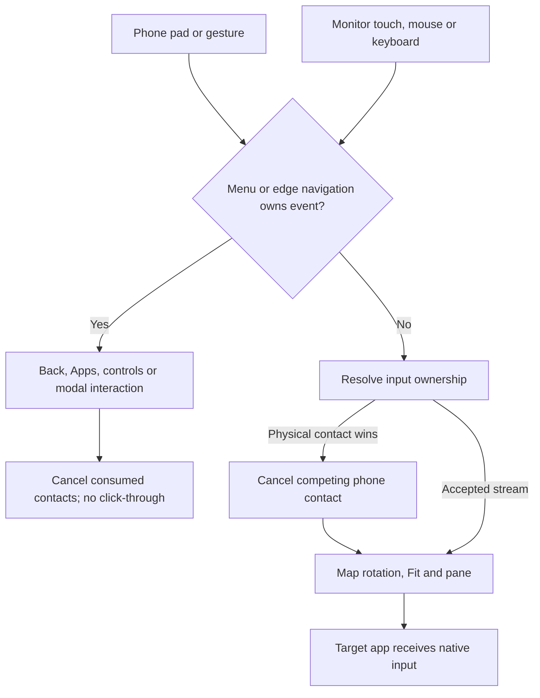

# Feature Specification: Phone input, monitor navigation and search keyboard

**Feature Branch**: `chore/existing-feature-specs` (retrospective documentation)

**Created**: 2026-10-16

**Status**: Backfilled contract for existing behavior; verification remains scoped in the
requirement map.

**Input**: Control the external desktop from a phone pad or monitor touch without competing
contacts, duplicate navigation or delayed keyboard mirroring.

Uses the [Spec Kit-style template](../templates/spec.md). The [baseline](../../SPEC.md)
owns the complete numbered contract. IDs below refer to that baseline and are not
new feature-local requirements. This backfill adds no app behavior or test result.

## User Scenarios & Testing

### User Story 1 - Point, scroll, zoom and go Back (Priority: P1)

Control the external desktop from a phone pad or monitor touch without competing contacts, duplicate
navigation or delayed keyboard mirroring.

**Why this priority**: A rendered desktop must accept reliable input.

**Independent Test**: Exercise native input targets using phone pad and direct monitor touch in four
rotations and Fit.

**Acceptance Scenarios**:

1. **Given** relative phone touchpad mode, **When** one finger moves/taps, two fingers scroll/pinch,
   or Back is requested, **Then** the intended pointer/click, wheel/swipe, native pinch or single
   Back reaches the external app.
2. **Given** a rotated or fitted desktop, **When** monitor tap/drag/long press/pinch is delivered,
   **Then** contact IDs, timing and coordinates remain aligned; Fit-bar starts reach no app.
3. **Given** a held monitor contact, including Android 11 pending focus, **When** phone
   pointer/touch/wheel input competes, **Then** monitor ownership wins until release/cancel, and
   monitor touch hides the pointer.
4. **Given** controller exit, Stop or disconnect, **When** an input sequence is held, **Then**
   contacts cancel without a stray tap or stuck input.
5. **Given** modern native relay rejects initial DOWN, **When** fresh metadata
   positively confirms a pending owned window and unchanged target identity,
   **Then** cancel the injected verifier contact, suppress the physical stream,
   retain both panes and allow only a fresh retry. Unknown/ready-window rejection
   or failed cleanup remains an explicit error.

### User Story 2 - Navigate the monitor shell (Priority: P1)

Control the external desktop from a phone pad or monitor touch without competing contacts, duplicate
navigation or delayed keyboard mirroring.

**Why this priority**: The monitor must remain usable with the phone in the background.

**Independent Test**: Recognize and reject edge gestures, then dismiss and navigate menus using
touch and phone pointer.

**Acceptance Scenarios**:

1. **Given** an app in any workspace rotation, **When** an inward side, bottom or top edge gesture
   qualifies, **Then** one Back, Apps or Controls action commits after release relative to the
   upright desktop.
2. **Given** a short, outward, perpendicular, multi-touch, disabled or Fit-bar start, **When**
   recognition fails or is cancelled, **Then** no navigation commits and feedback settles.
3. **Given** an open shell menu, **When** Back or an outside/Fit tap occurs, **Then** shell
   navigation/dismissal consumes the contact without app click-through; inside blank taps keep the
   menu.
4. **Given** app touch forwarding is disabled, **When** shell controls or navigation are used,
   **Then** those controls remain independently usable.

### User Story 3 - Search locally on the monitor (Priority: P1)

Control the external desktop from a phone pad or monitor touch without competing contacts, duplicate
navigation or delayed keyboard mirroring.

**Why this priority**: App search must edit at the interaction surface.

**Independent Test**: Type/edit/select/delete/clear/hide/reopen a query with local keys, phone
pointer and hardware text keys.

**Acceptance Scenarios**:

1. **Given** Apps just opened, **When** the user has not interacted with search, **Then** no
   keyboard is summoned automatically.
2. **Given** explicit search focus, **When** characters, Shift, Delete or Clear are used, **Then**
   selection-aware text and filtered results update together.
3. **Given** a hidden query, **When** search is tapped again, **Then** the local keyboard reopens
   with query/results preserved.
4. **Given** search is active, **When** a valid hardware Back release occurs, **Then** local
   keys hide first; a later release returns one visited level or dismisses a root.
   Served system IME also hides and a non-editor keeps menu focus, preserving
   query/results so the next distinct Back needs no extra IME-dismissal press.
   A cancelled release does neither, and no handled Back reaches the app.

### Edge Cases

- Three-finger Back requires horizontal movement over 60 dp with horizontal dominance on pointer
  lift; pointer speed choices are 1.0/1.6/2.5.
- Edges use a 20 dp band, 60 dp inward movement, 1.4x dominance and a 1.5-second limit; top/bottom
  take corner priority. Respect Android-owned bars.
- Android 11 initial focus buffering is asynchronous/bounded with a 100 ms settling fallback;
  overflow/takeover/cancellation discards pending events and timeout.

## Requirements

### Functional Requirements

- **FR-006** (DX-KEYBOARD-001): Monitor search keyboard edits, filters, handles lifecycle and
  preserves focus without opening phone IME.
- **FR-007** (DX-NAV-001): Side-edge Back, bottom launcher and top controls navigate once relative
  to desktop rotation.
- **FR-008** (DX-NAV-002): Rejected edge gestures preserve app input; modal menus dismiss outside
  without click-through.
- **FR-009** (DX-NAV-003): Gesture feedback and menu transitions settle without orphan overlays or
  duplicate actions.
- **FR-010** (DX-INPUT-001): Phone pad supports tap, native pinch, scroll and three-finger Back with
  contact arbitration.
- **FR-011** (DX-INPUT-002): Monitor touch maps through rotation/Fit, preserves contact IDs and
  hides the pointer.
- **FR-029** (DX-FOCUS-001): Android 11 monitor contact owns arbitration while waiting for focus,
  cancels buffered events with shared input cancellation, and starts after focus settles without
  mid-contact focus loss or lost semantic tap.
- **DFR-001** (DX-OPTIONAL-001): Deferred: Direct absolute phone gesture mode is optional and
  distinct from the current relative touchpad.

### Key Entities

- **Input sequence**: source, contacts, down time, ownership, mapped positions and cancellation.
- **Navigation candidate**: edge, progress, recognition and commit/cancel state.
- **Search query**: selection, local keyboard state and filtered catalog results.

## Success Criteria

### Measurable Outcomes

- **SC-001**: Center/corner coordinates meet the existing two-pixel acceptance tolerance in each
  affected rotation/Fit case.
- **SC-002**: One qualifying navigation produces exactly one action; cancelled sequences produce none.
- **SC-003**: Local search edits/filters correctly without a phone IME mirror; numerical latency
  requires separate measured evidence.

## Assumptions

- Relative touchpad is implemented. Absolute/direct phone gesture mode and its switch remain
  deferred (DFR-001); do not label them shipped.
- General external-app IME placement and system-reserved shortcuts remain Android-controlled.
  Physical peripheral results are separate from injected tests.

## Feature flow

Input ownership and navigation. This is a product-level flow; implementation ownership is in
[architecture](../ARCHITECTURE.md) and the [owning code](../../app/src/main/kotlin/dev/dexdroid/Geometry.kt).

## Verification and coverage

The linked entries contain concrete checks, scenario dimensions and current gaps.
They are mappings, not passes; use an identified run for execution evidence.

| Stable requirement | Scenario/test coverage |
| --- | --- |
| DX-KEYBOARD-001 / FR-006 | [Checks and gaps](../coverage.md#dx-keyboard-001) |
| DX-NAV-001 / FR-007 | [Checks and gaps](../coverage.md#dx-nav-001) |
| DX-NAV-002 / FR-008 | [Checks and gaps](../coverage.md#dx-nav-002) |
| DX-NAV-003 / FR-009 | [Checks and gaps](../coverage.md#dx-nav-003) |
| DX-INPUT-001 / FR-010 | [Checks and gaps](../coverage.md#dx-input-001) |
| DX-INPUT-002 / FR-011 | [Checks and gaps](../coverage.md#dx-input-002) |
| DX-FOCUS-001 / FR-029 | [Checks and gaps](../coverage.md#dx-focus-001) |
| DX-OPTIONAL-001 / DFR-001 | [Checks and gaps](../coverage.md#dx-optional-001) |

Run commands: [testing runbook](../TESTING.md). Visual/performance scope:
[quality strategy](../QUALITY.md). Shared UI: [design](../DESIGN.md).
Implementation ownership: [architecture](../ARCHITECTURE.md).
Return to the [feature index](README.md).

## Implementation diagrams

See the [component overview and representative sequence](../architecture/features/input-and-navigation.md)
for source ownership, lifecycle/failure boundaries and current verification limits.
