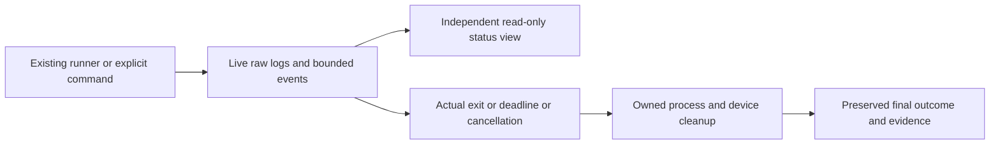

# Feature Specification: Local development monitoring

**Feature Branch**: `chore/coding-practice`

**Created**: 2026-10-17

**Status**: Implementation contract; execution evidence is separate.

**Input**: Observe long-running work locally without subscriptions or model calls.

## User Scenarios & Testing

### User Story 1 - See current progress (Priority: P1)

**Why this priority**: A buffered command can conceal either progress or a stall.

**Independent Test**: Start a fixture that writes both streams before waiting;
attach another process and inspect live files/status before the fixture exits.

**Acceptance Scenarios**:

1. **Given** a running command, **When** it emits bytes, **Then** raw stdout/stderr
   are available before exit, independently from extracted progress events.
2. **Given** a quiet command, **When** the warning threshold passes, **Then** the
   viewer shows suspected inactivity and a live supervisor heartbeat; work continues.
3. **Given** a missing, malformed or stale run, **When** observed, **Then** state is
   unknown/stale, never a fabricated pass. Closing the viewer does not affect work.
   Both status/watch return 2 for unknown observation, distinct from non-success 1.

### User Story 2 - Finish or fail predictably (Priority: P1)

**Why this priority**: Monitoring must preserve failure and cleanup semantics.

**Independent Test**: Exercise deadline, cancellation, nonzero exit, output limit,
reader/extractor faults and a descendant retaining inherited output handles.

**Acceptance Scenarios**:

1. **Given** a deadline or runner interrupt, **When** execution ends, **Then** owned
   processes are cleaned up, partial streams retained and result is timeout/cancelled.
2. **Given** Android instrumentation, **When** timeout/cancellation occurs, **Then**
   both streams remain available and controller restoration is separately recorded;
   successful cleanup cannot turn the failed/cancelled test into a pass.
3. **Given** capture/extraction failure or configured output/event limits, **When**
   execution finishes, **Then** evidence limitations are explicit and success is refused.
4. **Given** an asynchronous monitor fault after the last command or at finalization,
   **When** results are sealed, **Then** monitor, runner metadata and exit status all
   refuse success; successful device restoration remains recorded independently.
5. **Given** the full Android suite including a suite named monitor, **When** the
   supervisor records progress, **Then** suite results and supervisor logs coexist
   in distinct folders and all suites can execute without a path collision.

### Edge Cases

Non-UTF-8/split chunks, no newline, concurrent streams, launch failure, output floods,
short/completed runs, observer detachment, source/configuration identity, and orphaned
output handles. Known command descendants are owned; this is not a security sandbox.

## Experience review

Read-only advisor `/root/monitor_experience_preflight` recommended an attach-only
terminal viewer, separate liveness/activity/progress, honest unknown totals and
separate cleanup status. User authorized the local monitor with "proceed" after
the cost/scope discussion. No unresolved material choice or Android UI change.

## Feature flow

## Requirements

### Functional Requirements

Baseline NFR-011 / DX-OBSERVE-001 owns this contract. The template equivalent is
NFR-009 / WF-MONITOR-001. Existing instrumentation success checks, required host
gates, coverage/review policies and release evidence bindings remain required.

### Key Entities

- **Run**: Unique local directory, schema/run ID, scope and source/configuration context.
- **Command**: Label, process ID, deadline, raw streams, observed progress and outcome.
- **Observation**: Read-only snapshot of heartbeat, activity, warnings and final state.

## Success Criteria

### Measurable Outcomes

- Live fixture output is observable before child completion; preserved bytes match.
- Quiet fixtures warn without cancellation; deadline fixtures cannot report success.
- Observer-only actions do not launch/cancel commands or mutate device state.
- Tests demonstrate Windows process cleanup; POSIX cleanup requires its own platform run.

## Assumptions

Python standard library and local disk. No always-on service, network dashboard,
model/session telemetry collector, automatic retries or scenario selectors. Existing
Android PASS labels are observed assertions, not independently counted test cases.
Source provenance comes from the owning runner; generic commands may have no repo.

## Implementation diagrams

See the [component overview and representative sequence](../architecture/features/local-monitoring.md)
for source ownership, lifecycle/failure boundaries and current verification limits.
