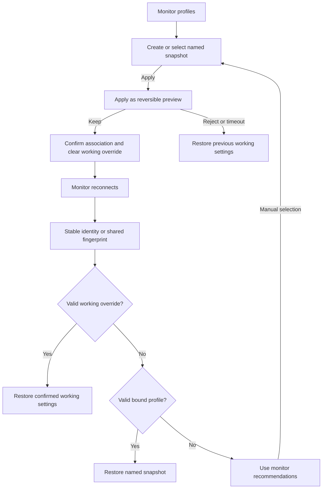

# Feature Specification: Named monitor profiles and remembered bindings

**Feature Branch**: `chore/existing-feature-specs` (retrospective documentation)

**Created**: 2026-10-16

**Status**: Backfilled contract for existing behavior; verification remains scoped in the
requirement map.

**Input**: Create several monitor setups and automatically restore the confirmed setup for a
recognized monitor.

Uses the [Spec Kit-style template](../templates/spec.md). The [baseline](../../SPEC.md)
owns the complete numbered contract. IDs below refer to that baseline and are not
new feature-local requirements. This backfill adds no app behavior or test result.

## User Scenarios & Testing

### User Story 1 - Manage reusable profiles (Priority: P2)

Create several monitor setups and automatically restore the confirmed setup for a recognized monitor.

**Why this priority**: Different monitors need distinct readable configurations.

**Independent Test**: Create/rename/update/delete two profiles from either surface and compare their
snapshots.

**Acceptance Scenarios**:

1. **Given** the current desktop configuration, **When** a valid profile name is saved, **Then** a
   named dimensions/DPI/default-rotation snapshot is created.
2. **Given** a blank, overlong or case-insensitive duplicate name, **When** the user edits or
   submits it, **Then** validation remains safe on both keyboards and prevents invalid storage.
3. **Given** a saved profile, **When** Rename, Update from current or Delete is chosen, **Then**
   only the explicit operation changes it; unrelated profiles and app overrides remain intact.

### User Story 2 - Apply and restore a monitor setup (Priority: P1)

Create several monitor setups and automatically restore the confirmed setup for a recognized monitor.

**Why this priority**: A failed preview must not replace a working monitor association.

**Independent Test**: Apply/Keep/Revert/timeout, reconnect, Forget and ordinary display Keep; verify
snapshots and bindings independently.

**Acceptance Scenarios**:

1. **Given** a running desktop and named profile, **When** Apply then Keep is selected, **Then** all
   saved display values apply and only confirmation binds that monitor.
2. **Given** a pending profile preview, **When** Revert, timeout, resize failure, Stop or disconnect
   occurs, **Then** the previous binding survives and pending changes clear.
3. **Given** a recognized monitor, **When** startup/reconnect occurs, **Then** a valid binding is
   reapplied; invalid/missing records fall back safely.
4. **Given** a bound monitor, **When** ordinary resolution/DPI or manual default rotation is
   confirmed, **Then** a separate working configuration survives restart without mutating the named
   snapshot.
5. **Given** a monitor identity, **When** Forget is chosen, **Then** its binding/working/legacy
   settings clear while named profiles remain available.

### Edge Cases

- Prefer accessible stable physical identity; otherwise name/sorted-capability fingerprints can
  collide and share a binding, disclosed to the user.
- Applying/saving a profile clears its working override; explicit bound-profile update clears the
  current monitor override. Migration happens once without replacing named profiles.
- Stopped rotation uses the detected monitor configuration, not stale dimensions from another
  monitor. Deleting a profile clears bindings without resizing the running desktop.

## Requirements

### Functional Requirements

- **FR-020** (DX-MONITOR-001): Named monitor profiles support shared phone/monitor create, rename,
  explicit update and delete with validated names and independent snapshots.
- **FR-021** (DX-MONITOR-002): Profile application previews dimensions/DPI/rotation and binds only
  on Keep; Revert/timeout/Stop/failure preserve the old association, with input and app overrides
  intact.
- **FR-022** (DX-MONITOR-003): Monitor bindings restore valid profiles automatically, fall back
  safely, migrate legacy settings once and allow forgetting without deleting named profiles.
  Separately confirmed working settings survive restart without mutating snapshots.

### Key Entities

- **Named profile**: validated name and immutable-until-explicit-update display snapshot.
- **Monitor binding**: stable identity/fingerprint to profile ID, separate from temporary Android
  display IDs.
- **Working override**: separately confirmed monitor configuration, independent of the named snapshot.

## Success Criteria

### Measurable Outcomes

- **SC-001**: CRUD and current binding present identical values/actions on both surfaces.
- **SC-002**: Only Keep changes a pending binding; every rejected/interrupted application retains
  the old association.
- **SC-003**: Restart/Forget/migration scenarios preserve the documented separation between
  snapshots, bindings and working settings.

## Assumptions

- Indistinguishable monitor reports cannot be reliably told apart; manual selection/forgetting is
  required.
- Per-app and one-time launch rotation retain precedence in single view.

## Feature flow

Profile confirmation and remembered monitor. This is a product-level flow; implementation ownership is in
[architecture](../ARCHITECTURE.md) and the [owning code](../../app/src/main/java/dev/dexdroid/MonitorProfiles.java).

Working settings take precedence over the named snapshot. Name/capability
fingerprints may share settings across indistinguishable monitors; reconnect does
not add an ambiguity gate. Users can manually select or forget an association.

## Verification and coverage

The linked entries contain concrete checks, scenario dimensions and current gaps.
They are mappings, not passes; use an identified run for execution evidence.

| Stable requirement | Scenario/test coverage |
| --- | --- |
| DX-MONITOR-001 / FR-020 | [Checks and gaps](../coverage.md#dx-monitor-001) |
| DX-MONITOR-002 / FR-021 | [Checks and gaps](../coverage.md#dx-monitor-002) |
| DX-MONITOR-003 / FR-022 | [Checks and gaps](../coverage.md#dx-monitor-003) |

Run commands: [testing runbook](../TESTING.md). Visual/performance scope:
[quality strategy](../QUALITY.md). Shared UI: [design](../DESIGN.md).
Implementation ownership: [architecture](../ARCHITECTURE.md).
Return to the [feature index](README.md).

## Implementation diagrams

See the [component overview and representative sequence](../architecture/features/monitor-profiles.md)
for source ownership, lifecycle/failure boundaries and current verification limits.
