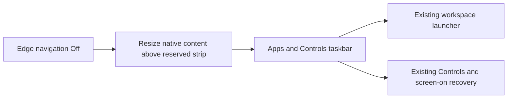

# Feature Specification: Reserved monitor taskbar

**Feature Branch**: `feat/phone-panel-power-prototype`

**Created**: 2026-11-14

**Status**: Implemented; focused Xiaomi Android16 acceptance, broader scenarios remain partial

**Input**: Keep Apps and Controls accessible without edge gestures, reserve space
for them beneath native apps, and optionally remove centered idle launch icons.

Uses the [Spec Kit-style template](../templates/spec.md). The baseline owns
FR-005, FR-045 and stable DX-TASKBAR-001; no current verification is implied.

## User Scenarios & Testing

### User Story 1 - Navigate without edge gestures (Priority: P1)

**Why this priority**: Disabling edge gestures must preserve discoverable shell
access without covering an app's bottom controls.

**Independent Test**: Disable Monitor edge navigation and use taskbar Apps and
Controls with an occupied native app in single and split views.

**Acceptance Scenarios**:

1. **Given** edge navigation On, **When** it is turned Off, **Then** pending feedback
   accompanies the resize and a reserved bottom Apps/Controls bar appears after
   success; native app bounds end above it and match input coordinates.
2. **Given** the taskbar, **When** Apps or Controls is activated by touch, mouse or
   phone pointer, **Then** the existing respective menu opens once, even if app
   touch forwarding is Off, with no contact reaching the underlying app.
3. **Given** the phone panel Off, **When** Controls is opened, **Then** phone-screen
   restoration remains reachable regardless of the optional icon preference.
4. **Given** edge navigation Off, **When** it is enabled, **Then** successful resize
   restores full app space; failure retains the old preference and geometry or
   stops safely if rollback fails.

### User Story 2 - Keep the idle background uncluttered (Priority: P2)

**Why this priority**: Users with another launcher entry should control duplicate
center buttons without losing navigation or changing empty-pane geometry.

**Independent Test**: Toggle Show center Apps button and reconnect the desktop.

**Acceptance Scenarios**:

1. **Given** a fresh setup, **When** an empty desktop is shown, **Then** center Apps
   is visible by default.
2. **Given** single or empty split panes, **When** Show center Apps button is Off,
   **Then** only center launch icons disappear; backgrounds and taskbar remain.
3. **Given** a saved choice, **When** the session restarts or Settings is opened on
   either screen, **Then** the same choice is shown and applied.

### Edge Cases

- Four rotations, Fit bars, DPI/resolution preview and rollback must agree on the
  output area, smaller native content area and reserved bar.
- Held contacts cancel before resizing; crossing into the strip must not retarget
  an app contact or let a taskbar contact leak to the app.
- Menus and keyboards keep their existing modal ownership, focus and dismissal.
- Stop/disconnect/reconnect must not retain stale taskbar callbacks or app bounds.

## Experience review

UI expert `/root/monitor_taskbar_ui` proposed a 56dp logical bottom strip with two
labeled monochrome actions and 48dp targets. User selected **Reserved bottom**.
The user then requested center alignment and a smaller icon-only Android-navigation
style, then settled a fixed4% of the output's shorter edge, independent of app
DPI, with no override. Square targets equal strip height, glyphs are half-height
and gap one sixth. This taskbar-only exception supersedes the earlier48dp minimum.
Black chrome has no labels or separator; accessible names/tooltips remain.
Controls means the existing top-edge Controls menu, not a second control layout.
Side-edge Back stays disabled; normal app/phone/hardware Back remains.

## Architecture links

[Input and navigation](../architecture/features/input-and-navigation.md) and
[change preflight](../changes/monitor-taskbar.md). Reserved geometry requires a
fresh approved viewport design before dependent implementation.

## Requirements

### Functional Requirements

- **FR-045**: Reserve the taskbar outside native app bounds when edges are Off;
  synchronize rendering/input/resize/rollback and preserve shell recovery.
- **FR-005**: Persist optional centered Apps visibility across single/split idle.

### Key Entities

- **Output**: Selected full logical monitor dimensions, transformed with rotation/Fit.
- **Content viewport**: Native app area above the4% taskbar, or full output when hidden.
- **Center Apps preference**: One remembered choice shared by all empty panes.

## Success Criteria

### Measurable Outcomes

- **SC-001**: Both taskbar actions match the fixed-ratio strip and open existing menus
  in all four rotations and separate Fit checks, without app click-through.
- **SC-002**: Native content dimensions and rendered/input app bounds agree before
  and after edge toggles, single/split changes and successful preview rollback.
- **SC-003**: Hiding center icons preserves backgrounds, pane layout and taskbar access.

## Assumptions

- Android11 minimum remains; no new privilege, external launcher or system taskbar.
- No independent taskbar-hide switch, new Back action, Power remap or keyboard shortcut.
- Actual device/visual checks are recorded separately; unrun OS/ROM scenarios stay open.
