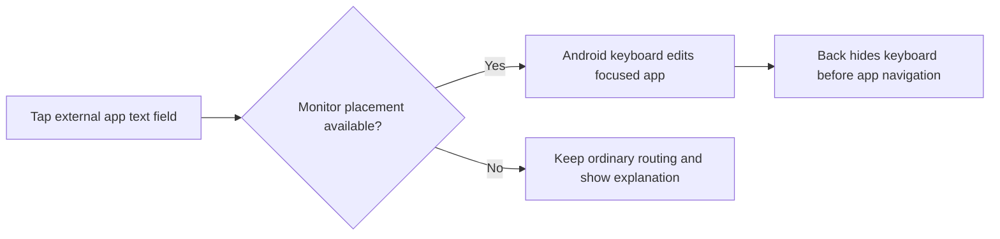

# Feature Specification: Native keyboard on the monitor

**Feature Branch**: `feature/native-monitor-keyboard`

**Created**: 2026-11-11

**Status**: Release candidate 0.18.0; tested behavior retained

**Input**: Type directly on a touch monitor using the actual selected Android
keyboard, without the slow phone-keyboard synchronization removed previously.
Preserve Android 11 desktop behavior when its ROM cannot host that keyboard.

## User Scenarios & Testing

### User Story 1 - Type in the external app (Priority: P1)

Tap a text field in a managed app and use the Android keyboard on the monitor.

**Why this priority**: Touch-monitor typing currently requires reaching for the phone.

**Independent Test**: A separate-UID synthetic editor receives actual native
keyboard touches, text edits and Back on the requested display. Optional Chrome
address-bar smoke would use synthetic text and stay private. Rendering and focus are checked,
not inferred from a policy setter or injected text command.

**Acceptance Scenarios**:

1. **Given** a supported active desktop with monitor placement requested, **When**
   an app text field is tapped, **Then** the selected Android keyboard is visible
   on the managed display and real key taps edit that app's field.
2. **Given** a rotated/Fit desktop or either split pane, **When** keyboard input is
   used, **Then** keys, content and touches remain aligned and edit only the
   currently focused app; Back hides the keyboard before ordinary app navigation.
3. **Given** a hardware keyboard or phone controller interaction, **When** focus
   changes, **Then** existing input behavior remains usable without text duplication.

### User Story 2 - Choose placement and understand restrictions (Priority: P1)

Use one current-value option on either controller and receive honest policy status.

**Why this priority**: Keyboard support must not turn a working desktop into a failure.

**Independent Test**: Change the shared preference on both surfaces, read its actual
per-display result, simulate rejection and replace the session during a pending call.

**Acceptance Scenarios**:

1. **Given** a running desktop, **When** placement is changed, **Then** both
   controllers show the requested value and separate pending/applied/unavailable
   feedback. A desktop already created with an incompatible focus mode explains
   that On applies after the next user-initiated Stop/Start; no app is silently
   restarted. Off releases the override now, without changing creation-time flags.
   New installs/upgrades without a stored preference default Off; stored choices
   are retained. The user authorized release of this existing tested behavior.
2. **Given** Android 11 or another ROM that denies the required operation, **When**
   monitor placement is requested, **Then** the existing desktop remains usable,
   ordinary phone keyboard routing is retained where Android permits and the
   limitation is explained without claiming the keyboard rendered successfully.
3. **Given** Stop, disconnect, split removal or helper loss, **When** old work
   completes, **Then** it cannot affect the replacement display or publish stale
   success; session policy cleanup respects later external changes.
4. **Given** Android 11 and its attached monitor, **When** the placement option
   is exercised on both controllers, **Then** On explains unavailability, Off
   returns Android-controlled status, desktop identity/focus eligibility remain
   unchanged and an actual monitor contact reaches the synthetic editor. Keyboard
   window observations and private captures establish only the routing observed.

### Edge Cases

- Readback disagrees with the request; a missing API/permission or untrusted display.
- One split pane supports placement and another cannot establish it.
- An Android/keyboard implementation moves the single active IME with focus.
- A controller menu opens over an app with its keyboard visible.
- The dimmed app keyboard remains behind a modal: one outside contact dismisses
  without typing into either editor; close/retap restores native app typing.
- Resize/rotation/preview rollback while the IME is visible; Android-owned bars.
- A user changes keyboard app externally; DexDroid never changes that selection.

## Experience review

- Fresh UI expert `/root/native_ime_ui_preflight` reviewed the flow and rendered
  On/configured Settings row on both screens; scope is in the change record.
- New main-row controls and touchpad footprint changes are excluded.
- Release preserves the implemented Off initial default and apply-on-next-start
  guidance under the user's authorization to release the tested build as-is.
- Local launcher/name keys remain unchanged in this first implementation.

## Architecture links

See the [input ownership overview and sequence](../architecture/features/input-and-navigation.md)
and the [change preflight](../changes/native-monitor-keyboard.md). The
[per-display overview and sequence](../architecture/features/native-monitor-keyboard.md)
describe policy ownership and finite cleanup separately from input delivery.

## Requirements

### Functional Requirements

- **FR-041 / DX-IME-001**: Capability-dependent native keyboard placement, shared
  request/status, independent optional failure, exact session ownership and cleanup.
- **FR-006 / DX-KEYBOARD-001**: Local monitor search remains reliable and independent.
- Existing FR-011/015/016/033 input, geometry, lifecycle and split invariants apply.

### Key Entities

- **Placement preference**: Request native monitor placement, or release the
  override to Android's captured baseline. Off does not force phone placement.
- **Display policy outcome**: Current owner, requested/applied policy and fixed reason.
- **Policy lease**: Session-owned baseline and confirmed last write for safe cleanup.
- **Creation focus mode**: One captured request used by primary, secondary and
  recreated helpers; static eligibility precedes optional API34+ flag selection.

## Success Criteria

### Measurable Outcomes

- **SC-001**: Actual native keyboard pixels, real key touches and editor changes
  agree on the managed display; policy readback alone does not satisfy acceptance.
- **SC-002**: Unsupported and stale results preserve a usable desktop and honest status.
- **SC-003**: Four rotations, Fit, both split panes and keyboard Back are checked on
  the selected hardware; excluded devices/IMEs/input methods remain unverified.
- **SC-004**: No phone keyboard capture/text synchronization loop exists. Latency
  samples record their exact boundaries and cannot imply physical finger latency.

## Assumptions

- Shizuku remains required; root and new persistent permission grants are excluded.
- Android 11 remains supported by the app, with native monitor typing conditional
  on its actual ROM permissions and display support.
- Xiaomi 14 / Android 16 with its real monitor is the initial hardware target.
- Showing independent native keyboards on both screens is not promised.
