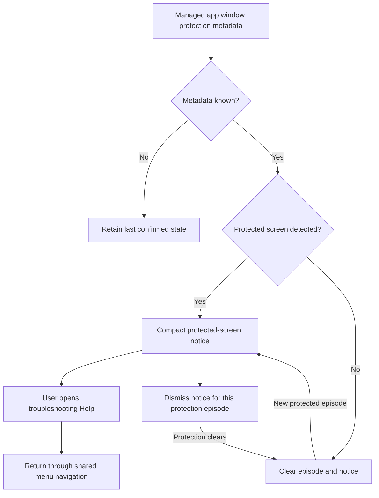

# Feature Specification: Protected-screen detection and troubleshooting

**Feature Branch**: `chore/existing-feature-specs` (retrospective documentation)

**Created**: 2026-10-16

**Status**: Backfilled contract for existing behavior; verification remains scoped in the
requirement map.

**Input**: Understand blank protected windows and find safe instructions without DexDroid changing
browser privacy settings.

Uses the [Spec Kit-style template](../templates/spec.md). The [baseline](../../SPEC.md)
owns the complete numbered contract. IDs below refer to that baseline and are not
new feature-local requirements. This backfill adds no app behavior or test result.

## User Scenarios & Testing

### User Story 1 - Understand a protected desktop screen (Priority: P1)

Understand blank protected windows and find safe instructions without DexDroid changing browser
privacy settings.

**Why this priority**: A blank transport must not be presented as a successful secure-render path.

**Independent Test**: Show a protected fixture, ordinary screen and unknown metadata; inspect
notices and Help on both surfaces.

**Acceptance Scenarios**:

1. **Given** a visible surfaced secure window on the current virtual display, **When** security
   metadata confirms protection, **Then** a minimal dismissible monitor notice and phone Help action
   appear.
2. **Given** unknown/unrecognized/incomplete metadata or a phone-only secure window, **When**
   inspection occurs, **Then** DexDroid does not claim incognito detection or falsely clear a
   confirmed state.
3. **Given** a confirmed episode, **When** the notice is dismissed, **Then** it stays hidden until
   protection clears and a new episode starts.
4. **Given** complete native visibility metadata, **When** `isOnScreen` is standalone or joined
   to the seamless-rotation diagnostic, **Then** the same current-display protection state is
   detected. Missing, malformed, truncated, repeated or conflicting fields remain unknown.

### User Story 2 - Use self-service guidance (Priority: P2)

Understand blank protected windows and find safe instructions without DexDroid changing browser
privacy settings.

**Why this priority**: Any Chrome screenshot opt-in is the user's privacy decision.

**Independent Test**: Open Help from the notice and Settings, dismiss outside, then stop/reconnect
the session.

**Acceptance Scenarios**:

1. **Given** Help is opened from either surface, **When** instructions are read, **Then** they
   explain protected transport limits, optional Chrome flag, screenshot/thumbnail consequences, undo
   steps and policy/availability limits.
2. **Given** detection is unavailable, **When** Settings Help is opened, **Then** the same guide
   remains reachable.
3. **Given** an open guide, **When** phone pointer or monitor touch dismisses it, **Then** no click
   reaches the underlying app and controls/Back stay usable.

### Edge Cases

- Inspect only security metadata for the current display at a bounded two-second interval off
  UI/input workers; ignore stale callbacks and stop on teardown.
- No screenshots, URLs, page text or window titles are retained. Chrome incognito cannot be inferred
  solely from a blank screen or FLAG_SECURE.

## Requirements

### Functional Requirements

- **FR-027** (DX-SECURE-001): Protected window limitations and Chrome opt-in privacy configuration
  are explicit; no silent protection changes or unsupported secure-render claims.
- **FR-028** (DX-PROTECTED-001): Visible protected windows on the current desktop trigger minimal
  Help notices and shared self-service instructions, with safe unknown state, OEM joined-header
  parsing, dismissal and session cleanup.

### Key Entities

- **Protection state**: confirmed ordinary/protected or unknown, scoped to current display/session.
- **Protection episode**: notice dismissal lifetime and shared guide availability.

## Success Criteria

### Measurable Outcomes

- **SC-001**: Phone/hidden/unrelated secure windows trigger no desktop notice; unknown retains the
  last confirmed state.
- **SC-002**: Four monitor rotations retain usable notices/help/dismissal without click-through.
- **SC-003**: No test or product operation silently changes Chrome flags or requests secure-capture
  privilege.
- **SC-004**: Standalone and native joined visibility fields produce the same state; ambiguous
  visibility never establishes protection or clears a previously confirmed episode.

## Assumptions

- Non-secure transport cannot promise protected-window rendering; apps and browser versions differ.
- If a user explicitly opts into a Chrome screenshot setting, verification must record that privacy
  configuration.

## Feature flow

Protected-screen help. This is a product-level flow; implementation ownership is in
[architecture](../ARCHITECTURE.md) and the [owning code](../../app/src/main/kotlin/dev/dexdroid/ProtectedWindowObserver.kt).

## Verification and coverage

The linked entries contain concrete checks, scenario dimensions and current gaps.
They are mappings, not passes; use an identified run for execution evidence.

| Stable requirement | Scenario/test coverage |
| --- | --- |
| DX-SECURE-001 / FR-027 | [Checks and gaps](../coverage.md#dx-secure-001) |
| DX-PROTECTED-001 / FR-028 | [Checks and gaps](../coverage.md#dx-protected-001) |

Run commands: [testing runbook](../TESTING.md). Visual/performance scope:
[quality strategy](../QUALITY.md). Shared UI: [design](../DESIGN.md).
Implementation ownership: [architecture](../ARCHITECTURE.md).
Return to the [feature index](README.md).

## Implementation diagrams

See the [component overview and representative sequence](../architecture/features/protected-content.md)
for source ownership, lifecycle/failure boundaries and current verification limits.
