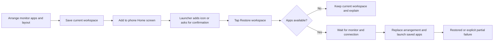

# Feature Specification: One saved workspace shortcut

**Feature Branch**: `feature/saved-launch-shortcut`

**Created**: 2026-10-21; workspace scope settled 2026-10-24

**Status**: Implemented candidate; scoped Xiaomi acceptance recorded separately from release gates

**Input**: Save the current external workspace once, then reopen its apps and arrangement with one phone Home screen action.

Uses the [Spec Kit structure](../templates/spec.md). [Baseline FR-038](../../SPEC.md)
and DX-SHORTCUT-001 own the observable contract.

## User Scenarios & Testing

### User Story 1 - Save and restore my workspace (Priority: P1)

Arrange one app or two split panes, save the setup, and restore it from one shortcut.

**Why this priority**: Removes repeated app selection, layout and rotation setup.

**Independent Test**: Save synthetic app + Settings layouts, use the private shortcut
entry and actual pinned icon, and verify physical-output placement and usable input.

**Acceptance Scenarios**:

1. **Given** a stable monitor workspace with at least one app, **When** Save/Update
   is selected in Settings → Workspace shortcut, **Then** one snapshot replaces the
   old saved setup without changing the running arrangement.
2. **Given** a saved snapshot, **When** Add to phone Home screen is selected,
   **Then** Android's phone launcher handles pinning with optional confirmation;
   setup explains Home pages and manual shortcut-permission recovery. Submission/cancellation
   does not erase the snapshot or falsely claim a successful pin.
3. **Given** a stopped or different running desktop, **When** Restore workspace is
   tapped, **Then** all apps are checked before replacement, cleanup/layout/app
   launches complete in order, and final pane selection/maximization is restored.
4. **Given** missing monitor/Shizuku or busy configuration, **When** activated,
   **Then** status explains waiting/recovery without opening a target on the phone.
5. **Given** a missing/disabled/ambiguous launch entry, **When** saving or restoring,
   **Then** the failure is actionable and restore preflight preserves the current
   workspace. A failure after replacement reports a partial result, never success.
6. **Given** pending work, **When** Stop, Clear/Update, manual app/layout/display
   changes, disconnect, debugging shutdown or destruction occurs, **Then** remaining
   work and stale callbacks cannot recreate a canceled workspace.
7. **Given** repeated pending taps or Activity recreation, **When** entry callbacks
   repeat, **Then** duplicate work does not accumulate or replay automatically.
8. **Given** collapsed status, **When** restoration starts or fails (including no
   saved workspace), **Then** its short notice precedes " · Show details". Progress
   persists while active; a terminal notice expires after 10 seconds. Expanding
   status retains the full last shortcut result despite routine status messages.
9. **Given** app A is visible and B is queued, overlapping or rejected, **When**
   Save is attempted before all ordinary launches finish, **Then** it cannot
   overwrite the saved record with B. After failure, a fresh owned-display query
   confirms the actual app; unknown state preserves the record and offers retry.
   Launch/layout changes during capture invalidate its eventual completion.

### Edge Cases

- Preserve empty panes and hidden apps behind a maximized pane. Reject an entirely empty snapshot.
- Resolve current private child Activities to public enabled launcher entries; no task ID is saved.
- Monitor profiles own resolution/DPI. Saved rotation is a workspace override, not a profile rewrite.
- Current audio/scroll preferences remain independent. Apps own their internal pages, documents,
  history and unsaved contents; arbitrary screen-content restoration is outside scope.
- Clear cancels pending restoration and keeps the running arrangement. A remaining launcher icon
  opens DexDroid with setup guidance; its removal belongs to the launcher.
- A new explicit shortcut tap may retry; no automatic retry after partial failure.

## Experience review

User approved Settings as one-time setup, clarified apps + layout expectation and
instructed implementation after the effort/blast-radius proposal. Experts
`/root/workspace_shortcut_ui` and `/root/workspace_shortcut_arch` approve the scoped
approach. [Change record](../changes/saved-launch-shortcut.md) retains the decision.
Both surfaces share current/saved summaries, Save/Update, pin, Clear and honest
operation feedback. Existing fixed Up/Close, scrolling and outside dismissal apply.

## Architecture links

[Workspace overview and sequence](../architecture/features/workspace-shortcut.md).

## Requirements

### Functional Requirements

- **FR-038 / DX-SHORTCUT-001**: One bounded, explicit saved-workspace activation
  through the existing service and privileged launch owners; no external command API.

### Key Entities

- **Saved workspace**: Versioned launch entries, pane layout and output rotation.
- **Home screen shortcut**: One stable launcher identity referring to the current saved snapshot.
- **Restore operation**: One transient, cancelable sequence with guarded step completions.

## Success Criteria

- Cold/warm restoration reproduces saved app assignments, empty panes, geometry and rotation.
- Actual app/task placement and fresh input confirm useful output; state strings alone are insufficient.
- Unsupported/canceled pinning and failed preflight do not mutate the saved/running workspace.
- Stop and stale callbacks cannot resume remaining restore steps.

## Assumptions

- Existing monitor and authorized Shizuku dependencies remain required.
- Acceptance targets Xiaomi 14 with real monitor; other OEM/OS/launchers remain unverified.
- Multiple workspaces, Tasker/MacroDroid API, scripts and plugin runtime are deferred.
