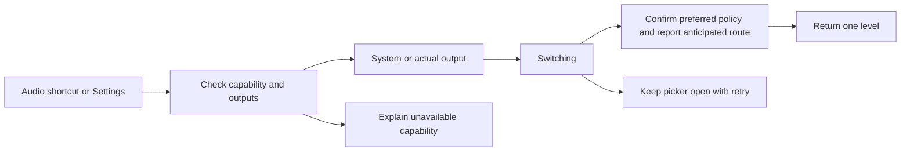

# Feature Specification: Session media output

**Feature Branch**: `feature/session-audio-output`

**Created**: 2026-10-21

**Status**: Implemented; focused Xiaomi acceptance recorded with explicit gaps

**Input**: Choose monitor audio versus another connected output without relying
on device connection order, using a frequent-use control on either screen.

Adapted from the [Spec Kit template](../templates/spec.md).
Baseline FR-036 maps to DX-AUDIO-001; setup guidance also updates DX-SETUP-001.

## User Scenarios & Testing

### User Story 1 - Select session media output (Priority: P1)

As a desktop user, I choose my monitor, phone speaker or connected headphones
from Audio and can tell my requested setting from Android's reported route.

**Why this priority**: Connection order must not determine the only available choice.

**Independent Test**: Play synthetic default-routed media in a separate app UID;
select actual outputs and verify playback routing, then release the override.

**Acceptance Scenarios**:

1. **Given** capable shell access and connected audio sinks, **When** Audio opens,
   **Then** both surfaces list the same System and actual output choices.
2. **Given** default media playback, **When** a sink is chosen, **Then** pending is
   visible until a confirmed policy result, with the anticipated route separately
   labelled; actual playback requires separate verification.
3. **Given** an owned override, **When** System or Stop is chosen, **Then** the
   original preferred policy is restored if no later external change is observed.
4. **Given** denied capability or a display without an audio sink, **When** Audio
   opens, **Then** the limitation is explicit and no route success is invented.
5. **Given** a live session, **When** controller, display or split layout changes,
   **Then** the session preference remains; a new session starts with System.
6. **Given** an explicit endpoint, **When** it disappears, **Then** the owned override is released where possible, System is
   reported with a disconnected notice, and reconnect does not silently reselect it.

7. **Given** either Audio picker, **When** Refresh outputs is used, **Then** a
   visible enabled full-width action refreshes outputs and retains the picker;
   its bounds remain usable in all tested rotations and Fit.

### Edge Cases

- Newer selection/Stop retires stale completions; no unbounded audio request queue.
- External policy change loses ownership; no policy tug-of-war or destructive restore.
- Cleanup after app-owner death is attempted while helper lives. Helper crash,
  lost privilege and non-atomic policy comparison can leave cleanup uncertain.
- Phone media also follows the default; app-explicit outputs/casts can override it.
- No calls, microphone routing, volume, root, Bluetooth toggles or fake disconnections.
- Android 11/12 AOSP shell may lack routing privilege; version alone proves nothing.

## Experience review

Expert `/root/audio_ui_preflight` reviewed existing source and historical private
captures. User explicitly delegated the best design. Add Audio as the fourth
same-height action, preserving pad space; also Settings > Audio output.
Use the shared monochrome radio rows and navigation. Root shortcut dismisses on
confirmed selection; nested picker returns one level. Pending selection retains
Back/X; failure stays open. System restores/releases DexDroid policy. Show
`Android media route`, not `Playing through`. Four rotations/Fit and narrow phone
renders are acceptance obligations, not already approved baselines.

## Architecture links

[Session audio ownership and sequence](../architecture/features/session-audio.md).
Preflight `/root/audio_arch_preflight` approves capability-gated exploration with
primary-only ownership, independent of per-display lifetimes. Capability probe
and final implementation review remain separate from actual playback acceptance.

## Requirements

### Functional Requirements

- **FR-001** (DX-AUDIO-001 / baseline FR-036): Offer session-wide output choices
  and capability/availability/pending/error feedback identically on both screens.
- **FR-002** (DX-AUDIO-001): Keep original preferred policy and release only an
  observed owned override on System/Stop/disconnect, with honest cleanup limits.
- **FR-003** (DX-SETUP-001): Explain Shizuku's bootstrap/debugging boundaries;
  no permanent runtime privilege grant or banking compatibility promise.

### Key Entities

- **Audio session**: One default-media policy lifetime across both managed panes.
- **Output**: Current detected sink with transient endpoint identity; not a saved monitor profile.
- **Preferred policy**: Requested output, separate from anticipated/audible route.

## Success Criteria

### Measurable Outcomes

- **SC-001**: A visible controller can request an output in two taps without
  reducing touchpad height; both menus use identical state and navigation.
- **SC-002**: Focused capability, ownership/stale/restore host checks and physical
  synthetic playback checks record actual outcomes and explicit unsupported gaps.
- **SC-003**: No device address or personal media content is newly published.

## Assumptions

- Global media policy requires privileged API access, not ordinary app AudioTrack routing.
- Session-only choice; no per-app, per-pane or future-session persistence.
- Synthetic fixture playback establishes routing only on tested endpoints/devices.
